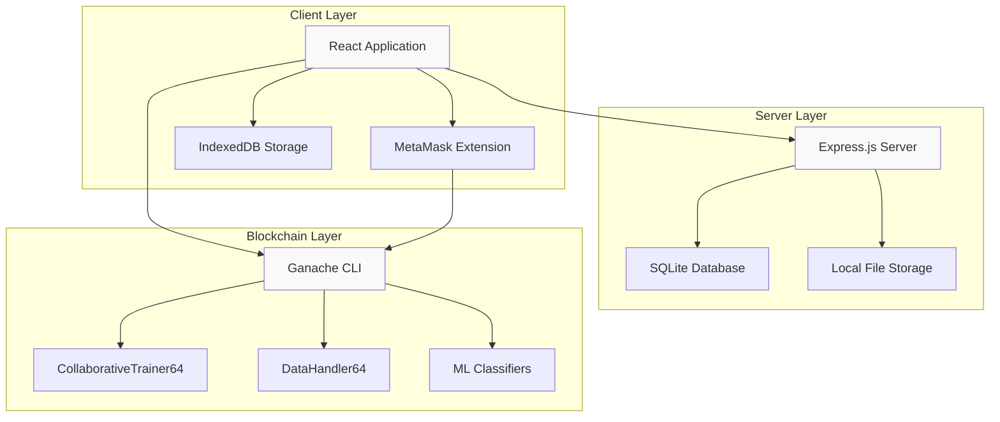
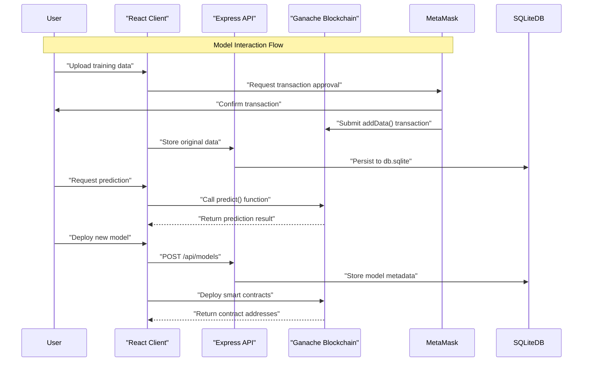
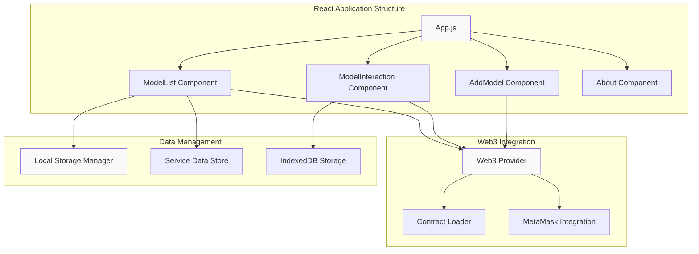
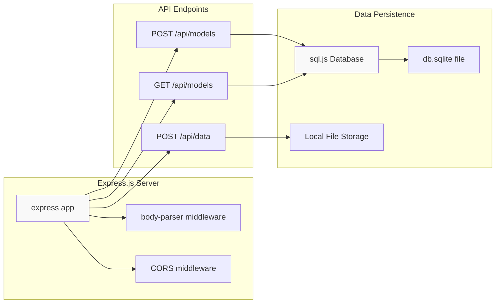
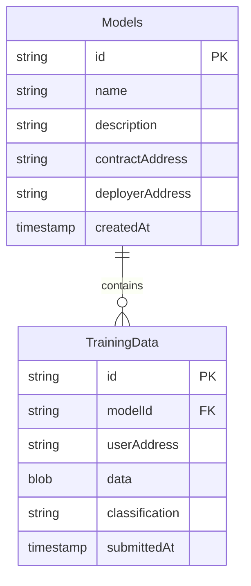
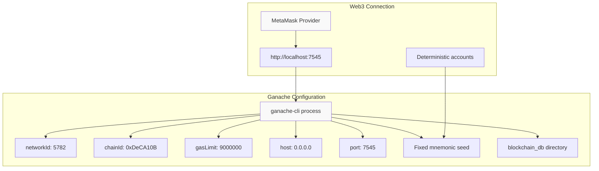
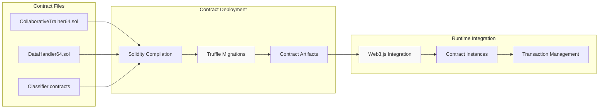
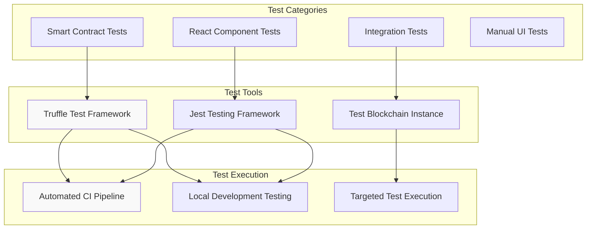
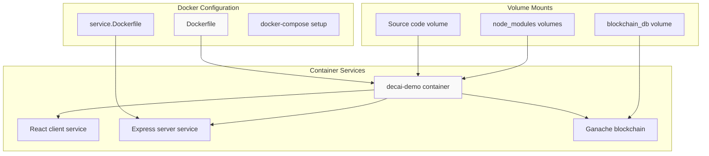

<!-- source: DeepWiki mcp.deepwiki.com · repo microsoft/0xDeCA10B · page 2 Demo Application · fetched 2026-10-26 -->

# Demo Application

Relevant source files

The following files were used as context for generating this wiki page:

- [demo/README.md](demo/README.md)
- [demo/client/src/float-utils.js](demo/client/src/float-utils.js)
- [demo/package.json](demo/package.json)
- [demo/yarn.lock](demo/yarn.lock)

## Purpose and Scope

The Demo Application is a full-stack web application that showcases the Sharing Updatable Models (SUM) framework through an interactive dashboard. It provides a complete example implementation of blockchain-based collaborative machine learning, allowing users to deploy, train, and interact with AI models on a local Ethereum blockchain.

This document covers the technical architecture, components, and implementation details of the demo application. For information about the core SUM framework contracts and smart contract architecture, see [Smart Contracts](#3). For details about the Python-based simulation environment, see [Simulation System](#4).

## System Architecture Overview

The demo application follows a three-tier architecture with a React frontend, Express.js backend, and Ganache blockchain layer. The system demonstrates end-to-end functionality including model deployment, collaborative training, prediction services, and incentive mechanisms.

### High-Level Component Architecture

Sources: [demo/README.md:1-30](), [demo/package.json:1-35]()

### Data Flow and Interaction Patterns

Sources: [demo/README.md:100-142](), [demo/package.json:6-15]()

## Frontend Implementation

The React frontend serves as the primary user interface for interacting with blockchain-based machine learning models. It handles Web3 integration, smart contract interactions, and provides components for model management and data visualization.

### Core React Application Structure

Sources: [demo/client/src/float-utils.js:1-20]()

### Development and Build Pipeline

The frontend uses Create React App with additional TypeScript and ESLint configuration for development workflows.

| Component | Technology | Purpose |
|-----------|------------|---------|
| Build System | Create React App | Development and production builds |
| Language | JavaScript/TypeScript | Type-safe frontend development |
| Linting | ESLint + TypeScript ESLint | Code quality enforcement |
| Package Manager | Yarn | Dependency management |
| Testing | Jest | Unit and integration testing |

Sources: [demo/package.json:24-34](), [demo/yarn.lock:90-157]()

## Backend Services

The Express.js backend provides API endpoints for model metadata management, data storage, and serves as an optional persistence layer for the demo application.

### API Server Architecture

Sources: [demo/package.json:17-22]()

### Database Schema and Storage

The backend uses SQLite via `sql.js` for lightweight data persistence, storing model metadata and training data references.

Sources: [demo/package.json:21]()

## Blockchain Integration

The demo application integrates with a local Ganache blockchain to demonstrate smart contract interactions for collaborative machine learning.

### Ganache Configuration and Network Setup

The blockchain component uses Ganache CLI with specific configuration for deterministic testing and development:

Sources: [demo/package.json:7]()

### Smart Contract Deployment Workflow

Sources: [demo/README.md:103-118]()

## Development Workflow

The demo application provides a comprehensive development environment with automated testing, linting, and deployment scripts.

### Build and Development Scripts

| Script | Command | Purpose |
|--------|---------|---------|
| `blockchain` | `yarn blockchain` | Start local Ganache blockchain |
| `server` | `yarn server` | Start Express.js API server |
| `client` | `yarn client` | Start React development server |
| `test` | `yarn test` | Run automated test suite |
| `lint` | `yarn lint` | Run code quality checks |
| `clean` | `yarn clean` | Clean blockchain and cache files |

Sources: [demo/package.json:6-15]()

### Testing Infrastructure

Sources: [demo/README.md:184-213]()

## Deployment and Production Configuration

The demo application supports both development and production deployment modes with Docker containerization and environment-specific configurations.

### Docker Deployment Strategy

Sources: [demo/README.md:40-73]()

### Environment Configuration

The application uses environment-specific settings for development and production deployments:

| Environment Variable | Purpose | Default |
|---------------------|---------|---------|
| `PORT` | Blockchain port | 7545 |
| `REACT_APP_ENABLE_SERVICE_DATA_STORE` | Enable backend storage | true (dev) |
| `NODE_ENV` | Environment mode | development |

Sources: [demo/README.md:120-128]()

---

