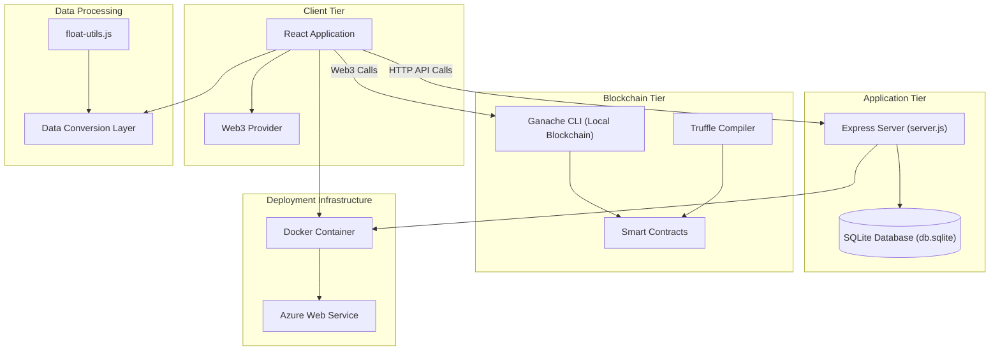
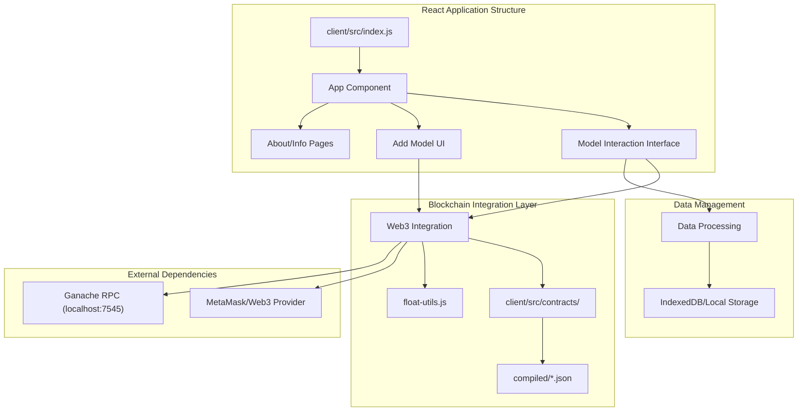
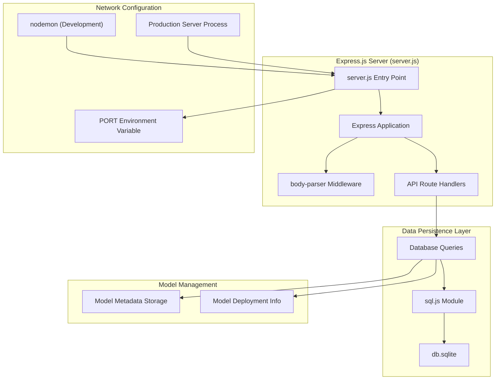
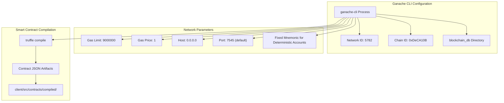
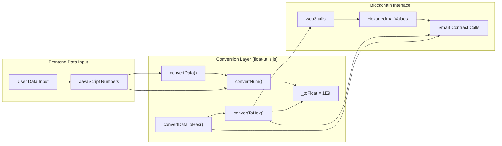
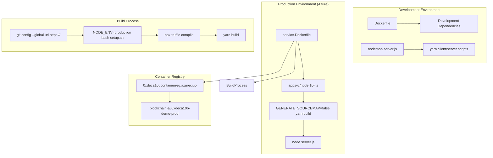
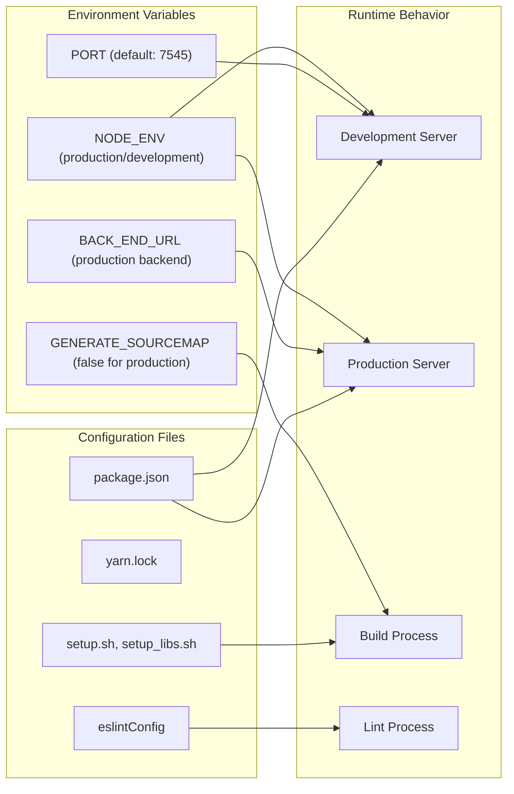

<!-- source: DeepWiki mcp.deepwiki.com · repo microsoft/0xDeCA10B · page 2.1 System Architecture · fetched 2026-10-26 -->

# System Architecture

Relevant source files

The following files were used as context for generating this wiki page:

- [demo/Dockerfile](demo/Dockerfile)
- [demo/client/src/float-utils.js](demo/client/src/float-utils.js)
- [demo/package.json](demo/package.json)
- [demo/service.Dockerfile](demo/service.Dockerfile)
- [demo/yarn.lock](demo/yarn.lock)

## Purpose and Scope

This document describes the technical architecture of the 0xDeCA10B demo application, a full-stack web application that showcases the Sharing Updatable Models (SUM) framework in action. The demo provides a complete implementation including React frontend, Express.js backend, local blockchain infrastructure, and database storage to demonstrate collaborative machine learning with blockchain-based incentive mechanisms.

For information about the smart contracts that power the collaborative training system, see [Contract Architecture](#3.1). For details about the React frontend components and user interface, see [React Frontend](#2.2).

## High-Level Architecture Overview

The demo application follows a multi-tier architecture pattern with clear separation between presentation, application logic, blockchain interaction, and data persistence layers.

### System Components Overview

Sources: [demo/package.json:1-35](), [demo/Dockerfile:1-18](), [demo/service.Dockerfile:1-35]()

## Frontend Architecture

The React-based frontend serves as the primary user interface for interacting with the collaborative machine learning system.

### Frontend Component Structure

Sources: [demo/client/src/float-utils.js:1-20](), [demo/package.json:7-15]()

## Backend Services Architecture

The Express.js backend provides API endpoints and data persistence services for the demo application.

### Backend Service Components

Sources: [demo/package.json:13-14](), [demo/package.json:21]()

## Blockchain Infrastructure

The demo uses Ganache CLI to provide a local Ethereum blockchain for development and testing.

### Blockchain Network Configuration

Sources: [demo/package.json:7]()

## Data Flow and Conversion Layer

The application includes specialized utilities for handling numeric data conversion between JavaScript and blockchain formats.

### Data Processing Pipeline

Sources: [demo/client/src/float-utils.js:1-20]()

## Deployment Architecture

The demo application supports multiple deployment scenarios including local development and cloud deployment.

### Deployment Configurations

Sources: [demo/Dockerfile:1-18](), [demo/service.Dockerfile:1-35]()

## Integration Points

The demo application integrates with multiple external systems and frameworks.

### External System Dependencies

| Component | Purpose | Configuration |
|-----------|---------|---------------|
| `ganache-cli` | Local blockchain network | Network ID 5782, Chain ID 0xDeCA10B |
| `sql.js` | SQLite database engine | In-memory and file-based storage |
| `body-parser` | HTTP request parsing | JSON and URL-encoded data |
| `express` | Web server framework | API routes and static file serving |
| `typescript` | Type checking and compilation | ES6+ features for smart contracts |
| `truffle` | Smart contract compilation | Generates contract artifacts |

Sources: [demo/package.json:17-23]()

## Environment Configuration

The application uses environment variables and configuration files to manage different deployment scenarios.

### Configuration Management

Sources: [demo/package.json:6-15](), [demo/service.Dockerfile:28-34]()

---

