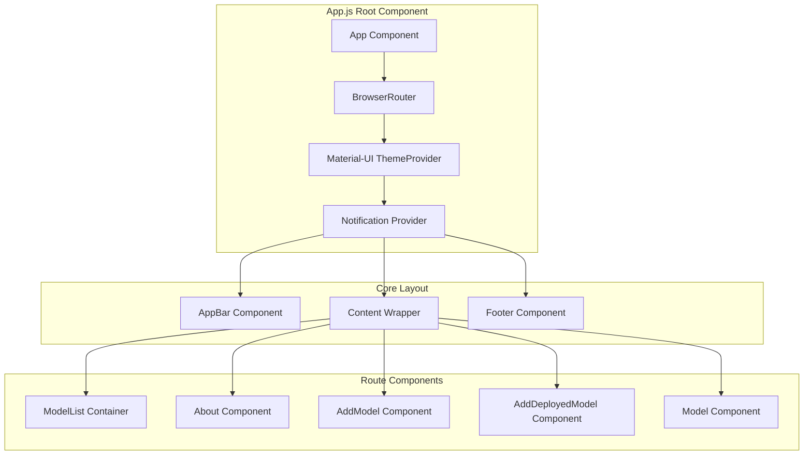
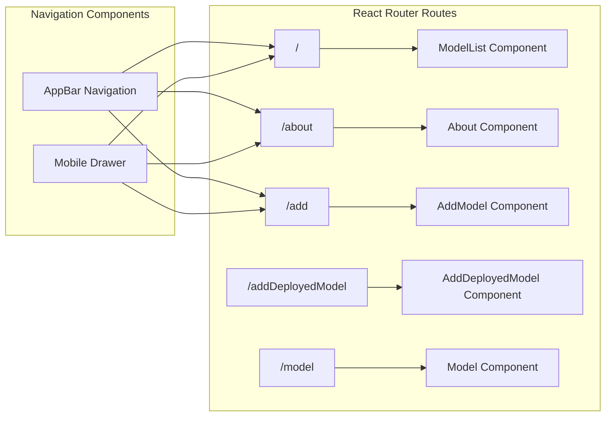
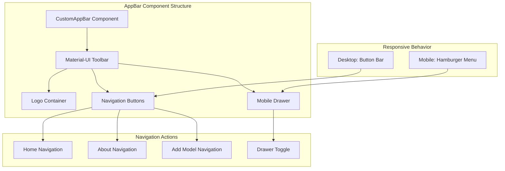
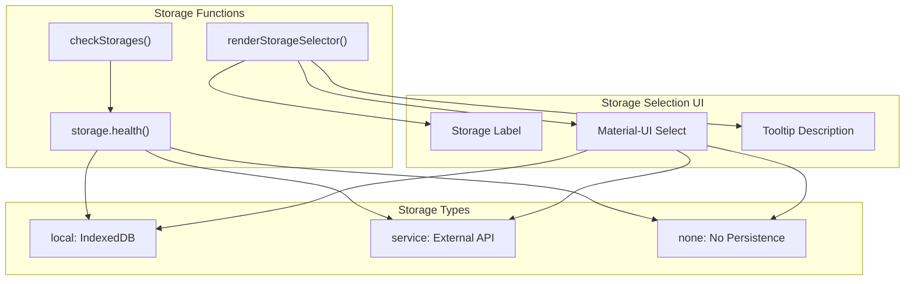

<!-- source: DeepWiki mcp.deepwiki.com · repo microsoft/0xDeCA10B · page 2.2 React Frontend · fetched 2026-10-26 -->

# React Frontend

<details>
<summary>Relevant source files</summary>

The following files were used as context for generating this wiki page:

- [demo/client/package.json](demo/client/package.json)
- [demo/client/src/App.js](demo/client/src/App.js)
- [demo/client/src/components/appBar.js](demo/client/src/components/appBar.js)
- [demo/client/src/components/storageSelector.js](demo/client/src/components/storageSelector.js)
- [demo/client/yarn.lock](demo/client/yarn.lock)

</details>


## Purpose and Scope

The React frontend serves as the primary user interface for the 0xDeCA10B demo application, providing a web-based client for interacting with blockchain-based collaborative machine learning models. This document covers the frontend application structure, dependencies, routing, and key components that enable users to view model lists, add new models, train existing models, and make predictions.

For backend API services, see [Backend Services](#2.5). For detailed component documentation, see [User Interface Components](#2.3). For model interaction workflows, see [Model Interaction Interface](#2.4).

## Technology Stack and Dependencies

The React frontend is built using modern web technologies with a focus on machine learning and blockchain integration.

### Core Framework Dependencies

| Package | Version | Purpose |
|---------|---------|---------|
| `react` | ^16.14.0 | Core React framework |
| `react-dom` | ^16.14.0 | React DOM rendering |
| `react-scripts` | ^3.4.4 | Create React App build tools |
| `typescript` | ^3.7.3 | TypeScript support |

### UI and Styling

| Package | Version | Purpose |
|---------|---------|---------|
| `@material-ui/core` | ^4.7.1 | Material Design components |
| `@material-ui/icons` | ^4.5.1 | Material Design icons |
| `notistack` | ^0.9.7 | Notification system |
| `react-spinners` | ^0.6.1 | Loading indicators |

### Blockchain Integration

| Package | Version | Purpose |
|---------|---------|---------|
| `web3` | ^1.3.0 | Ethereum blockchain interaction |
| `web3-eth-contract` | ^1.3.0 | Smart contract interface |
| `@drizzle-utils/get-web3` | ^0.2.2-alpha.0 | Web3 provider utilities |
| `truffle` | ^5.1.50 | Smart contract compilation |

### Machine Learning

| Package | Version | Purpose |
|---------|---------|---------|
| `@tensorflow/tfjs` | ^1.3.2 | TensorFlow.js ML framework |
| `@tensorflow-models/mobilenet` | ^2.0.4 | Pre-trained MobileNet model |
| `@tensorflow-models/universal-sentence-encoder` | ^1.2.0 | Text embedding model |

Sources: [demo/client/package.json:1-60]()

## Application Architecture

### Main Application Structure



The application follows a hierarchical component structure with the main `App` component serving as the root. Material-UI provides theming with a dark color scheme using `blue[300]` as the primary color.

Sources: [demo/client/src/App.js:1-73]()

### Routing Configuration



The routing system uses `react-router-dom` with five main routes defined in the `App` component. Navigation is handled through the `AppBar` component with responsive design supporting both desktop buttons and mobile drawer navigation.

Sources: [demo/client/src/App.js:56-60](), [demo/client/src/components/appBar.js:1-168]()

## Component Architecture

### Navigation System

The `CustomAppBar` component provides the primary navigation interface with responsive design patterns:



The component uses Material-UI's `Hidden` components to provide responsive behavior, showing navigation buttons on larger screens and a drawer menu on mobile devices.

Sources: [demo/client/src/components/appBar.js:65-162]()

### Storage Management System

The `storageSelector.js` module provides utilities for managing different data storage options:



The storage system supports three modes: local browser storage using IndexedDB, external service storage via API calls, and no storage for temporary usage. Health checking ensures storage availability before presenting options to users.

Sources: [demo/client/src/components/storageSelector.js:7-50]()

## Build and Development Configuration

### Build Scripts and Environment

| Script | Command | Purpose |
|---------|---------|---------|
| `start` | `bash deploy_client.sh` | Local development server |
| `start-prod` | `bash start_prod.sh` | Production server |
| `build` | `react-scripts build --expose-gc --max_old_space_size=8192` | Production build with memory optimization |
| `test` | `bash test.sh` | Test execution |

The build configuration includes memory optimization flags (`--expose-gc --max_old_space_size=8192`) to handle the large TensorFlow.js dependencies during compilation.

### Development Environment

The application uses a proxy configuration pointing to `http://localhost:5387/` for backend API communication during development. TypeScript support is provided through `@types` packages for React, Node.js, and custom dependencies.

### Browser Compatibility

```json
"browserslist": [
  ">0.2%",
  "not dead", 
  "not ie <= 11",
  "not op_mini all"
]
```

The application targets modern browsers with >0.2% market share, excluding Internet Explorer 11 and Opera Mini for optimal performance with ML and blockchain features.

Sources: [demo/client/package.json:6](), [demo/client/package.json:39-53]()

## Integration Points

### Blockchain Integration Dependencies

The frontend integrates with Ethereum blockchain through several key packages:
- `web3` for blockchain communication
- `@drizzle-utils/get-web3` for Web3 provider management
- `truffle` for smart contract artifacts and compilation

### Machine Learning Dependencies

TensorFlow.js integration enables client-side ML operations:
- `@tensorflow/tfjs` for core ML functionality
- Pre-trained models for image classification and text processing
- Canvas support for image manipulation through the `canvas` package

### Backend Communication

The application communicates with the Express.js backend through:
- `axios` for HTTP requests
- Proxy configuration for development API routing
- Support for both local and external storage backends

Sources: [demo/client/package.json:8-37]()

---

