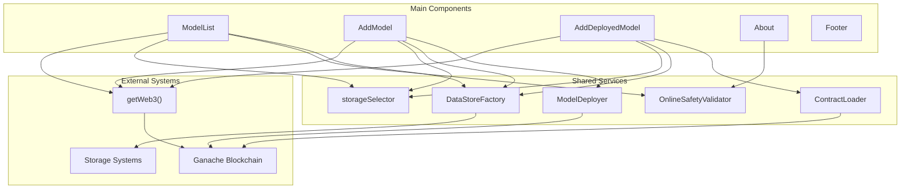
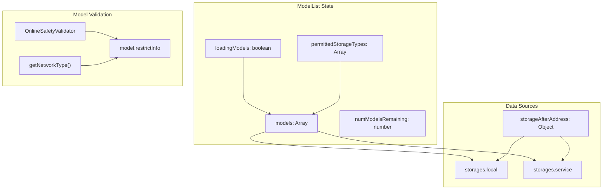
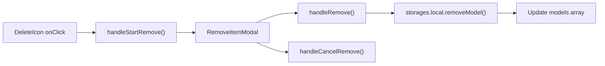
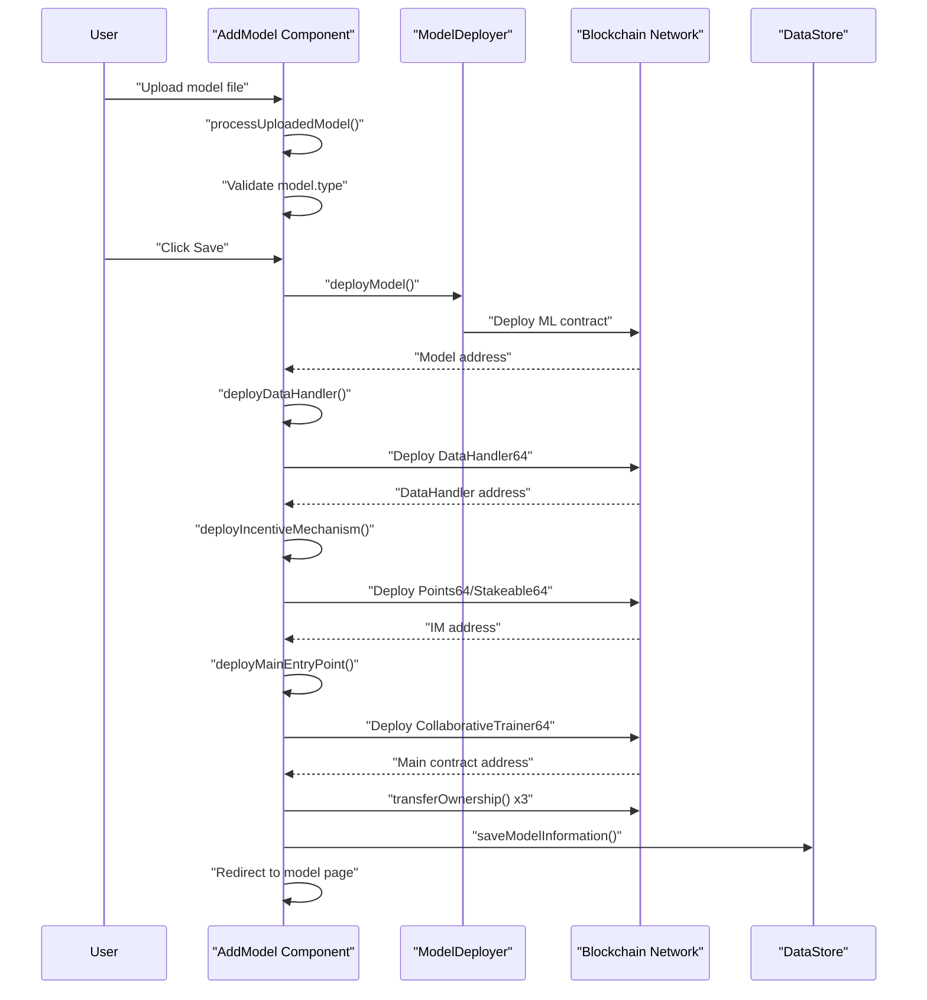
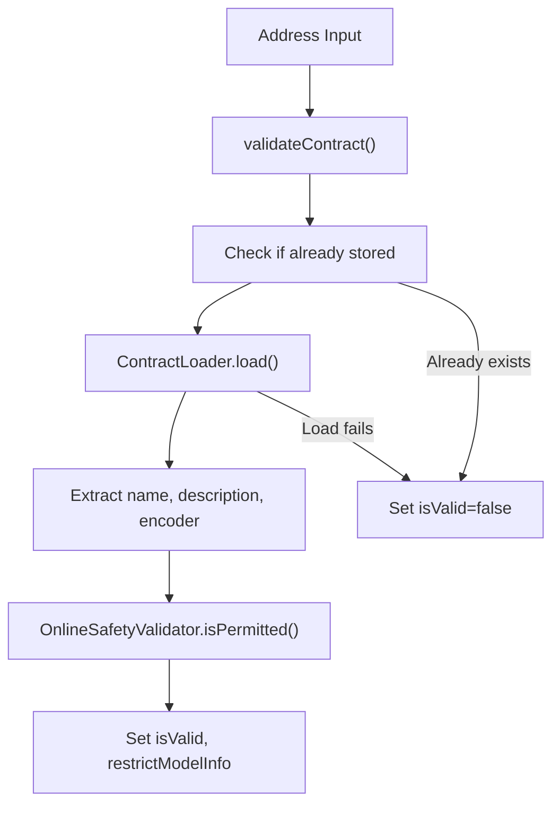
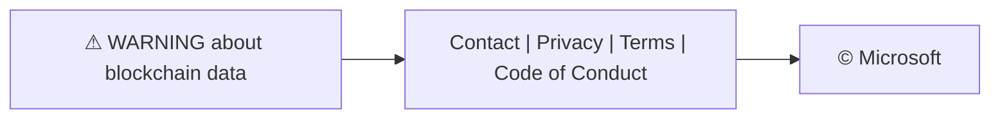

<!-- source: DeepWiki mcp.deepwiki.com · repo microsoft/0xDeCA10B · page 2.3 User Interface Components · fetched 2026-10-26 -->

# User Interface Components

<details>
<summary>Relevant source files</summary>

The following files were used as context for generating this wiki page:

- [demo/client/src/Footer.js](demo/client/src/Footer.js)
- [demo/client/src/components/About.js](demo/client/src/components/About.js)
- [demo/client/src/components/addDeployedModel.js](demo/client/src/components/addDeployedModel.js)
- [demo/client/src/components/addModel.js](demo/client/src/components/addModel.js)
- [demo/client/src/containers/modelList.js](demo/client/src/containers/modelList.js)

</details>


This document covers the React frontend components that form the user interface of the 0xDeCA10B demo application. These components handle model discovery, deployment, and metadata management through integration with blockchain contracts and storage systems.

For details about the model interaction interface specifically, see [Model Interaction Interface](#2.4). For backend API integration, see [Backend Services](#2.5).

## Component Architecture

The demo application uses a component-based architecture built with React and Material-UI. The main UI components handle different aspects of the collaborative machine learning workflow:



**Sources:** [demo/client/src/containers/modelList.js:1-25](), [demo/client/src/components/addModel.js:1-33](), [demo/client/src/components/addDeployedModel.js:1-25]()

## ModelList Component

The `ModelList` class serves as the main landing page component, displaying available models from multiple storage sources and providing navigation to model interaction interfaces.

### Core State and Data Management



The component maintains state for model loading status [demo/client/src/containers/modelList.js:67-72]() and fetches models from multiple storage sources using `DataStoreFactory.getAll()` [demo/client/src/containers/modelList.js:64]().

### Model Retrieval and Filtering

The `updateModels()` method implements pagination and safety filtering:

| Method | Purpose | Key Logic |
|--------|---------|-----------|
| `updateModels()` | Fetch models from all permitted storage types | Calls `storages[storageType].getModels(afterId, limit)` [demo/client/src/containers/modelList.js:116-141]() |
| Safety validation | Filter restricted content | Sets `model.restrictInfo` based on `validator.isPermitted(networkType, model.address)` [demo/client/src/containers/modelList.js:122]() |
| Pagination | Load additional models | Uses `storageAfterAddress` to track pagination state [demo/client/src/containers/modelList.js:126]() |

### Model Removal Interface

The component includes a modal-based removal system for locally stored model metadata:



**Sources:** [demo/client/src/containers/modelList.js:143-201]()

## AddModel Component

The `AddModel` class implements a comprehensive form for deploying new machine learning models to the blockchain. It handles the entire deployment pipeline from model file upload to contract deployment.

### Deployment State Management

The component tracks deployment progress through a structured state object:

```javascript
deploymentInfo: {
  dataHandler: { transactionHash, address },
  incentiveMechanism: { transactionHash, address }, 
  model: { transactionHash, address },
  main: { transactionHash, address }
}
```

### Model Deployment Pipeline



**Sources:** [demo/client/src/components/addModel.js:527-585](), [demo/client/src/components/addModel.js:636-702]()

### Form Configuration and Validation

The component supports configurable encoders and incentive mechanisms:

| Configuration | Options | Validation |
|---------------|---------|------------|
| `encoder` | None, Mult1E9Round, MurmurHash3, ImdbVocab, USE, MobileNetV2 | Set from uploaded model or user selection [demo/client/src/components/addModel.js:294-325]() |
| `incentiveMechanism` | Points64, Stakeable64 | Determines contract type and parameters [demo/client/src/components/addModel.js:365-386]() |
| Time parameters | `refundTimeWaitTimeS`, `ownerClaimWaitTimeS`, `anyAddressClaimWaitTimeS` | Must satisfy: refund ≤ owner ≤ anyAddress [demo/client/src/components/addModel.js:235-240]() |

**Sources:** [demo/client/src/components/addModel.js:228-245](), [demo/client/src/components/addModel.js:587-634]()

## AddDeployedModel Component

The `AddDeployedModel` class provides an interface for adding metadata about already deployed models. It validates contract addresses and extracts model information from existing blockchain deployments.

### Contract Validation Flow



The validation process checks both contract validity and content safety:

```javascript
// Contract loading and validation
this.contractLoader.load(address).then(async collabTrainer => {
  const restrictModelInfo = !this.validator.isPermitted(await getNetworkType(), address)
  // Extract model information only if content is permitted
  if (!restrictModelInfo) {
    [name, description] = await Promise.all([
      collabTrainer.name(),
      collabTrainer.description()
    ])
  }
})
```

**Sources:** [demo/client/src/components/addDeployedModel.js:139-201]()

## About Component

The `About` class renders informational content about the project, including disclaimers, project description, and safety information. It integrates with `OnlineSafetyValidator` to conditionally display safety-related content.

### Content Structure

| Section | Purpose | Dynamic Content |
|---------|---------|-----------------|
| Disclaimers | Blockchain interaction warnings | Static warnings about data privacy |
| Project Description | SUM framework explanation | Links to external documentation |
| Online Safety | Content filtering explanation | Conditional rendering based on `validator.isEnabled()` [demo/client/src/components/About.js:58-66]() |
| Version Information | Build version display | Dynamic version from `package.json` [demo/client/src/components/About.js:89-90]() |

**Sources:** [demo/client/src/components/About.js:20-94]()

## Footer Component

The `Footer` class provides a persistent warning banner and legal links. It uses Material-UI theming for consistent styling and positioning.



**Sources:** [demo/client/src/Footer.js:21-48]()

## Common Patterns and Utilities

### Storage Integration

All components that persist data use the `DataStoreFactory` pattern for storage abstraction:

```javascript
this.storages = DataStoreFactory.getAll()
// Components check permitted storage types
checkStorages(this.storages).then(permittedStorageTypes => {
  this.setState({ permittedStorageTypes })
})
```

### Notification System

Components use the `withSnackbar` HOC for user notifications:

```javascript
notify(...args) {
  return this.props.enqueueSnackbar(...args)
}
dismissNotification(...args) {
  return this.props.closeSnackbar(...args)  
}
```

### Web3 Integration

Blockchain-connected components follow a common pattern for Web3 setup:

```javascript
async setupWeb3() {
  this.web3 = await getWeb3()
  this.setState({ networkType: await getNetworkType() })
}
```

**Sources:** [demo/client/src/containers/modelList.js:63-97](), [demo/client/src/components/addModel.js:142-151](), [demo/client/src/components/addDeployedModel.js:94-113]()

---

