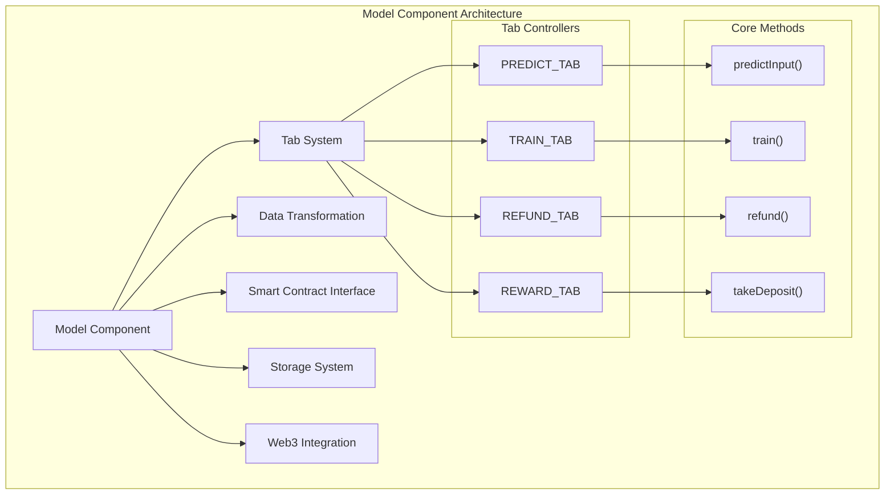
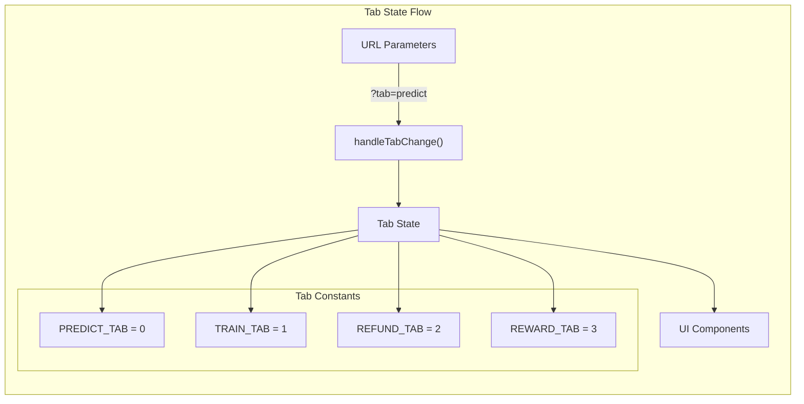
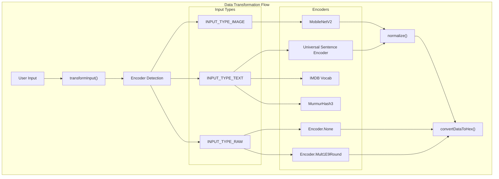
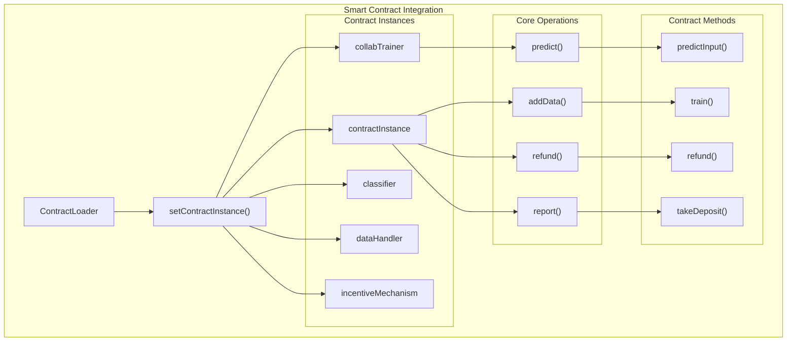
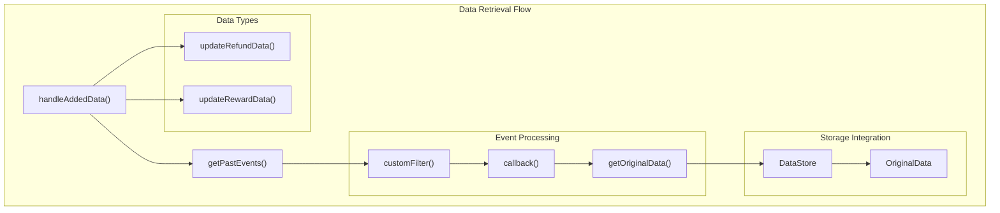
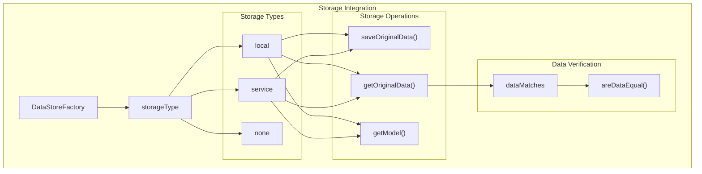
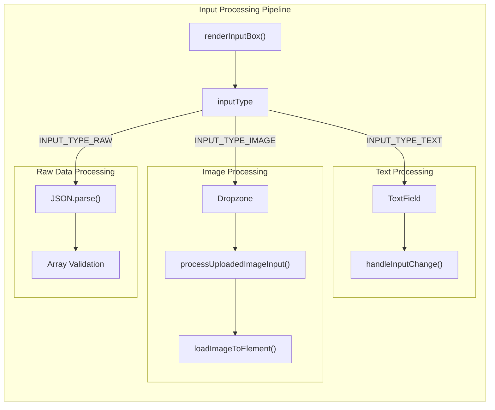

<!-- source: DeepWiki mcp.deepwiki.com · repo microsoft/0xDeCA10B · page 2.4 Model Interaction Interface · fetched 2026-10-26 -->

# Model Interaction Interface

Relevant source files

The following files were used as context for generating this wiki page:

- [demo/client/src/components/model.js](demo/client/src/components/model.js)

## Purpose and Scope

The Model Interaction Interface is the primary React component that enables users to interact with deployed machine learning models on the blockchain. This interface provides a comprehensive set of tools for model prediction, training data submission, refund requests, and reward claiming through a tabbed user interface.

This document covers the core `Model` component implementation, its integration with smart contracts, data transformation pipelines, and storage systems. For information about the broader React frontend architecture, see [React Frontend](#2.2). For details about smart contract deployment and management, see [Smart Contracts](#3).

## Component Architecture Overview

The `Model` component serves as the central hub for all blockchain-based model interactions, managing complex state relationships between user inputs, smart contract calls, and data storage systems.

The component manages four distinct interaction modes through tab constants defined at [demo/client/src/components/model.js:124-134](), with each tab providing specialized functionality for different types of model interactions.

**Sources:** [demo/client/src/components/model.js:123-135]()

## Tab-Based Interaction Modes

The interface provides four primary interaction modes, each serving distinct purposes in the collaborative training ecosystem:

| Tab | Purpose | Primary Actions | State Dependencies |
|-----|---------|----------------|-------------------|
| **Predict** | Model inference testing | `predictInput()` | `input`, `inputType`, `predicting` |
| **Train** | Submit training data | `train()` | `trainClassIndex`, `depositCost` |
| **Refund** | Claim deposit refunds | `refund()` | `addedData`, `refundWaitTimeS` |
| **Reward** | Report incorrect data | `takeDeposit()` | `rewardData`, `numGood` |

### Tab Navigation and State Management

Tab navigation synchronizes with URL parameters and triggers data loading for specific tabs through the `handleTabChange` method at [demo/client/src/components/model.js:689-712]().

**Sources:** [demo/client/src/components/model.js:124-134](), [demo/client/src/components/model.js:689-712]()

## Data Transformation Pipeline

The component implements a sophisticated data transformation system that converts various input types into blockchain-compatible formats based on the model's encoder configuration.

The `setTransformInputMethod` function at [demo/client/src/components/model.js:358-457]() configures the appropriate transformation based on the contract's encoder setting, with each encoder type requiring specific processing logic.

**Sources:** [demo/client/src/components/model.js:47-49](), [demo/client/src/components/model.js:358-457]()

## Smart Contract Integration

The component establishes connections with multiple smart contract interfaces through the `ContractLoader` system, managing collaborative training, data handling, and incentive mechanisms.

Contract initialization occurs in `setContractInstance` at [demo/client/src/components/model.js:277-341](), which loads contract interfaces and establishes Web3 connections for blockchain interactions.

**Sources:** [demo/client/src/components/model.js:277-341](), [demo/client/src/components/model.js:306-340]()

## State Management and Data Flow

The component maintains extensive state for managing user interactions, blockchain data, and UI responsiveness across different interaction modes.

### Core State Categories

| State Category | Key Variables | Purpose |
|---------------|---------------|---------|
| **Contract State** | `contractInstance`, `contractInfo`, `classifications` | Smart contract connectivity and metadata |
| **User Interaction** | `input`, `prediction`, `trainClassIndex` | Input handling and results |
| **Data Management** | `addedData`, `rewardData`, `storageType` | Historical data and storage configuration |
| **UI Control** | `tab`, `readyForInput`, `predicting` | Interface state and loading indicators |

### Data Retrieval and Processing

The data retrieval system at [demo/client/src/components/model.js:627-671]() processes blockchain events to reconstruct user interaction history, filtering events by account and validating data integrity.

**Sources:** [demo/client/src/components/model.js:157-200](), [demo/client/src/components/model.js:627-671](), [demo/client/src/components/model.js:806-863]()

## Storage System Integration

The component integrates with multiple storage backends for preserving original data and enabling data verification workflows.

Storage selection occurs through the `renderStorageSelector` component, allowing users to choose between local browser storage, external services, or no storage for original data preservation.

**Sources:** [demo/client/src/components/model.js:141-143](), [demo/client/src/components/model.js:591-606](), [demo/client/src/components/model.js:1087-1101]()

## Input Processing and Validation

The component handles diverse input types through specialized processing pipelines that prepare data for blockchain submission and model inference.

### Input Type Processing

Input processing begins with `renderInputBox` at [demo/client/src/components/model.js:1469-1509](), which renders appropriate UI controls based on the model's expected input format.

**Sources:** [demo/client/src/components/model.js:1469-1509](), [demo/client/src/components/model.js:971-995](), [demo/client/src/components/model.js:673-686]()

---

