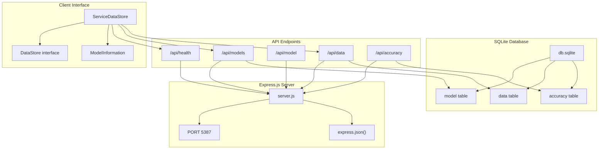
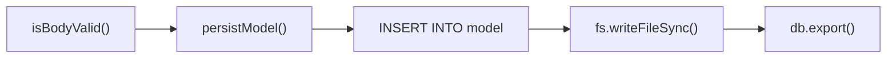
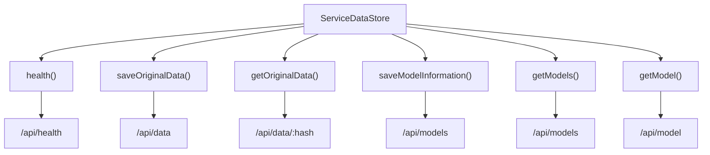

<!-- source: DeepWiki mcp.deepwiki.com · repo microsoft/0xDeCA10B · page 2.5 Backend Services · fetched 2026-10-26 -->

# Backend Services

<details>
<summary>Relevant source files</summary>

The following files were used as context for generating this wiki page:

- [demo/client/src/storage/data-store.ts](demo/client/src/storage/data-store.ts)
- [demo/client/src/storage/service-data-store.ts](demo/client/src/storage/service-data-store.ts)
- [demo/server.js](demo/server.js)

</details>


This document covers the backend services of the 0xDeCA10B demo application, including the Express.js API server, SQLite database management, and data storage interfaces. The backend services provide persistent storage for model metadata, training data, and accuracy tracking through REST API endpoints.

For information about how the frontend interacts with these services, see [Blockchain Integration](#2.6). For details about the React components that consume these services, see [User Interface Components](#2.3).

## System Overview

The backend services consist of an Express.js server with SQLite database storage and a TypeScript client interface for frontend integration. The system manages three primary data types: model information, training data, and accuracy records.

## Service Architecture



Sources: [demo/server.js:1-204](), [demo/client/src/storage/service-data-store.ts:1-86](), [demo/client/src/storage/data-store.ts:1-86]()

## Express.js API Server

The backend runs on an Express.js server that initializes with SQLite database support using the `sql.js` library. The server configuration includes JSON parsing middleware and configurable port settings.

### Server Initialization

The server initializes asynchronously using `initSqlJs()` and creates or loads the SQLite database from `db.sqlite`. If the database file doesn't exist, it creates new tables with the following schema:

| Table | Purpose | Key Fields |
|-------|---------|------------|
| `model` | Store ML model metadata | `id`, `name`, `address`, `description`, `model_type`, `encoder`, `accuracy` |
| `data` | Store original training data | `transaction_hash`, `text` |
| `accuracy` | Track model accuracy over time | `transaction_hash`, `block_number`, `model_id`, `accuracy`, `timestamp` |

Sources: [demo/server.js:10-24]()

### Request Validation

The server includes validation functions for incoming requests:

```javascript
function isBodyValid(body) {
    return body && body.name
        && body.address && typeof body.address === 'string' && body.address.startsWith('0x')
}
```

Sources: [demo/server.js:28-31]()

## Database Management

The SQLite database uses prepared statements for secure data operations and includes automatic file persistence after modifications.

### Model Persistence



The `persistModel()` function handles model insertion with parameter binding to prevent SQL injection, followed by immediate file system persistence.

### Data Persistence  

The system provides separate persistence functions for training data and accuracy records:

- `persistData()` - Stores original training data with transaction hash references
- `presistAccuracyRecord()` - Tracks model accuracy changes over time with timestamps

Sources: [demo/server.js:33-43](), [demo/server.js:128-135](), [demo/server.js:156-165]()

## API Endpoints

The server exposes RESTful endpoints for model management, data storage, and accuracy tracking.

### Health Check Endpoint

```
GET /api/health
Response: { healthy: true }
```

### Model Management Endpoints

| Endpoint | Method | Purpose | Key Parameters |
|----------|--------|---------|----------------|
| `/api/models` | GET | Retrieve paginated model list | `afterAddress`, `limit` |
| `/api/model` | GET | Get specific model by ID or address | `modelId`, `address` |
| `/api/models` | POST | Add new model | Model metadata in request body |

The models endpoint supports pagination using address-based cursoring and returns both the requested models and a count of remaining records.

### Data Management Endpoints

| Endpoint | Method | Purpose |
|----------|--------|---------|
| `/api/data` | POST | Store original training data |
| `/api/data/:transactionHash` | GET | Retrieve original data by transaction hash |

### Accuracy Tracking Endpoints

| Endpoint | Method | Purpose |
|----------|--------|---------|
| `/api/accuracy` | POST | Record new accuracy measurement |
| `/api/accuracy/model` | GET | Get accuracy history for specific model |

Sources: [demo/server.js:46-202]()

## Client-Side Data Store Interface

The frontend interacts with backend services through the `DataStore` interface implemented by `ServiceDataStore`.

### ServiceDataStore Implementation



The `ServiceDataStore` class provides a TypeScript interface for the backend services with automatic URL configuration based on environment variables.

### Configuration

The service URL is determined by:
1. Constructor parameter
2. `BACK_END_URL` environment variable in production
3. Empty string (relative URLs) as fallback

The service can be disabled via `REACT_APP_ENABLE_SERVICE_DATA_STORE` environment variable.

Sources: [demo/client/src/storage/service-data-store.ts:4-27]()

### Data Models

The client defines TypeScript classes for structured data exchange:

| Class | Purpose | Key Properties |
|-------|---------|----------------|
| `ModelInformation` | Model metadata structure | `id`, `name`, `address`, `modelType`, `encoder`, `accuracy` |
| `ModelsResponse` | Paginated model list response | `models[]`, `remaining` |
| `OriginalData` | Training data container | `text` |
| `DataStoreHealthStatus` | Service health information | `healthy`, `details` |

Sources: [demo/client/src/storage/data-store.ts:4-68]()

## Error Handling and Validation

The backend implements comprehensive error handling including:

- Request body validation for required fields
- Database constraint enforcement  
- HTTP status code responses (400, 404, 200)
- Timeout handling for health checks (1000ms)
- SQL prepared statement error catching

The system uses try-catch blocks around database operations and returns appropriate HTTP status codes with error messages.

Sources: [demo/server.js:116-125](), [demo/client/src/storage/service-data-store.ts:21-26]()

---

