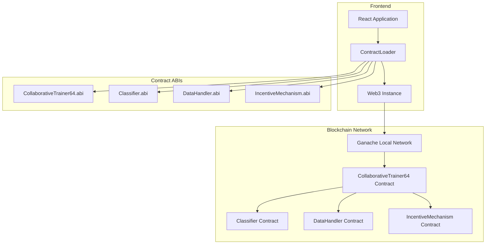
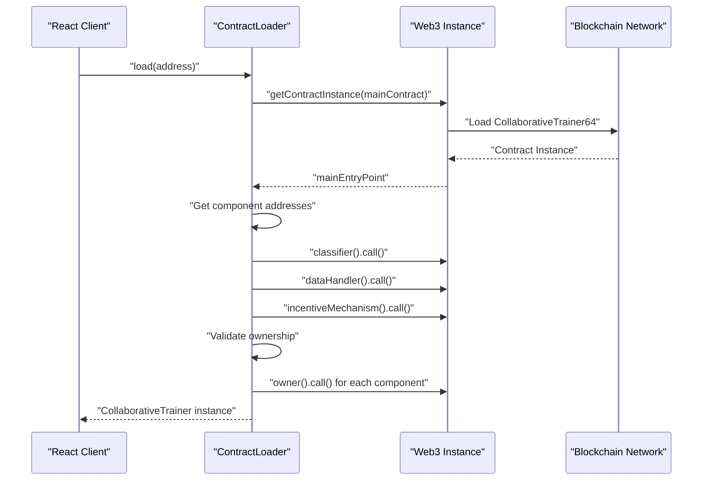
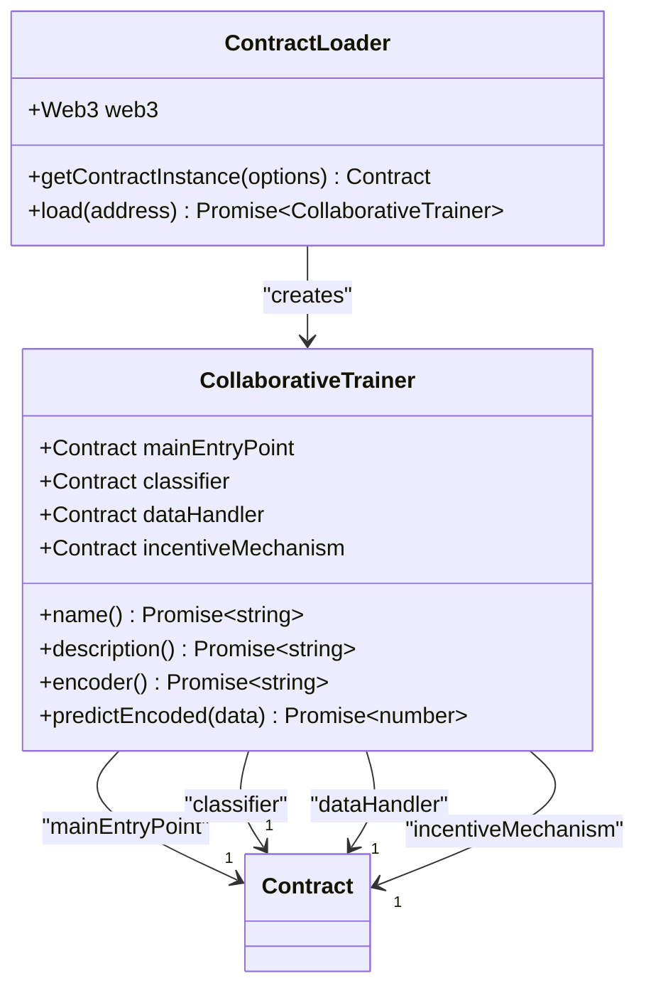
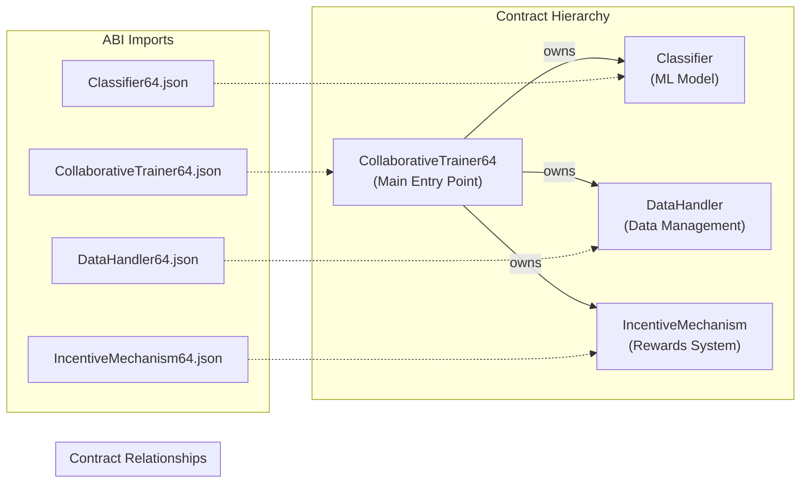

<!-- source: DeepWiki mcp.deepwiki.com · repo microsoft/0xDeCA10B · page 2.6 Blockchain Integration · fetched 2026-10-26 -->

# Blockchain Integration

Relevant source files

The following files were used as context for generating this wiki page:

- [demo/client/public/favicon.ico](demo/client/public/favicon.ico)
- [demo/client/public/index.html](demo/client/public/index.html)
- [demo/client/src/contracts/loader.ts](demo/client/src/contracts/loader.ts)
- [demo/client/src/images/logo_transparent_100x73.png](demo/client/src/images/logo_transparent_100x73.png)
- [demo/client/src/index.css](demo/client/src/index.css)

## Purpose and Scope

This document covers how the React frontend connects to and interacts with smart contracts deployed on the blockchain. It focuses on the contract loading mechanism, Web3 integration, and the interface layer that allows the frontend to communicate with deployed CollaborativeTrainer contracts and their associated components.

For information about the smart contract architecture itself, see [Smart Contracts](#3). For details about the React components that use these blockchain connections, see [Model Interaction Interface](#2.4).

## Web3 Integration Architecture

The blockchain integration is built around Web3.js and provides a structured way to load and interact with the deployed smart contract ecosystem. The system uses compiled contract ABIs and implements validation to ensure contract integrity.

**Sources:** [demo/client/src/contracts/loader.ts:1-7](), [demo/client/src/contracts/loader.ts:54-59]()

## Contract Loading System

The `ContractLoader` class provides the core functionality for loading and validating deployed contracts. It takes a Web3 instance and provides methods to instantiate contract objects with proper validation.

**Sources:** [demo/client/src/contracts/loader.ts:70-115]()

## Contract Validation and Ownership Verification

The system implements strict validation to ensure contract integrity. When loading a `CollaborativeTrainer` contract, the loader verifies that all component contracts are properly owned by the main entry point.

| Validation Check | Purpose | Implementation |
|-----------------|---------|----------------|
| Address Validation | Ensures non-empty contract address | [demo/client/src/contracts/loader.ts:71-73]() |
| Component Loading | Loads all required contract components | [demo/client/src/contracts/loader.ts:79-97]() |
| Ownership Verification | Confirms main contract owns all components | [demo/client/src/contracts/loader.ts:103-110]() |

The validation process checks that:
- `classifier.owner() === mainContract.address`
- `dataHandler.owner() === mainContract.address` 
- `incentiveMechanism.owner() === mainContract.address`

**Sources:** [demo/client/src/contracts/loader.ts:108-110]()

## CollaborativeTrainer Interface

The `CollaborativeTrainer` class provides a high-level interface for interacting with the complete contract system. It wraps the four main contract components and exposes commonly used methods.

### Key Methods

- `name()`: Returns the model name from the main contract
- `description()`: Returns the model description 
- `encoder()`: Returns the encoder type used by the model
- `predictEncoded(data)`: Makes predictions using encoded data through the classifier

**Sources:** [demo/client/src/contracts/loader.ts:11-49]()

## Contract Component Architecture

The blockchain integration manages four distinct contract types that work together to provide the collaborative training functionality:

Each contract serves a specific purpose:
- **CollaborativeTrainer64**: Main entry point and orchestration
- **Classifier**: Handles machine learning predictions
- **DataHandler**: Manages training data and submissions
- **IncentiveMechanism**: Handles staking, rewards, and refunds

**Sources:** [demo/client/src/contracts/loader.ts:3-6](), [demo/client/src/contracts/loader.ts:75-96]()

---

