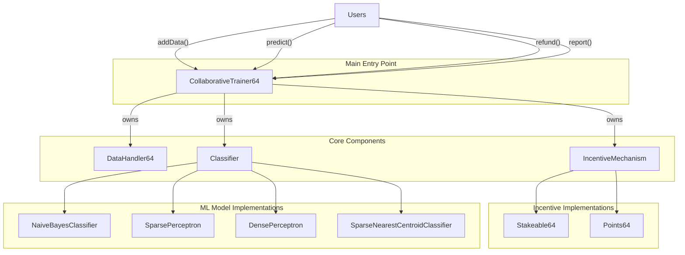
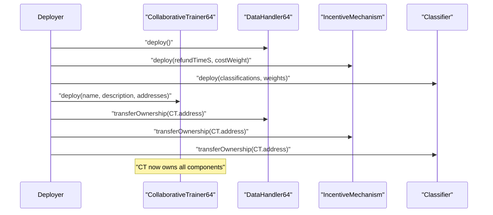
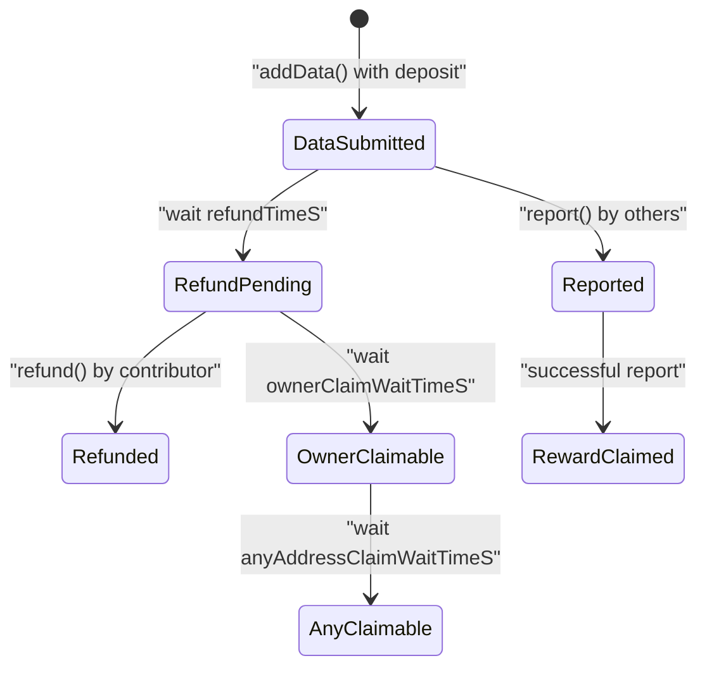
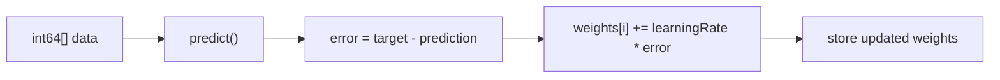
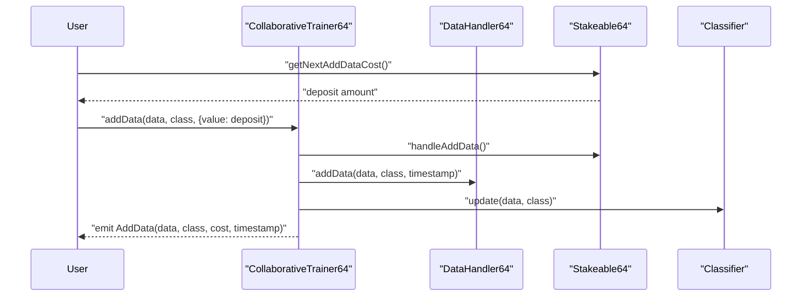
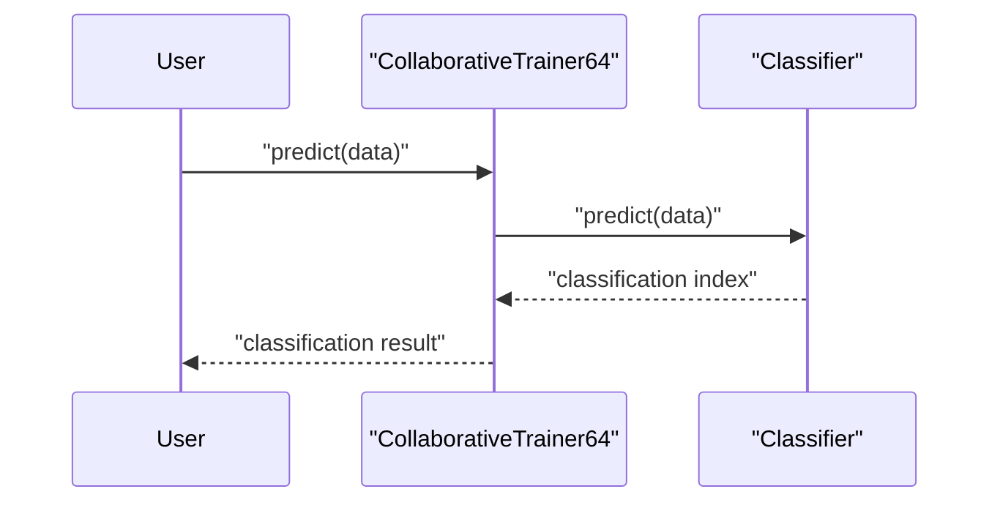
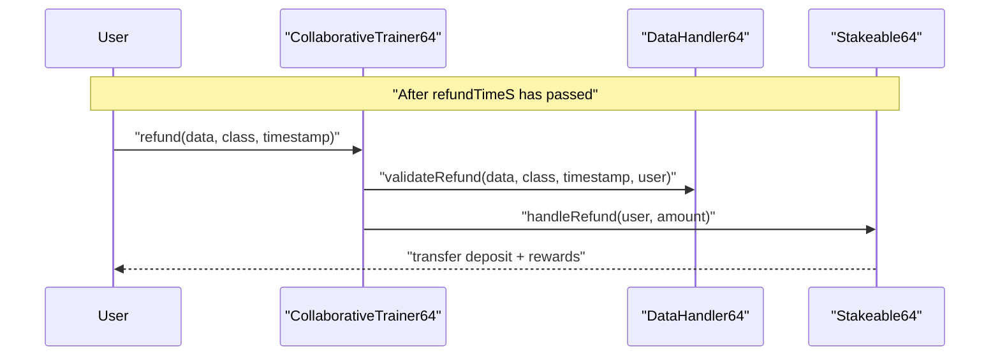

<!-- source: DeepWiki mcp.deepwiki.com · repo microsoft/0xDeCA10B · page 3 Smart Contracts · fetched 2026-10-26 -->

# Smart Contracts

<details>
<summary>Relevant source files</summary>

The following files were used as context for generating this wiki page:

- [demo/.soliumignore](demo/.soliumignore)
- [demo/client/migrations/2_deploy_sentiment_classifier.js](demo/client/migrations/2_deploy_sentiment_classifier.js)
- [demo/client/migrations/4_deploy_hot_dog_classifier.js](demo/client/migrations/4_deploy_hot_dog_classifier.js)
- [demo/client/src/contracts/classification/SparseNearestCentroidClassifier.sol](demo/client/src/contracts/classification/SparseNearestCentroidClassifier.sol)
- [demo/client/test/contracts/check-gas-costs.js](demo/client/test/contracts/check-gas-costs.js)
- [demo/client/test/contracts/classification/sparsenearestcentroidclassifier.js](demo/client/test/contracts/classification/sparsenearestcentroidclassifier.js)
- [demo/client/test/contracts/classification/sparseperceptron.js](demo/client/test/contracts/classification/sparseperceptron.js)

</details>


This document covers the blockchain smart contracts that implement the core collaborative machine learning functionality of the 0xDeCA10B system. These contracts enable decentralized model training where participants can contribute data, receive predictions, and earn rewards based on data quality.

For information about the demo application that interacts with these contracts, see [Demo Application](#2). For details about the model deployment infrastructure, see [Model Deployment System](#3.3).

## System Architecture

The smart contract system follows a modular architecture with clear separation of concerns between data handling, incentive mechanisms, and machine learning models.



**Sources:** [demo/client/migrations/2_deploy_sentiment_classifier.js:7-10](), [demo/client/test/contracts/check-gas-costs.js:3-5]()

## Main Contract Components

### CollaborativeTrainer64

The `CollaborativeTrainer64` contract serves as the main interface for all user interactions. It orchestrates the collaboration between data handling, incentive mechanisms, and machine learning models.

| Function | Purpose | Parameters |
|----------|---------|------------|
| `addData()` | Submit training data with deposit | `data`, `classification`, `value` |
| `predict()` | Get model prediction | `data` |
| `refund()` | Claim refund for good data | `data`, `classification`, `time` |
| `report()` | Report bad data to claim rewards | `data`, `classification`, `time`, `contributor` |

The contract deployment process follows a specific ownership transfer pattern:



**Sources:** [demo/client/migrations/2_deploy_sentiment_classifier.js:69-94](), [demo/client/test/contracts/check-gas-costs.js:56-78]()

### DataHandler64

The `DataHandler64` contract manages the storage and validation of training data submissions. It tracks data contributions, timestamps, and claimable amounts for the incentive system.

Key responsibilities:
- Store training data with associated metadata
- Track contributor addresses and timestamps
- Manage claim status for refunds and rewards
- Validate data integrity

**Sources:** [demo/client/test/contracts/sparseperceptron.js:233-245]()

### Incentive Mechanisms

#### Stakeable64

The `Stakeable64` contract implements a deposit-based incentive system where contributors must stake funds when submitting data.

Configuration parameters:
- `refundTimeS`: Time before contributors can claim refunds
- `ownerClaimWaitTimeS`: Wait time for owner to claim disputed funds  
- `anyAddressClaimWaitTimeS`: Wait time for anyone to claim abandoned funds
- `costWeight`: Weight factor for calculating deposit costs



**Sources:** [demo/client/migrations/2_deploy_sentiment_classifier.js:30-36](), [demo/client/test/contracts/sparseperceptron.js:12-14]()

## Classification Models

The system supports multiple machine learning model types, all inheriting from the abstract `Classifier64` base contract.

### Model Interface

All classifiers implement these core functions:

| Function | Purpose | Returns |
|----------|---------|---------|
| `predict(data)` | Classify input data | `uint64` classification index |
| `update(data, classification)` | Train model with new sample | - |
| `norm(data)` | Calculate data normalization | `uint` magnitude |
| `getNumClassifications()` | Get number of classes | `uint` count |

### SparsePerceptron

The `SparsePerceptron` implements a linear classifier using sparse data representation where each element in the input array represents a feature index.

Key characteristics:
- Supports sparse weight updates
- Uses learning rate for gradient descent
- Efficient for high-dimensional sparse data

Training process:


**Sources:** [demo/client/test/contracts/sparseperceptron.js:267-286](), [demo/client/test/contracts/classification/sparseperceptron.js:130-169]()

### SparseNearestCentroidClassifier

The `SparseNearestCentroidClassifier` uses Euclidean distance to find the closest centroid for classification.

Structure details:
- `ClassInfo` struct stores centroid data and sample counts
- `CentroidValue` struct handles sparse centroid representation
- Maintains squared magnitude for efficient distance calculation

The classifier optimizes storage by using sparse centroids:

```solidity
struct CentroidValue {
    uint64 value;      // centroid component value * toFloat
    uint64 numSamples; // denominator for moving average
}
```

Distance calculation optimization:
```
distance = baseMagnitude + toFloat * (-2 * centroid[j] + toFloat)
```

**Sources:** [demo/client/src/contracts/classification/SparseNearestCentroidClassifier.sol:32-56](), [demo/client/src/contracts/classification/SparseNearestCentroidClassifier.sol:124-160]()

### DensePerceptron

The `DensePerceptron` handles dense feature vectors where all dimensions are explicitly represented in the input data.

Key differences from sparse version:
- Uses `initializeWeights()` for deploying large weight vectors in chunks
- Supports `addFeatureIndices()` for feature selection
- Optimized for dense data representations

**Sources:** [demo/client/migrations/4_deploy_hot_dog_classifier.js:59-80]()

## Model Deployment Process

The model deployment follows a standardized pattern across all classifier types:

### Deployment Steps

1. **Data Handler Deployment**
   ```javascript
   const dataHandler = await DataHandler64.new()
   ```

2. **Incentive Mechanism Setup**
   ```javascript
   const incentiveMechanism = await Stakeable64.new(
       refundTimeS, ownerClaimWaitTimeS, anyAddressClaimWaitTimeS, costWeight
   )
   ```

3. **Classifier Deployment with Chunked Weights**
   ```javascript
   const classifier = await deployer.deploy(Classifier,
       classifications, weights.slice(0, initNumWords), intercept, learningRate
   )
   
   // Add remaining weights in chunks
   for (let i = initNumWords; i < weights.length; i += numWordsPerUpdate) {
       await classifier.initializeWeights(i, weights.slice(i, i + numWordsPerUpdate))
   }
   ```

4. **Main Interface Integration**
   ```javascript
   const instance = await CollaborativeTrainer64.new(
       name, description, encoder,
       dataHandler.address, incentiveMechanism.address, classifier.address
   )
   ```

5. **Ownership Transfer**
   ```javascript
   await Promise.all([
       dataHandler.transferOwnership(instance.address),
       incentiveMechanism.transferOwnership(instance.address),
       classifier.transferOwnership(instance.address)
   ])
   ```

### Gas Optimization

The system uses several strategies to manage gas costs:

- **Chunked Weight Deployment**: Large weight vectors are deployed in chunks to stay within gas limits
- **Sparse Data Representation**: Only non-zero features are stored and processed
- **Efficient Storage Patterns**: Using packed structs and optimized data types

**Sources:** [demo/client/migrations/2_deploy_sentiment_classifier.js:37-98](), [demo/client/migrations/4_deploy_hot_dog_classifier.js:50-105]()

## Data Flow and Interaction Patterns

### Training Data Submission



### Prediction Request



### Refund Process



**Sources:** [demo/client/test/contracts/sparseperceptron.js:180-265](), [demo/client/test/contracts/check-gas-costs.js:155-183]()

---

