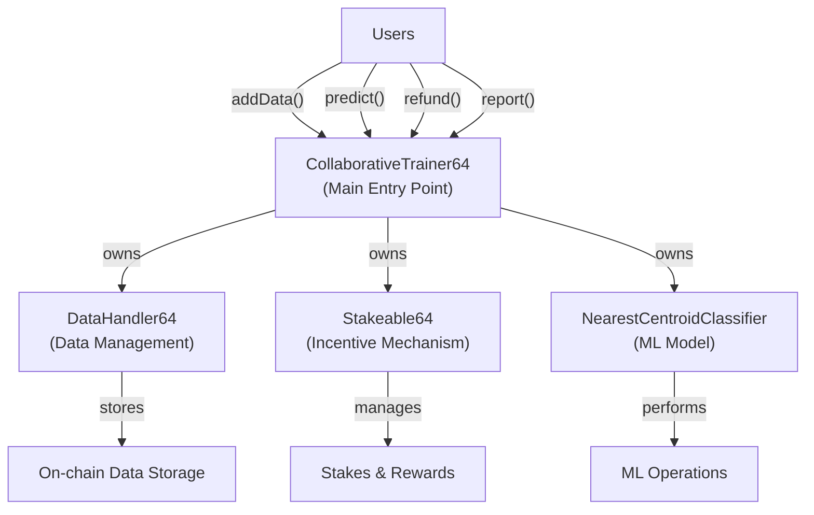
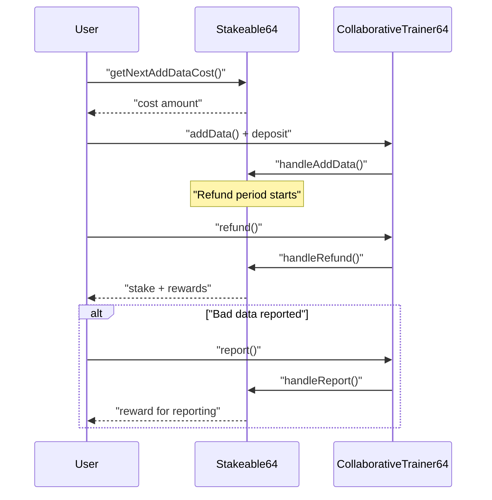
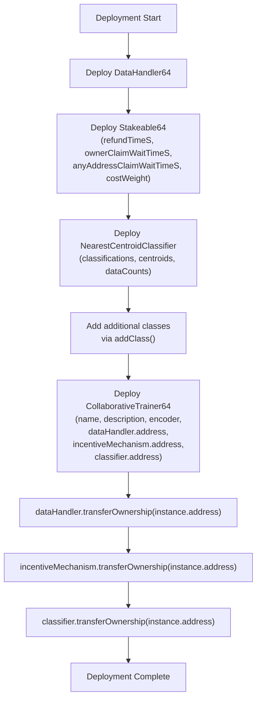
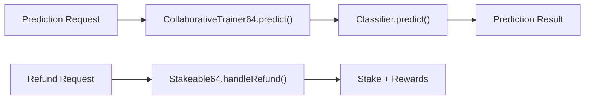
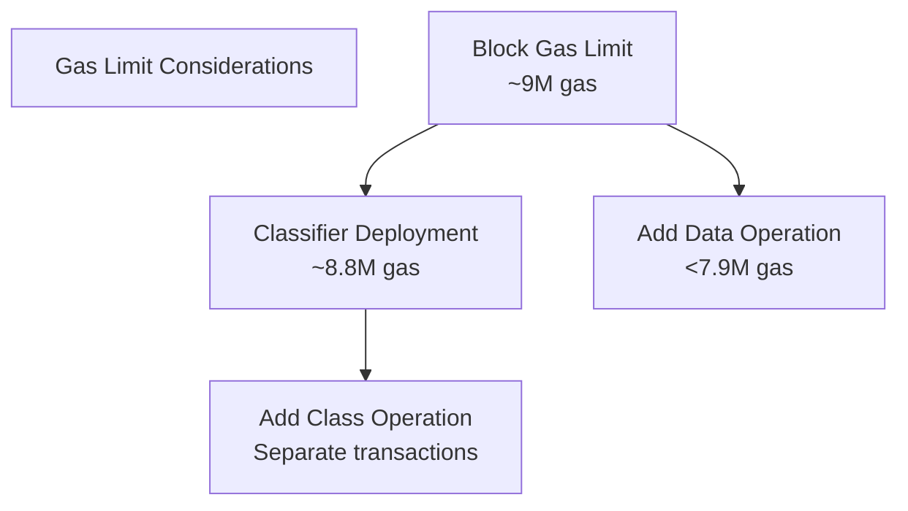

<!-- source: DeepWiki mcp.deepwiki.com · repo microsoft/0xDeCA10B · page 3.1 Contract Architecture · fetched 2026-10-26 -->

# Contract Architecture

Relevant source files

The following files were used as context for generating this wiki page:

- [demo/client/migrations/3_deploy_VPA_classifier.js](demo/client/migrations/3_deploy_VPA_classifier.js)
- [demo/client/src/getWeb3.js](demo/client/src/getWeb3.js)
- [demo/client/test/contracts/classification/nearestcentroidclassifier.js](demo/client/test/contracts/classification/nearestcentroidclassifier.js)
- [demo/client/test/contracts/incentive/stakeable.js](demo/client/test/contracts/incentive/stakeable.js)
- [demo/client/test/contracts/vpa-classifier.js](demo/client/test/contracts/vpa-classifier.js)
- [demo/client/truffle.js](demo/client/truffle.js)

This document describes the smart contract architecture of the 0xDeCA10B collaborative machine learning system. It covers the core contract components, their relationships, deployment patterns, and ownership models that enable decentralized training of machine learning models on the blockchain.

For information about the specific ML classification algorithms implemented within these contracts, see [Classification Models](#3.2). For details about how these contracts are deployed to the blockchain, see [Model Deployment System](#3.3).

## Overview

The smart contract architecture follows a modular design with clear separation of concerns across four primary components: the main coordinator (`CollaborativeTrainer64`), data management (`DataHandler64`), incentive mechanisms (`Stakeable64`), and machine learning models (various classifier implementations). These contracts work together to enable users to contribute training data, receive predictions, and earn rewards based on data quality.

## Core Contract Components

### CollaborativeTrainer64 - Main Entry Point

The `CollaborativeTrainer64` contract serves as the primary interface and coordinator for the entire collaborative training system. It owns and orchestrates all other components in the architecture.

**Contract Architecture Overview**

Sources: [demo/client/migrations/3_deploy_VPA_classifier.js:72-77](), [demo/client/test/contracts/vpa-classifier.js:92-97]()

### DataHandler64 - Data Management Layer

The `DataHandler64` contract manages all data-related operations including storage, validation, and retrieval of training data submitted by users.

### Stakeable64 - Incentive Mechanism

The `Stakeable64` contract implements the economic incentives for data contribution, including deposit requirements, refund mechanisms, and reward distribution based on data quality validation.

**Incentive Mechanism Flow**

Sources: [demo/client/test/contracts/incentive/stakeable.js:22-76](), [demo/client/test/contracts/incentive/stakeable.js:96-154]()

### Classification Models

The system supports multiple machine learning classifier implementations, with `NearestCentroidClassifier` being the primary example shown in the codebase.

## Contract Deployment Architecture

The deployment process follows a specific pattern where contracts are deployed independently and then ownership is transferred to the main `CollaborativeTrainer64` contract.

**Deployment Flow**

Sources: [demo/client/migrations/3_deploy_VPA_classifier.js:49-98](), [demo/client/test/contracts/vpa-classifier.js:68-105]()

## Contract Interactions and Data Flow

### Training Data Submission

The system handles training data submission through a coordinated process involving deposits, validation, and storage:

| Step | Contract | Method | Purpose |
|------|----------|---------|---------|
| 1 | `Stakeable64` | `getNextAddDataCost()` | Calculate required deposit |
| 2 | `CollaborativeTrainer64` | `addData(normalizedData, classification)` | Submit data with deposit |
| 3 | `DataHandler64` | Internal storage | Store training data on-chain |
| 4 | `NearestCentroidClassifier` | `update()` | Update model with new data |

### Prediction and Rewards

Sources: [demo/client/test/contracts/vpa-classifier.js:122-160](), [demo/client/test/contracts/classification/nearestcentroidclassifier.js:56-72]()

## Configuration Parameters

The contracts support various configuration parameters set during deployment:

| Parameter | Contract | Purpose | Example Value |
|-----------|----------|---------|---------------|
| `refundTimeS` | `Stakeable64` | Time before refunds available | 15 seconds |
| `ownerClaimWaitTimeS` | `Stakeable64` | Wait time for owner claims | 20 seconds |
| `anyAddressClaimWaitTimeS` | `Stakeable64` | Wait time for any address claims | 20 seconds |
| `costWeight` | `Stakeable64` | Weight for deposit cost calculation | 1E15 wei |
| `toFloat` | System-wide | Float precision multiplier | 1E9 |

Sources: [demo/client/migrations/3_deploy_VPA_classifier.js:31-35](), [demo/client/test/contracts/vpa-classifier.js:42-47]()

## Gas Usage and Optimization

The contract architecture is designed with gas efficiency in mind, particularly for the classifier operations:

- **Classifier Deployment**: Limited to ~8.8M gas to stay within block limits
- **Class Addition**: Performed separately after deployment to avoid gas limit issues
- **Data Addition**: Optimized to stay below 7.9M gas per transaction

Sources: [demo/client/migrations/3_deploy_VPA_classifier.js:61-62](), [demo/client/test/contracts/vpa-classifier.js:80-81](), [demo/client/test/contracts/vpa-classifier.js:144-146]()

## Security and Ownership Model

The contract architecture implements a secure ownership transfer pattern where:

1. All component contracts are initially owned by the deployer
2. Ownership is transferred to the main `CollaborativeTrainer64` contract after deployment
3. Only the main contract can interact with the component contracts after transfer
4. Users interact exclusively through the main contract interface

This design ensures centralized control through the main contract while maintaining modular architecture benefits.

Sources: [demo/client/migrations/3_deploy_VPA_classifier.js:79-83](), [demo/client/test/contracts/vpa-classifier.js:99-103]()

---

