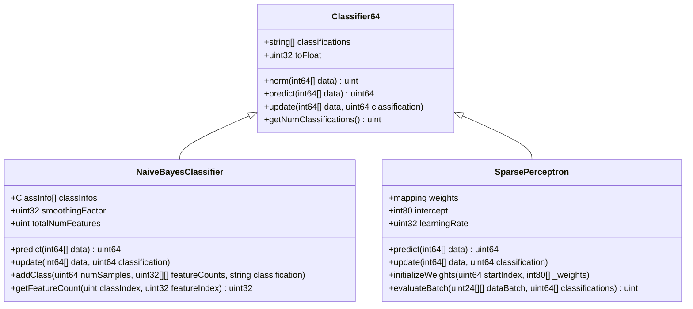
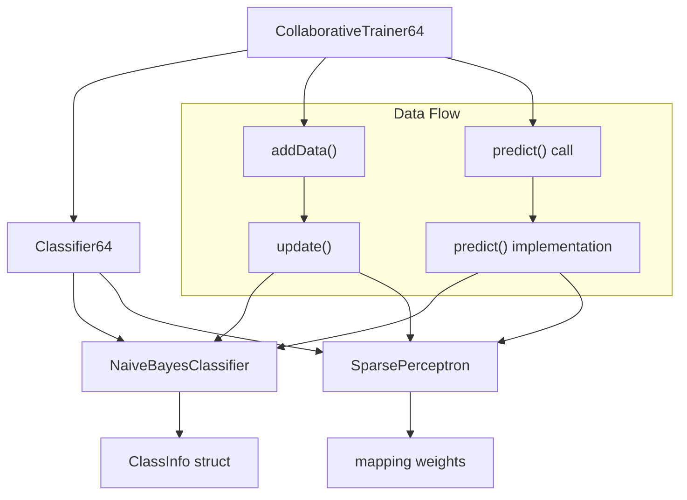
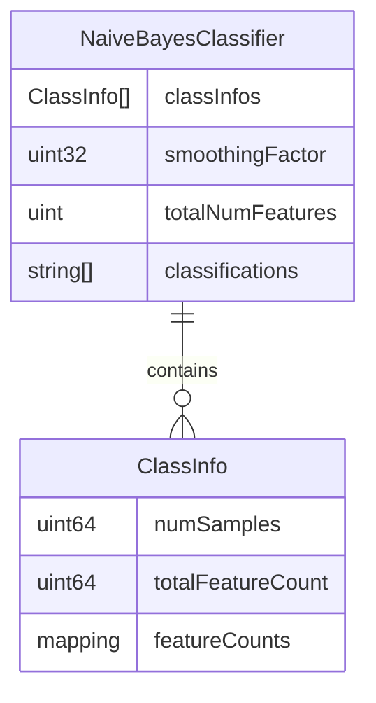
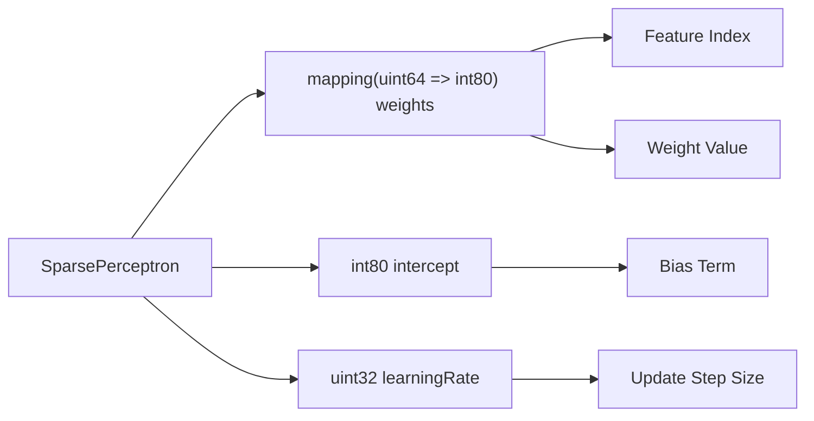

<!-- source: DeepWiki mcp.deepwiki.com · repo microsoft/0xDeCA10B · page 3.2 Classification Models · fetched 2026-10-26 -->

# Classification Models

<details>
<summary>Relevant source files</summary>

The following files were used as context for generating this wiki page:

- [demo/client/src/contracts/classification/NaiveBayesClassifier.sol](demo/client/src/contracts/classification/NaiveBayesClassifier.sol)
- [demo/client/src/contracts/classification/SparsePerceptron.sol](demo/client/src/contracts/classification/SparsePerceptron.sol)
- [demo/client/test/contracts/classification/naivebayes.js](demo/client/test/contracts/classification/naivebayes.js)

</details>


This document covers the on-chain machine learning classification models implemented as smart contracts in the 0xDeCA10B system. These models enable collaborative training and prediction directly on the blockchain, supporting the core SUM (Sharing Updatable Models) framework.

For information about the broader smart contract architecture, see [Contract Architecture](#3.1). For details on how these models are deployed to the blockchain, see [Model Deployment System](#3.3).

## Architecture Overview

The classification models in 0xDeCA10B implement a hierarchical contract structure with a base `Classifier64` interface and specialized implementations for different machine learning algorithms.

### Classification Model Hierarchy



Sources: [demo/client/src/contracts/classification/NaiveBayesClassifier.sol:6-18](), [demo/client/src/contracts/classification/SparsePerceptron.sol:4-10]()

### Integration with SUM Framework



Sources: [demo/client/src/contracts/classification/NaiveBayesClassifier.sol:18](), [demo/client/src/contracts/classification/SparsePerceptron.sol:10]()

## Base Classifier Interface

All classification models inherit from `Classifier64`, which provides the fundamental interface for 64-bit precision classification operations. The base class defines the contract structure that all implementations must follow.

### Core Interface Methods

| Method | Purpose | Parameters |
|--------|---------|------------|
| `predict(int64[] data)` | Generate predictions from input data | Sparse feature indices |
| `update(int64[] data, uint64 classification)` | Update model with new training data | Feature indices and true label |
| `norm(int64[] data)` | Normalize input data (optional) | Raw feature data |
| `getNumClassifications()` | Get total number of supported classes | None |

The `int64[]` data parameter represents sparse feature vectors where each integer is a feature index that is present in the sample.

Sources: [demo/client/src/contracts/classification/NaiveBayesClassifier.sol:138-185](), [demo/client/src/contracts/classification/SparsePerceptron.sol:78-116]()

## Naive Bayes Classifier

The `NaiveBayesClassifier` implements a multinomial Naive Bayes algorithm optimized for on-chain execution. It uses sparse feature representation and maintains class-specific feature counts.

### Data Structures



The `ClassInfo` struct [demo/client/src/contracts/classification/NaiveBayesClassifier.sol:30-44]() stores:
- `numSamples`: Number of training samples for the class
- `totalFeatureCount`: Sum of all feature occurrences in the class  
- `featureCounts`: Mapping from feature index to occurrence count

Sources: [demo/client/src/contracts/classification/NaiveBayesClassifier.sol:30-49]()

### Training and Prediction Logic

The `update` method [demo/client/src/contracts/classification/NaiveBayesClassifier.sol:164-185]() processes new training data by:

1. Incrementing the class sample count
2. Adding feature occurrences to `featureCounts` mapping
3. Updating the total feature count for the class

The `predict` method [demo/client/src/contracts/classification/NaiveBayesClassifier.sol:142-162]() implements the Naive Bayes formula:

```
P(class|features) ∝ P(class) × ∏P(feature|class)
```

With Laplace smoothing applied to handle unseen features:
```
P(feature|class) = (featureCount + smoothingFactor) / (totalFeatureCount + smoothingFactor × totalNumFeatures)
```

### Constructor Parameters

The constructor [demo/client/src/contracts/classification/NaiveBayesClassifier.sol:71-96]() accepts:
- `_classifications`: Array of class names
- `_classCounts`: Initial sample counts per class
- `_featureCounts`: Nested array of [featureIndex, count] pairs per class
- `_totalNumFeatures`: Total vocabulary size
- `_smoothingFactor`: Smoothing parameter (typically `toFloat` for Laplace smoothing)

Sources: [demo/client/src/contracts/classification/NaiveBayesClassifier.sol:71-96](), [demo/client/src/contracts/classification/NaiveBayesClassifier.sol:142-185]()

## Sparse Perceptron

The `SparsePerceptron` implements a binary perceptron classifier using sparse feature representation. It maintains a weight vector and bias term that are updated through online learning.

### Model Parameters



The model stores:
- `weights`: Mapping from feature indices to weight values (multiplied by `toFloat`)
- `intercept`: Bias term added to the linear combination  
- `learningRate`: Step size for weight updates during training

Sources: [demo/client/src/contracts/classification/SparsePerceptron.sol:12-28]()

### Training Algorithm

The `update` method [demo/client/src/contracts/classification/SparsePerceptron.sol:96-116]() implements the perceptron learning rule:

1. Generate prediction for current sample
2. If prediction ≠ true label, update weights:
   - For positive class (classification > 0): `weight += learningRate`
   - For negative class (classification = 0): `weight -= learningRate`

### Prediction Logic

The `predict` method [demo/client/src/contracts/classification/SparsePerceptron.sol:82-94]() computes:

```
output = intercept + Σ(weights[featureIndex]) for each present feature
classification = output > 0 ? 1 : 0
```

### Batch Evaluation

The `evaluateBatch` method [demo/client/src/contracts/classification/SparsePerceptron.sol:125-150]() provides optimized evaluation for multiple samples simultaneously, designed for IMDB dataset evaluation with fixed 60-feature samples.

Sources: [demo/client/src/contracts/classification/SparsePerceptron.sol:37-50](), [demo/client/src/contracts/classification/SparsePerceptron.sol:82-116](), [demo/client/src/contracts/classification/SparsePerceptron.sol:125-150]()

## Model Lifecycle Operations

### Initialization and Setup

Both classifiers support initialization methods for efficient deployment:

**NaiveBayesClassifier**:
- `initializeCounts()` [demo/client/src/contracts/classification/NaiveBayesClassifier.sol:106-117](): Set feature counts after deployment
- `addClass()` [demo/client/src/contracts/classification/NaiveBayesClassifier.sol:121-136](): Add new classification classes

**SparsePerceptron**:
- `initializeWeights()` [demo/client/src/contracts/classification/SparsePerceptron.sol:58-62](): Set weight values after deployment  
- `initializeSparseWeights()` [demo/client/src/contracts/classification/SparsePerceptron.sol:70-76](): Set sparse weight representation

### Data Format Requirements

All classification models expect sparse feature representation where:
- Input data is `int64[]` array
- Each element represents a feature index that is present
- Feature indices must be non-negative integers
- Maximum feature index constraints apply based on data type limits

### Testing and Validation

The test suite [demo/client/test/contracts/classification/naivebayes.js]() demonstrates:
- Model deployment with initial training data
- Prediction accuracy on test samples
- Online learning through `update()` calls
- Dynamic class addition capabilities

Key test scenarios include:
- Binary classification (ALARM vs WEATHER) [demo/client/test/contracts/classification/naivebayes.js:34-38]()
- Feature count tracking [demo/client/test/contracts/classification/naivebayes.js:54-76]()
- Model updates and retraining [demo/client/test/contracts/classification/naivebayes.js:91-125]()

Sources: [demo/client/src/contracts/classification/NaiveBayesClassifier.sol:106-136](), [demo/client/src/contracts/classification/SparsePerceptron.sol:58-76](), [demo/client/test/contracts/classification/naivebayes.js:34-154]()

---

