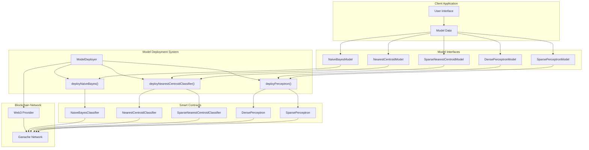
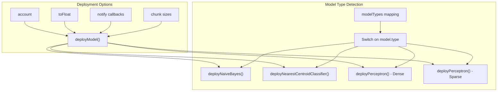
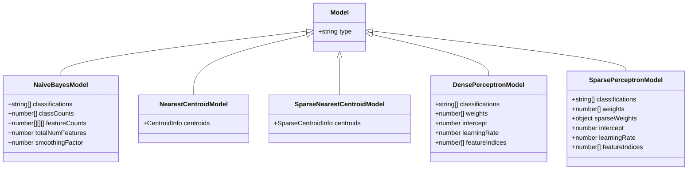
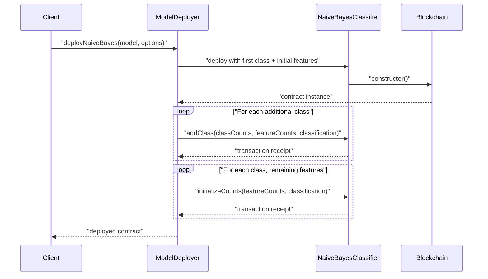
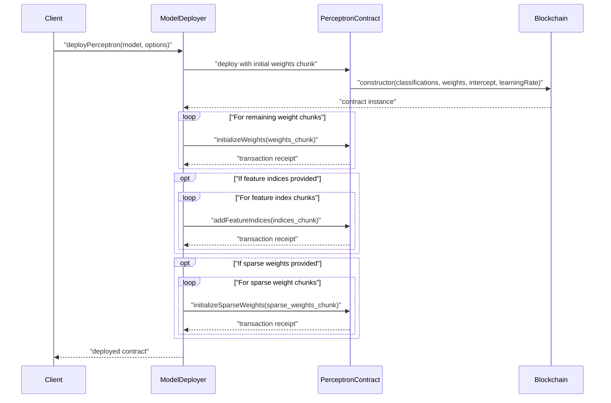
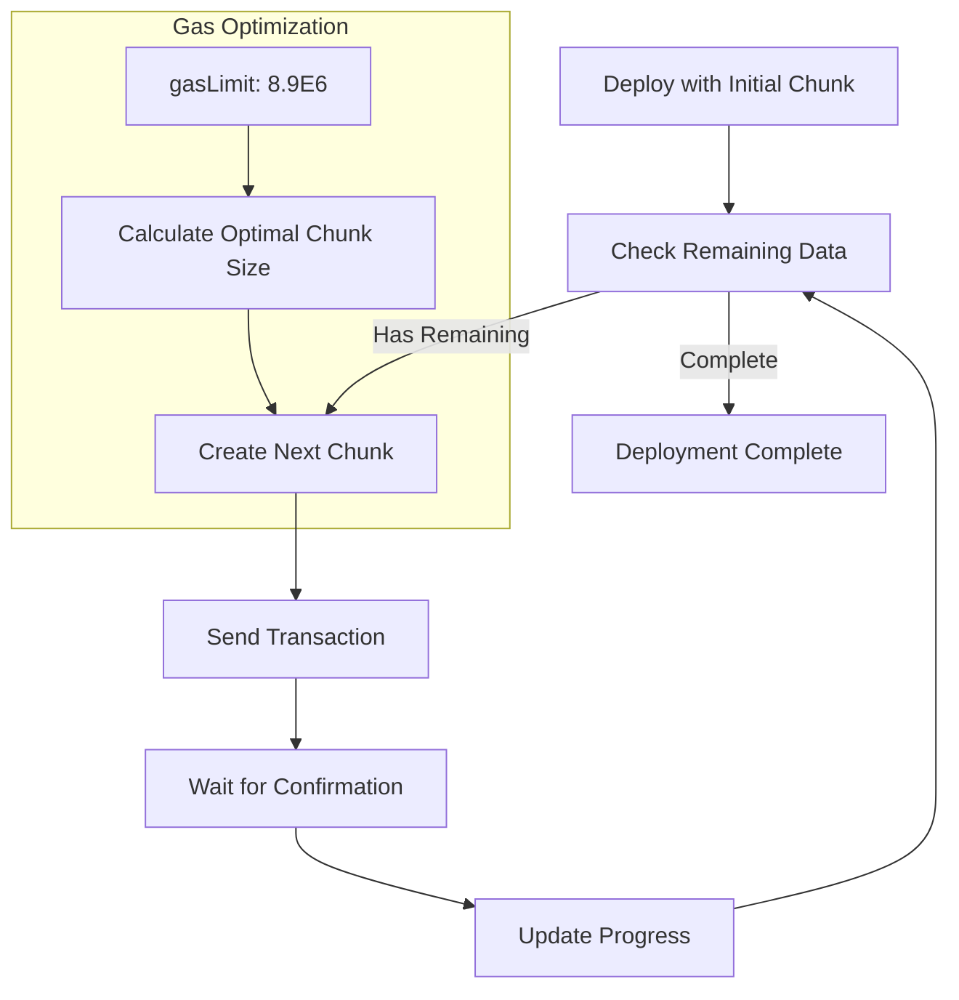
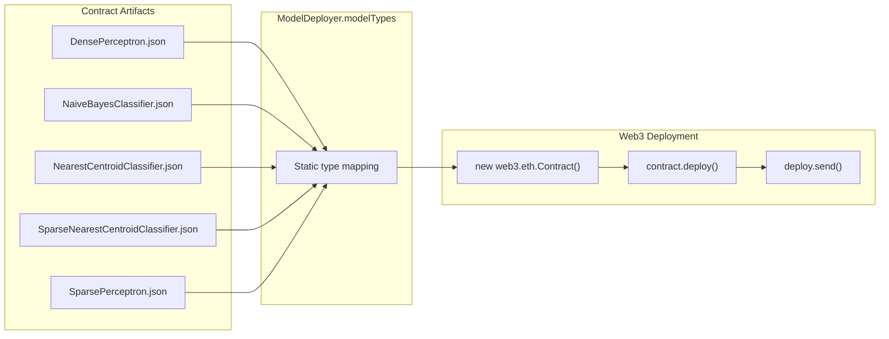

<!-- source: DeepWiki mcp.deepwiki.com · repo microsoft/0xDeCA10B · page 3.3 Model Deployment System · fetched 2026-10-26 -->

# Model Deployment System

Relevant source files

The following files were used as context for generating this wiki page:

- [demo/client/src/ml-models/__tests__/deploy-model.test.ts](demo/client/src/ml-models/__tests__/deploy-model.test.ts)
- [demo/client/src/ml-models/deploy-model-node.js](demo/client/src/ml-models/deploy-model-node.js)
- [demo/client/src/ml-models/deploy-model.ts](demo/client/src/ml-models/deploy-model.ts)
- [demo/client/src/ml-models/model-interfaces.ts](demo/client/src/ml-models/model-interfaces.ts)

## Purpose and Scope

The Model Deployment System handles the deployment of trained machine learning models to blockchain smart contracts within the 0xDeCA10B framework. This system converts serialized ML models into smart contract instances that can perform on-chain inference and collaborative training. The deployment process manages gas optimization through chunking strategies and provides a unified interface for deploying different classifier types.

For information about the smart contract architecture that these models deploy to, see [Contract Architecture](#3.1). For details about the specific classification models available, see [Classification Models](#3.2).

## System Architecture

The model deployment system consists of the `ModelDeployer` class which orchestrates the deployment of different model types to their corresponding smart contracts:

**Sources:** [demo/client/src/ml-models/deploy-model.ts:11-361](), [demo/client/src/ml-models/model-interfaces.ts:1-154]()

## ModelDeployer Class

The `ModelDeployer` class serves as the central orchestrator for model deployment operations:

| Property/Method | Purpose | Default Value |
|-----------------|---------|---------------|
| `toFloat` | Floating point conversion factor | `1E9` |
| `gasLimit` | Maximum gas per transaction | `8.9E6` |
| `modelTypes` | Maps model type strings to contract artifacts | Static mapping |
| `deployModel()` | Main deployment entry point | - |

The class supports five distinct model deployment workflows through specialized methods:

**Sources:** [demo/client/src/ml-models/deploy-model.ts:11-43](), [demo/client/src/ml-models/deploy-model.ts:321-361]()

## Model Types and Interfaces

The system supports deployment of five distinct classifier types through a hierarchical model interface structure:

| Model Type | Contract Target | Key Parameters |
|------------|-----------------|----------------|
| `naive bayes` | `NaiveBayesClassifier` | Feature counts, class counts, smoothing factor |
| `nearest centroid classifier` | `NearestCentroidClassifier` | Dense centroids, data counts |
| `sparse nearest centroid classifier` | `SparseNearestCentroidClassifier` | Sparse centroids, feature indices |
| `dense perceptron` | `DensePerceptron` | Dense weights, intercept, learning rate |
| `sparse perceptron` | `SparsePerceptron` | Dense + sparse weights, feature indices |

**Sources:** [demo/client/src/ml-models/model-interfaces.ts:4-154](), [demo/client/src/ml-models/deploy-model.ts:22-30]()

## Deployment Strategies

Each model type follows a specific deployment strategy optimized for gas usage and contract initialization:

### Naive Bayes Deployment Flow

### Perceptron Deployment Flow

**Sources:** [demo/client/src/ml-models/deploy-model.ts:35-107](), [demo/client/src/ml-models/deploy-model.ts:205-315]()

## Gas Management and Chunking

The deployment system implements sophisticated chunking strategies to work within blockchain gas limits:

| Model Type | Initial Chunk Size | Subsequent Chunk Size | Special Handling |
|------------|--------------------|--------------------|------------------|
| Naive Bayes | 150 features | 350 features | Per-class feature batching |
| Nearest Centroid | 200 dimensions | 250 dimensions | Per-class centroid extension |
| Dense Perceptron | 450 weights | 450 weights | Sequential weight initialization |
| Sparse Perceptron | 300 weights | 300 weights | Separate sparse weight chunks |

### Chunking Strategy Implementation

**Sources:** [demo/client/src/ml-models/deploy-model.ts:19-20](), [demo/client/src/ml-models/deploy-model.ts:39-40](), [demo/client/src/ml-models/deploy-model.ts:254-278]()

## Integration with Smart Contracts

The deployment system integrates with the smart contract layer through Web3 contract deployment and method invocation:

### Contract Compilation and Deployment

### Transaction Monitoring and Callbacks

The deployment process provides comprehensive transaction monitoring through callback functions:

| Callback Function | Purpose | Timing |
|-------------------|---------|--------|
| `notify()` | Display deployment progress | Throughout process |
| `dismissNotification()` | Clear progress notifications | After each step |
| `saveTransactionHash()` | Store transaction reference | On transaction submission |
| `saveAddress()` | Store deployed contract address | On successful deployment |

**Sources:** [demo/client/src/ml-models/deploy-model.ts:1-7](), [demo/client/src/ml-models/deploy-model.ts:46-61](), [demo/client/src/ml-models/deploy-model.ts:326-338]()

---

