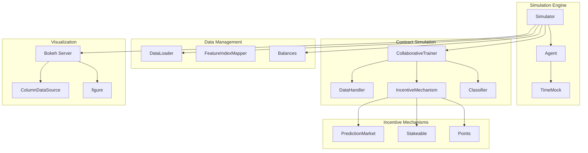
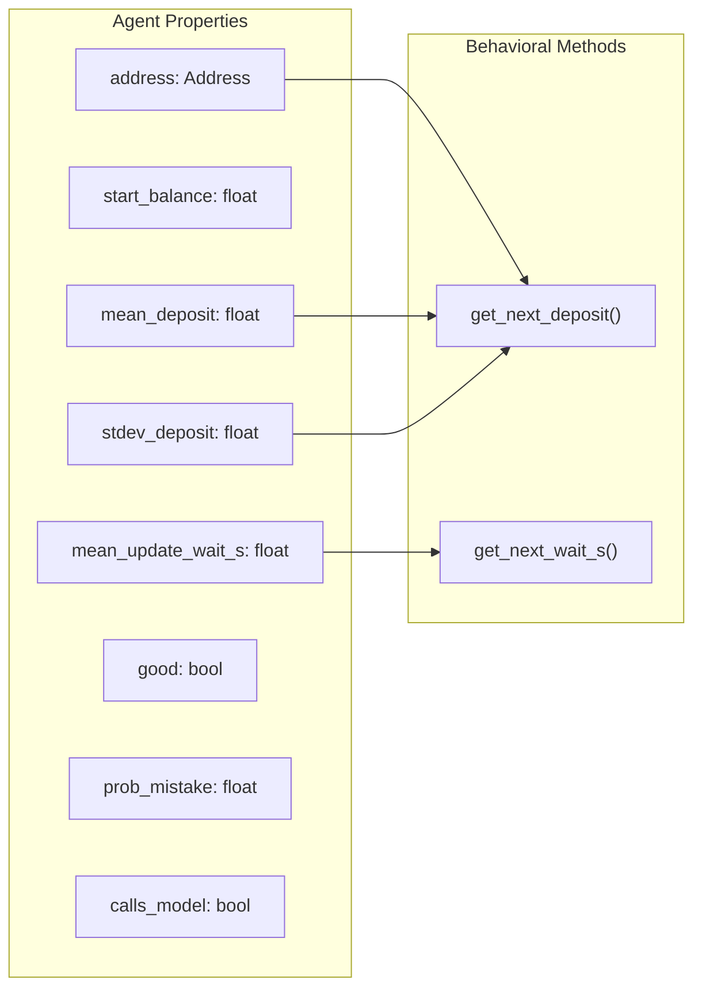
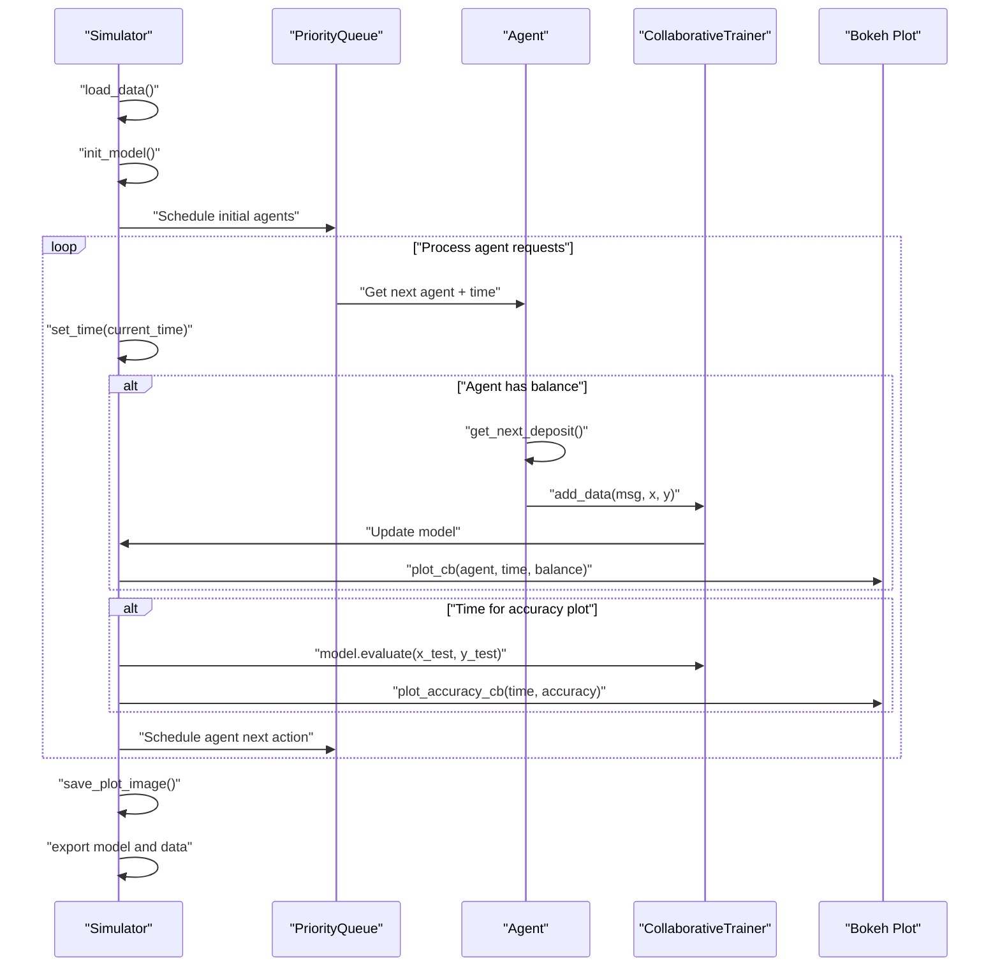
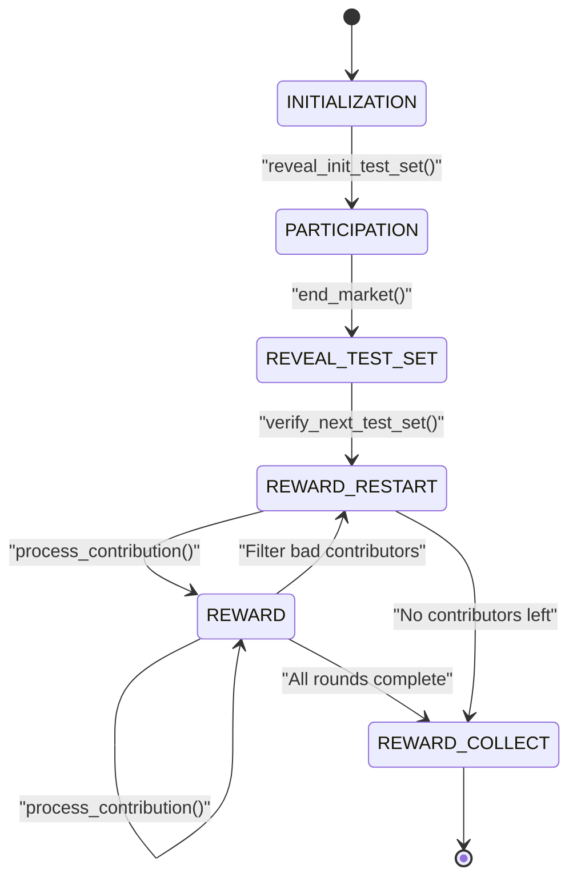
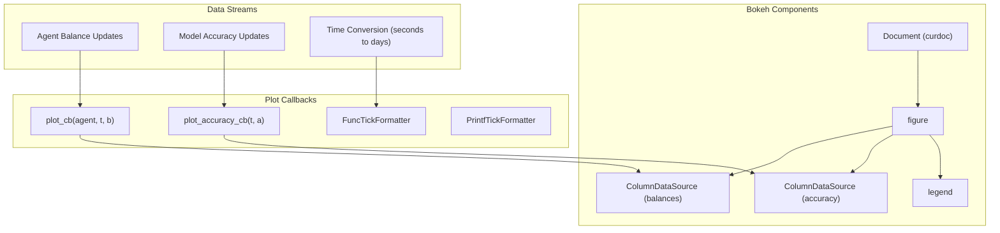

<!-- source: DeepWiki mcp.deepwiki.com · repo microsoft/0xDeCA10B · page 4 Simulation System · fetched 2026-10-26 -->

# Simulation System

<details>
<summary>Relevant source files</summary>

The following files were used as context for generating this wiki page:

- [simulation/.dockerignore](simulation/.dockerignore)
- [simulation/Dockerfile](simulation/Dockerfile)
- [simulation/README.md](simulation/README.md)
- [simulation/decai/simulation/contract/incentive/prediction_market.py](simulation/decai/simulation/contract/incentive/prediction_market.py)
- [simulation/decai/simulation/simulate.py](simulation/decai/simulation/simulate.py)

</details>


The Simulation System provides a Python-based environment for testing and validating incentive mechanisms and collaborative training scenarios in the 0xDeCA10B framework. It simulates multiple agents interacting with blockchain-based machine learning models, allowing researchers to evaluate the effectiveness of different incentive structures and analyze how honest and malicious contributors affect model performance over time.

This document covers the simulation environment, agent modeling, incentive mechanism testing, and visualization components. For information about the smart contracts being simulated, see [Smart Contracts](#3). For the demo application that showcases real blockchain integration, see [Demo Application](#2).

## System Architecture

The simulation system is built around several core components that work together to create a realistic testing environment for collaborative machine learning scenarios.

### Core Architecture Diagram



Sources: [simulation/decai/simulation/simulate.py:68-89](), [simulation/decai/simulation/contract/incentive/prediction_market.py:79-114]()

### Component Responsibilities

| Component | Purpose | Key Methods |
|-----------|---------|-------------|
| `Simulator` | Orchestrates simulation execution | `simulate()`, `save_plot_image()` |
| `Agent` | Represents individual participants | `get_next_deposit()`, `get_next_wait_s()` |
| `CollaborativeTrainer` | Simulates smart contract logic | `add_data()`, `predict()`, `refund()` |
| `PredictionMarket` | Market-based incentive mechanism | `initialize_market()`, `process_contribution()` |
| `DataLoader` | Manages training datasets | `load_data()`, `classifications()` |
| `Balances` | Tracks participant balances | `initialize()`, `send()` |

Sources: [simulation/decai/simulation/simulate.py:34-66](), [simulation/decai/simulation/contract/incentive/prediction_market.py:176-219]()

## Agent Modeling

The simulation system models participants as `Agent` instances with configurable behavioral parameters that represent different types of contributors to the collaborative learning system.

### Agent Configuration



Sources: [simulation/decai/simulation/simulate.py:33-66]()

The `Agent` dataclass defines participant behavior through several key parameters:

- **Financial behavior**: `start_balance`, `mean_deposit`, `stdev_deposit` control how much agents invest
- **Temporal behavior**: `mean_update_wait_s`, `stdev_update_wait_time` determine interaction frequency  
- **Trustworthiness**: `good` flag indicates honest vs malicious intent
- **Error modeling**: `prob_mistake` simulates accidental label errors
- **Usage patterns**: `calls_model` distinguishes data contributors from model users

Sources: [simulation/decai/simulation/simulate.py:34-48]()

## Simulation Execution Flow

The simulation orchestrates agent interactions through a priority queue-based event system that models real-time blockchain transactions.

### Simulation Process Diagram



Sources: [simulation/decai/simulation/simulate.py:233-491]()

### Event Processing Logic

The core simulation loop processes agent actions chronologically:

1. **Initialization**: Load data, train initial model, schedule agents [simulation/decai/simulation/simulate.py:234-270]()
2. **Agent processing**: Dequeue next agent, process their action [simulation/decai/simulation/simulate.py:281-354]()
3. **Model updates**: Apply data contributions, evaluate accuracy [simulation/decai/simulation/simulate.py:315-346]()
4. **Visualization**: Update real-time plots of balances and accuracy [simulation/decai/simulation/simulate.py:220-230]()
5. **Cleanup**: Handle refunds and final rewards [simulation/decai/simulation/simulate.py:355-404]()

Sources: [simulation/decai/simulation/simulate.py:276-407]()

## Incentive Mechanism Testing

The simulation system supports multiple incentive mechanisms to evaluate their effectiveness in encouraging honest participation and discouraging malicious behavior.

### Prediction Market Implementation

The `PredictionMarket` class implements a sophisticated market-based incentive system with multiple phases:



Sources: [simulation/decai/simulation/contract/incentive/prediction_market.py:20-44]()

### Market Phase Operations

| Phase | Purpose | Key Operations |
|-------|---------|---------------|
| `INITIALIZATION` | Set up test sets and bounty | `initialize_market()`, `add_test_set_hashes()` |
| `PARTICIPATION` | Accept data contributions | `handle_add_data()` |
| `REVEAL_TEST_SET` | Verify committed test data | `verify_next_test_set()` |
| `REWARD` | Calculate contribution scores | `process_contribution()` |
| `REWARD_COLLECT` | Distribute final rewards | `handle_refund()`, `handle_report()` |

Sources: [simulation/decai/simulation/contract/incentive/prediction_market.py:176-479]()

## Visualization and Real-time Monitoring

The simulation system uses Bokeh to provide real-time visualization of simulation progress, allowing researchers to observe agent behavior and model performance dynamically.

### Bokeh Integration Architecture



Sources: [simulation/decai/simulation/simulate.py:149-218]()

### Plot Configuration

The visualization system displays:

- **Agent balances**: Color-coded lines showing each agent's balance over time
- **Model accuracy**: Black line tracking test set accuracy
- **Baseline comparison**: Horizontal line showing optimal accuracy
- **Time formatting**: Converts simulation seconds to days for readability

Key formatting features:
- X-axis shows time in days using `FuncTickFormatter` [simulation/decai/simulation/simulate.py:204-206]()
- Y-axis shows percentages using `PrintfTickFormatter` [simulation/decai/simulation/simulate.py:207]()
- Agent lines use different colors and dash patterns for honest vs malicious agents [simulation/decai/simulation/simulate.py:184-198]()

Sources: [simulation/decai/simulation/simulate.py:153-218]()

## Configuration and Setup

### Environment Setup

The simulation system supports both local conda environments and Docker containers for reproducible execution.

#### Local Setup Requirements
- Python 3.8
- Bokeh for visualization server
- Scientific computing stack: numpy, pandas, scikit-learn, scipy, tensorflow
- Additional tools: mkl, mkl-service, phantomjs for plot export

#### Docker Configuration
The system provides a containerized environment based on `continuumio/miniconda3:4.9.2`:

```bash
# Build simulation container
docker build -t decai-simulation .

# Run with port mapping for Bokeh server
docker run --rm -it -p 5006:5006 -v ${PWD}:/root/workspace/0xDeCA10B/simulation decai-simulation
```

Sources: [simulation/README.md:30-62](), [simulation/Dockerfile:1-22]()

### Execution Commands

Start simulations using the Bokeh server:

```bash
# Run IMDB Perceptron simulation
bokeh serve decai/simulation/simulate_imdb_perceptron.py

# Access via browser at http://localhost:5006/simulate_imdb_perceptron
```

The simulation automatically:
- Saves run data to `saved_runs/{timestamp}-{filename}-simulation_data.json`
- Exports model state to `saved_runs/{timestamp}-{filename}-model.json`  
- Generates plot images at `saved_runs/{timestamp}-{filename}.png`

Sources: [simulation/README.md:78-85](), [simulation/decai/simulation/simulate.py:142-147]()

---

