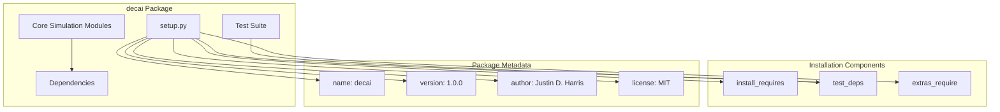
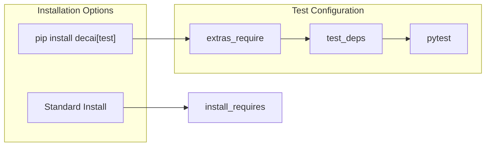
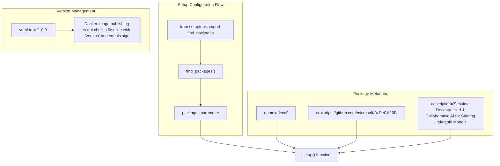
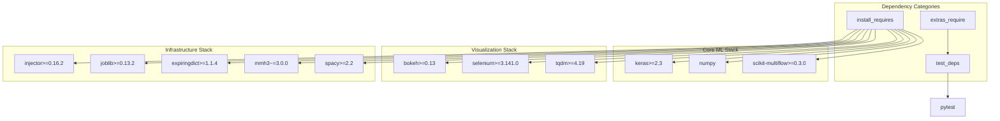

<!-- source: DeepWiki mcp.deepwiki.com · repo microsoft/0xDeCA10B · page 4.1 Simulation Setup and Configuration · fetched 2026-10-26 -->

# Simulation Setup and Configuration

<details>
<summary>Relevant source files</summary>

The following files were used as context for generating this wiki page:

- [simulation/setup.py](simulation/setup.py)

</details>


## Purpose and Scope

This document covers the setup and configuration of the Python-based simulation environment for the 0xDeCA10B project. The simulation system provides a framework for testing incentive mechanisms, collaborative training scenarios, and machine learning model behaviors in a controlled environment before deployment to the blockchain.

For information about the data loading components used within simulations, see [Data Loaders and Datasets](#4.2). For broader development environment setup including the demo application, see [Local Development Setup](#5.1).

## Package Overview

The simulation environment is packaged as a Python distribution named `decai`, designed specifically for simulating decentralized and collaborative AI systems. The package enables researchers and developers to test various scenarios involving sharing updatable models with different incentive mechanisms.

### Package Structure



Sources: [simulation/setup.py:29-43]()

## Dependencies and Requirements

The simulation environment requires a comprehensive set of Python packages to support machine learning, visualization, web serving, and data processing capabilities.

### Core Dependencies

| Category | Package | Version | Purpose |
|----------|---------|---------|---------|
| Visualization | `bokeh` | >=0.13 | Interactive web-based plotting and dashboard server |
| Caching | `expiringdict` | >=1.1.4 | Time-based dictionary expiration for simulation state |
| Dependency Injection | `injector` | >=0.16.2 | Dependency injection framework for modular design |
| Parallel Processing | `joblib` | >=0.13.2 | Parallel execution and caching utilities |
| Deep Learning | `keras` | >=2.3 | Neural network models and training |
| Hashing | `mmh3` | ~=3.0.0 | MurmurHash3 implementation for data hashing |
| Numerical Computing | `numpy` | latest | Fundamental array operations and mathematical functions |

### Specialized Dependencies

| Package | Version | Purpose |
|---------|---------|---------|
| `selenium` | >=3.141.0 | Web driver for automated plot saving and screenshots |
| `scikit-multiflow` | >=0.3.0 | Stream learning and online machine learning algorithms |
| `spacy` | >=2.2 | Natural language processing for text-based datasets |
| `tqdm` | >=4.19 | Progress bars for long-running simulation processes |

### Test Dependencies

The package includes optional test dependencies for development and validation:



Sources: [simulation/setup.py:25-27](), [simulation/setup.py:40-42]()

## Setup Configuration

The package setup is configured through the `setup.py` file using Python's `setuptools` framework. The configuration includes metadata, dependency specifications, and package discovery.

### Package Discovery and Structure



Sources: [simulation/setup.py:3](), [simulation/setup.py:5-6](), [simulation/setup.py:29-37]()

### Dependency Resolution

The setup configuration defines three categories of dependencies that are resolved during installation:

1. **Required Dependencies** (`install_requires`): Core packages needed for basic simulation functionality
2. **Test Dependencies** (`test_deps`): Additional packages needed for running the test suite
3. **Extra Dependencies** (`extras_require`): Optional dependency groups that can be installed selectively



Sources: [simulation/setup.py:8-23](), [simulation/setup.py:25-27](), [simulation/setup.py:40-42]()

## Installation and Environment Setup

### Standard Installation

The simulation package can be installed using standard Python package management tools:

```bash
pip install -e .
```

This installs the package in development mode, allowing for immediate reflection of code changes during development.

### Installation with Test Dependencies

For development environments that require running the test suite:

```bash
pip install -e .[test]
```

This installs both the core dependencies and the additional test dependencies defined in the `extras_require` configuration.

### Version Management

The package version is managed through a simple variable assignment at the top of the setup file. This approach supports automated Docker image publishing, where deployment scripts parse the version information by looking for the first line containing `version` and an equals sign.

Sources: [simulation/setup.py:5-6]()

## Docker Configuration

While the setup.py file includes references to Docker image publishing integration, the simulation environment is designed to work within containerized deployments. The version management strategy specifically accommodates Docker-based deployment pipelines where automated scripts need to extract version information for image tagging.

For detailed containerization setup and deployment procedures, see [Containerization and Deployment](#5.3).

Sources: [simulation/setup.py:5-6]()

---

