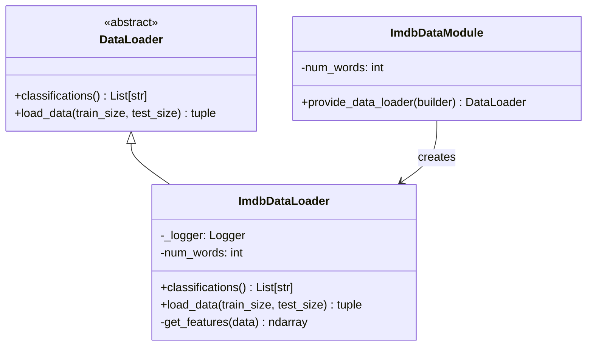
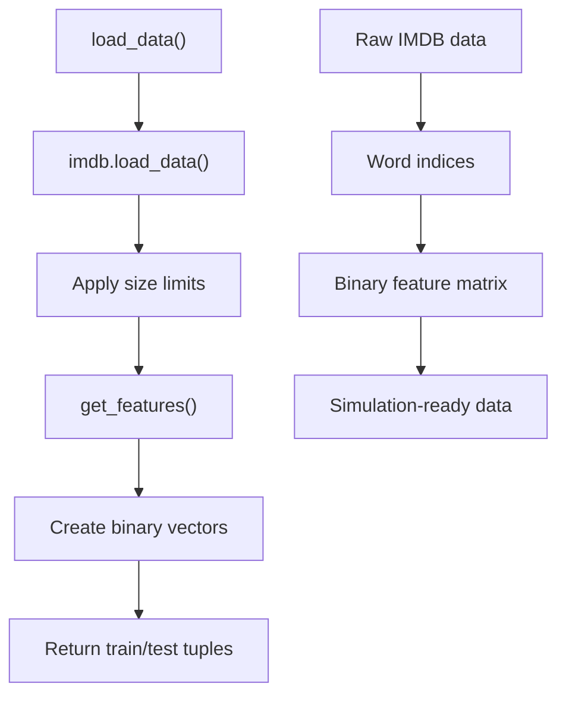
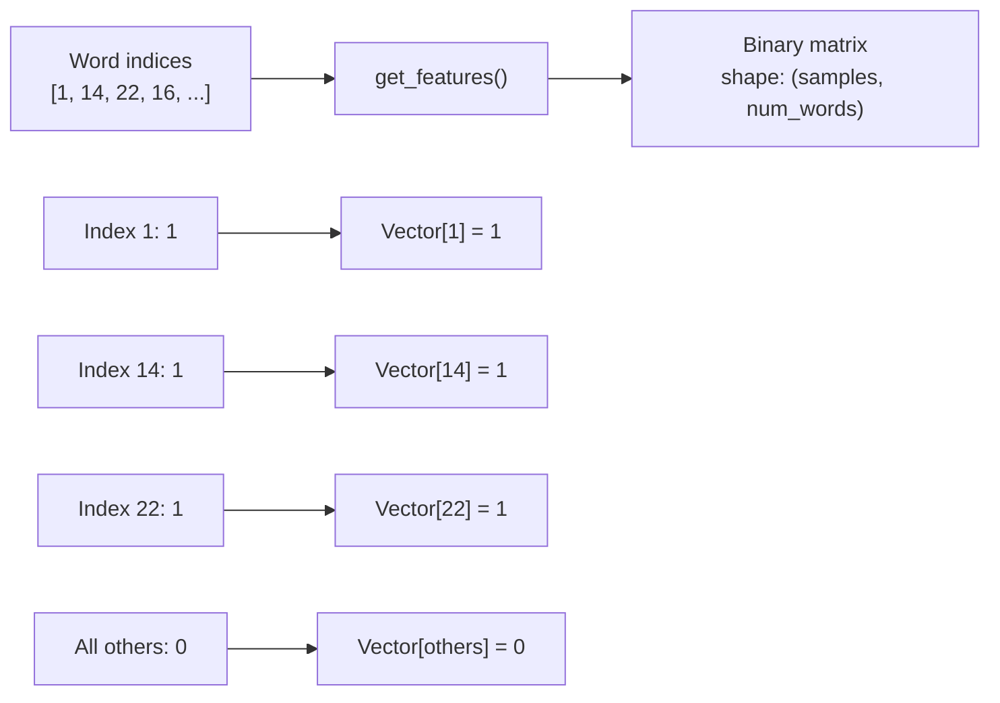
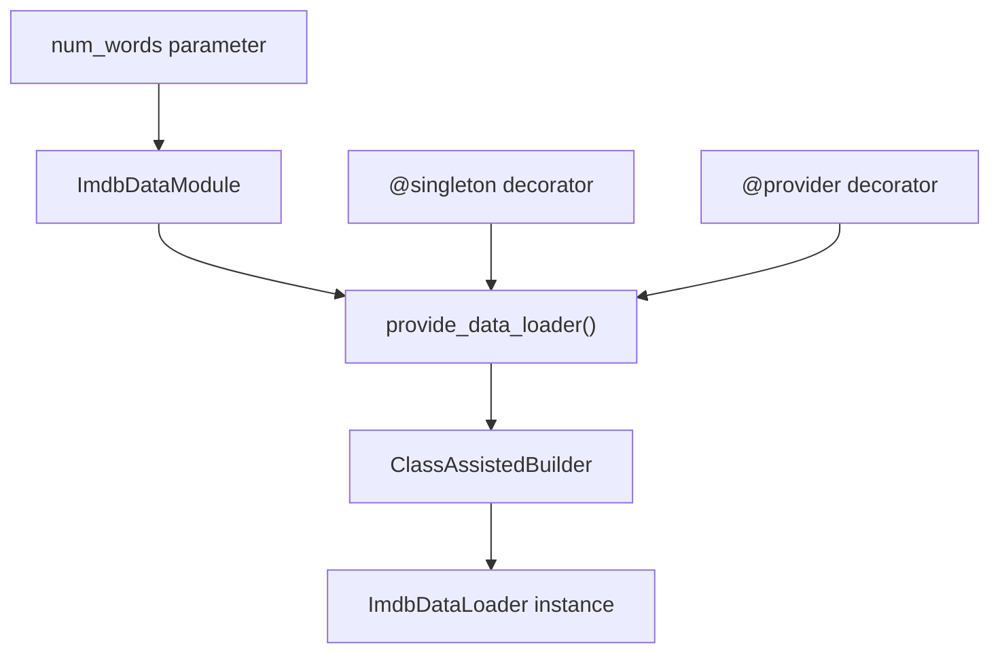
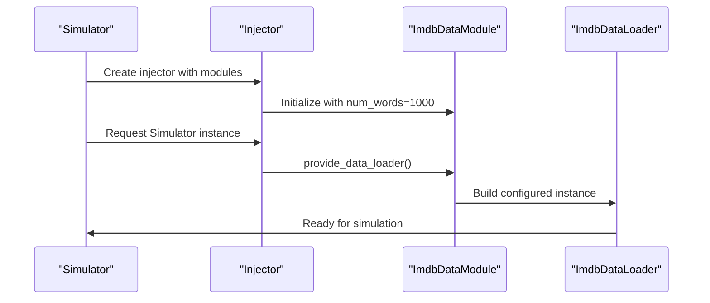

<!-- source: DeepWiki mcp.deepwiki.com · repo microsoft/0xDeCA10B · page 4.2 Data Loaders and Datasets · fetched 2026-10-26 -->

# Data Loaders and Datasets

Relevant source files

The following files were used as context for generating this wiki page:

- [simulation/decai/simulation/data/imdb_data_loader.py](simulation/decai/simulation/data/imdb_data_loader.py)
- [simulation/decai/simulation/simulate_imdb_perceptron.py](simulation/decai/simulation/simulate_imdb_perceptron.py)

This document covers the data loading and preprocessing systems used in the 0xDeCA10B simulation environment. The data loaders are responsible for loading various datasets, transforming them into simulation-compatible formats, and providing them to machine learning models for collaborative training experiments.

For information about the broader simulation system architecture, see [4.1](#4.1). For details about the machine learning models that consume this data, see [3.2](#3.2).

## Data Loader Architecture

The simulation system uses an abstract `DataLoader` interface to provide a consistent API for loading different types of datasets. This design allows the simulation to work with various data sources while maintaining a uniform interface for data access and preprocessing.

### Data Loader Class Hierarchy

Sources: [simulation/decai/simulation/data/imdb_data_loader.py:9-10](), [simulation/decai/simulation/data/imdb_data_loader.py:12-14](), [simulation/decai/simulation/data/imdb_data_loader.py:49-56]()

## IMDB Data Loader Implementation

The `ImdbDataLoader` class provides sentiment analysis data from the IMDB movie reviews dataset. It implements the abstract `DataLoader` interface and handles the specific requirements for loading and preprocessing IMDB review data.

### Key Features

| Feature | Description | Implementation |
|---------|-------------|----------------|
| Dataset Source | Keras IMDB dataset | [simulation/decai/simulation/data/imdb_data_loader.py:29]() |
| Vocabulary Size | Configurable word count | [simulation/decai/simulation/data/imdb_data_loader.py:22]() |
| Classifications | Binary sentiment labels | [simulation/decai/simulation/data/imdb_data_loader.py:24-25]() |
| Feature Encoding | Binary bag-of-words vectors | [simulation/decai/simulation/data/imdb_data_loader.py:35-43]() |

### Data Loading Process

The `ImdbDataLoader.load_data()` method performs several key transformations:

1. **Data Loading**: Uses Keras `imdb.load_data()` to retrieve the raw dataset with vocabulary limited to `num_words`
2. **Size Limiting**: Optionally truncates training and test sets to specified sizes
3. **Feature Transformation**: Converts word index sequences to binary feature vectors using the `get_features()` helper method
4. **Output Formatting**: Returns data in the standard `(x_train, y_train), (x_test, y_test)` tuple format

Sources: [simulation/decai/simulation/data/imdb_data_loader.py:27-46]()

## Data Transformation Process

The IMDB data undergoes a specific transformation to convert variable-length sequences of word indices into fixed-size binary feature vectors suitable for machine learning models.

### Feature Vector Creation

The transformation process implemented in `get_features()`:

1. **Initialize**: Creates a zero matrix with dimensions `(len(data), num_words)`
2. **Binary Encoding**: For each sample, sets matrix positions to 1 where word indices appear
3. **Result**: Each row becomes a binary bag-of-words representation of the original review

Sources: [simulation/decai/simulation/data/imdb_data_loader.py:35-43]()

## Configuration and Integration

The data loader system uses dependency injection through the `injector` library to provide flexible configuration and integration with the simulation framework.

### Module Configuration

The `ImdbDataModule` class serves as a configuration container:

- **Parameter Configuration**: Accepts `num_words` parameter to control vocabulary size
- **Singleton Pattern**: Ensures single instance of data loader per injector
- **Builder Pattern**: Uses `ClassAssistedBuilder` to construct configured instances

Sources: [simulation/decai/simulation/data/imdb_data_loader.py:49-56]()

## Usage in Simulations

Data loaders are integrated into simulation runs through the dependency injection system. The simulation setup demonstrates how to configure and use the IMDB data loader with specific parameters.

### Simulation Integration Example

The integration process involves:

1. **Module Registration**: `ImdbDataModule(num_words=num_words)` is added to the injector modules list
2. **Parameter Configuration**: Vocabulary size and other parameters are set at module creation
3. **Automatic Injection**: The simulation framework automatically receives the configured data loader
4. **Runtime Usage**: Data loader methods are called during simulation execution to provide training and test data

Sources: [simulation/decai/simulation/simulate_imdb_perceptron.py:58-64]()

### Configuration Parameters

| Parameter | Purpose | Example Value | Location |
|-----------|---------|---------------|----------|
| `num_words` | Vocabulary size limit | 1000 | [simulation/decai/simulation/simulate_imdb_perceptron.py:17]() |
| `train_size` | Training set size limit | None (unlimited) | [simulation/decai/simulation/simulate_imdb_perceptron.py:18]() |
| `init_train_data_portion` | Initial training data fraction | 0.08 | [simulation/decai/simulation/simulate_imdb_perceptron.py:20]() |

Sources: [simulation/decai/simulation/simulate_imdb_perceptron.py:17-22]()

---

