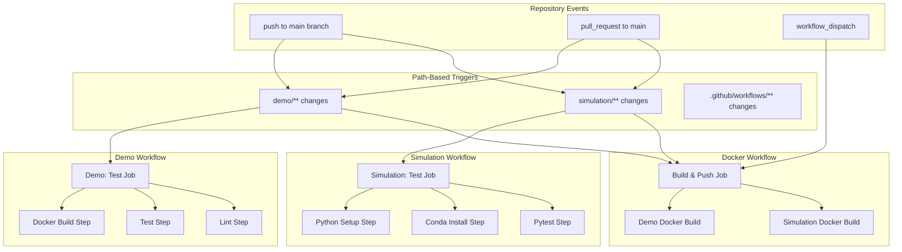
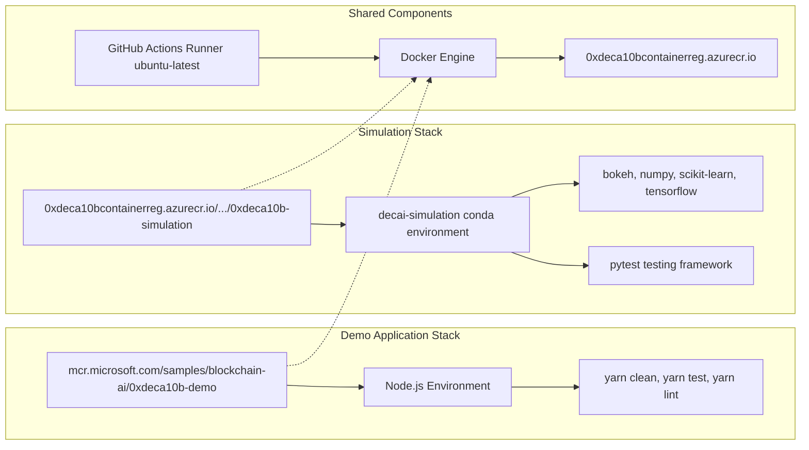
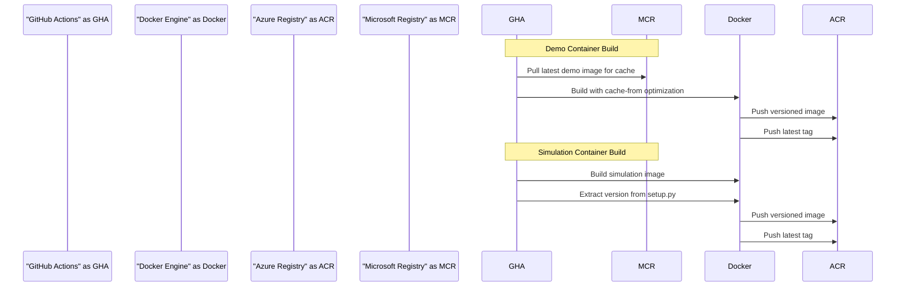

<!-- source: DeepWiki mcp.deepwiki.com · repo microsoft/0xDeCA10B · page 5 Development and Deployment · fetched 2026-10-26 -->

# Development and Deployment

Relevant source files

The following files were used as context for generating this wiki page:

- [.github/workflows/demo-test.yml](.github/workflows/demo-test.yml)
- [.github/workflows/docker.yml](.github/workflows/docker.yml)
- [.github/workflows/simulation-test.yml](.github/workflows/simulation-test.yml)

This document covers the development workflow, automated testing infrastructure, and deployment strategies for the 0xDeCA10B project. It provides an overview of the CI/CD pipeline, containerization approach, and deployment targets used across the demo application and simulation system.

For detailed setup instructions, see [Local Development Setup](#5.1). For comprehensive testing documentation, see [Testing Framework](#5.2). For Docker and cloud deployment specifics, see [Containerization and Deployment](#5.3).

## CI/CD Pipeline Architecture

The project uses GitHub Actions for continuous integration and deployment, with separate workflows for different system components. The pipeline automatically triggers on code changes to relevant paths and provides automated testing, linting, and deployment capabilities.

### GitHub Actions Workflow Structure

**Sources:** [.github/workflows/demo-test.yml:1-54](), [.github/workflows/simulation-test.yml:1-48](), [.github/workflows/docker.yml:1-43]()

## Development Environment Components

The development environment supports multiple technology stacks and deployment targets, with distinct setups for the demo application and simulation system.

### Technology Stack Distribution

**Sources:** [.github/workflows/demo-test.yml:26-34](), [.github/workflows/simulation-test.yml:26-35](), [.github/workflows/docker.yml:24-42]()

## Testing Strategy Overview

The project implements a multi-layered testing approach with component-specific test suites and automated quality assurance checks.

### Demo Application Testing

The demo testing workflow uses Docker containers to ensure consistent test environments. The process includes:

- **Container-based Testing**: Tests run inside the `mcr.microsoft.com/samples/blockchain-ai/0xdeca10b-demo:latest` image
- **Volume Mounting**: Source code is mounted at `/root/workspace/demo` with preserved `node_modules`
- **Test Execution**: Runs `yarn clean && yarn test` command sequence
- **Linting**: Separate `yarn lint` step that executes regardless of test results

**Sources:** [.github/workflows/demo-test.yml:35-53]()

### Simulation Testing Framework

The simulation testing uses conda-based Python environment management:

- **Python Version Matrix**: Tests against Python 3.8
- **Conda Environment**: Creates `decai-simulation` environment with scientific computing packages
- **Dependencies**: Installs `bokeh`, `mkl`, `numpy`, `scikit-learn`, `scipy`, `tensorflow`
- **Test Runner**: Executes tests using `conda run --name decai-simulation pytest`

**Sources:** [.github/workflows/simulation-test.yml:19-47]()

## Containerization Architecture

The project uses Docker for both development and deployment, with separate container strategies for each system component.

| Component | Base Registry | Image Name | Version Source |
|-----------|---------------|------------|----------------|
| Demo | `mcr.microsoft.com` | `samples/blockchain-ai/0xdeca10b-demo` | `package.json` version field |
| Simulation | `0xdeca10bcontainerreg.azurecr.io` | `public/samples/blockchain-ai/0xdeca10b-simulation` | `setup.py` version field |

### Container Build Process

**Sources:** [.github/workflows/docker.yml:21-42]()

## Deployment Infrastructure

The deployment infrastructure centers around Azure Container Registry with automated image publishing, though the Docker workflow notes that Azure resources have been partially decommissioned.

### Registry Configuration

- **Primary Registry**: `0xdeca10bcontainerreg.azurecr.io`
- **Authentication**: Uses `_0XDECA10B_AZURECR_PASSWORD` secret
- **Username**: `0xDeCA10Bcontainerreg`
- **Image Tagging**: Both `latest` and semantic version tags

### Version Management

The system extracts version information directly from project files:
- **Demo Versions**: Parsed from `package.json` using `grep` and `awk`
- **Simulation Versions**: Extracted from `setup.py` using text processing

**Sources:** [.github/workflows/docker.yml:24-42]()

## Workflow Triggers and Path Management

The CI/CD system uses path-based triggers to optimize build times and ensure relevant tests run for code changes:

### Path-Based Trigger Configuration

| Workflow | Trigger Paths | Purpose |
|----------|---------------|---------|
| `demo-test.yml` | `demo/**`, `.github/workflows/demo-**` | Demo application changes |
| `simulation-test.yml` | `simulation/**`, `.github/workflows/simulation-**` | Simulation system changes |
| `docker.yml` | `demo/**`, `simulation/**`, `.github/workflows/docker.yml` | Container builds |

### Manual Execution

Both the demo and docker workflows support manual execution via `workflow_dispatch`, enabling on-demand testing and deployment.

**Sources:** [.github/workflows/demo-test.yml:3-16](), [.github/workflows/simulation-test.yml:3-13](), [.github/workflows/docker.yml:4-12]()

---

