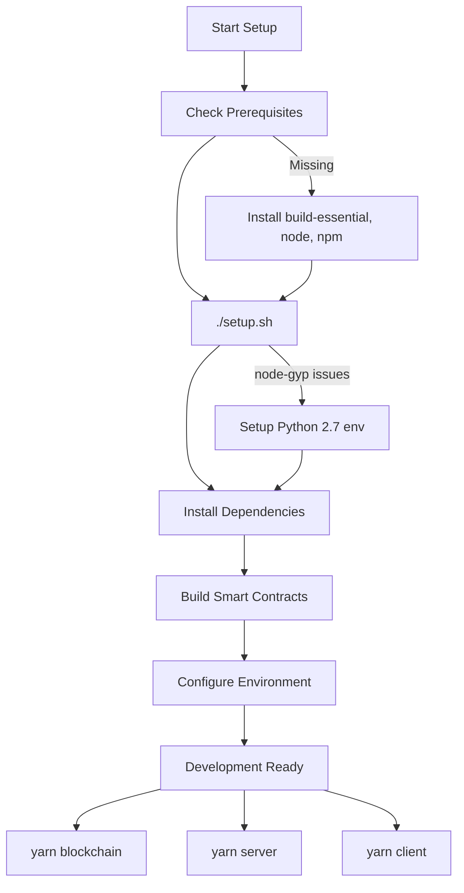
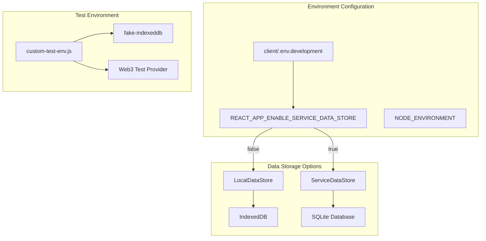
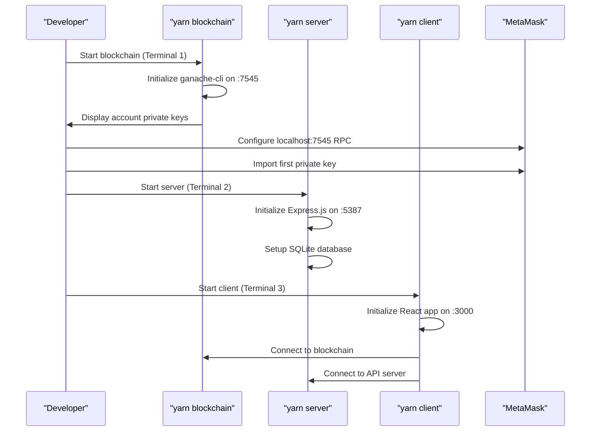
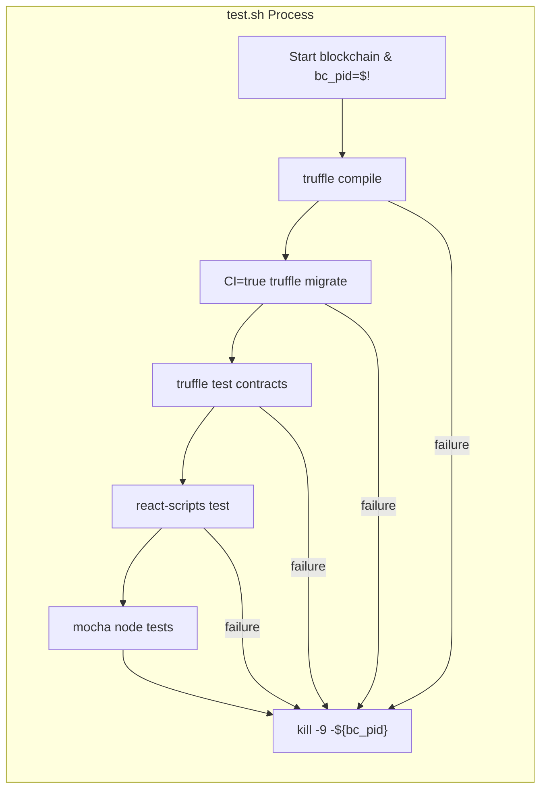

<!-- source: DeepWiki mcp.deepwiki.com · repo microsoft/0xDeCA10B · page 5.1 Local Development Setup · fetched 2026-10-26 -->

# Local Development Setup

<details>
<summary>Relevant source files</summary>

The following files were used as context for generating this wiki page:

- [demo/README.md](demo/README.md)
- [demo/client/src/storage/__tests__/local-data-store.test.ts](demo/client/src/storage/__tests__/local-data-store.test.ts)
- [demo/client/src/storage/local-data-store.ts](demo/client/src/storage/local-data-store.ts)
- [demo/client/test.sh](demo/client/test.sh)
- [demo/client/test/custom-test-env.js](demo/client/test/custom-test-env.js)

</details>


This document provides comprehensive instructions for setting up a local development environment for the 0xDeCA10B project. It covers both native installation on Linux/WSL systems and Docker-based development environments, along with configuration requirements and troubleshooting guidance.

For information about testing the setup after installation, see [Testing Framework](#5.2). For deployment procedures, see [Containerization and Deployment](#5.3).

## Prerequisites and System Requirements

The 0xDeCA10B demo application requires specific system dependencies and runtime environments to function properly.

### Core Dependencies

| Requirement | Version | Purpose |
|------------|---------|---------|
| Node.js | 10.x | JavaScript runtime (later versions may work but node-gyp issues occurred with v14) |
| npm | Latest | Package management |
| make | Latest | Build tools |
| Python | 2.7 | Required for node-gyp compilation |

For Debian-based systems (Ubuntu), install build tools using:
```bash
sudo apt install build-essential
```

### Node.js Version Compatibility

The system is specifically designed for Node.js version 10, as documented in [demo/README.md:18-19](). Version 14 and later may cause node-gyp compilation issues during the setup process. If experiencing build problems, consider using a Python 2.7 conda environment temporarily during installation:

```bash
conda create --name python2 python=2
conda activate python2
```

Sources: [demo/README.md:15-38]()

## Local Development Setup Process

### Setup Flow Architecture



### Primary Setup Script

The main setup process is handled by the `setup.sh` script located in the demo directory. This script manages dependency installation and initial configuration:

```bash
./setup.sh
```

This script performs the following operations:
- Installs npm dependencies for both client and server components
- Compiles smart contracts using Truffle
- Sets up the development environment configuration
- Prepares the local blockchain environment

Sources: [demo/README.md:27-30]()

## Docker-Based Development Environment

### Docker Setup Architecture

```mermaid
flowchart LR
    subgraph "Host System"
        HostCode["Host Code Directory"]
        HostPorts["Host Ports 3000, 5387, 7545"]
    end
    
    subgraph "Docker Container"
        ContainerWorkspace["/root/workspace/demo"]
        NodeModules["node_modules volumes"]
        SetupLibs["./setup_libs.sh"]
        Byobu["byobu session manager"]
    end
    
    subgraph "Development Services"
        Frontend["React Client :3000"]
        Backend["Express Server :5387"]
        Blockchain["Ganache CLI :7545"]
    end
    
    HostCode -->|Volume Mount| ContainerWorkspace
    HostPorts -->|Port Mapping| Development Services
    ContainerWorkspace --> SetupLibs
    SetupLibs --> NodeModules
    Byobu --> Development Services
```

Docker provides an alternative setup method that encapsulates all dependencies and eliminates host system configuration issues. 

### Docker Image Build and Run Process

Navigate to the demo directory and build the container:

```bash
cd 0xDeCA10B/demo
docker build -t decai-demo .
```

Run the development container with proper port mappings and volume mounts:

```bash
docker run --rm -it -p 3000:3000 -p 5387:5387 -p 7545:7545 \
  -v ${PWD}:/root/workspace/demo \
  -v /root/workspace/demo/node_modules \
  -v /root/workspace/demo/client/node_modules \
  --name decai-demo decai-demo bash
```

### Container Initialization

Inside the container, perform the initial setup:

```bash
# First-time setup
./setup_libs.sh

# Start session manager for multiple processes
byobu
```

The `byobu` session manager allows running multiple development processes simultaneously within the container environment.

Sources: [demo/README.md:40-71]()

## Development Environment Configuration

### Service Configuration Architecture



### Client Environment Configuration

The React client supports different data storage backends controlled by environment variables. The development environment file `client/.env.development` controls whether to use the local IndexedDB storage or the external service database.

Key configuration option:
- `REACT_APP_ENABLE_SERVICE_DATA_STORE=true`: Enables server-side SQLite database storage
- `REACT_APP_ENABLE_SERVICE_DATA_STORE=false` (default): Uses browser IndexedDB via `LocalDataStore`

### Test Environment Setup

The test environment requires special configuration to provide browser APIs in the Node.js testing context. The `CustomTestEnvironment` class in [demo/client/test/custom-test-env.js:6]() extends Jest's jsdom environment to include:

- `TextEncoder` for TensorFlow.js compatibility [demo/client/test/custom-test-env.js:10-12]()
- `fake-indexeddb` for IndexedDB simulation [demo/client/test/custom-test-env.js:14-19]()
- Web3 provider for blockchain testing [demo/client/test/custom-test-env.js:20-25]()

Sources: [demo/README.md:120-131](), [demo/client/test/custom-test-env.js:1-27]()

## Development Workflow Services

### Service Startup Sequence



### Blockchain Service

The blockchain service uses `ganache-cli` to provide a local Ethereum-compatible blockchain:

```bash
yarn blockchain
```

This starts a local blockchain on port 7545 with pre-funded accounts. The first private key should be imported into MetaMask for development use. The blockchain requires configuration of a custom RPC endpoint in MetaMask pointing to `http://localhost:7545`.

### Backend Server Service

The optional Express.js server provides model metadata storage and original data persistence:

```bash
yarn server
```

The server runs on port 5387 and provides a SQLite database for storing model information when `REACT_APP_ENABLE_SERVICE_DATA_STORE=true` is configured.

### Frontend Client Service

The React development server hosts the user interface:

```bash
yarn client
```

This starts the development server on port 3000 with hot reloading enabled.

Sources: [demo/README.md:103-141]()

## Troubleshooting Common Issues

### Contract Address Issues

When restarting the blockchain (Ganache), previously deployed contracts become invalid. This manifests as errors about contracts not found at specific addresses. Resolution involves cleaning generated contract artifacts:

```bash
rm -f client/{build,src}/contracts/compiled/*.json
```

For complete blockchain reset:
```bash
rm -rf blockchain_db
yarn clean
```

### MetaMask Configuration Issues

#### Nonce Synchronization Problems
MetaMask caches transaction nonces that become invalid when the blockchain restarts. Solutions:
1. Reset account in MetaMask settings to clear transaction history
2. Change Ganache network ID if persistent issues occur

#### MetaMask Loading Issues
If MetaMask becomes unresponsive:
1. Disable extension at `chrome://extensions`
2. Re-enable and reopen extension
3. Switch to Main Ethereum Network, login, then switch back
4. Reject any queued transactions

For persistent issues, combine account reset with blockchain restart using `yarn clean`.

### Node.js and Python Compatibility

Node-gyp compilation issues typically stem from Python version incompatibility. The recommended approach uses a temporary Python 2.7 conda environment during `./setup.sh` execution.

Sources: [demo/README.md:143-180]()

## Test Execution Environment

### Test Script Architecture



The test execution script [demo/client/test.sh:1-32]() provides automated testing with proper cleanup. It manages a background blockchain process and ensures termination regardless of test outcomes.

Key test script features:
- Background blockchain process management with PID tracking [demo/client/test.sh:7]()
- Environment variable defaults [demo/client/test.sh:20]()
- Sequential test execution with failure handling [demo/client/test.sh:21-26]()
- Comprehensive cleanup function [demo/client/test.sh:11-16]()

The script sets `CI=true` to disable interactive features and ensure consistent test execution in automated environments.

Sources: [demo/client/test.sh:1-32](), [demo/README.md:184-213]()

---

