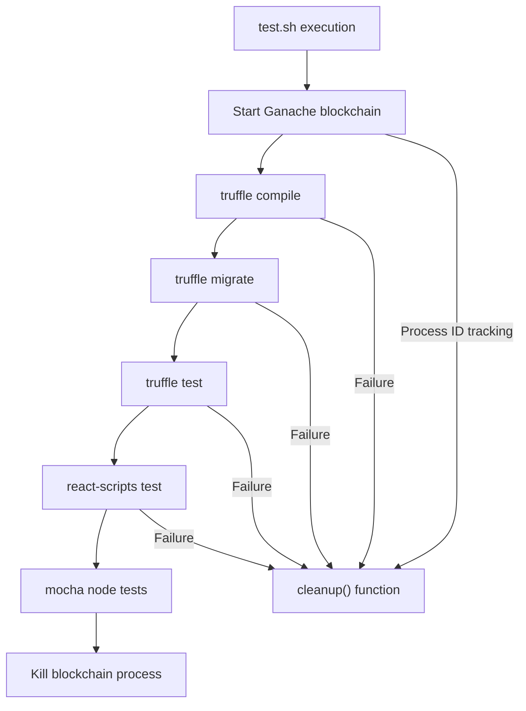
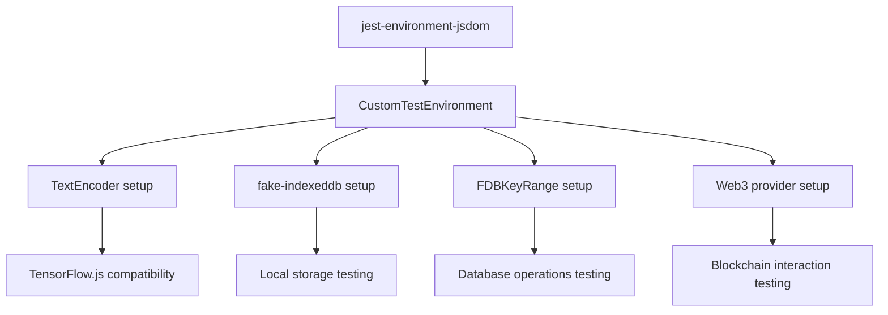
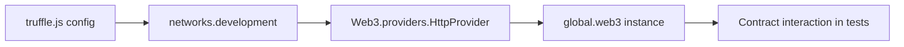
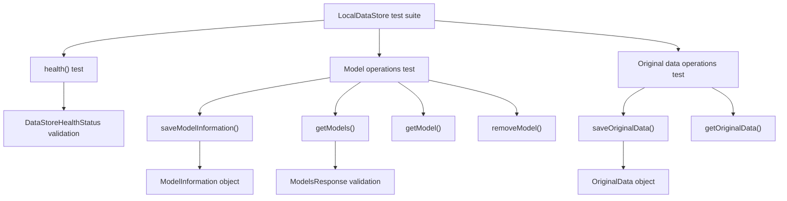
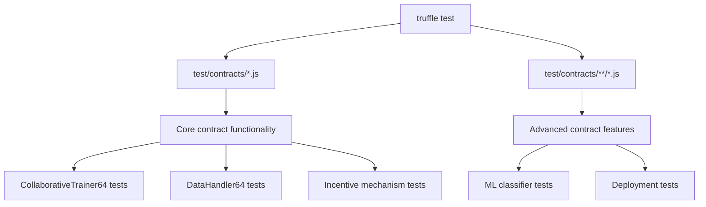
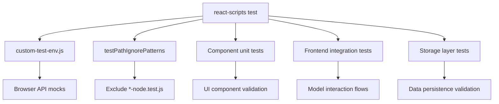
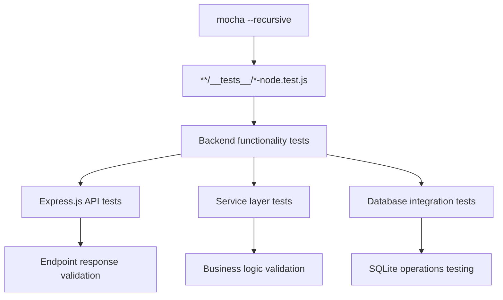
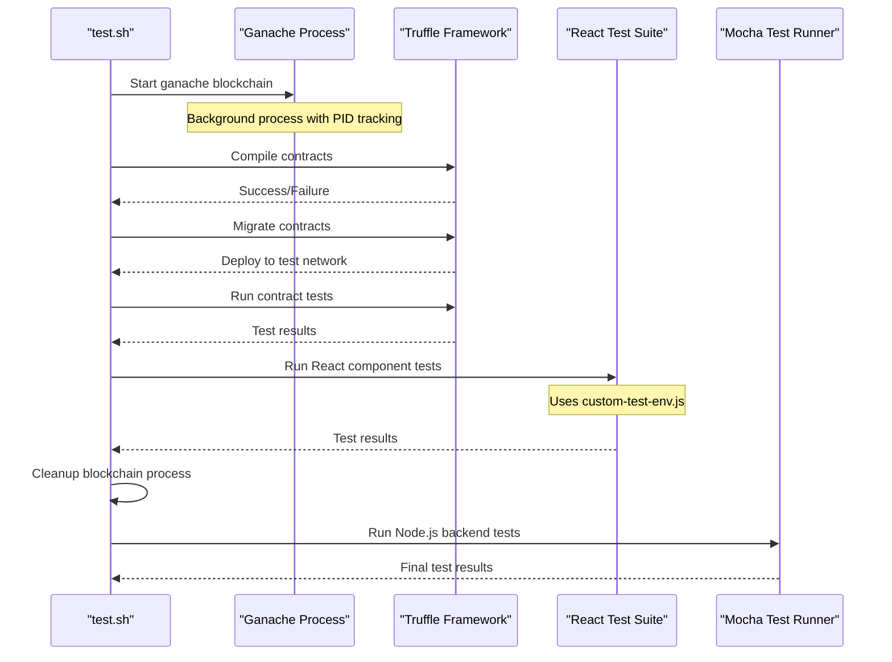

<!-- source: DeepWiki mcp.deepwiki.com · repo microsoft/0xDeCA10B · page 5.2 Testing Framework · fetched 2026-10-26 -->

# Testing Framework

Relevant source files

The following files were used as context for generating this wiki page:

- [demo/client/src/storage/__tests__/local-data-store.test.ts](demo/client/src/storage/__tests__/local-data-store.test.ts)
- [demo/client/src/storage/local-data-store.ts](demo/client/src/storage/local-data-store.ts)
- [demo/client/test.sh](demo/client/test.sh)
- [demo/client/test/custom-test-env.js](demo/client/test/custom-test-env.js)

This document describes the comprehensive testing infrastructure used in the 0xDeCA10B project, covering unit tests, integration tests, smart contract tests, and the automated test execution pipeline. The testing framework ensures reliability across the React frontend, Express.js backend, smart contracts, and storage systems.

For information about local development setup, see [Local Development Setup](#5.1). For deployment and containerization testing, see [Containerization and Deployment](#5.3).

## Test Execution Pipeline

The testing framework is orchestrated by a comprehensive test script that manages blockchain setup, contract deployment, and multi-layer testing execution.

### Test Orchestration Script

The main test execution is controlled by the `test.sh` script which manages the complete testing lifecycle:

**Sources:** [demo/client/test.sh:1-32]()

The script implements process management and error handling through the `cleanup()` function which ensures the blockchain process is properly terminated regardless of test outcomes.

### Environment Configuration

Test execution supports multiple environments with configurable settings:

| Environment Variable | Default Value | Purpose |
|---------------------|---------------|---------|
| `NODE_ENVIRONMENT` | `development` | Controls test environment configuration |
| `CI` | `true` | Disables file watching and interactive prompts |

**Sources:** [demo/client/test.sh:18-26]()

## Custom Test Environment

The testing framework includes a custom Jest environment that provides necessary browser APIs and blockchain connectivity for comprehensive testing.

### CustomTestEnvironment Setup

**Sources:** [demo/client/test/custom-test-env.js:1-27]()

The `CustomTestEnvironment` class extends the standard JSDOM environment and configures:

- **TextEncoder**: Required by TensorFlow.js for ML operations
- **IndexedDB**: Mock database for testing storage functionality using `fake-indexeddb`
- **IDBKeyRange**: Database query operations support
- **Web3**: Blockchain connectivity using Truffle configuration

### Blockchain Test Connection

The Web3 setup automatically connects to the development blockchain using Truffle configuration:

**Sources:** [demo/client/test/custom-test-env.js:22-24]()

## Unit Testing Structure

The testing framework implements comprehensive unit tests for critical system components, particularly focusing on data storage and model management functionality.

### LocalDataStore Testing

The `LocalDataStore` test suite validates IndexedDB-based storage operations:

**Sources:** [demo/client/src/storage/__tests__/local-data-store.test.ts:1-37]()

### Test Data Structures

The unit tests utilize specific data structures to validate storage operations:

| Test Entity | Class | Key Properties |
|-------------|-------|----------------|
| Model Information | `ModelInformation` | `name`, `address`, `description`, `modelType`, `encoder` |
| Original Data | `OriginalData` | `text` |
| Health Status | `DataStoreHealthStatus` | `isHealthy` boolean |
| Models Response | `ModelsResponse` | `models` array, `remaining` count |

**Sources:** [demo/client/src/storage/__tests__/local-data-store.test.ts:13-16](), [demo/client/src/storage/__tests__/local-data-store.test.ts:32]()

## Test Types and Coverage

The testing framework implements multiple test types to ensure comprehensive system validation:

### Smart Contract Tests

Truffle-based contract testing validates blockchain functionality:

**Sources:** [demo/client/test.sh:23]()

### React Component Tests

Frontend testing uses React Testing Library and Jest:

**Sources:** [demo/client/test.sh:26](), [demo/client/test/custom-test-env.js:1-27]()

### Node.js Backend Tests

Server-side testing uses Mocha for backend functionality:

**Sources:** [demo/client/test.sh:31]()

## Test Execution Flow

The complete test execution follows a structured sequence ensuring proper system state management:

**Sources:** [demo/client/test.sh:1-32]()

The testing framework ensures reliable system validation through comprehensive coverage of smart contracts, frontend components, backend services, and data storage operations, with proper error handling and resource cleanup throughout the test execution lifecycle.

---

