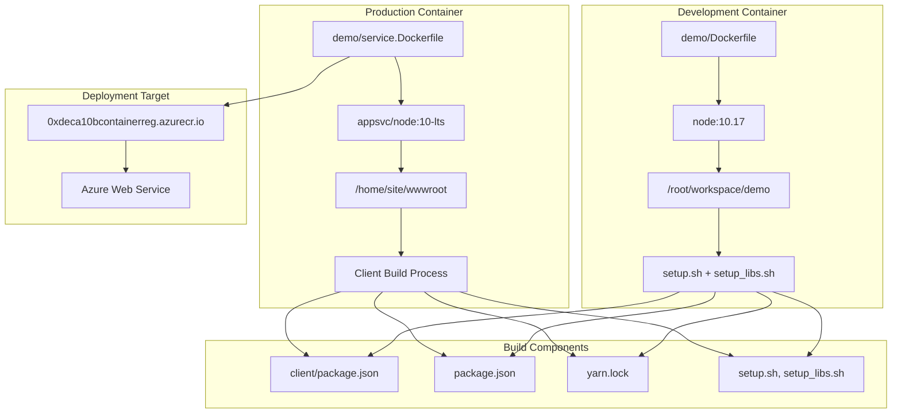
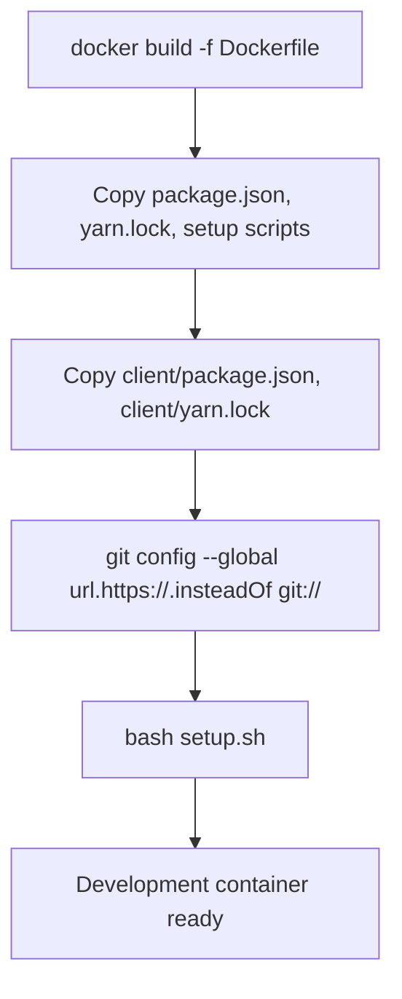
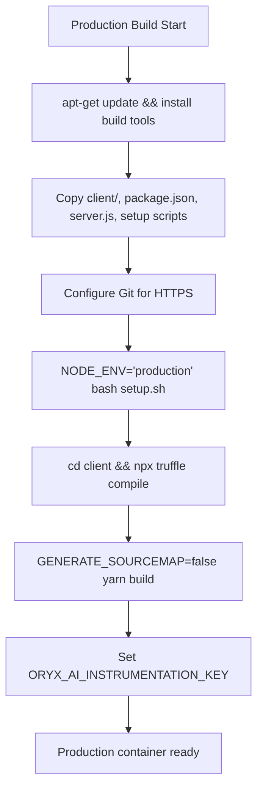
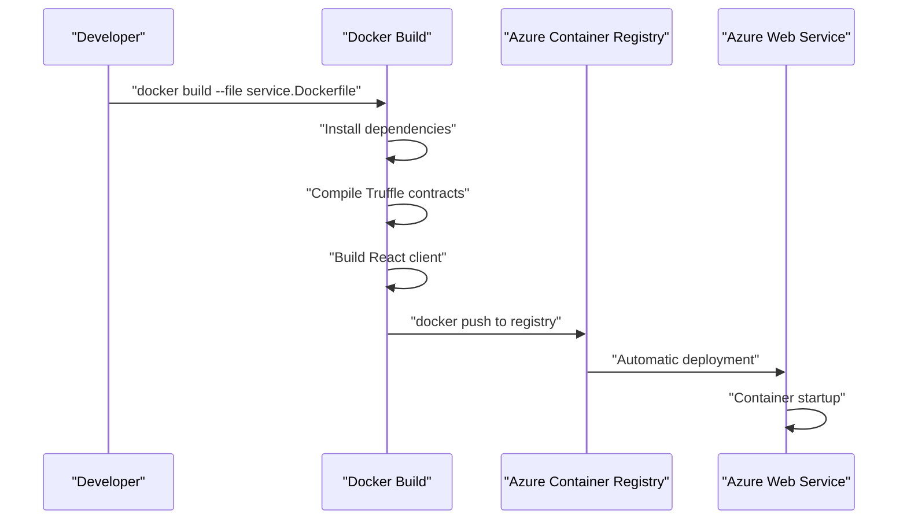

<!-- source: DeepWiki mcp.deepwiki.com · repo microsoft/0xDeCA10B · page 5.3 Containerization and Deployment · fetched 2026-10-26 -->

# Containerization and Deployment

<details>
<summary>Relevant source files</summary>

The following files were used as context for generating this wiki page:

- [demo/Dockerfile](demo/Dockerfile)
- [demo/service.Dockerfile](demo/service.Dockerfile)

</details>


This document covers the Docker containerization and deployment strategies for the 0xDeCA10B demo application. It explains how the system is packaged into containers for both development and production environments, with specific focus on Azure Container Registry deployment.

For information about local development setup without containers, see [Local Development Setup](#5.1). For testing infrastructure, see [Testing Framework](#5.2).

## Container Architecture Overview

The 0xDeCA10B demo application uses a multi-container approach with different configurations for development and production environments. The containerization strategy supports both local development workflows and cloud deployment to Azure Web Services.

### Container Architecture Diagram



Sources: [demo/Dockerfile:1-18](), [demo/service.Dockerfile:1-35]()

## Development Container Configuration

The development container uses a standard Node.js base image and sets up a complete development environment with debugging tools and localization support.

### Development Container Specifications

| Component | Configuration |
|-----------|---------------|
| Base Image | `node:10.17` |
| Working Directory | `/root/workspace/demo` |
| Package Manager | yarn |
| Additional Tools | byobu, locales |
| Setup Process | `setup.sh` script |

The development container includes several key setup steps:

1. **System Dependencies**: Installs `byobu` for terminal multiplexing and locale support
2. **Git Configuration**: Configures Git to use HTTPS instead of Git protocol to avoid build issues
3. **Package Installation**: Copies and installs both root and client dependencies
4. **Development Tools**: Sets up debugging and development utilities

### Development Build Process



Sources: [demo/Dockerfile:10-17]()

## Production Container Configuration

The production container is specifically designed for Azure Web Service deployment and includes optimized build processes for production environments.

### Production Container Specifications

| Component | Configuration |
|-----------|---------------|
| Base Image | `appsvc/node:10-lts` |
| Working Directory | `/home/site/wwwroot` (Azure default) |
| Build Environment | `NODE_ENV='production'` |
| Client Build | `GENERATE_SOURCEMAP=false` |
| Registry | `0xdeca10bcontainerreg.azurecr.io` |

### Production Build Process

The production container follows a comprehensive build pipeline:



Sources: [demo/service.Dockerfile:21-34]()

## Azure Container Registry Integration

The production deployment integrates with Azure Container Registry for automated deployment to Azure Web Services.

### Container Registry Workflow

The deployment process follows specific commands for Azure integration:

```bash
# Authentication
docker login 0xdeca10bcontainerreg.azurecr.io

# Build with specific tag
docker build --file service.Dockerfile -t 0xdeca10bcontainerreg.azurecr.io/public/samples/blockchain-ai/0xdeca10b-demo-prod .

# Push to registry
docker push 0xdeca10bcontainerreg.azurecr.io/public/samples/blockchain-ai/0xdeca10b-demo-prod:latest
```

### Deployment Pipeline



Sources: [demo/service.Dockerfile:2-6]()

## Container Build Dependencies

Both containers rely on several key files and scripts for proper setup:

### Core Dependencies

| File | Purpose | Container Usage |
|------|---------|------------------|
| `package.json` | Root dependencies | Both containers |
| `yarn.lock` | Dependency versions | Both containers |
| `setup.sh` | Main setup script | Both containers |
| `setup_libs.sh` | Library setup | Both containers |
| `client/package.json` | Frontend dependencies | Both containers |
| `server.js` | Express server | Production only |

### Setup Script Integration

The containers execute setup scripts with specific environment configurations:

- **Development**: Standard setup for development tools
- **Production**: `NODE_ENV='production'` for optimized builds

### Client Build Process

The production container includes a complete client build process:

1. **Truffle Compilation**: Compiles smart contracts using `npx --no-install truffle compile`
2. **React Build**: Builds the client with `GENERATE_SOURCEMAP=false yarn build`
3. **Asset Optimization**: Removes source maps for production deployment

Sources: [demo/service.Dockerfile:30-32]()

## Environment Configuration

### Production Environment Variables

The production container supports several environment variables for deployment configuration:

| Variable | Purpose | Default |
|----------|---------|---------|
| `NODE_ENV` | Runtime environment | `'production'` |
| `BACK_END_URL` | Backend service URL | User-defined |
| `ORYX_AI_INSTRUMENTATION_KEY` | Application insights | Empty |
| `GENERATE_SOURCEMAP` | Source map generation | `false` |

### Container Labels

Both containers include comprehensive labeling for maintainability:

- **Maintainer**: Justin D. Harris
- **Vendor**: Microsoft
- **Source URL**: GitHub repository links
- **VCS URL**: Version control system reference

Sources: [demo/service.Dockerfile:13-16](), [demo/Dockerfile:3-6]()

---

