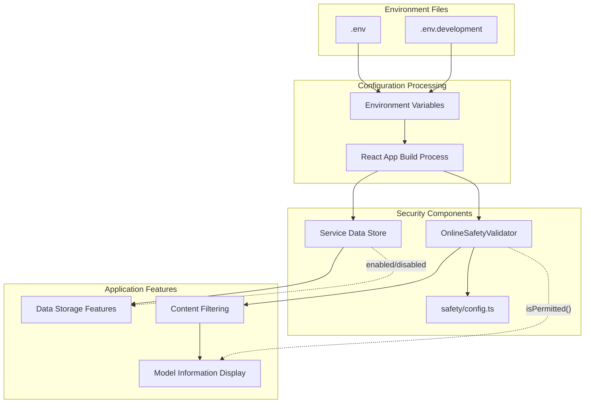
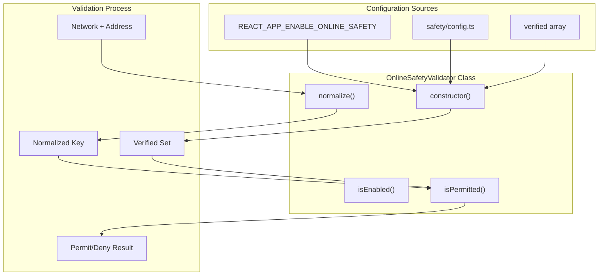
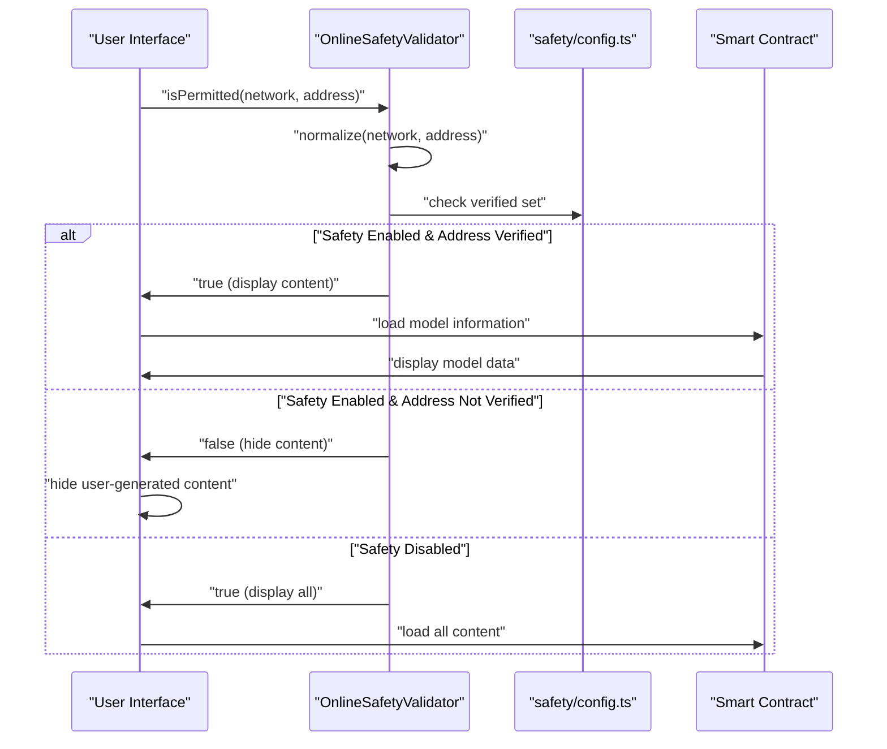

<!-- source: DeepWiki mcp.deepwiki.com · repo microsoft/0xDeCA10B · page 6 Configuration and Security · fetched 2026-10-26 -->

# Configuration and Security

<details>
<summary>Relevant source files</summary>

The following files were used as context for generating this wiki page:

- [demo/client/.env](demo/client/.env)
- [demo/client/.env.development](demo/client/.env.development)
- [demo/client/src/safety/__tests__/validator.test.ts](demo/client/src/safety/__tests__/validator.test.ts)
- [demo/client/src/safety/config.ts](demo/client/src/safety/config.ts)
- [demo/client/src/safety/validator.ts](demo/client/src/safety/validator.ts)

</details>


This document covers the configuration options and security features available in the 0xDeCA10B system. It focuses on environment variable configuration, online safety validation mechanisms, and security controls that can be applied to deployed instances of the demo application.

For general development setup information, see [Local Development Setup](#5.1). For deployment-specific configuration, see [Containerization and Deployment](#5.3).

## System Configuration Overview

The 0xDeCA10B system uses environment variables to control key features and security settings. The configuration system is designed to support different deployment environments with appropriate security controls for production use.

### Configuration Architecture



**Sources:** [demo/client/.env:1-16](), [demo/client/.env.development:1-7](), [demo/client/src/safety/validator.ts:1-37]()

## Environment Variable Configuration

The system uses React environment variables prefixed with `REACT_APP_` to control feature availability and security settings.

### Production Configuration

The default production configuration prioritizes security and compliance:

| Variable | Default Value | Purpose |
|----------|---------------|---------|
| `REACT_APP_ENABLE_SERVICE_DATA_STORE` | `false` | Disables external data storage service |
| `REACT_APP_ENABLE_ONLINE_SAFETY` | `true` | Enables content filtering and validation |

### Development Configuration

Development settings prioritize developer convenience:

| Variable | Development Value | Purpose |
|----------|-------------------|---------|
| `REACT_APP_ENABLE_SERVICE_DATA_STORE` | `true` | Enables data storage for testing |
| `REACT_APP_ENABLE_ONLINE_SAFETY` | `false` | Disables content filtering for easier development |

**Sources:** [demo/client/.env:3-16](), [demo/client/.env.development:3-7]()

## Online Safety Validation System

The `OnlineSafetyValidator` class provides content filtering capabilities to comply with regulations regarding user-generated content display.

### Safety Validator Implementation



**Sources:** [demo/client/src/safety/validator.ts:3-36](), [demo/client/src/safety/config.ts:1-10]()

### Safety Configuration Management

The safety system maintains a whitelist of verified contract addresses:

```typescript
// Configuration structure from safety/config.ts
{
  verified: [
    {
      network: 'private',
      address: '0x1b88938102bE9ED97a0e9b8Cb321dD89C60e86Ab'
    }
  ]
}
```

Key methods in `OnlineSafetyValidator`:

- `isEnabled()`: Checks if safety validation is active based on environment variable [demo/client/src/safety/validator.ts:20-22]()
- `isPermitted(networkType, address)`: Validates if contract information can be displayed [demo/client/src/safety/validator.ts:29-35]()
- `normalize(networkType, address)`: Creates consistent keys for verification lookup [demo/client/src/safety/validator.ts:12-15]()

**Sources:** [demo/client/src/safety/validator.ts:8-15](), [demo/client/src/safety/config.ts:2-9]()

## Security Feature Integration

### Content Filtering Flow



**Sources:** [demo/client/src/safety/validator.ts:29-35](), [demo/client/src/safety/__tests__/validator.test.ts:6-13]()

### Data Storage Control

The service data store can be enabled or disabled based on deployment requirements:

- **Enabled**: Allows external data persistence and retrieval
- **Disabled**: Restricts data storage to local/blockchain sources only

This setting affects the availability of centralized data storage features in the demo application.

**Sources:** [demo/client/.env:4-7]()

## Configuration Testing

The system includes unit tests to verify configuration behavior:

```typescript
// Test validates safety configuration
const validator = new OnlineSafetyValidator()
const network = "private"
const address = "0x1b88938102bE9ED97a0e9b8Cb321dD89C60e86Ab"
assert(validator.isPermitted(network, address) === true)
```

The test validates that verified addresses are properly recognized by the safety system, accounting for both configuration-based verification and environment variable states.

**Sources:** [demo/client/src/safety/__tests__/validator.test.ts:7-12]()

## Security Best Practices

### Production Deployment

1. **Enable Online Safety**: Set `REACT_APP_ENABLE_ONLINE_SAFETY=true` to filter user-generated content
2. **Disable Service Storage**: Set `REACT_APP_ENABLE_SERVICE_DATA_STORE=false` to reduce attack surface
3. **Verify Contract Addresses**: Maintain an up-to-date whitelist in `safety/config.ts`

### Development Environment

1. **Disable Safety Filtering**: Set `REACT_APP_ENABLE_ONLINE_SAFETY=false` for easier testing
2. **Enable Service Storage**: Set `REACT_APP_ENABLE_SERVICE_DATA_STORE=true` for full feature testing
3. **Test Safety Configurations**: Verify both enabled and disabled safety states

**Sources:** [demo/client/.env:9-16](), [demo/client/.env.development:6-7]()

---

