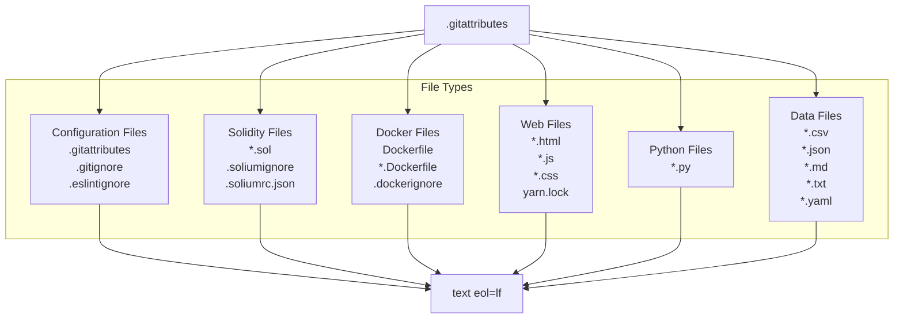
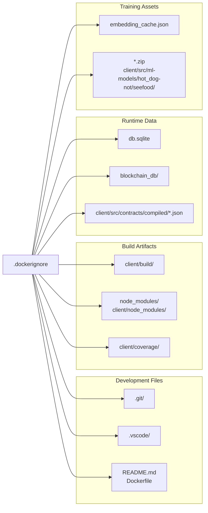
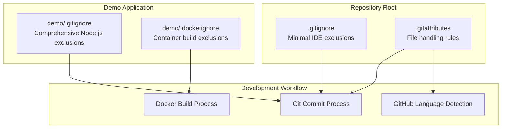

<!-- source: DeepWiki mcp.deepwiki.com · repo microsoft/0xDeCA10B · page 6.1 Repository Configuration · fetched 2026-10-26 -->

# Repository Configuration

<details>
<summary>Relevant source files</summary>

The following files were used as context for generating this wiki page:

- [.gitattributes](.gitattributes)
- [.gitignore](.gitignore)
- [demo/.dockerignore](demo/.dockerignore)
- [demo/.gitignore](demo/.gitignore)
- [demo/client/start_prod.sh](demo/client/start_prod.sh)
- [simulation/decai/simulation/data/tests/test_news_data_loader.py](simulation/decai/simulation/data/tests/test_news_data_loader.py)

</details>


This document covers the configuration files that control repository management, version control behavior, and containerization settings for the 0xDeCA10B project. These configuration files define which files are tracked by Git, how files are handled across different platforms, and what gets included in Docker containers.

For information about application-specific configuration and environment variables, see [Configuration and Security](#6). For deployment and containerization processes, see [Containerization and Deployment](#5.3).

## Overview

The repository uses several configuration files to manage different aspects of the development workflow:

| Configuration Type | File Location | Purpose |
|-------------------|---------------|---------|
| Git Ignore | [.gitignore:1-4]() | Root-level file exclusions |
| Git Ignore | [demo/.gitignore:1-81]() | Demo-specific exclusions |
| Git Attributes | [.gitattributes:1-37]() | File handling and language detection |
| Docker Ignore | [demo/.dockerignore:1-35]() | Container build exclusions |

## Git Configuration Management

### Root-Level Ignore Configuration

The main repository uses a minimal `.gitignore` configuration that focuses on development environment exclusions:

```
.idea/      # IntelliJ IDEA configuration
.vscode/    # Visual Studio Code configuration  
.venv/      # Python virtual environment
```

This lightweight approach allows subsystems like the demo application to define their own more specific ignore rules.

**Sources:** [.gitignore:1-4]()

### Demo Application Ignore Configuration

The demo application maintains a comprehensive `.gitignore` file that handles Node.js, blockchain, and machine learning artifacts:

#### Key Exclusion Categories

| Category | Examples | Purpose |
|----------|----------|---------|
| Build Artifacts | `build/`, `client/build/` | Compiled output |
| Dependencies | `node_modules/`, `jspm_packages/` | Package manager files |
| Blockchain Data | `blockchain_db`, `db.sqlite` | Local blockchain storage |
| Generated Contracts | `client/src/contracts/compiled/*.json` | Smart contract artifacts |
| Training Data | `embedding_cache.json`, `*.zip` | ML model caches |
| External Libraries | `SafeMath.sol`, `SignedSafeMath.sol` | OpenZeppelin imports |

**Sources:** [demo/.gitignore:1-81]()

## File Attribute Management

### Line Ending Standardization

The `.gitattributes` file enforces consistent line endings across platforms by setting `text eol=lf` for all text files:



**Sources:** [.gitattributes:1-37]()

### Language Detection Override

The configuration overrides GitHub's automatic language detection for documentation:

```
demo/* linguist-documentation=false
```

This ensures the demo application code is properly classified for repository statistics rather than being marked as documentation.

**Sources:** [.gitattributes:7]()

## Docker Configuration Management

### Container Build Exclusions

The demo application's `.dockerignore` file prevents unnecessary files from being included in Docker containers:



### Smart Contract Artifact Exclusion

Both `.gitignore` and `.dockerignore` exclude generated smart contract configurations, but maintain flexibility for different locations:

```
# Current location
client/src/contracts/compiled/*.json
# Previous location before refactor
client/src/contracts/*.json
```

This pattern allows for contract artifact location changes during development while maintaining clean builds.

**Sources:** [demo/.dockerignore:22-25](), [demo/.gitignore:13-16]()

## Configuration File Hierarchy

The repository uses a hierarchical approach to configuration management:



This structure allows the root repository to remain lightweight while enabling subsystems to define specific requirements for their development and deployment processes.

**Sources:** [.gitignore:1-4](), [.gitattributes:1-37](), [demo/.gitignore:1-81](), [demo/.dockerignore:1-35]()