# Page: Overview

# Overview

<details>
<summary>Relevant source files</summary>

The following files were used as context for generating this wiki page:

- [.github/workflows/demo-prod.yml](.github/workflows/demo-prod.yml)
- [README.md](README.md)

</details>


## Purpose and Scope

This document provides a high-level introduction to the 0xDeCA10B project and its core Sharing Updatable Models (SUM) framework. It covers the fundamental concepts, system architecture, and main components that enable blockchain-based collaborative machine learning.

For detailed information about specific system components, see the [Demo Application](#2), [Smart Contracts](#3), and [Simulation System](#4) sections. For development setup and deployment guidance, see [Development and Deployment](#5).

## What is 0xDeCA10B

**0xDeCA10B** implements the **Sharing Updatable Models (SUM)** framework, a blockchain-based system for hosting and training publicly available machine learning models. The framework enables decentralized collaborative training where multiple participants can contribute data to improve shared models while receiving incentives for quality contributions.

The system operates on three core principles:
- **Free predictions**: Anyone can query deployed models for predictions at no cost
- **Incentivized data contribution**: Contributors provide training data with validation and potential rewards
- **Transparent model evolution**: All training data and model updates are recorded on the blockchain

**Sources:** [README.md:1-24]()

## Core Framework Architecture

The SUM framework consists of three primary validation components that process every data contribution:

### SUM Framework Core Components

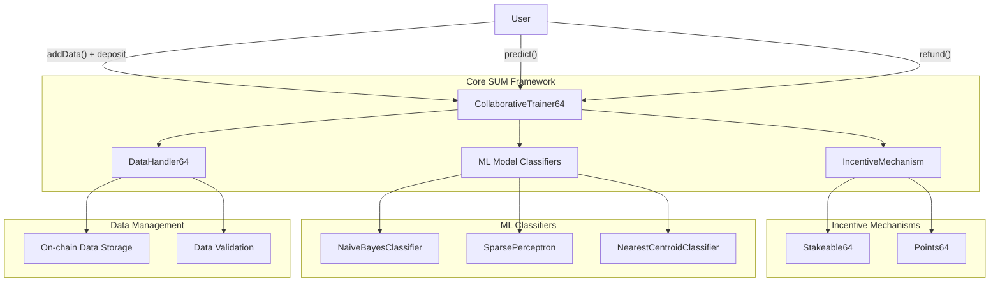

**Sources:** [README.md:15-20]()

### Three-Step Validation Process

1. **IncentiveMechanism**: Validates data contribution requests, manages stakes/deposits, and handles reward distribution
2. **DataHandler**: Stores training data and metadata on-chain for permanent accessibility
3. **ML Model**: Updates model parameters using predefined training algorithms based on the new data

**Sources:** [README.md:17-19]()

## System Components Overview

The 0xDeCA10B repository contains three major system components:

### Complete System Architecture

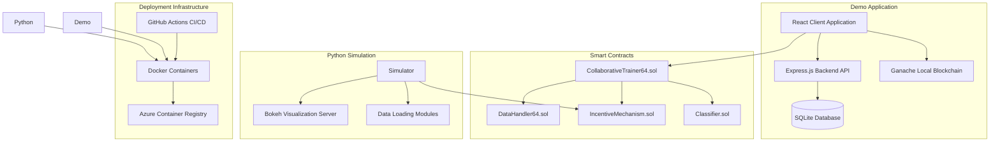

**Sources:** [README.md:25-27]()

### Component Descriptions

| Component | Purpose | Key Technologies |
|-----------|---------|------------------|
| **Demo Application** | Full-stack web application showcasing SUM framework capabilities | React.js, Express.js, Web3.js, Ganache |
| **Smart Contracts** | Blockchain implementation of collaborative training logic | Solidity, Ethereum, Truffle |
| **Simulation System** | Python-based testing environment for incentive mechanisms | Python, Bokeh, NumPy, scikit-learn |
| **Deployment Infrastructure** | Containerization and CI/CD for cloud deployment | Docker, Azure, GitHub Actions |

**Sources:** [README.md:25-27]()

## Data Flow and Training Process

The collaborative training process follows a structured workflow where users interact with smart contracts through the demo application:

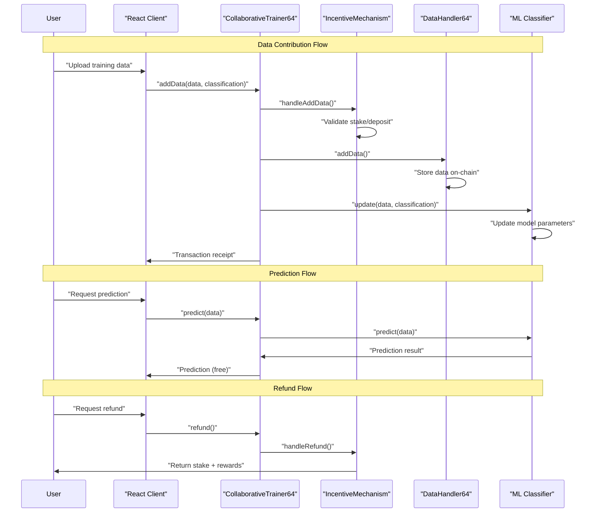

**Sources:** [README.md:15-20]()

## Machine Learning Models

The framework supports multiple on-chain machine learning algorithms optimized for blockchain execution:

- **NaiveBayesClassifier**: Probabilistic classifier using Bayes' theorem
- **SparsePerceptron**: Linear classifier with sparse weight updates
- **NearestCentroidClassifier**: Distance-based classification using class centroids

These models are designed to handle incremental updates efficiently, making them suitable for blockchain deployment where transaction costs are a consideration.

**Sources:** [README.md:35-42]()

## Incentive Mechanisms

The framework implements multiple incentive mechanisms to encourage quality data contributions:

- **Stakeable64**: Deposit-based mechanism where contributors stake tokens
- **Points64**: Reputation-based system using virtual karma points
- **Self-Assessment**: Contributors evaluate their own data quality
- **Prediction Market**: Market-based rewards for accurate contributions

**Sources:** [README.md:61-76]()

## Repository Structure

The codebase is organized into distinct modules:

- **`/demo`**: Full-stack web application with React frontend and Express backend
- **`/simulation`**: Python simulation environment with Bokeh visualization
- **`/contracts`**: Solidity smart contracts for blockchain deployment
- **`/.github`**: CI/CD workflows and automation scripts

**Sources:** [README.md:25-27]()

---

# Page: Demo Application

# Demo Application

<details>
<summary>Relevant source files</summary>

The following files were used as context for generating this wiki page:

- [demo/README.md](demo/README.md)
- [demo/client/src/float-utils.js](demo/client/src/float-utils.js)
- [demo/package.json](demo/package.json)
- [demo/yarn.lock](demo/yarn.lock)

</details>


## Purpose and Scope

The Demo Application is a full-stack web application that showcases the Sharing Updatable Models (SUM) framework through an interactive dashboard. It provides a complete example implementation of blockchain-based collaborative machine learning, allowing users to deploy, train, and interact with AI models on a local Ethereum blockchain.

This document covers the technical architecture, components, and implementation details of the demo application. For information about the core SUM framework contracts and smart contract architecture, see [Smart Contracts](#3). For details about the Python-based simulation environment, see [Simulation System](#4).

## System Architecture Overview

The demo application follows a three-tier architecture with a React frontend, Express.js backend, and Ganache blockchain layer. The system demonstrates end-to-end functionality including model deployment, collaborative training, prediction services, and incentive mechanisms.

### High-Level Component Architecture

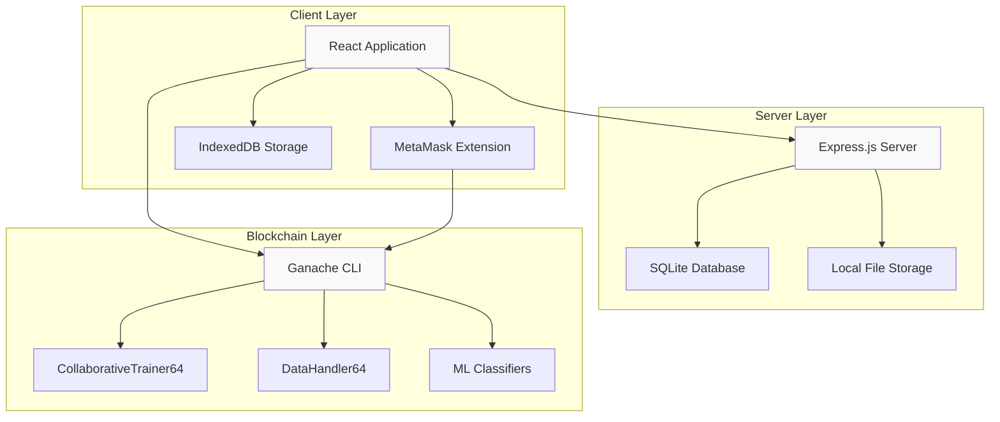

Sources: [demo/README.md:1-30](), [demo/package.json:1-35]()

### Data Flow and Interaction Patterns

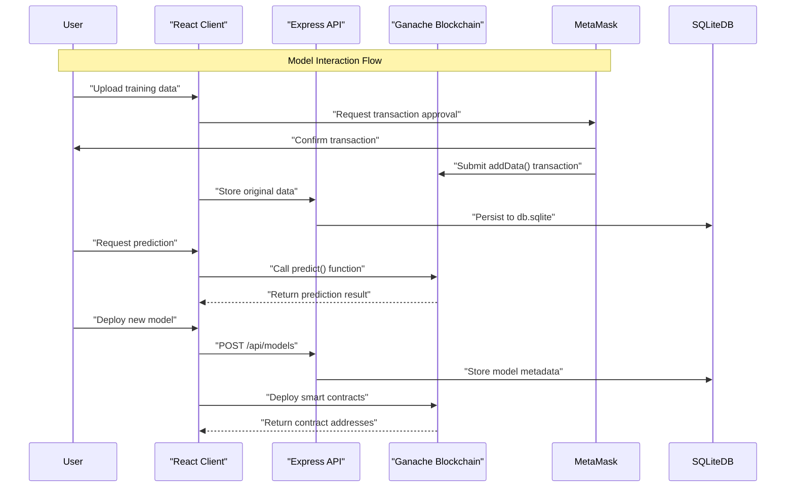

Sources: [demo/README.md:100-142](), [demo/package.json:6-15]()

## Frontend Implementation

The React frontend serves as the primary user interface for interacting with blockchain-based machine learning models. It handles Web3 integration, smart contract interactions, and provides components for model management and data visualization.

### Core React Application Structure

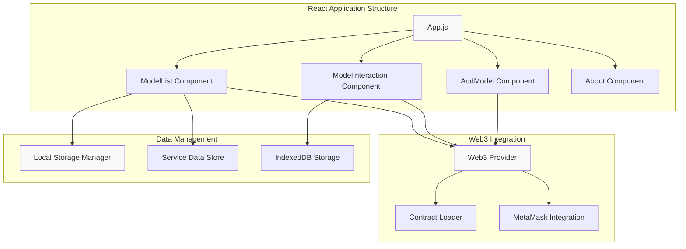

Sources: [demo/client/src/float-utils.js:1-20]()

### Development and Build Pipeline

The frontend uses Create React App with additional TypeScript and ESLint configuration for development workflows.

| Component | Technology | Purpose |
|-----------|------------|---------|
| Build System | Create React App | Development and production builds |
| Language | JavaScript/TypeScript | Type-safe frontend development |
| Linting | ESLint + TypeScript ESLint | Code quality enforcement |
| Package Manager | Yarn | Dependency management |
| Testing | Jest | Unit and integration testing |

Sources: [demo/package.json:24-34](), [demo/yarn.lock:90-157]()

## Backend Services

The Express.js backend provides API endpoints for model metadata management, data storage, and serves as an optional persistence layer for the demo application.

### API Server Architecture

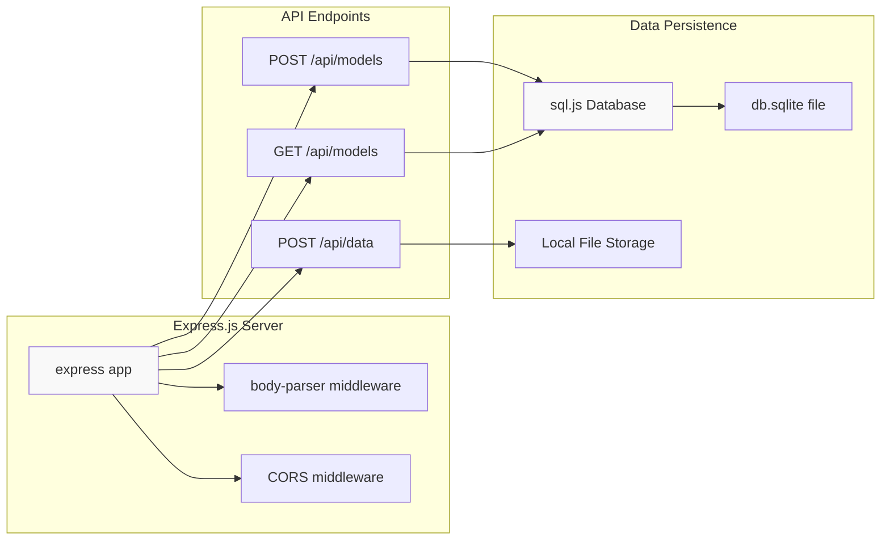

Sources: [demo/package.json:17-22]()

### Database Schema and Storage

The backend uses SQLite via `sql.js` for lightweight data persistence, storing model metadata and training data references.

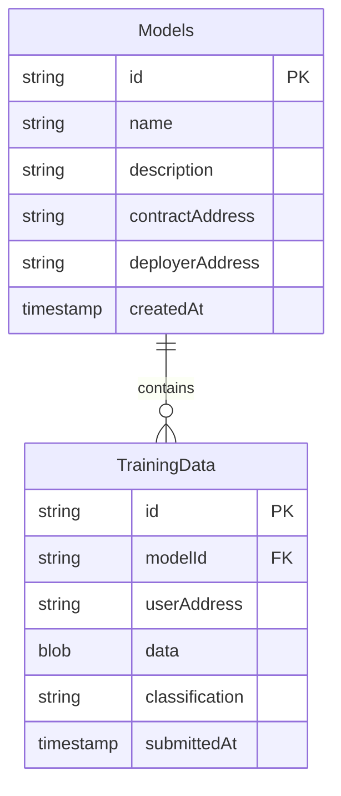

Sources: [demo/package.json:21]()

## Blockchain Integration

The demo application integrates with a local Ganache blockchain to demonstrate smart contract interactions for collaborative machine learning.

### Ganache Configuration and Network Setup

The blockchain component uses Ganache CLI with specific configuration for deterministic testing and development:

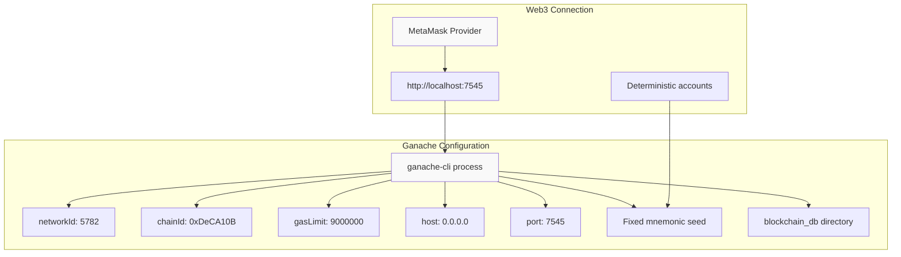

Sources: [demo/package.json:7]()

### Smart Contract Deployment Workflow

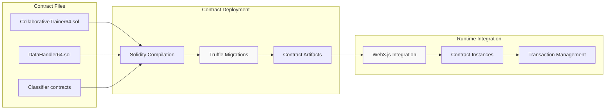

Sources: [demo/README.md:103-118]()

## Development Workflow

The demo application provides a comprehensive development environment with automated testing, linting, and deployment scripts.

### Build and Development Scripts

| Script | Command | Purpose |
|--------|---------|---------|
| `blockchain` | `yarn blockchain` | Start local Ganache blockchain |
| `server` | `yarn server` | Start Express.js API server |
| `client` | `yarn client` | Start React development server |
| `test` | `yarn test` | Run automated test suite |
| `lint` | `yarn lint` | Run code quality checks |
| `clean` | `yarn clean` | Clean blockchain and cache files |

Sources: [demo/package.json:6-15]()

### Testing Infrastructure

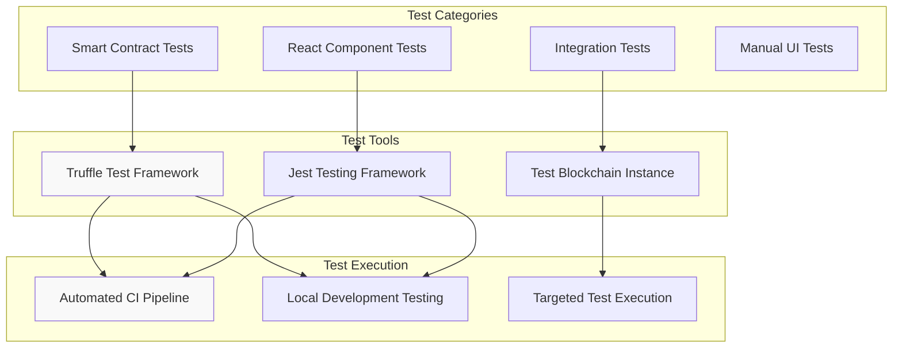

Sources: [demo/README.md:184-213]()

## Deployment and Production Configuration

The demo application supports both development and production deployment modes with Docker containerization and environment-specific configurations.

### Docker Deployment Strategy

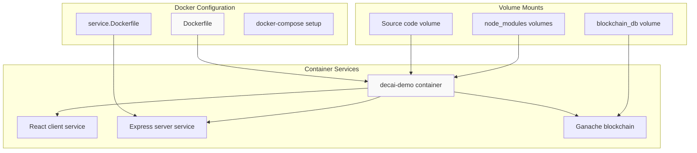

Sources: [demo/README.md:40-73]()

### Environment Configuration

The application uses environment-specific settings for development and production deployments:

| Environment Variable | Purpose | Default |
|---------------------|---------|---------|
| `PORT` | Blockchain port | 7545 |
| `REACT_APP_ENABLE_SERVICE_DATA_STORE` | Enable backend storage | true (dev) |
| `NODE_ENV` | Environment mode | development |

Sources: [demo/README.md:120-128]()

---

# Page: System Architecture

# System Architecture

<details>
<summary>Relevant source files</summary>

The following files were used as context for generating this wiki page:

- [demo/Dockerfile](demo/Dockerfile)
- [demo/client/src/float-utils.js](demo/client/src/float-utils.js)
- [demo/package.json](demo/package.json)
- [demo/service.Dockerfile](demo/service.Dockerfile)
- [demo/yarn.lock](demo/yarn.lock)

</details>


## Purpose and Scope

This document describes the technical architecture of the 0xDeCA10B demo application, a full-stack web application that showcases the Sharing Updatable Models (SUM) framework in action. The demo provides a complete implementation including React frontend, Express.js backend, local blockchain infrastructure, and database storage to demonstrate collaborative machine learning with blockchain-based incentive mechanisms.

For information about the smart contracts that power the collaborative training system, see [Contract Architecture](#3.1). For details about the React frontend components and user interface, see [React Frontend](#2.2).

## High-Level Architecture Overview

The demo application follows a multi-tier architecture pattern with clear separation between presentation, application logic, blockchain interaction, and data persistence layers.

### System Components Overview

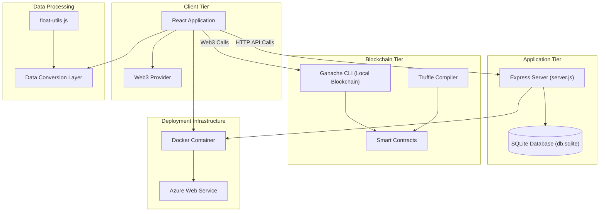

Sources: [demo/package.json:1-35](), [demo/Dockerfile:1-18](), [demo/service.Dockerfile:1-35]()

## Frontend Architecture

The React-based frontend serves as the primary user interface for interacting with the collaborative machine learning system.

### Frontend Component Structure

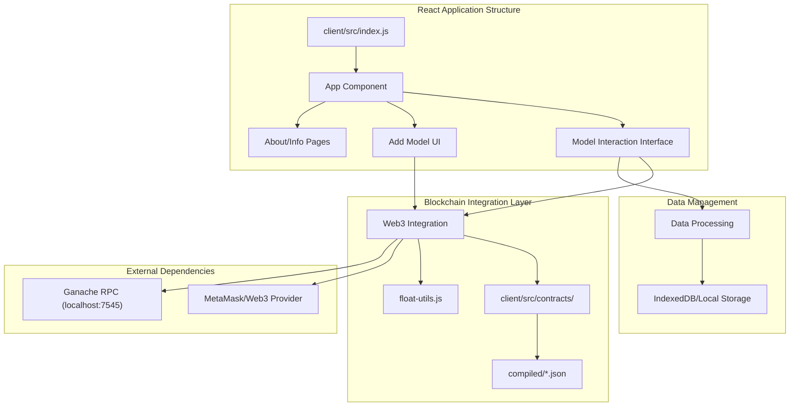

Sources: [demo/client/src/float-utils.js:1-20](), [demo/package.json:7-15]()

## Backend Services Architecture

The Express.js backend provides API endpoints and data persistence services for the demo application.

### Backend Service Components

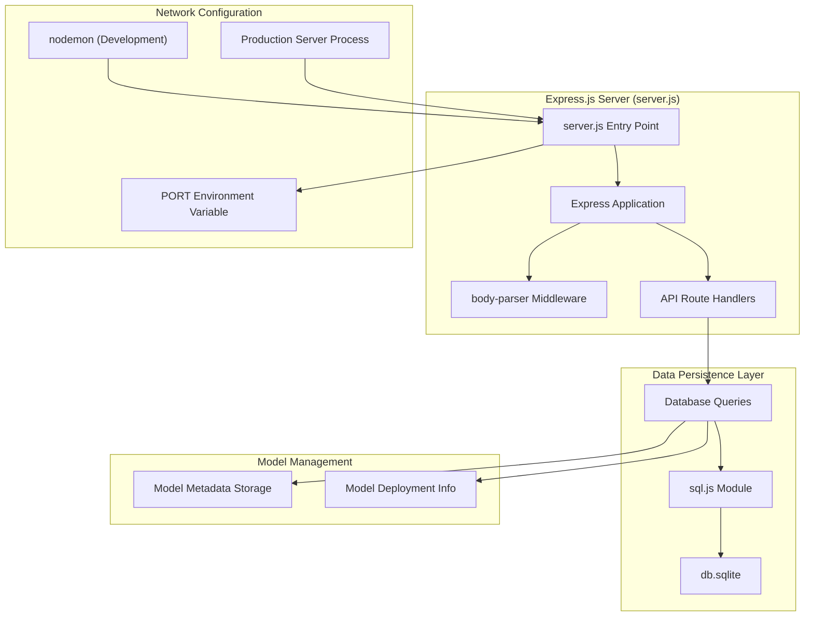

Sources: [demo/package.json:13-14](), [demo/package.json:21]()

## Blockchain Infrastructure

The demo uses Ganache CLI to provide a local Ethereum blockchain for development and testing.

### Blockchain Network Configuration

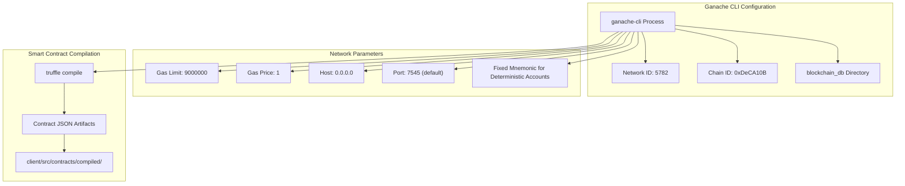

Sources: [demo/package.json:7]()

## Data Flow and Conversion Layer

The application includes specialized utilities for handling numeric data conversion between JavaScript and blockchain formats.

### Data Processing Pipeline

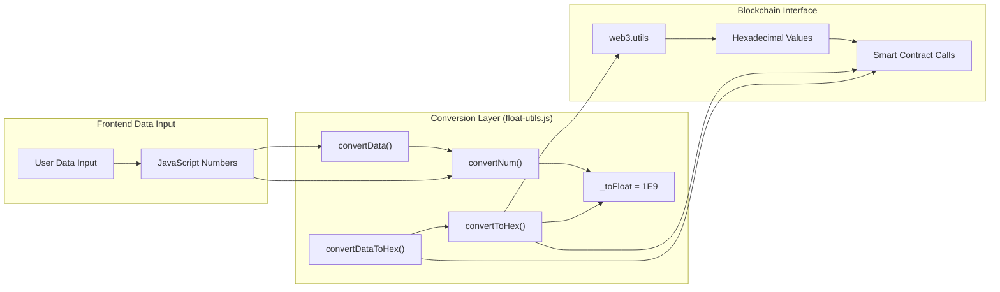

Sources: [demo/client/src/float-utils.js:1-20]()

## Deployment Architecture

The demo application supports multiple deployment scenarios including local development and cloud deployment.

### Deployment Configurations

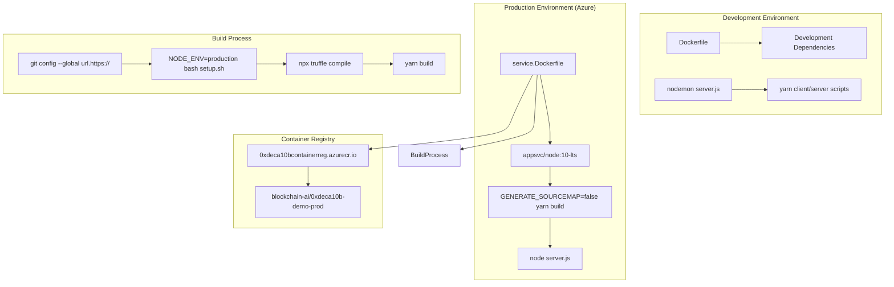

Sources: [demo/Dockerfile:1-18](), [demo/service.Dockerfile:1-35]()

## Integration Points

The demo application integrates with multiple external systems and frameworks.

### External System Dependencies

| Component | Purpose | Configuration |
|-----------|---------|---------------|
| `ganache-cli` | Local blockchain network | Network ID 5782, Chain ID 0xDeCA10B |
| `sql.js` | SQLite database engine | In-memory and file-based storage |
| `body-parser` | HTTP request parsing | JSON and URL-encoded data |
| `express` | Web server framework | API routes and static file serving |
| `typescript` | Type checking and compilation | ES6+ features for smart contracts |
| `truffle` | Smart contract compilation | Generates contract artifacts |

Sources: [demo/package.json:17-23]()

## Environment Configuration

The application uses environment variables and configuration files to manage different deployment scenarios.

### Configuration Management

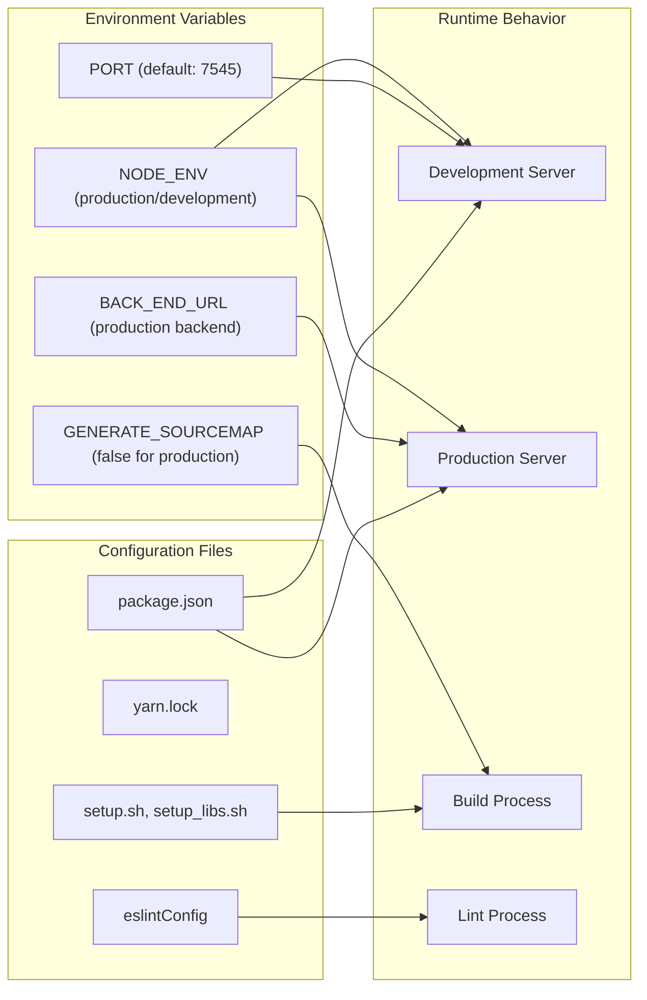

Sources: [demo/package.json:6-15](), [demo/service.Dockerfile:28-34]()

---

# Page: React Frontend

# React Frontend

<details>
<summary>Relevant source files</summary>

The following files were used as context for generating this wiki page:

- [demo/client/package.json](demo/client/package.json)
- [demo/client/src/App.js](demo/client/src/App.js)
- [demo/client/src/components/appBar.js](demo/client/src/components/appBar.js)
- [demo/client/src/components/storageSelector.js](demo/client/src/components/storageSelector.js)
- [demo/client/yarn.lock](demo/client/yarn.lock)

</details>


## Purpose and Scope

The React frontend serves as the primary user interface for the 0xDeCA10B demo application, providing a web-based client for interacting with blockchain-based collaborative machine learning models. This document covers the frontend application structure, dependencies, routing, and key components that enable users to view model lists, add new models, train existing models, and make predictions.

For backend API services, see [Backend Services](#2.5). For detailed component documentation, see [User Interface Components](#2.3). For model interaction workflows, see [Model Interaction Interface](#2.4).

## Technology Stack and Dependencies

The React frontend is built using modern web technologies with a focus on machine learning and blockchain integration.

### Core Framework Dependencies

| Package | Version | Purpose |
|---------|---------|---------|
| `react` | ^16.14.0 | Core React framework |
| `react-dom` | ^16.14.0 | React DOM rendering |
| `react-scripts` | ^3.4.4 | Create React App build tools |
| `typescript` | ^3.7.3 | TypeScript support |

### UI and Styling

| Package | Version | Purpose |
|---------|---------|---------|
| `@material-ui/core` | ^4.7.1 | Material Design components |
| `@material-ui/icons` | ^4.5.1 | Material Design icons |
| `notistack` | ^0.9.7 | Notification system |
| `react-spinners` | ^0.6.1 | Loading indicators |

### Blockchain Integration

| Package | Version | Purpose |
|---------|---------|---------|
| `web3` | ^1.3.0 | Ethereum blockchain interaction |
| `web3-eth-contract` | ^1.3.0 | Smart contract interface |
| `@drizzle-utils/get-web3` | ^0.2.2-alpha.0 | Web3 provider utilities |
| `truffle` | ^5.1.50 | Smart contract compilation |

### Machine Learning

| Package | Version | Purpose |
|---------|---------|---------|
| `@tensorflow/tfjs` | ^1.3.2 | TensorFlow.js ML framework |
| `@tensorflow-models/mobilenet` | ^2.0.4 | Pre-trained MobileNet model |
| `@tensorflow-models/universal-sentence-encoder` | ^1.2.0 | Text embedding model |

Sources: [demo/client/package.json:1-60]()

## Application Architecture

### Main Application Structure

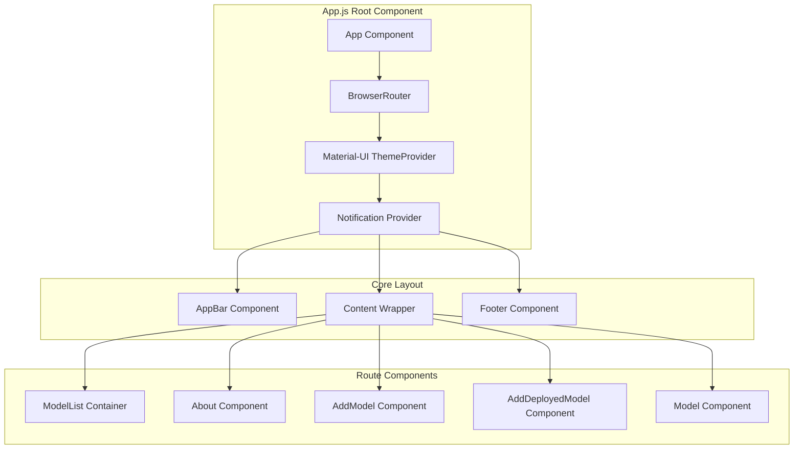

The application follows a hierarchical component structure with the main `App` component serving as the root. Material-UI provides theming with a dark color scheme using `blue[300]` as the primary color.

Sources: [demo/client/src/App.js:1-73]()

### Routing Configuration

```mermaid
graph LR
    subgraph "React Router Routes"
        Root["/"] --> ModelListRoute["ModelList Component"]
        About["/about"] --> AboutRoute["About Component"]
        Add["/add"] --> AddModelRoute["AddModel Component"]
        AddDeployed["/addDeployedModel"] --> AddDeployedRoute["AddDeployedModel Component"]
        ModelPath["/model"] --> ModelRoute["Model Component"]
    end
    
    subgraph "Navigation Components"
        AppBarNav["AppBar Navigation"]
        DrawerNav["Mobile Drawer"]
    end
    
    AppBarNav --> Root
    AppBarNav --> About
    AppBarNav --> Add
    DrawerNav --> Root
    DrawerNav --> About
    DrawerNav --> Add
```

The routing system uses `react-router-dom` with five main routes defined in the `App` component. Navigation is handled through the `AppBar` component with responsive design supporting both desktop buttons and mobile drawer navigation.

Sources: [demo/client/src/App.js:56-60](), [demo/client/src/components/appBar.js:1-168]()

## Component Architecture

### Navigation System

The `CustomAppBar` component provides the primary navigation interface with responsive design patterns:

```mermaid
graph TB
    subgraph "AppBar Component Structure"
        AppBarRoot["CustomAppBar Component"]
        Toolbar["Material-UI Toolbar"]
        Logo["Logo Container"]
        NavButtons["Navigation Buttons"]
        MobileDrawer["Mobile Drawer"]
    end
    
    subgraph "Navigation Actions"
        HomeAction["Home Navigation"]
        AboutAction["About Navigation"] 
        AddModelAction["Add Model Navigation"]
        DrawerToggle["Drawer Toggle"]
    end
    
    subgraph "Responsive Behavior"
        DesktopView["Desktop: Button Bar"]
        MobileView["Mobile: Hamburger Menu"]
    end
    
    AppBarRoot --> Toolbar
    Toolbar --> Logo
    Toolbar --> NavButtons
    Toolbar --> MobileDrawer
    
    NavButtons --> HomeAction
    NavButtons --> AboutAction
    NavButtons --> AddModelAction
    
    MobileDrawer --> DrawerToggle
    
    DesktopView --> NavButtons
    MobileView --> MobileDrawer
```

The component uses Material-UI's `Hidden` components to provide responsive behavior, showing navigation buttons on larger screens and a drawer menu on mobile devices.

Sources: [demo/client/src/components/appBar.js:65-162]()

### Storage Management System

The `storageSelector.js` module provides utilities for managing different data storage options:

```mermaid
graph TB
    subgraph "Storage Types"
        LocalStorage["local: IndexedDB"]
        ServiceStorage["service: External API"]
        NoStorage["none: No Persistence"]
    end
    
    subgraph "Storage Functions"
        CheckStorages["checkStorages()"]
        RenderSelector["renderStorageSelector()"]
        HealthCheck["storage.health()"]
    end
    
    subgraph "Storage Selection UI"
        InputLabel["Storage Label"]
        SelectDropdown["Material-UI Select"]
        TooltipHelp["Tooltip Description"]
    end
    
    CheckStorages --> HealthCheck
    HealthCheck --> LocalStorage
    HealthCheck --> ServiceStorage
    HealthCheck --> NoStorage
    
    RenderSelector --> InputLabel
    RenderSelector --> SelectDropdown
    RenderSelector --> TooltipHelp
    
    SelectDropdown --> LocalStorage
    SelectDropdown --> ServiceStorage
    SelectDropdown --> NoStorage
```

The storage system supports three modes: local browser storage using IndexedDB, external service storage via API calls, and no storage for temporary usage. Health checking ensures storage availability before presenting options to users.

Sources: [demo/client/src/components/storageSelector.js:7-50]()

## Build and Development Configuration

### Build Scripts and Environment

| Script | Command | Purpose |
|---------|---------|---------|
| `start` | `bash deploy_client.sh` | Local development server |
| `start-prod` | `bash start_prod.sh` | Production server |
| `build` | `react-scripts build --expose-gc --max_old_space_size=8192` | Production build with memory optimization |
| `test` | `bash test.sh` | Test execution |

The build configuration includes memory optimization flags (`--expose-gc --max_old_space_size=8192`) to handle the large TensorFlow.js dependencies during compilation.

### Development Environment

The application uses a proxy configuration pointing to `http://localhost:5387/` for backend API communication during development. TypeScript support is provided through `@types` packages for React, Node.js, and custom dependencies.

### Browser Compatibility

```json
"browserslist": [
  ">0.2%",
  "not dead", 
  "not ie <= 11",
  "not op_mini all"
]
```

The application targets modern browsers with >0.2% market share, excluding Internet Explorer 11 and Opera Mini for optimal performance with ML and blockchain features.

Sources: [demo/client/package.json:6](), [demo/client/package.json:39-53]()

## Integration Points

### Blockchain Integration Dependencies

The frontend integrates with Ethereum blockchain through several key packages:
- `web3` for blockchain communication
- `@drizzle-utils/get-web3` for Web3 provider management
- `truffle` for smart contract artifacts and compilation

### Machine Learning Dependencies

TensorFlow.js integration enables client-side ML operations:
- `@tensorflow/tfjs` for core ML functionality
- Pre-trained models for image classification and text processing
- Canvas support for image manipulation through the `canvas` package

### Backend Communication

The application communicates with the Express.js backend through:
- `axios` for HTTP requests
- Proxy configuration for development API routing
- Support for both local and external storage backends

Sources: [demo/client/package.json:8-37]()

---

# Page: User Interface Components

# User Interface Components

<details>
<summary>Relevant source files</summary>

The following files were used as context for generating this wiki page:

- [demo/client/src/Footer.js](demo/client/src/Footer.js)
- [demo/client/src/components/About.js](demo/client/src/components/About.js)
- [demo/client/src/components/addDeployedModel.js](demo/client/src/components/addDeployedModel.js)
- [demo/client/src/components/addModel.js](demo/client/src/components/addModel.js)
- [demo/client/src/containers/modelList.js](demo/client/src/containers/modelList.js)

</details>


This document covers the React frontend components that form the user interface of the 0xDeCA10B demo application. These components handle model discovery, deployment, and metadata management through integration with blockchain contracts and storage systems.

For details about the model interaction interface specifically, see [Model Interaction Interface](#2.4). For backend API integration, see [Backend Services](#2.5).

## Component Architecture

The demo application uses a component-based architecture built with React and Material-UI. The main UI components handle different aspects of the collaborative machine learning workflow:

```mermaid
graph TB
    subgraph "Main Components"
        ModelList["ModelList"]
        AddModel["AddModel"] 
        AddDeployedModel["AddDeployedModel"]
        About["About"]
        Footer["Footer"]
    end
    
    subgraph "Shared Services"
        DataStoreFactory["DataStoreFactory"]
        OnlineSafetyValidator["OnlineSafetyValidator"]
        ContractLoader["ContractLoader"]
        ModelDeployer["ModelDeployer"]
        StorageSelector["storageSelector"]
    end
    
    subgraph "External Systems"
        Web3["getWeb3()"]
        Blockchain["Ganache Blockchain"]
        Storage["Storage Systems"]
    end
    
    ModelList --> DataStoreFactory
    ModelList --> OnlineSafetyValidator
    ModelList --> StorageSelector
    ModelList --> Web3
    
    AddModel --> ModelDeployer
    AddModel --> DataStoreFactory
    AddModel --> StorageSelector
    AddModel --> Web3
    
    AddDeployedModel --> ContractLoader
    AddDeployedModel --> DataStoreFactory
    AddDeployedModel --> StorageSelector
    AddDeployedModel --> Web3
    
    About --> OnlineSafetyValidator
    
    DataStoreFactory --> Storage
    ContractLoader --> Blockchain
    ModelDeployer --> Blockchain
    Web3 --> Blockchain
```

**Sources:** [demo/client/src/containers/modelList.js:1-25](), [demo/client/src/components/addModel.js:1-33](), [demo/client/src/components/addDeployedModel.js:1-25]()

## ModelList Component

The `ModelList` class serves as the main landing page component, displaying available models from multiple storage sources and providing navigation to model interaction interfaces.

### Core State and Data Management

```mermaid
graph TB
    subgraph "ModelList State"
        LoadingState["loadingModels: boolean"]
        ModelsArray["models: Array"]
        StorageTypes["permittedStorageTypes: Array"]
        RemainingCount["numModelsRemaining: number"]
    end
    
    subgraph "Data Sources"
        LocalStorage["storages.local"]
        ServiceStorage["storages.service"] 
        StorageAfter["storageAfterAddress: Object"]
    end
    
    subgraph "Model Validation"
        SafetyValidator["OnlineSafetyValidator"]
        NetworkCheck["getNetworkType()"]
        RestrictInfo["model.restrictInfo"]
    end
    
    ModelsArray --> LocalStorage
    ModelsArray --> ServiceStorage
    StorageAfter --> LocalStorage
    StorageAfter --> ServiceStorage
    
    SafetyValidator --> RestrictInfo
    NetworkCheck --> RestrictInfo
    
    LoadingState --> ModelsArray
    StorageTypes --> ModelsArray
```

The component maintains state for model loading status [demo/client/src/containers/modelList.js:67-72]() and fetches models from multiple storage sources using `DataStoreFactory.getAll()` [demo/client/src/containers/modelList.js:64]().

### Model Retrieval and Filtering

The `updateModels()` method implements pagination and safety filtering:

| Method | Purpose | Key Logic |
|--------|---------|-----------|
| `updateModels()` | Fetch models from all permitted storage types | Calls `storages[storageType].getModels(afterId, limit)` [demo/client/src/containers/modelList.js:116-141]() |
| Safety validation | Filter restricted content | Sets `model.restrictInfo` based on `validator.isPermitted(networkType, model.address)` [demo/client/src/containers/modelList.js:122]() |
| Pagination | Load additional models | Uses `storageAfterAddress` to track pagination state [demo/client/src/containers/modelList.js:126]() |

### Model Removal Interface

The component includes a modal-based removal system for locally stored model metadata:

```mermaid
graph LR
    DeleteButton["DeleteIcon onClick"] --> StartRemove["handleStartRemove()"]
    StartRemove --> Modal["RemoveItemModal"]
    Modal --> ConfirmRemove["handleRemove()"]
    Modal --> CancelRemove["handleCancelRemove()"]
    ConfirmRemove --> LocalStorage["storages.local.removeModel()"]
    LocalStorage --> StateUpdate["Update models array"]
```

**Sources:** [demo/client/src/containers/modelList.js:143-201]()

## AddModel Component

The `AddModel` class implements a comprehensive form for deploying new machine learning models to the blockchain. It handles the entire deployment pipeline from model file upload to contract deployment.

### Deployment State Management

The component tracks deployment progress through a structured state object:

```javascript
deploymentInfo: {
  dataHandler: { transactionHash, address },
  incentiveMechanism: { transactionHash, address }, 
  model: { transactionHash, address },
  main: { transactionHash, address }
}
```

### Model Deployment Pipeline

```mermaid
sequenceDiagram
    participant User
    participant AddModel as "AddModel Component"
    participant ModelDeployer as "ModelDeployer"
    participant Blockchain as "Blockchain Network"
    participant Storage as "DataStore"
    
    User->>AddModel: "Upload model file"
    AddModel->>AddModel: "processUploadedModel()"
    AddModel->>AddModel: "Validate model.type"
    
    User->>AddModel: "Click Save"
    AddModel->>ModelDeployer: "deployModel()"
    ModelDeployer->>Blockchain: "Deploy ML contract"
    Blockchain-->>AddModel: "Model address"
    
    AddModel->>AddModel: "deployDataHandler()"
    AddModel->>Blockchain: "Deploy DataHandler64"
    Blockchain-->>AddModel: "DataHandler address"
    
    AddModel->>AddModel: "deployIncentiveMechanism()"
    AddModel->>Blockchain: "Deploy Points64/Stakeable64"
    Blockchain-->>AddModel: "IM address"
    
    AddModel->>AddModel: "deployMainEntryPoint()"
    AddModel->>Blockchain: "Deploy CollaborativeTrainer64"
    Blockchain-->>AddModel: "Main contract address"
    
    AddModel->>Blockchain: "transferOwnership() x3"
    AddModel->>Storage: "saveModelInformation()"
    AddModel->>AddModel: "Redirect to model page"
```

**Sources:** [demo/client/src/components/addModel.js:527-585](), [demo/client/src/components/addModel.js:636-702]()

### Form Configuration and Validation

The component supports configurable encoders and incentive mechanisms:

| Configuration | Options | Validation |
|---------------|---------|------------|
| `encoder` | None, Mult1E9Round, MurmurHash3, ImdbVocab, USE, MobileNetV2 | Set from uploaded model or user selection [demo/client/src/components/addModel.js:294-325]() |
| `incentiveMechanism` | Points64, Stakeable64 | Determines contract type and parameters [demo/client/src/components/addModel.js:365-386]() |
| Time parameters | `refundTimeWaitTimeS`, `ownerClaimWaitTimeS`, `anyAddressClaimWaitTimeS` | Must satisfy: refund ≤ owner ≤ anyAddress [demo/client/src/components/addModel.js:235-240]() |

**Sources:** [demo/client/src/components/addModel.js:228-245](), [demo/client/src/components/addModel.js:587-634]()

## AddDeployedModel Component

The `AddDeployedModel` class provides an interface for adding metadata about already deployed models. It validates contract addresses and extracts model information from existing blockchain deployments.

### Contract Validation Flow

```mermaid
graph TB
    AddressInput["Address Input"] --> ValidateContract["validateContract()"]
    ValidateContract --> CheckStorage["Check if already stored"]
    CheckStorage --> LoadContract["ContractLoader.load()"]
    LoadContract --> ExtractInfo["Extract name, description, encoder"]
    ExtractInfo --> SafetyCheck["OnlineSafetyValidator.isPermitted()"]
    SafetyCheck --> UpdateState["Set isValid, restrictModelInfo"]
    
    CheckStorage -->|"Already exists"| SetInvalid["Set isValid=false"]
    LoadContract -->|"Load fails"| SetInvalid
```

The validation process checks both contract validity and content safety:

```javascript
// Contract loading and validation
this.contractLoader.load(address).then(async collabTrainer => {
  const restrictModelInfo = !this.validator.isPermitted(await getNetworkType(), address)
  // Extract model information only if content is permitted
  if (!restrictModelInfo) {
    [name, description] = await Promise.all([
      collabTrainer.name(),
      collabTrainer.description()
    ])
  }
})
```

**Sources:** [demo/client/src/components/addDeployedModel.js:139-201]()

## About Component

The `About` class renders informational content about the project, including disclaimers, project description, and safety information. It integrates with `OnlineSafetyValidator` to conditionally display safety-related content.

### Content Structure

| Section | Purpose | Dynamic Content |
|---------|---------|-----------------|
| Disclaimers | Blockchain interaction warnings | Static warnings about data privacy |
| Project Description | SUM framework explanation | Links to external documentation |
| Online Safety | Content filtering explanation | Conditional rendering based on `validator.isEnabled()` [demo/client/src/components/About.js:58-66]() |
| Version Information | Build version display | Dynamic version from `package.json` [demo/client/src/components/About.js:89-90]() |

**Sources:** [demo/client/src/components/About.js:20-94]()

## Footer Component

The `Footer` class provides a persistent warning banner and legal links. It uses Material-UI theming for consistent styling and positioning.

```mermaid
graph LR
    WarningText["⚠ WARNING about blockchain data"]
    LegalLinks["Contact | Privacy | Terms | Code of Conduct"]
    Copyright["© Microsoft"]
    
    WarningText --> LegalLinks
    LegalLinks --> Copyright
```

**Sources:** [demo/client/src/Footer.js:21-48]()

## Common Patterns and Utilities

### Storage Integration

All components that persist data use the `DataStoreFactory` pattern for storage abstraction:

```javascript
this.storages = DataStoreFactory.getAll()
// Components check permitted storage types
checkStorages(this.storages).then(permittedStorageTypes => {
  this.setState({ permittedStorageTypes })
})
```

### Notification System

Components use the `withSnackbar` HOC for user notifications:

```javascript
notify(...args) {
  return this.props.enqueueSnackbar(...args)
}
dismissNotification(...args) {
  return this.props.closeSnackbar(...args)  
}
```

### Web3 Integration

Blockchain-connected components follow a common pattern for Web3 setup:

```javascript
async setupWeb3() {
  this.web3 = await getWeb3()
  this.setState({ networkType: await getNetworkType() })
}
```

**Sources:** [demo/client/src/containers/modelList.js:63-97](), [demo/client/src/components/addModel.js:142-151](), [demo/client/src/components/addDeployedModel.js:94-113]()

---

# Page: Model Interaction Interface

# Model Interaction Interface

<details>
<summary>Relevant source files</summary>

The following files were used as context for generating this wiki page:

- [demo/client/src/components/model.js](demo/client/src/components/model.js)

</details>


## Purpose and Scope

The Model Interaction Interface is the primary React component that enables users to interact with deployed machine learning models on the blockchain. This interface provides a comprehensive set of tools for model prediction, training data submission, refund requests, and reward claiming through a tabbed user interface.

This document covers the core `Model` component implementation, its integration with smart contracts, data transformation pipelines, and storage systems. For information about the broader React frontend architecture, see [React Frontend](#2.2). For details about smart contract deployment and management, see [Smart Contracts](#3).

## Component Architecture Overview

The `Model` component serves as the central hub for all blockchain-based model interactions, managing complex state relationships between user inputs, smart contract calls, and data storage systems.

```mermaid
graph TB
    subgraph "Model Component Architecture"
        MC["Model Component"]
        TS["Tab System"]
        DT["Data Transformation"]
        SCI["Smart Contract Interface"]
        SS["Storage System"]
        WEB3["Web3 Integration"]
        
        MC --> TS
        MC --> DT
        MC --> SCI
        MC --> SS
        MC --> WEB3
        
        subgraph "Tab Controllers"
            PT["PREDICT_TAB"]
            TT["TRAIN_TAB"] 
            RT["REFUND_TAB"]
            RWT["REWARD_TAB"]
        end
        
        TS --> PT
        TS --> TT
        TS --> RT
        TS --> RWT
        
        subgraph "Core Methods"
            PI["predictInput()"]
            TR["train()"]
            RF["refund()"]
            TD["takeDeposit()"]
        end
        
        PT --> PI
        TT --> TR
        RT --> RF
        RWT --> TD
    end
```

The component manages four distinct interaction modes through tab constants defined at [demo/client/src/components/model.js:124-134](), with each tab providing specialized functionality for different types of model interactions.

**Sources:** [demo/client/src/components/model.js:123-135]()

## Tab-Based Interaction Modes

The interface provides four primary interaction modes, each serving distinct purposes in the collaborative training ecosystem:

| Tab | Purpose | Primary Actions | State Dependencies |
|-----|---------|----------------|-------------------|
| **Predict** | Model inference testing | `predictInput()` | `input`, `inputType`, `predicting` |
| **Train** | Submit training data | `train()` | `trainClassIndex`, `depositCost` |
| **Refund** | Claim deposit refunds | `refund()` | `addedData`, `refundWaitTimeS` |
| **Reward** | Report incorrect data | `takeDeposit()` | `rewardData`, `numGood` |

### Tab Navigation and State Management

```mermaid
graph LR
    subgraph "Tab State Flow"
        HTC["handleTabChange()"]
        URL["URL Parameters"]
        TS["Tab State"]
        
        URL -->|"?tab=predict"| HTC
        HTC --> TS
        TS --> UC["UI Components"]
        
        subgraph "Tab Constants"
            PT0["PREDICT_TAB = 0"]
            TT1["TRAIN_TAB = 1"] 
            RT2["REFUND_TAB = 2"]
            RWT3["REWARD_TAB = 3"]
        end
        
        TS --> PT0
        TS --> TT1
        TS --> RT2
        TS --> RWT3
    end
```

Tab navigation synchronizes with URL parameters and triggers data loading for specific tabs through the `handleTabChange` method at [demo/client/src/components/model.js:689-712]().

**Sources:** [demo/client/src/components/model.js:124-134](), [demo/client/src/components/model.js:689-712]()

## Data Transformation Pipeline

The component implements a sophisticated data transformation system that converts various input types into blockchain-compatible formats based on the model's encoder configuration.

```mermaid
graph TB
    subgraph "Data Transformation Flow"
        UI["User Input"]
        TI["transformInput()"]
        EN["Encoder Detection"]
        
        UI --> TI
        TI --> EN
        
        subgraph "Input Types"
            IT_IMG["INPUT_TYPE_IMAGE"]
            IT_TEXT["INPUT_TYPE_TEXT"]
            IT_RAW["INPUT_TYPE_RAW"]
        end
        
        EN --> IT_IMG
        EN --> IT_TEXT
        EN --> IT_RAW
        
        subgraph "Encoders"
            NONE["Encoder.None"]
            MULT["Encoder.Mult1E9Round"]
            USE["Universal Sentence Encoder"]
            MOB["MobileNetV2"]
            IMDB["IMDB Vocab"]
            MUR["MurmurHash3"]
        end
        
        IT_RAW --> NONE
        IT_RAW --> MULT
        IT_TEXT --> USE
        IT_IMG --> MOB
        IT_TEXT --> IMDB
        IT_TEXT --> MUR
        
        NONE --> HEX["convertDataToHex()"]
        MULT --> HEX
        USE --> NORM["normalize()"]
        MOB --> NORM
        NORM --> HEX
    end
```

The `setTransformInputMethod` function at [demo/client/src/components/model.js:358-457]() configures the appropriate transformation based on the contract's encoder setting, with each encoder type requiring specific processing logic.

**Sources:** [demo/client/src/components/model.js:47-49](), [demo/client/src/components/model.js:358-457]()

## Smart Contract Integration

The component establishes connections with multiple smart contract interfaces through the `ContractLoader` system, managing collaborative training, data handling, and incentive mechanisms.

```mermaid
graph TB
    subgraph "Smart Contract Integration"
        CL["ContractLoader"]
        SCI["setContractInstance()"]
        
        CL --> SCI
        
        subgraph "Contract Instances"
            CI["contractInstance"]
            CT["collabTrainer"] 
            CLS["classifier"]
            DH["dataHandler"]
            IM["incentiveMechanism"]
        end
        
        SCI --> CI
        SCI --> CT
        SCI --> CLS
        SCI --> DH
        SCI --> IM
        
        subgraph "Core Operations"
            PRED["predict()"]
            ADD["addData()"]
            REF["refund()"]
            REP["report()"]
        end
        
        CT --> PRED
        CI --> ADD
        CI --> REF
        CI --> REP
        
        subgraph "Contract Methods"
            PC["predictInput()"]
            TC["train()"]
            RC["refund()"]
            TDC["takeDeposit()"]
        end
        
        PRED --> PC
        ADD --> TC
        REF --> RC
        REP --> TDC
    end
```

Contract initialization occurs in `setContractInstance` at [demo/client/src/components/model.js:277-341](), which loads contract interfaces and establishes Web3 connections for blockchain interactions.

**Sources:** [demo/client/src/components/model.js:277-341](), [demo/client/src/components/model.js:306-340]()

## State Management and Data Flow

The component maintains extensive state for managing user interactions, blockchain data, and UI responsiveness across different interaction modes.

### Core State Categories

| State Category | Key Variables | Purpose |
|---------------|---------------|---------|
| **Contract State** | `contractInstance`, `contractInfo`, `classifications` | Smart contract connectivity and metadata |
| **User Interaction** | `input`, `prediction`, `trainClassIndex` | Input handling and results |
| **Data Management** | `addedData`, `rewardData`, `storageType` | Historical data and storage configuration |
| **UI Control** | `tab`, `readyForInput`, `predicting` | Interface state and loading indicators |

### Data Retrieval and Processing

```mermaid
graph TB
    subgraph "Data Retrieval Flow"
        HAD["handleAddedData()"]
        GPE["getPastEvents()"]
        
        HAD --> GPE
        
        subgraph "Event Processing"
            CF["customFilter()"]
            CB["callback()"]
            GOD["getOriginalData()"]
        end
        
        GPE --> CF
        CF --> CB
        CB --> GOD
        
        subgraph "Data Types"
            URD["updateRefundData()"]
            URWD["updateRewardData()"]
        end
        
        HAD --> URD
        HAD --> URWD
        
        subgraph "Storage Integration"
            DS["DataStore"]
            OD["OriginalData"]
        end
        
        GOD --> DS
        DS --> OD
    end
```

The data retrieval system at [demo/client/src/components/model.js:627-671]() processes blockchain events to reconstruct user interaction history, filtering events by account and validating data integrity.

**Sources:** [demo/client/src/components/model.js:157-200](), [demo/client/src/components/model.js:627-671](), [demo/client/src/components/model.js:806-863]()

## Storage System Integration

The component integrates with multiple storage backends for preserving original data and enabling data verification workflows.

```mermaid
graph TB
    subgraph "Storage Integration"
        DSF["DataStoreFactory"]
        ST["storageType"]
        
        DSF --> ST
        
        subgraph "Storage Types"
            LOCAL["local"]
            SERVICE["service"]
            NONE["none"]
        end
        
        ST --> LOCAL
        ST --> SERVICE  
        ST --> NONE
        
        subgraph "Storage Operations"
            SOD["saveOriginalData()"]
            GOD["getOriginalData()"]
            GM["getModel()"]
        end
        
        LOCAL --> SOD
        SERVICE --> SOD
        LOCAL --> GOD
        SERVICE --> GOD
        LOCAL --> GM
        SERVICE --> GM
        
        subgraph "Data Verification"
            DM["dataMatches"]
            ADQ["areDataEqual()"]
        end
        
        GOD --> DM
        DM --> ADQ
    end
```

Storage selection occurs through the `renderStorageSelector` component, allowing users to choose between local browser storage, external services, or no storage for original data preservation.

**Sources:** [demo/client/src/components/model.js:141-143](), [demo/client/src/components/model.js:591-606](), [demo/client/src/components/model.js:1087-1101]()

## Input Processing and Validation

The component handles diverse input types through specialized processing pipelines that prepare data for blockchain submission and model inference.

### Input Type Processing

```mermaid
graph LR
    subgraph "Input Processing Pipeline"
        RIB["renderInputBox()"]
        IT["inputType"]
        
        RIB --> IT
        
        subgraph "Image Processing"
            DZ["Dropzone"]
            PUII["processUploadedImageInput()"]
            LITE["loadImageToElement()"]
        end
        
        IT -->|"INPUT_TYPE_IMAGE"| DZ
        DZ --> PUII
        PUII --> LITE
        
        subgraph "Text Processing"  
            TF["TextField"]
            HIC["handleInputChange()"]
        end
        
        IT -->|"INPUT_TYPE_TEXT"| TF
        TF --> HIC
        
        subgraph "Raw Data Processing"
            JSON["JSON.parse()"]
            VAL["Array Validation"]
        end
        
        IT -->|"INPUT_TYPE_RAW"| JSON
        JSON --> VAL
    end
```

Input processing begins with `renderInputBox` at [demo/client/src/components/model.js:1469-1509](), which renders appropriate UI controls based on the model's expected input format.

**Sources:** [demo/client/src/components/model.js:1469-1509](), [demo/client/src/components/model.js:971-995](), [demo/client/src/components/model.js:673-686]()

---

# Page: Backend Services

# Backend Services

<details>
<summary>Relevant source files</summary>

The following files were used as context for generating this wiki page:

- [demo/client/src/storage/data-store.ts](demo/client/src/storage/data-store.ts)
- [demo/client/src/storage/service-data-store.ts](demo/client/src/storage/service-data-store.ts)
- [demo/server.js](demo/server.js)

</details>


This document covers the backend services of the 0xDeCA10B demo application, including the Express.js API server, SQLite database management, and data storage interfaces. The backend services provide persistent storage for model metadata, training data, and accuracy tracking through REST API endpoints.

For information about how the frontend interacts with these services, see [Blockchain Integration](#2.6). For details about the React components that consume these services, see [User Interface Components](#2.3).

## System Overview

The backend services consist of an Express.js server with SQLite database storage and a TypeScript client interface for frontend integration. The system manages three primary data types: model information, training data, and accuracy records.

## Service Architecture

```mermaid
graph TB
    subgraph "Express.js Server"
        server["server.js"]
        port["PORT 5387"]
        jsonParser["express.json()"]
        
        server --> port
        server --> jsonParser
    end
    
    subgraph "SQLite Database"
        db["db.sqlite"]
        modelTable["model table"]
        dataTable["data table"] 
        accuracyTable["accuracy table"]
        
        db --> modelTable
        db --> dataTable
        db --> accuracyTable
    end
    
    subgraph "API Endpoints"
        health["/api/health"]
        models["/api/models"]
        model["/api/model"]
        data["/api/data"]
        accuracy["/api/accuracy"]
        
        health --> server
        models --> server
        model --> server
        data --> server
        accuracy --> server
    end
    
    subgraph "Client Interface"
        ServiceDataStore["ServiceDataStore"]
        DataStore["DataStore interface"]
        ModelInformation["ModelInformation"]
        
        ServiceDataStore --> DataStore
        ServiceDataStore --> ModelInformation
    end
    
    ServiceDataStore --> health
    ServiceDataStore --> models
    ServiceDataStore --> data
    
    models --> modelTable
    data --> dataTable
    accuracy --> accuracyTable
```

Sources: [demo/server.js:1-204](), [demo/client/src/storage/service-data-store.ts:1-86](), [demo/client/src/storage/data-store.ts:1-86]()

## Express.js API Server

The backend runs on an Express.js server that initializes with SQLite database support using the `sql.js` library. The server configuration includes JSON parsing middleware and configurable port settings.

### Server Initialization

The server initializes asynchronously using `initSqlJs()` and creates or loads the SQLite database from `db.sqlite`. If the database file doesn't exist, it creates new tables with the following schema:

| Table | Purpose | Key Fields |
|-------|---------|------------|
| `model` | Store ML model metadata | `id`, `name`, `address`, `description`, `model_type`, `encoder`, `accuracy` |
| `data` | Store original training data | `transaction_hash`, `text` |
| `accuracy` | Track model accuracy over time | `transaction_hash`, `block_number`, `model_id`, `accuracy`, `timestamp` |

Sources: [demo/server.js:10-24]()

### Request Validation

The server includes validation functions for incoming requests:

```javascript
function isBodyValid(body) {
    return body && body.name
        && body.address && typeof body.address === 'string' && body.address.startsWith('0x')
}
```

Sources: [demo/server.js:28-31]()

## Database Management

The SQLite database uses prepared statements for secure data operations and includes automatic file persistence after modifications.

### Model Persistence

```mermaid
graph LR
    persistModel["persistModel()"] --> insertStmt["INSERT INTO model"]
    insertStmt --> writeFile["fs.writeFileSync()"]
    writeFile --> dbExport["db.export()"]
    
    isBodyValid["isBodyValid()"] --> persistModel
```

The `persistModel()` function handles model insertion with parameter binding to prevent SQL injection, followed by immediate file system persistence.

### Data Persistence  

The system provides separate persistence functions for training data and accuracy records:

- `persistData()` - Stores original training data with transaction hash references
- `presistAccuracyRecord()` - Tracks model accuracy changes over time with timestamps

Sources: [demo/server.js:33-43](), [demo/server.js:128-135](), [demo/server.js:156-165]()

## API Endpoints

The server exposes RESTful endpoints for model management, data storage, and accuracy tracking.

### Health Check Endpoint

```
GET /api/health
Response: { healthy: true }
```

### Model Management Endpoints

| Endpoint | Method | Purpose | Key Parameters |
|----------|--------|---------|----------------|
| `/api/models` | GET | Retrieve paginated model list | `afterAddress`, `limit` |
| `/api/model` | GET | Get specific model by ID or address | `modelId`, `address` |
| `/api/models` | POST | Add new model | Model metadata in request body |

The models endpoint supports pagination using address-based cursoring and returns both the requested models and a count of remaining records.

### Data Management Endpoints

| Endpoint | Method | Purpose |
|----------|--------|---------|
| `/api/data` | POST | Store original training data |
| `/api/data/:transactionHash` | GET | Retrieve original data by transaction hash |

### Accuracy Tracking Endpoints

| Endpoint | Method | Purpose |
|----------|--------|---------|
| `/api/accuracy` | POST | Record new accuracy measurement |
| `/api/accuracy/model` | GET | Get accuracy history for specific model |

Sources: [demo/server.js:46-202]()

## Client-Side Data Store Interface

The frontend interacts with backend services through the `DataStore` interface implemented by `ServiceDataStore`.

### ServiceDataStore Implementation

```mermaid
graph TB
    ServiceDataStore["ServiceDataStore"] --> health["health()"]
    ServiceDataStore --> saveOriginalData["saveOriginalData()"]
    ServiceDataStore --> getOriginalData["getOriginalData()"]
    ServiceDataStore --> saveModelInformation["saveModelInformation()"]
    ServiceDataStore --> getModels["getModels()"]
    ServiceDataStore --> getModel["getModel()"]
    
    health --> axios_get["/api/health"]
    saveOriginalData --> axios_post_data["/api/data"]
    getOriginalData --> axios_get_data["/api/data/:hash"]
    saveModelInformation --> axios_post_models["/api/models"]
    getModels --> axios_get_models["/api/models"]
    getModel --> axios_get_model["/api/model"]
```

The `ServiceDataStore` class provides a TypeScript interface for the backend services with automatic URL configuration based on environment variables.

### Configuration

The service URL is determined by:
1. Constructor parameter
2. `BACK_END_URL` environment variable in production
3. Empty string (relative URLs) as fallback

The service can be disabled via `REACT_APP_ENABLE_SERVICE_DATA_STORE` environment variable.

Sources: [demo/client/src/storage/service-data-store.ts:4-27]()

### Data Models

The client defines TypeScript classes for structured data exchange:

| Class | Purpose | Key Properties |
|-------|---------|----------------|
| `ModelInformation` | Model metadata structure | `id`, `name`, `address`, `modelType`, `encoder`, `accuracy` |
| `ModelsResponse` | Paginated model list response | `models[]`, `remaining` |
| `OriginalData` | Training data container | `text` |
| `DataStoreHealthStatus` | Service health information | `healthy`, `details` |

Sources: [demo/client/src/storage/data-store.ts:4-68]()

## Error Handling and Validation

The backend implements comprehensive error handling including:

- Request body validation for required fields
- Database constraint enforcement  
- HTTP status code responses (400, 404, 200)
- Timeout handling for health checks (1000ms)
- SQL prepared statement error catching

The system uses try-catch blocks around database operations and returns appropriate HTTP status codes with error messages.

Sources: [demo/server.js:116-125](), [demo/client/src/storage/service-data-store.ts:21-26]()

---

# Page: Blockchain Integration

# Blockchain Integration

<details>
<summary>Relevant source files</summary>

The following files were used as context for generating this wiki page:

- [demo/client/public/favicon.ico](demo/client/public/favicon.ico)
- [demo/client/public/index.html](demo/client/public/index.html)
- [demo/client/src/contracts/loader.ts](demo/client/src/contracts/loader.ts)
- [demo/client/src/images/logo_transparent_100x73.png](demo/client/src/images/logo_transparent_100x73.png)
- [demo/client/src/index.css](demo/client/src/index.css)

</details>


## Purpose and Scope

This document covers how the React frontend connects to and interacts with smart contracts deployed on the blockchain. It focuses on the contract loading mechanism, Web3 integration, and the interface layer that allows the frontend to communicate with deployed CollaborativeTrainer contracts and their associated components.

For information about the smart contract architecture itself, see [Smart Contracts](#3). For details about the React components that use these blockchain connections, see [Model Interaction Interface](#2.4).

## Web3 Integration Architecture

The blockchain integration is built around Web3.js and provides a structured way to load and interact with the deployed smart contract ecosystem. The system uses compiled contract ABIs and implements validation to ensure contract integrity.

```mermaid
graph TB
    subgraph "Frontend"
        ReactApp["React Application"]
        Web3Instance["Web3 Instance"]
        ContractLoader["ContractLoader"]
    end
    
    subgraph "Contract ABIs"
        CollabTrainerABI["CollaborativeTrainer64.abi"]
        ClassifierABI["Classifier.abi"] 
        DataHandlerABI["DataHandler.abi"]
        IncentiveABI["IncentiveMechanism.abi"]
    end
    
    subgraph "Blockchain Network"
        Ganache["Ganache Local Network"]
        MainContract["CollaborativeTrainer64 Contract"]
        ClassifierContract["Classifier Contract"]
        DataHandlerContract["DataHandler Contract"] 
        IncentiveContract["IncentiveMechanism Contract"]
    end
    
    ReactApp --> ContractLoader
    ContractLoader --> Web3Instance
    Web3Instance --> Ganache
    
    ContractLoader --> CollabTrainerABI
    ContractLoader --> ClassifierABI
    ContractLoader --> DataHandlerABI
    ContractLoader --> IncentiveABI
    
    Ganache --> MainContract
    MainContract --> ClassifierContract
    MainContract --> DataHandlerContract
    MainContract --> IncentiveContract
```

**Sources:** [demo/client/src/contracts/loader.ts:1-7](), [demo/client/src/contracts/loader.ts:54-59]()

## Contract Loading System

The `ContractLoader` class provides the core functionality for loading and validating deployed contracts. It takes a Web3 instance and provides methods to instantiate contract objects with proper validation.

```mermaid
sequenceDiagram
    participant Client as "React Client"
    participant Loader as "ContractLoader"
    participant Web3 as "Web3 Instance"
    participant Blockchain as "Blockchain Network"
    
    Client->>Loader: "load(address)"
    Loader->>Web3: "getContractInstance(mainContract)"
    Web3->>Blockchain: "Load CollaborativeTrainer64"
    Blockchain-->>Web3: "Contract Instance"
    Web3-->>Loader: "mainEntryPoint"
    
    Loader->>Loader: "Get component addresses"
    Loader->>Web3: "classifier().call()"
    Loader->>Web3: "dataHandler().call()"
    Loader->>Web3: "incentiveMechanism().call()"
    
    Loader->>Loader: "Validate ownership"
    Loader->>Web3: "owner().call() for each component"
    
    Loader-->>Client: "CollaborativeTrainer instance"
```

**Sources:** [demo/client/src/contracts/loader.ts:70-115]()

## Contract Validation and Ownership Verification

The system implements strict validation to ensure contract integrity. When loading a `CollaborativeTrainer` contract, the loader verifies that all component contracts are properly owned by the main entry point.

| Validation Check | Purpose | Implementation |
|-----------------|---------|----------------|
| Address Validation | Ensures non-empty contract address | [demo/client/src/contracts/loader.ts:71-73]() |
| Component Loading | Loads all required contract components | [demo/client/src/contracts/loader.ts:79-97]() |
| Ownership Verification | Confirms main contract owns all components | [demo/client/src/contracts/loader.ts:103-110]() |

The validation process checks that:
- `classifier.owner() === mainContract.address`
- `dataHandler.owner() === mainContract.address` 
- `incentiveMechanism.owner() === mainContract.address`

**Sources:** [demo/client/src/contracts/loader.ts:108-110]()

## CollaborativeTrainer Interface

The `CollaborativeTrainer` class provides a high-level interface for interacting with the complete contract system. It wraps the four main contract components and exposes commonly used methods.

```mermaid
classDiagram
    class CollaborativeTrainer {
        +Contract mainEntryPoint
        +Contract classifier
        +Contract dataHandler
        +Contract incentiveMechanism
        +name() Promise~string~
        +description() Promise~string~
        +encoder() Promise~string~
        +predictEncoded(data) Promise~number~
    }
    
    class ContractLoader {
        +Web3 web3
        +getContractInstance(options) Contract
        +load(address) Promise~CollaborativeTrainer~
    }
    
    ContractLoader --> CollaborativeTrainer : "creates"
    
    CollaborativeTrainer --> "1" Contract : "mainEntryPoint"
    CollaborativeTrainer --> "1" Contract : "classifier" 
    CollaborativeTrainer --> "1" Contract : "dataHandler"
    CollaborativeTrainer --> "1" Contract : "incentiveMechanism"
```

### Key Methods

- `name()`: Returns the model name from the main contract
- `description()`: Returns the model description 
- `encoder()`: Returns the encoder type used by the model
- `predictEncoded(data)`: Makes predictions using encoded data through the classifier

**Sources:** [demo/client/src/contracts/loader.ts:11-49]()

## Contract Component Architecture

The blockchain integration manages four distinct contract types that work together to provide the collaborative training functionality:

```mermaid
graph LR
    subgraph "Contract Hierarchy"
        MainEntry["CollaborativeTrainer64<br/>(Main Entry Point)"]
        Classifier["Classifier<br/>(ML Model)"]
        DataHandler["DataHandler<br/>(Data Management)"] 
        Incentive["IncentiveMechanism<br/>(Rewards System)"]
    end
    
    subgraph "Contract Relationships"
        MainEntry -->|"owns"| Classifier
        MainEntry -->|"owns"| DataHandler
        MainEntry -->|"owns"| Incentive
    end
    
    subgraph "ABI Imports"
        CollabABI["CollaborativeTrainer64.json"]
        ClassABI["Classifier64.json"] 
        DataABI["DataHandler64.json"]
        IncentABI["IncentiveMechanism64.json"]
    end
    
    CollabABI -.-> MainEntry
    ClassABI -.-> Classifier
    DataABI -.-> DataHandler  
    IncentABI -.-> Incentive
```

Each contract serves a specific purpose:
- **CollaborativeTrainer64**: Main entry point and orchestration
- **Classifier**: Handles machine learning predictions
- **DataHandler**: Manages training data and submissions
- **IncentiveMechanism**: Handles staking, rewards, and refunds

**Sources:** [demo/client/src/contracts/loader.ts:3-6](), [demo/client/src/contracts/loader.ts:75-96]()

---

# Page: Smart Contracts

# Smart Contracts

<details>
<summary>Relevant source files</summary>

The following files were used as context for generating this wiki page:

- [demo/.soliumignore](demo/.soliumignore)
- [demo/client/migrations/2_deploy_sentiment_classifier.js](demo/client/migrations/2_deploy_sentiment_classifier.js)
- [demo/client/migrations/4_deploy_hot_dog_classifier.js](demo/client/migrations/4_deploy_hot_dog_classifier.js)
- [demo/client/src/contracts/classification/SparseNearestCentroidClassifier.sol](demo/client/src/contracts/classification/SparseNearestCentroidClassifier.sol)
- [demo/client/test/contracts/check-gas-costs.js](demo/client/test/contracts/check-gas-costs.js)
- [demo/client/test/contracts/classification/sparsenearestcentroidclassifier.js](demo/client/test/contracts/classification/sparsenearestcentroidclassifier.js)
- [demo/client/test/contracts/classification/sparseperceptron.js](demo/client/test/contracts/classification/sparseperceptron.js)

</details>


This document covers the blockchain smart contracts that implement the core collaborative machine learning functionality of the 0xDeCA10B system. These contracts enable decentralized model training where participants can contribute data, receive predictions, and earn rewards based on data quality.

For information about the demo application that interacts with these contracts, see [Demo Application](#2). For details about the model deployment infrastructure, see [Model Deployment System](#3.3).

## System Architecture

The smart contract system follows a modular architecture with clear separation of concerns between data handling, incentive mechanisms, and machine learning models.

```mermaid
graph TB
    subgraph "Main Entry Point"
        CT["CollaborativeTrainer64"]
    end
    
    subgraph "Core Components"
        DH["DataHandler64"]
        IM["IncentiveMechanism"]
        CL["Classifier"]
    end
    
    subgraph "Incentive Implementations"
        Stakes["Stakeable64"]
        Points["Points64"]
        
        IM --> Stakes
        IM --> Points
    end
    
    subgraph "ML Model Implementations"
        NB["NaiveBayesClassifier"]
        SP["SparsePerceptron"]
        DP["DensePerceptron"]
        NCC["SparseNearestCentroidClassifier"]
        
        CL --> NB
        CL --> SP
        CL --> DP
        CL --> NCC
    end
    
    CT -->|"owns"| DH
    CT -->|"owns"| IM
    CT -->|"owns"| CL
    
    Users["Users"] -->|"addData()"| CT
    Users -->|"predict()"| CT
    Users -->|"refund()"| CT
    Users -->|"report()"| CT
```

**Sources:** [demo/client/migrations/2_deploy_sentiment_classifier.js:7-10](), [demo/client/test/contracts/check-gas-costs.js:3-5]()

## Main Contract Components

### CollaborativeTrainer64

The `CollaborativeTrainer64` contract serves as the main interface for all user interactions. It orchestrates the collaboration between data handling, incentive mechanisms, and machine learning models.

| Function | Purpose | Parameters |
|----------|---------|------------|
| `addData()` | Submit training data with deposit | `data`, `classification`, `value` |
| `predict()` | Get model prediction | `data` |
| `refund()` | Claim refund for good data | `data`, `classification`, `time` |
| `report()` | Report bad data to claim rewards | `data`, `classification`, `time`, `contributor` |

The contract deployment process follows a specific ownership transfer pattern:

```mermaid
sequenceDiagram
    participant Deployer
    participant CT as "CollaborativeTrainer64"
    participant DH as "DataHandler64"
    participant IM as "IncentiveMechanism"
    participant CL as "Classifier"
    
    Deployer->>DH: "deploy()"
    Deployer->>IM: "deploy(refundTimeS, costWeight)"
    Deployer->>CL: "deploy(classifications, weights)"
    Deployer->>CT: "deploy(name, description, addresses)"
    
    Deployer->>DH: "transferOwnership(CT.address)"
    Deployer->>IM: "transferOwnership(CT.address)"
    Deployer->>CL: "transferOwnership(CT.address)"
    
    Note over CT: "CT now owns all components"
```

**Sources:** [demo/client/migrations/2_deploy_sentiment_classifier.js:69-94](), [demo/client/test/contracts/check-gas-costs.js:56-78]()

### DataHandler64

The `DataHandler64` contract manages the storage and validation of training data submissions. It tracks data contributions, timestamps, and claimable amounts for the incentive system.

Key responsibilities:
- Store training data with associated metadata
- Track contributor addresses and timestamps
- Manage claim status for refunds and rewards
- Validate data integrity

**Sources:** [demo/client/test/contracts/sparseperceptron.js:233-245]()

### Incentive Mechanisms

#### Stakeable64

The `Stakeable64` contract implements a deposit-based incentive system where contributors must stake funds when submitting data.

Configuration parameters:
- `refundTimeS`: Time before contributors can claim refunds
- `ownerClaimWaitTimeS`: Wait time for owner to claim disputed funds  
- `anyAddressClaimWaitTimeS`: Wait time for anyone to claim abandoned funds
- `costWeight`: Weight factor for calculating deposit costs

```mermaid
stateDiagram-v2
    [*] --> DataSubmitted: "addData() with deposit"
    DataSubmitted --> RefundPending: "wait refundTimeS"
    RefundPending --> Refunded: "refund() by contributor"
    DataSubmitted --> Reported: "report() by others"
    Reported --> RewardClaimed: "successful report"
    RefundPending --> OwnerClaimable: "wait ownerClaimWaitTimeS"
    OwnerClaimable --> AnyClaimable: "wait anyAddressClaimWaitTimeS"
```

**Sources:** [demo/client/migrations/2_deploy_sentiment_classifier.js:30-36](), [demo/client/test/contracts/sparseperceptron.js:12-14]()

## Classification Models

The system supports multiple machine learning model types, all inheriting from the abstract `Classifier64` base contract.

### Model Interface

All classifiers implement these core functions:

| Function | Purpose | Returns |
|----------|---------|---------|
| `predict(data)` | Classify input data | `uint64` classification index |
| `update(data, classification)` | Train model with new sample | - |
| `norm(data)` | Calculate data normalization | `uint` magnitude |
| `getNumClassifications()` | Get number of classes | `uint` count |

### SparsePerceptron

The `SparsePerceptron` implements a linear classifier using sparse data representation where each element in the input array represents a feature index.

Key characteristics:
- Supports sparse weight updates
- Uses learning rate for gradient descent
- Efficient for high-dimensional sparse data

Training process:
```mermaid
graph LR
    Input["int64[] data"] --> Prediction["predict()"]
    Prediction --> Error["error = target - prediction"]
    Error --> Update["weights[i] += learningRate * error"]
    Update --> Store["store updated weights"]
```

**Sources:** [demo/client/test/contracts/sparseperceptron.js:267-286](), [demo/client/test/contracts/classification/sparseperceptron.js:130-169]()

### SparseNearestCentroidClassifier

The `SparseNearestCentroidClassifier` uses Euclidean distance to find the closest centroid for classification.

Structure details:
- `ClassInfo` struct stores centroid data and sample counts
- `CentroidValue` struct handles sparse centroid representation
- Maintains squared magnitude for efficient distance calculation

The classifier optimizes storage by using sparse centroids:

```solidity
struct CentroidValue {
    uint64 value;      // centroid component value * toFloat
    uint64 numSamples; // denominator for moving average
}
```

Distance calculation optimization:
```
distance = baseMagnitude + toFloat * (-2 * centroid[j] + toFloat)
```

**Sources:** [demo/client/src/contracts/classification/SparseNearestCentroidClassifier.sol:32-56](), [demo/client/src/contracts/classification/SparseNearestCentroidClassifier.sol:124-160]()

### DensePerceptron

The `DensePerceptron` handles dense feature vectors where all dimensions are explicitly represented in the input data.

Key differences from sparse version:
- Uses `initializeWeights()` for deploying large weight vectors in chunks
- Supports `addFeatureIndices()` for feature selection
- Optimized for dense data representations

**Sources:** [demo/client/migrations/4_deploy_hot_dog_classifier.js:59-80]()

## Model Deployment Process

The model deployment follows a standardized pattern across all classifier types:

### Deployment Steps

1. **Data Handler Deployment**
   ```javascript
   const dataHandler = await DataHandler64.new()
   ```

2. **Incentive Mechanism Setup**
   ```javascript
   const incentiveMechanism = await Stakeable64.new(
       refundTimeS, ownerClaimWaitTimeS, anyAddressClaimWaitTimeS, costWeight
   )
   ```

3. **Classifier Deployment with Chunked Weights**
   ```javascript
   const classifier = await deployer.deploy(Classifier,
       classifications, weights.slice(0, initNumWords), intercept, learningRate
   )
   
   // Add remaining weights in chunks
   for (let i = initNumWords; i < weights.length; i += numWordsPerUpdate) {
       await classifier.initializeWeights(i, weights.slice(i, i + numWordsPerUpdate))
   }
   ```

4. **Main Interface Integration**
   ```javascript
   const instance = await CollaborativeTrainer64.new(
       name, description, encoder,
       dataHandler.address, incentiveMechanism.address, classifier.address
   )
   ```

5. **Ownership Transfer**
   ```javascript
   await Promise.all([
       dataHandler.transferOwnership(instance.address),
       incentiveMechanism.transferOwnership(instance.address),
       classifier.transferOwnership(instance.address)
   ])
   ```

### Gas Optimization

The system uses several strategies to manage gas costs:

- **Chunked Weight Deployment**: Large weight vectors are deployed in chunks to stay within gas limits
- **Sparse Data Representation**: Only non-zero features are stored and processed
- **Efficient Storage Patterns**: Using packed structs and optimized data types

**Sources:** [demo/client/migrations/2_deploy_sentiment_classifier.js:37-98](), [demo/client/migrations/4_deploy_hot_dog_classifier.js:50-105]()

## Data Flow and Interaction Patterns

### Training Data Submission

```mermaid
sequenceDiagram
    participant User
    participant CT as "CollaborativeTrainer64"
    participant DH as "DataHandler64"
    participant IM as "Stakeable64"
    participant CL as "Classifier"
    
    User->>IM: "getNextAddDataCost()"
    IM-->>User: "deposit amount"
    
    User->>CT: "addData(data, class, {value: deposit})"
    CT->>IM: "handleAddData()"
    CT->>DH: "addData(data, class, timestamp)"
    CT->>CL: "update(data, class)"
    
    CT-->>User: "emit AddData(data, class, cost, timestamp)"
```

### Prediction Request

```mermaid
sequenceDiagram
    participant User
    participant CT as "CollaborativeTrainer64"
    participant CL as "Classifier"
    
    User->>CT: "predict(data)"
    CT->>CL: "predict(data)"
    CL-->>CT: "classification index"
    CT-->>User: "classification result"
```

### Refund Process

```mermaid
sequenceDiagram
    participant User
    participant CT as "CollaborativeTrainer64"
    participant DH as "DataHandler64"
    participant IM as "Stakeable64"
    
    Note over User,IM: "After refundTimeS has passed"
    
    User->>CT: "refund(data, class, timestamp)"
    CT->>DH: "validateRefund(data, class, timestamp, user)"
    CT->>IM: "handleRefund(user, amount)"
    IM-->>User: "transfer deposit + rewards"
```

**Sources:** [demo/client/test/contracts/sparseperceptron.js:180-265](), [demo/client/test/contracts/check-gas-costs.js:155-183]()

---

# Page: Contract Architecture

# Contract Architecture

<details>
<summary>Relevant source files</summary>

The following files were used as context for generating this wiki page:

- [demo/client/migrations/3_deploy_VPA_classifier.js](demo/client/migrations/3_deploy_VPA_classifier.js)
- [demo/client/src/getWeb3.js](demo/client/src/getWeb3.js)
- [demo/client/test/contracts/classification/nearestcentroidclassifier.js](demo/client/test/contracts/classification/nearestcentroidclassifier.js)
- [demo/client/test/contracts/incentive/stakeable.js](demo/client/test/contracts/incentive/stakeable.js)
- [demo/client/test/contracts/vpa-classifier.js](demo/client/test/contracts/vpa-classifier.js)
- [demo/client/truffle.js](demo/client/truffle.js)

</details>


This document describes the smart contract architecture of the 0xDeCA10B collaborative machine learning system. It covers the core contract components, their relationships, deployment patterns, and ownership models that enable decentralized training of machine learning models on the blockchain.

For information about the specific ML classification algorithms implemented within these contracts, see [Classification Models](#3.2). For details about how these contracts are deployed to the blockchain, see [Model Deployment System](#3.3).

## Overview

The smart contract architecture follows a modular design with clear separation of concerns across four primary components: the main coordinator (`CollaborativeTrainer64`), data management (`DataHandler64`), incentive mechanisms (`Stakeable64`), and machine learning models (various classifier implementations). These contracts work together to enable users to contribute training data, receive predictions, and earn rewards based on data quality.

## Core Contract Components

### CollaborativeTrainer64 - Main Entry Point

The `CollaborativeTrainer64` contract serves as the primary interface and coordinator for the entire collaborative training system. It owns and orchestrates all other components in the architecture.

**Contract Architecture Overview**
```mermaid
graph TB
    CT64["CollaborativeTrainer64<br/>(Main Entry Point)"]
    DH64["DataHandler64<br/>(Data Management)"]
    S64["Stakeable64<br/>(Incentive Mechanism)"]
    NCC["NearestCentroidClassifier<br/>(ML Model)"]
    
    User["Users"]
    
    User -->|"addData()"| CT64
    User -->|"predict()"| CT64
    User -->|"refund()"| CT64
    User -->|"report()"| CT64
    
    CT64 -->|"owns"| DH64
    CT64 -->|"owns"| S64
    CT64 -->|"owns"| NCC
    
    DH64 -->|"stores"| DataStore["On-chain Data Storage"]
    S64 -->|"manages"| Stakes["Stakes & Rewards"]
    NCC -->|"performs"| MLOps["ML Operations"]
```

Sources: [demo/client/migrations/3_deploy_VPA_classifier.js:72-77](), [demo/client/test/contracts/vpa-classifier.js:92-97]()

### DataHandler64 - Data Management Layer

The `DataHandler64` contract manages all data-related operations including storage, validation, and retrieval of training data submitted by users.

### Stakeable64 - Incentive Mechanism

The `Stakeable64` contract implements the economic incentives for data contribution, including deposit requirements, refund mechanisms, and reward distribution based on data quality validation.

**Incentive Mechanism Flow**
```mermaid
sequenceDiagram
    participant User
    participant Stakeable64
    participant CollaborativeTrainer64
    
    User->>Stakeable64: "getNextAddDataCost()"
    Stakeable64-->>User: "cost amount"
    
    User->>CollaborativeTrainer64: "addData() + deposit"
    CollaborativeTrainer64->>Stakeable64: "handleAddData()"
    
    Note over Stakeable64: "Refund period starts"
    
    User->>CollaborativeTrainer64: "refund()"
    CollaborativeTrainer64->>Stakeable64: "handleRefund()"
    Stakeable64-->>User: "stake + rewards"
    
    alt "Bad data reported"
        User->>CollaborativeTrainer64: "report()"
        CollaborativeTrainer64->>Stakeable64: "handleReport()"
        Stakeable64-->>User: "reward for reporting"
    end
```

Sources: [demo/client/test/contracts/incentive/stakeable.js:22-76](), [demo/client/test/contracts/incentive/stakeable.js:96-154]()

### Classification Models

The system supports multiple machine learning classifier implementations, with `NearestCentroidClassifier` being the primary example shown in the codebase.

## Contract Deployment Architecture

The deployment process follows a specific pattern where contracts are deployed independently and then ownership is transferred to the main `CollaborativeTrainer64` contract.

**Deployment Flow**
```mermaid
graph TD
    Start["Deployment Start"]
    
    DeployDH["Deploy DataHandler64"]
    DeployS64["Deploy Stakeable64<br/>(refundTimeS, ownerClaimWaitTimeS,<br/>anyAddressClaimWaitTimeS, costWeight)"]
    DeployNCC["Deploy NearestCentroidClassifier<br/>(classifications, centroids, dataCounts)"]
    AddClasses["Add additional classes<br/>via addClass()"]
    DeployCT64["Deploy CollaborativeTrainer64<br/>(name, description, encoder,<br/>dataHandler.address,<br/>incentiveMechanism.address,<br/>classifier.address)"]
    
    TransferDH["dataHandler.transferOwnership(instance.address)"]
    TransferS64["incentiveMechanism.transferOwnership(instance.address)"]
    TransferNCC["classifier.transferOwnership(instance.address)"]
    
    Complete["Deployment Complete"]
    
    Start --> DeployDH
    DeployDH --> DeployS64
    DeployS64 --> DeployNCC
    DeployNCC --> AddClasses
    AddClasses --> DeployCT64
    DeployCT64 --> TransferDH
    TransferDH --> TransferS64
    TransferS64 --> TransferNCC
    TransferNCC --> Complete
```

Sources: [demo/client/migrations/3_deploy_VPA_classifier.js:49-98](), [demo/client/test/contracts/vpa-classifier.js:68-105]()

## Contract Interactions and Data Flow

### Training Data Submission

The system handles training data submission through a coordinated process involving deposits, validation, and storage:

| Step | Contract | Method | Purpose |
|------|----------|---------|---------|
| 1 | `Stakeable64` | `getNextAddDataCost()` | Calculate required deposit |
| 2 | `CollaborativeTrainer64` | `addData(normalizedData, classification)` | Submit data with deposit |
| 3 | `DataHandler64` | Internal storage | Store training data on-chain |
| 4 | `NearestCentroidClassifier` | `update()` | Update model with new data |

### Prediction and Rewards

```mermaid
graph LR
    PredictReq["Prediction Request"]
    CT64_Predict["CollaborativeTrainer64.predict()"]
    Classifier_Predict["Classifier.predict()"]
    Result["Prediction Result"]
    
    RefundReq["Refund Request"]
    Stakeable_Refund["Stakeable64.handleRefund()"]
    Rewards["Stake + Rewards"]
    
    PredictReq --> CT64_Predict
    CT64_Predict --> Classifier_Predict
    Classifier_Predict --> Result
    
    RefundReq --> Stakeable_Refund
    Stakeable_Refund --> Rewards
```

Sources: [demo/client/test/contracts/vpa-classifier.js:122-160](), [demo/client/test/contracts/classification/nearestcentroidclassifier.js:56-72]()

## Configuration Parameters

The contracts support various configuration parameters set during deployment:

| Parameter | Contract | Purpose | Example Value |
|-----------|----------|---------|---------------|
| `refundTimeS` | `Stakeable64` | Time before refunds available | 15 seconds |
| `ownerClaimWaitTimeS` | `Stakeable64` | Wait time for owner claims | 20 seconds |
| `anyAddressClaimWaitTimeS` | `Stakeable64` | Wait time for any address claims | 20 seconds |
| `costWeight` | `Stakeable64` | Weight for deposit cost calculation | 1E15 wei |
| `toFloat` | System-wide | Float precision multiplier | 1E9 |

Sources: [demo/client/migrations/3_deploy_VPA_classifier.js:31-35](), [demo/client/test/contracts/vpa-classifier.js:42-47]()

## Gas Usage and Optimization

The contract architecture is designed with gas efficiency in mind, particularly for the classifier operations:

- **Classifier Deployment**: Limited to ~8.8M gas to stay within block limits
- **Class Addition**: Performed separately after deployment to avoid gas limit issues
- **Data Addition**: Optimized to stay below 7.9M gas per transaction

```mermaid
graph TB
    GasLimits["Gas Limit Considerations"]
    
    BlockLimit["Block Gas Limit<br/>~9M gas"]
    DeployGas["Classifier Deployment<br/>~8.8M gas"]
    AddDataGas["Add Data Operation<br/><7.9M gas"]
    AddClassGas["Add Class Operation<br/>Separate transactions"]
    
    BlockLimit --> DeployGas
    BlockLimit --> AddDataGas
    DeployGas --> AddClassGas
```

Sources: [demo/client/migrations/3_deploy_VPA_classifier.js:61-62](), [demo/client/test/contracts/vpa-classifier.js:80-81](), [demo/client/test/contracts/vpa-classifier.js:144-146]()

## Security and Ownership Model

The contract architecture implements a secure ownership transfer pattern where:

1. All component contracts are initially owned by the deployer
2. Ownership is transferred to the main `CollaborativeTrainer64` contract after deployment
3. Only the main contract can interact with the component contracts after transfer
4. Users interact exclusively through the main contract interface

This design ensures centralized control through the main contract while maintaining modular architecture benefits.

Sources: [demo/client/migrations/3_deploy_VPA_classifier.js:79-83](), [demo/client/test/contracts/vpa-classifier.js:99-103]()

---

# Page: Classification Models

# Classification Models

<details>
<summary>Relevant source files</summary>

The following files were used as context for generating this wiki page:

- [demo/client/src/contracts/classification/NaiveBayesClassifier.sol](demo/client/src/contracts/classification/NaiveBayesClassifier.sol)
- [demo/client/src/contracts/classification/SparsePerceptron.sol](demo/client/src/contracts/classification/SparsePerceptron.sol)
- [demo/client/test/contracts/classification/naivebayes.js](demo/client/test/contracts/classification/naivebayes.js)

</details>


This document covers the on-chain machine learning classification models implemented as smart contracts in the 0xDeCA10B system. These models enable collaborative training and prediction directly on the blockchain, supporting the core SUM (Sharing Updatable Models) framework.

For information about the broader smart contract architecture, see [Contract Architecture](#3.1). For details on how these models are deployed to the blockchain, see [Model Deployment System](#3.3).

## Architecture Overview

The classification models in 0xDeCA10B implement a hierarchical contract structure with a base `Classifier64` interface and specialized implementations for different machine learning algorithms.

### Classification Model Hierarchy

```mermaid
classDiagram
    class Classifier64 {
        +string[] classifications
        +uint32 toFloat
        +norm(int64[] data) uint
        +predict(int64[] data) uint64
        +update(int64[] data, uint64 classification)
        +getNumClassifications() uint
    }

    class NaiveBayesClassifier {
        +ClassInfo[] classInfos
        +uint32 smoothingFactor
        +uint totalNumFeatures
        +predict(int64[] data) uint64
        +update(int64[] data, uint64 classification)
        +addClass(uint64 numSamples, uint32[][] featureCounts, string classification)
        +getFeatureCount(uint classIndex, uint32 featureIndex) uint32
    }

    class SparsePerceptron {
        +mapping weights
        +int80 intercept
        +uint32 learningRate
        +predict(int64[] data) uint64
        +update(int64[] data, uint64 classification)
        +initializeWeights(uint64 startIndex, int80[] _weights)
        +evaluateBatch(uint24[][] dataBatch, uint64[] classifications) uint
    }

    Classifier64 <|-- NaiveBayesClassifier
    Classifier64 <|-- SparsePerceptron
```

Sources: [demo/client/src/contracts/classification/NaiveBayesClassifier.sol:6-18](), [demo/client/src/contracts/classification/SparsePerceptron.sol:4-10]()

### Integration with SUM Framework

```mermaid
graph TB
    CollaborativeTrainer64["CollaborativeTrainer64"] --> Classifier64["Classifier64"]
    
    Classifier64 --> NaiveBayesClassifier["NaiveBayesClassifier"]
    Classifier64 --> SparsePerceptron["SparsePerceptron"]
    
    NaiveBayesClassifier --> ClassInfo["ClassInfo struct"]
    SparsePerceptron --> weights["mapping weights"]
    
    subgraph "Data Flow"
        addData["addData()"] --> update["update()"]
        predict_call["predict() call"] --> predict_impl["predict() implementation"]
    end
    
    CollaborativeTrainer64 --> addData
    CollaborativeTrainer64 --> predict_call
    
    update --> NaiveBayesClassifier
    update --> SparsePerceptron
    predict_impl --> NaiveBayesClassifier
    predict_impl --> SparsePerceptron
```

Sources: [demo/client/src/contracts/classification/NaiveBayesClassifier.sol:18](), [demo/client/src/contracts/classification/SparsePerceptron.sol:10]()

## Base Classifier Interface

All classification models inherit from `Classifier64`, which provides the fundamental interface for 64-bit precision classification operations. The base class defines the contract structure that all implementations must follow.

### Core Interface Methods

| Method | Purpose | Parameters |
|--------|---------|------------|
| `predict(int64[] data)` | Generate predictions from input data | Sparse feature indices |
| `update(int64[] data, uint64 classification)` | Update model with new training data | Feature indices and true label |
| `norm(int64[] data)` | Normalize input data (optional) | Raw feature data |
| `getNumClassifications()` | Get total number of supported classes | None |

The `int64[]` data parameter represents sparse feature vectors where each integer is a feature index that is present in the sample.

Sources: [demo/client/src/contracts/classification/NaiveBayesClassifier.sol:138-185](), [demo/client/src/contracts/classification/SparsePerceptron.sol:78-116]()

## Naive Bayes Classifier

The `NaiveBayesClassifier` implements a multinomial Naive Bayes algorithm optimized for on-chain execution. It uses sparse feature representation and maintains class-specific feature counts.

### Data Structures

```mermaid
erDiagram
    ClassInfo {
        uint64 numSamples
        uint64 totalFeatureCount
        mapping featureCounts
    }
    
    NaiveBayesClassifier {
        ClassInfo[] classInfos
        uint32 smoothingFactor
        uint totalNumFeatures
        string[] classifications
    }
    
    NaiveBayesClassifier ||--o{ ClassInfo : contains
```

The `ClassInfo` struct [demo/client/src/contracts/classification/NaiveBayesClassifier.sol:30-44]() stores:
- `numSamples`: Number of training samples for the class
- `totalFeatureCount`: Sum of all feature occurrences in the class  
- `featureCounts`: Mapping from feature index to occurrence count

Sources: [demo/client/src/contracts/classification/NaiveBayesClassifier.sol:30-49]()

### Training and Prediction Logic

The `update` method [demo/client/src/contracts/classification/NaiveBayesClassifier.sol:164-185]() processes new training data by:

1. Incrementing the class sample count
2. Adding feature occurrences to `featureCounts` mapping
3. Updating the total feature count for the class

The `predict` method [demo/client/src/contracts/classification/NaiveBayesClassifier.sol:142-162]() implements the Naive Bayes formula:

```
P(class|features) ∝ P(class) × ∏P(feature|class)
```

With Laplace smoothing applied to handle unseen features:
```
P(feature|class) = (featureCount + smoothingFactor) / (totalFeatureCount + smoothingFactor × totalNumFeatures)
```

### Constructor Parameters

The constructor [demo/client/src/contracts/classification/NaiveBayesClassifier.sol:71-96]() accepts:
- `_classifications`: Array of class names
- `_classCounts`: Initial sample counts per class
- `_featureCounts`: Nested array of [featureIndex, count] pairs per class
- `_totalNumFeatures`: Total vocabulary size
- `_smoothingFactor`: Smoothing parameter (typically `toFloat` for Laplace smoothing)

Sources: [demo/client/src/contracts/classification/NaiveBayesClassifier.sol:71-96](), [demo/client/src/contracts/classification/NaiveBayesClassifier.sol:142-185]()

## Sparse Perceptron

The `SparsePerceptron` implements a binary perceptron classifier using sparse feature representation. It maintains a weight vector and bias term that are updated through online learning.

### Model Parameters

```mermaid
graph LR
    SparsePerceptron --> weights["mapping(uint64 => int80) weights"]
    SparsePerceptron --> intercept["int80 intercept"]
    SparsePerceptron --> learningRate["uint32 learningRate"]
    
    weights --> featureIndex["Feature Index"]
    weights --> weightValue["Weight Value"]
    
    intercept --> bias["Bias Term"]
    learningRate --> updateStep["Update Step Size"]
```

The model stores:
- `weights`: Mapping from feature indices to weight values (multiplied by `toFloat`)
- `intercept`: Bias term added to the linear combination  
- `learningRate`: Step size for weight updates during training

Sources: [demo/client/src/contracts/classification/SparsePerceptron.sol:12-28]()

### Training Algorithm

The `update` method [demo/client/src/contracts/classification/SparsePerceptron.sol:96-116]() implements the perceptron learning rule:

1. Generate prediction for current sample
2. If prediction ≠ true label, update weights:
   - For positive class (classification > 0): `weight += learningRate`
   - For negative class (classification = 0): `weight -= learningRate`

### Prediction Logic

The `predict` method [demo/client/src/contracts/classification/SparsePerceptron.sol:82-94]() computes:

```
output = intercept + Σ(weights[featureIndex]) for each present feature
classification = output > 0 ? 1 : 0
```

### Batch Evaluation

The `evaluateBatch` method [demo/client/src/contracts/classification/SparsePerceptron.sol:125-150]() provides optimized evaluation for multiple samples simultaneously, designed for IMDB dataset evaluation with fixed 60-feature samples.

Sources: [demo/client/src/contracts/classification/SparsePerceptron.sol:37-50](), [demo/client/src/contracts/classification/SparsePerceptron.sol:82-116](), [demo/client/src/contracts/classification/SparsePerceptron.sol:125-150]()

## Model Lifecycle Operations

### Initialization and Setup

Both classifiers support initialization methods for efficient deployment:

**NaiveBayesClassifier**:
- `initializeCounts()` [demo/client/src/contracts/classification/NaiveBayesClassifier.sol:106-117](): Set feature counts after deployment
- `addClass()` [demo/client/src/contracts/classification/NaiveBayesClassifier.sol:121-136](): Add new classification classes

**SparsePerceptron**:
- `initializeWeights()` [demo/client/src/contracts/classification/SparsePerceptron.sol:58-62](): Set weight values after deployment  
- `initializeSparseWeights()` [demo/client/src/contracts/classification/SparsePerceptron.sol:70-76](): Set sparse weight representation

### Data Format Requirements

All classification models expect sparse feature representation where:
- Input data is `int64[]` array
- Each element represents a feature index that is present
- Feature indices must be non-negative integers
- Maximum feature index constraints apply based on data type limits

### Testing and Validation

The test suite [demo/client/test/contracts/classification/naivebayes.js]() demonstrates:
- Model deployment with initial training data
- Prediction accuracy on test samples
- Online learning through `update()` calls
- Dynamic class addition capabilities

Key test scenarios include:
- Binary classification (ALARM vs WEATHER) [demo/client/test/contracts/classification/naivebayes.js:34-38]()
- Feature count tracking [demo/client/test/contracts/classification/naivebayes.js:54-76]()
- Model updates and retraining [demo/client/test/contracts/classification/naivebayes.js:91-125]()

Sources: [demo/client/src/contracts/classification/NaiveBayesClassifier.sol:106-136](), [demo/client/src/contracts/classification/SparsePerceptron.sol:58-76](), [demo/client/test/contracts/classification/naivebayes.js:34-154]()

---

# Page: Model Deployment System

# Model Deployment System

<details>
<summary>Relevant source files</summary>

The following files were used as context for generating this wiki page:

- [demo/client/src/ml-models/__tests__/deploy-model.test.ts](demo/client/src/ml-models/__tests__/deploy-model.test.ts)
- [demo/client/src/ml-models/deploy-model-node.js](demo/client/src/ml-models/deploy-model-node.js)
- [demo/client/src/ml-models/deploy-model.ts](demo/client/src/ml-models/deploy-model.ts)
- [demo/client/src/ml-models/model-interfaces.ts](demo/client/src/ml-models/model-interfaces.ts)

</details>


## Purpose and Scope

The Model Deployment System handles the deployment of trained machine learning models to blockchain smart contracts within the 0xDeCA10B framework. This system converts serialized ML models into smart contract instances that can perform on-chain inference and collaborative training. The deployment process manages gas optimization through chunking strategies and provides a unified interface for deploying different classifier types.

For information about the smart contract architecture that these models deploy to, see [Contract Architecture](#3.1). For details about the specific classification models available, see [Classification Models](#3.2).

## System Architecture

The model deployment system consists of the `ModelDeployer` class which orchestrates the deployment of different model types to their corresponding smart contracts:

```mermaid
graph TB
    subgraph "Client Application"
        UI["User Interface"]
        ModelData["Model Data"]
    end
    
    subgraph "Model Deployment System"
        MD["ModelDeployer"]
        NB["deployNaiveBayes()"]
        NC["deployNearestCentroidClassifier()"]
        P["deployPerceptron()"]
        
        MD --> NB
        MD --> NC
        MD --> P
    end
    
    subgraph "Model Interfaces"
        NBModel["NaiveBayesModel"]
        NCModel["NearestCentroidModel"]
        SNCModel["SparseNearestCentroidModel"]
        DPModel["DensePerceptronModel"]
        SPModel["SparsePerceptronModel"]
    end
    
    subgraph "Smart Contracts"
        NBContract["NaiveBayesClassifier"]
        NCContract["NearestCentroidClassifier"]
        SNCContract["SparseNearestCentroidClassifier"]
        DPContract["DensePerceptron"]
        SPContract["SparsePerceptron"]
    end
    
    subgraph "Blockchain Network"
        Web3["Web3 Provider"]
        Ganache["Ganache Network"]
        
        Web3 --> Ganache
    end
    
    UI --> ModelData
    ModelData --> NBModel
    ModelData --> NCModel
    ModelData --> SNCModel
    ModelData --> DPModel
    ModelData --> SPModel
    
    NBModel --> NB
    NCModel --> NC
    SNCModel --> NC
    DPModel --> P
    SPModel --> P
    
    NB --> NBContract
    NC --> NCContract
    NC --> SNCContract
    P --> DPContract
    P --> SPContract
    
    MD --> Web3
    NBContract --> Ganache
    NCContract --> Ganache
    SNCContract --> Ganache
    DPContract --> Ganache
    SPContract --> Ganache
```

**Sources:** [demo/client/src/ml-models/deploy-model.ts:11-361](), [demo/client/src/ml-models/model-interfaces.ts:1-154]()

## ModelDeployer Class

The `ModelDeployer` class serves as the central orchestrator for model deployment operations:

| Property/Method | Purpose | Default Value |
|-----------------|---------|---------------|
| `toFloat` | Floating point conversion factor | `1E9` |
| `gasLimit` | Maximum gas per transaction | `8.9E6` |
| `modelTypes` | Maps model type strings to contract artifacts | Static mapping |
| `deployModel()` | Main deployment entry point | - |

The class supports five distinct model deployment workflows through specialized methods:

```mermaid
graph TD
    DM["deployModel()"]
    
    DM --> NB["deployNaiveBayes()"]
    DM --> NC["deployNearestCentroidClassifier()"]
    DM --> DP["deployPerceptron() - Dense"]
    DM --> SP["deployPerceptron() - Sparse"]
    
    subgraph "Model Type Detection"
        MT["modelTypes mapping"]
        TypeCheck["Switch on model.type"]
        
        MT --> TypeCheck
        TypeCheck --> NB
        TypeCheck --> NC
        TypeCheck --> DP
        TypeCheck --> SP
    end
    
    subgraph "Deployment Options"
        Account["account"]
        ToFloat["toFloat"]
        Notify["notify callbacks"]
        ChunkSize["chunk sizes"]
        
        Account --> DM
        ToFloat --> DM
        Notify --> DM
        ChunkSize --> DM
    end
```

**Sources:** [demo/client/src/ml-models/deploy-model.ts:11-43](), [demo/client/src/ml-models/deploy-model.ts:321-361]()

## Model Types and Interfaces

The system supports deployment of five distinct classifier types through a hierarchical model interface structure:

```mermaid
classDiagram
    class Model {
        +string type
    }
    
    class NaiveBayesModel {
        +string[] classifications
        +number[] classCounts
        +number[][][] featureCounts
        +number totalNumFeatures
        +number smoothingFactor
    }
    
    class NearestCentroidModel {
        +CentroidInfo centroids
    }
    
    class SparseNearestCentroidModel {
        +SparseCentroidInfo centroids
    }
    
    class DensePerceptronModel {
        +string[] classifications
        +number[] weights
        +number intercept
        +number learningRate
        +number[] featureIndices
    }
    
    class SparsePerceptronModel {
        +string[] classifications
        +number[] weights
        +object sparseWeights
        +number intercept
        +number learningRate
        +number[] featureIndices
    }
    
    Model <|-- NaiveBayesModel
    Model <|-- NearestCentroidModel
    Model <|-- SparseNearestCentroidModel
    Model <|-- DensePerceptronModel
    Model <|-- SparsePerceptronModel
```

| Model Type | Contract Target | Key Parameters |
|------------|-----------------|----------------|
| `naive bayes` | `NaiveBayesClassifier` | Feature counts, class counts, smoothing factor |
| `nearest centroid classifier` | `NearestCentroidClassifier` | Dense centroids, data counts |
| `sparse nearest centroid classifier` | `SparseNearestCentroidClassifier` | Sparse centroids, feature indices |
| `dense perceptron` | `DensePerceptron` | Dense weights, intercept, learning rate |
| `sparse perceptron` | `SparsePerceptron` | Dense + sparse weights, feature indices |

**Sources:** [demo/client/src/ml-models/model-interfaces.ts:4-154](), [demo/client/src/ml-models/deploy-model.ts:22-30]()

## Deployment Strategies

Each model type follows a specific deployment strategy optimized for gas usage and contract initialization:

### Naive Bayes Deployment Flow

```mermaid
sequenceDiagram
    participant Client
    participant ModelDeployer
    participant NaiveBayesClassifier
    participant Blockchain
    
    Client->>ModelDeployer: "deployNaiveBayes(model, options)"
    ModelDeployer->>NaiveBayesClassifier: "deploy with first class + initial features"
    NaiveBayesClassifier->>Blockchain: "constructor()"
    Blockchain-->>ModelDeployer: "contract instance"
    
    loop "For each additional class"
        ModelDeployer->>NaiveBayesClassifier: "addClass(classCounts, featureCounts, classification)"
        NaiveBayesClassifier-->>ModelDeployer: "transaction receipt"
    end
    
    loop "For each class, remaining features"
        ModelDeployer->>NaiveBayesClassifier: "initializeCounts(featureCounts, classification)"
        NaiveBayesClassifier-->>ModelDeployer: "transaction receipt"
    end
    
    ModelDeployer-->>Client: "deployed contract"
```

### Perceptron Deployment Flow

```mermaid
sequenceDiagram
    participant Client
    participant ModelDeployer
    participant PerceptronContract
    participant Blockchain
    
    Client->>ModelDeployer: "deployPerceptron(model, options)"
    ModelDeployer->>PerceptronContract: "deploy with initial weights chunk"
    PerceptronContract->>Blockchain: "constructor(classifications, weights, intercept, learningRate)"
    Blockchain-->>ModelDeployer: "contract instance"
    
    loop "For remaining weight chunks"
        ModelDeployer->>PerceptronContract: "initializeWeights(weights_chunk)"
        PerceptronContract-->>ModelDeployer: "transaction receipt"
    end
    
    opt "If feature indices provided"
        loop "For feature index chunks"
            ModelDeployer->>PerceptronContract: "addFeatureIndices(indices_chunk)"
            PerceptronContract-->>ModelDeployer: "transaction receipt"
        end
    end
    
    opt "If sparse weights provided"
        loop "For sparse weight chunks"
            ModelDeployer->>PerceptronContract: "initializeSparseWeights(sparse_weights_chunk)"
            PerceptronContract-->>ModelDeployer: "transaction receipt"
        end
    end
    
    ModelDeployer-->>Client: "deployed contract"
```

**Sources:** [demo/client/src/ml-models/deploy-model.ts:35-107](), [demo/client/src/ml-models/deploy-model.ts:205-315]()

## Gas Management and Chunking

The deployment system implements sophisticated chunking strategies to work within blockchain gas limits:

| Model Type | Initial Chunk Size | Subsequent Chunk Size | Special Handling |
|------------|--------------------|--------------------|------------------|
| Naive Bayes | 150 features | 350 features | Per-class feature batching |
| Nearest Centroid | 200 dimensions | 250 dimensions | Per-class centroid extension |
| Dense Perceptron | 450 weights | 450 weights | Sequential weight initialization |
| Sparse Perceptron | 300 weights | 300 weights | Separate sparse weight chunks |

### Chunking Strategy Implementation

```mermaid
graph TD
    Deploy["Deploy with Initial Chunk"]
    CheckRemaining["Check Remaining Data"]
    CreateChunk["Create Next Chunk"]
    SendTransaction["Send Transaction"]
    WaitConfirmation["Wait for Confirmation"]
    UpdateProgress["Update Progress"]
    
    Deploy --> CheckRemaining
    CheckRemaining -->|"Has Remaining"| CreateChunk
    CheckRemaining -->|"Complete"| Done["Deployment Complete"]
    CreateChunk --> SendTransaction
    SendTransaction --> WaitConfirmation
    WaitConfirmation --> UpdateProgress
    UpdateProgress --> CheckRemaining
    
    subgraph "Gas Optimization"
        GasLimit["gasLimit: 8.9E6"]
        ChunkCalc["Calculate Optimal Chunk Size"]
        
        GasLimit --> ChunkCalc
        ChunkCalc --> CreateChunk
    end
```

**Sources:** [demo/client/src/ml-models/deploy-model.ts:19-20](), [demo/client/src/ml-models/deploy-model.ts:39-40](), [demo/client/src/ml-models/deploy-model.ts:254-278]()

## Integration with Smart Contracts

The deployment system integrates with the smart contract layer through Web3 contract deployment and method invocation:

### Contract Compilation and Deployment

```mermaid
graph LR
    subgraph "Contract Artifacts"
        DensePerceptronJSON["DensePerceptron.json"]
        NaiveBayesJSON["NaiveBayesClassifier.json"]
        NearestCentroidJSON["NearestCentroidClassifier.json"]
        SparseNearestCentroidJSON["SparseNearestCentroidClassifier.json"]
        SparsePerceptronJSON["SparsePerceptron.json"]
    end
    
    subgraph "ModelDeployer.modelTypes"
        TypeMapping["Static type mapping"]
    end
    
    subgraph "Web3 Deployment"
        ContractInstance["new web3.eth.Contract()"]
        Deploy["contract.deploy()"]
        Send["deploy.send()"]
    end
    
    DensePerceptronJSON --> TypeMapping
    NaiveBayesJSON --> TypeMapping
    NearestCentroidJSON --> TypeMapping
    SparseNearestCentroidJSON --> TypeMapping
    SparsePerceptronJSON --> TypeMapping
    
    TypeMapping --> ContractInstance
    ContractInstance --> Deploy
    Deploy --> Send
```

### Transaction Monitoring and Callbacks

The deployment process provides comprehensive transaction monitoring through callback functions:

| Callback Function | Purpose | Timing |
|-------------------|---------|--------|
| `notify()` | Display deployment progress | Throughout process |
| `dismissNotification()` | Clear progress notifications | After each step |
| `saveTransactionHash()` | Store transaction reference | On transaction submission |
| `saveAddress()` | Store deployed contract address | On successful deployment |

**Sources:** [demo/client/src/ml-models/deploy-model.ts:1-7](), [demo/client/src/ml-models/deploy-model.ts:46-61](), [demo/client/src/ml-models/deploy-model.ts:326-338]()

---

# Page: Simulation System

# Simulation System

<details>
<summary>Relevant source files</summary>

The following files were used as context for generating this wiki page:

- [simulation/.dockerignore](simulation/.dockerignore)
- [simulation/Dockerfile](simulation/Dockerfile)
- [simulation/README.md](simulation/README.md)
- [simulation/decai/simulation/contract/incentive/prediction_market.py](simulation/decai/simulation/contract/incentive/prediction_market.py)
- [simulation/decai/simulation/simulate.py](simulation/decai/simulation/simulate.py)

</details>


The Simulation System provides a Python-based environment for testing and validating incentive mechanisms and collaborative training scenarios in the 0xDeCA10B framework. It simulates multiple agents interacting with blockchain-based machine learning models, allowing researchers to evaluate the effectiveness of different incentive structures and analyze how honest and malicious contributors affect model performance over time.

This document covers the simulation environment, agent modeling, incentive mechanism testing, and visualization components. For information about the smart contracts being simulated, see [Smart Contracts](#3). For the demo application that showcases real blockchain integration, see [Demo Application](#2).

## System Architecture

The simulation system is built around several core components that work together to create a realistic testing environment for collaborative machine learning scenarios.

### Core Architecture Diagram

```mermaid
graph TB
    subgraph "Simulation Engine"
        Simulator["Simulator"]
        Agent["Agent"]
        TimeMock["TimeMock"]
    end
    
    subgraph "Contract Simulation"
        CollaborativeTrainer["CollaborativeTrainer"]
        DataHandler["DataHandler"] 
        IncentiveMechanism["IncentiveMechanism"]
        Classifier["Classifier"]
    end
    
    subgraph "Incentive Mechanisms"
        PredictionMarket["PredictionMarket"]
        Stakeable["Stakeable"]
        Points["Points"]
    end
    
    subgraph "Data Management"
        DataLoader["DataLoader"]
        FeatureIndexMapper["FeatureIndexMapper"]
        Balances["Balances"]
    end
    
    subgraph "Visualization"
        BokehServer["Bokeh Server"]
        ColumnDataSource["ColumnDataSource"]
        PlotFigure["figure"]
    end
    
    Simulator --> Agent
    Simulator --> CollaborativeTrainer
    Simulator --> DataLoader
    Simulator --> Balances
    Simulator --> BokehServer
    
    CollaborativeTrainer --> DataHandler
    CollaborativeTrainer --> IncentiveMechanism
    CollaborativeTrainer --> Classifier
    
    IncentiveMechanism --> PredictionMarket
    IncentiveMechanism --> Stakeable
    IncentiveMechanism --> Points
    
    Agent --> TimeMock
    BokehServer --> ColumnDataSource
    BokehServer --> PlotFigure
```

Sources: [simulation/decai/simulation/simulate.py:68-89](), [simulation/decai/simulation/contract/incentive/prediction_market.py:79-114]()

### Component Responsibilities

| Component | Purpose | Key Methods |
|-----------|---------|-------------|
| `Simulator` | Orchestrates simulation execution | `simulate()`, `save_plot_image()` |
| `Agent` | Represents individual participants | `get_next_deposit()`, `get_next_wait_s()` |
| `CollaborativeTrainer` | Simulates smart contract logic | `add_data()`, `predict()`, `refund()` |
| `PredictionMarket` | Market-based incentive mechanism | `initialize_market()`, `process_contribution()` |
| `DataLoader` | Manages training datasets | `load_data()`, `classifications()` |
| `Balances` | Tracks participant balances | `initialize()`, `send()` |

Sources: [simulation/decai/simulation/simulate.py:34-66](), [simulation/decai/simulation/contract/incentive/prediction_market.py:176-219]()

## Agent Modeling

The simulation system models participants as `Agent` instances with configurable behavioral parameters that represent different types of contributors to the collaborative learning system.

### Agent Configuration

```mermaid
graph LR
    subgraph "Agent Properties"
        address["address: Address"]
        start_balance["start_balance: float"]
        mean_deposit["mean_deposit: float"]
        stdev_deposit["stdev_deposit: float"]
        mean_update_wait_s["mean_update_wait_s: float"]
        good["good: bool"]
        prob_mistake["prob_mistake: float"]
        calls_model["calls_model: bool"]
    end
    
    subgraph "Behavioral Methods"
        get_next_deposit["get_next_deposit()"]
        get_next_wait_s["get_next_wait_s()"]
    end
    
    address --> get_next_deposit
    mean_deposit --> get_next_deposit
    stdev_deposit --> get_next_deposit
    mean_update_wait_s --> get_next_wait_s
```

Sources: [simulation/decai/simulation/simulate.py:33-66]()

The `Agent` dataclass defines participant behavior through several key parameters:

- **Financial behavior**: `start_balance`, `mean_deposit`, `stdev_deposit` control how much agents invest
- **Temporal behavior**: `mean_update_wait_s`, `stdev_update_wait_time` determine interaction frequency  
- **Trustworthiness**: `good` flag indicates honest vs malicious intent
- **Error modeling**: `prob_mistake` simulates accidental label errors
- **Usage patterns**: `calls_model` distinguishes data contributors from model users

Sources: [simulation/decai/simulation/simulate.py:34-48]()

## Simulation Execution Flow

The simulation orchestrates agent interactions through a priority queue-based event system that models real-time blockchain transactions.

### Simulation Process Diagram

```mermaid
sequenceDiagram
    participant S as "Simulator"
    participant Q as "PriorityQueue"
    participant A as "Agent"
    participant CT as "CollaborativeTrainer"
    participant B as "Bokeh Plot"
    
    S->>S: "load_data()"
    S->>S: "init_model()"
    S->>Q: "Schedule initial agents"
    
    loop "Process agent requests"
        Q->>A: "Get next agent + time"
        S->>S: "set_time(current_time)"
        
        alt "Agent has balance"
            A->>A: "get_next_deposit()"
            A->>CT: "add_data(msg, x, y)"
            CT->>S: "Update model"
            S->>B: "plot_cb(agent, time, balance)"
        end
        
        alt "Time for accuracy plot"
            S->>CT: "model.evaluate(x_test, y_test)"
            S->>B: "plot_accuracy_cb(time, accuracy)"
        end
        
        S->>Q: "Schedule agent next action"
    end
    
    S->>S: "save_plot_image()"
    S->>S: "export model and data"
```

Sources: [simulation/decai/simulation/simulate.py:233-491]()

### Event Processing Logic

The core simulation loop processes agent actions chronologically:

1. **Initialization**: Load data, train initial model, schedule agents [simulation/decai/simulation/simulate.py:234-270]()
2. **Agent processing**: Dequeue next agent, process their action [simulation/decai/simulation/simulate.py:281-354]()
3. **Model updates**: Apply data contributions, evaluate accuracy [simulation/decai/simulation/simulate.py:315-346]()
4. **Visualization**: Update real-time plots of balances and accuracy [simulation/decai/simulation/simulate.py:220-230]()
5. **Cleanup**: Handle refunds and final rewards [simulation/decai/simulation/simulate.py:355-404]()

Sources: [simulation/decai/simulation/simulate.py:276-407]()

## Incentive Mechanism Testing

The simulation system supports multiple incentive mechanisms to evaluate their effectiveness in encouraging honest participation and discouraging malicious behavior.

### Prediction Market Implementation

The `PredictionMarket` class implements a sophisticated market-based incentive system with multiple phases:

```mermaid
stateDiagram-v2
    [*] --> INITIALIZATION
    INITIALIZATION --> PARTICIPATION : "reveal_init_test_set()"
    PARTICIPATION --> REVEAL_TEST_SET : "end_market()"
    REVEAL_TEST_SET --> REWARD_RESTART : "verify_next_test_set()"
    REWARD_RESTART --> REWARD : "process_contribution()"
    REWARD --> REWARD : "process_contribution()"
    REWARD --> REWARD_RESTART : "Filter bad contributors"
    REWARD --> REWARD_COLLECT : "All rounds complete"
    REWARD_RESTART --> REWARD_COLLECT : "No contributors left"
    REWARD_COLLECT --> [*]
```

Sources: [simulation/decai/simulation/contract/incentive/prediction_market.py:20-44]()

### Market Phase Operations

| Phase | Purpose | Key Operations |
|-------|---------|---------------|
| `INITIALIZATION` | Set up test sets and bounty | `initialize_market()`, `add_test_set_hashes()` |
| `PARTICIPATION` | Accept data contributions | `handle_add_data()` |
| `REVEAL_TEST_SET` | Verify committed test data | `verify_next_test_set()` |
| `REWARD` | Calculate contribution scores | `process_contribution()` |
| `REWARD_COLLECT` | Distribute final rewards | `handle_refund()`, `handle_report()` |

Sources: [simulation/decai/simulation/contract/incentive/prediction_market.py:176-479]()

## Visualization and Real-time Monitoring

The simulation system uses Bokeh to provide real-time visualization of simulation progress, allowing researchers to observe agent behavior and model performance dynamically.

### Bokeh Integration Architecture

```mermaid
graph TB
    subgraph "Bokeh Components"
        Document["Document (curdoc)"]
        PlotFigure["figure"]
        ColumnDataSource_Balance["ColumnDataSource (balances)"]
        ColumnDataSource_Accuracy["ColumnDataSource (accuracy)"]
        Legend["legend"]
    end
    
    subgraph "Plot Callbacks"
        plot_cb["plot_cb(agent, t, b)"]
        plot_accuracy_cb["plot_accuracy_cb(t, a)"]
        FuncTickFormatter["FuncTickFormatter"]
        PrintfTickFormatter["PrintfTickFormatter"]
    end
    
    subgraph "Data Streams"
        AgentBalances["Agent Balance Updates"]
        ModelAccuracy["Model Accuracy Updates"]
        TimeConversion["Time Conversion (seconds to days)"]
    end
    
    Document --> PlotFigure
    PlotFigure --> ColumnDataSource_Balance
    PlotFigure --> ColumnDataSource_Accuracy
    PlotFigure --> Legend
    
    plot_cb --> ColumnDataSource_Balance
    plot_accuracy_cb --> ColumnDataSource_Accuracy
    
    AgentBalances --> plot_cb
    ModelAccuracy --> plot_accuracy_cb
    TimeConversion --> FuncTickFormatter
```

Sources: [simulation/decai/simulation/simulate.py:149-218]()

### Plot Configuration

The visualization system displays:

- **Agent balances**: Color-coded lines showing each agent's balance over time
- **Model accuracy**: Black line tracking test set accuracy
- **Baseline comparison**: Horizontal line showing optimal accuracy
- **Time formatting**: Converts simulation seconds to days for readability

Key formatting features:
- X-axis shows time in days using `FuncTickFormatter` [simulation/decai/simulation/simulate.py:204-206]()
- Y-axis shows percentages using `PrintfTickFormatter` [simulation/decai/simulation/simulate.py:207]()
- Agent lines use different colors and dash patterns for honest vs malicious agents [simulation/decai/simulation/simulate.py:184-198]()

Sources: [simulation/decai/simulation/simulate.py:153-218]()

## Configuration and Setup

### Environment Setup

The simulation system supports both local conda environments and Docker containers for reproducible execution.

#### Local Setup Requirements
- Python 3.8
- Bokeh for visualization server
- Scientific computing stack: numpy, pandas, scikit-learn, scipy, tensorflow
- Additional tools: mkl, mkl-service, phantomjs for plot export

#### Docker Configuration
The system provides a containerized environment based on `continuumio/miniconda3:4.9.2`:

```bash
# Build simulation container
docker build -t decai-simulation .

# Run with port mapping for Bokeh server
docker run --rm -it -p 5006:5006 -v ${PWD}:/root/workspace/0xDeCA10B/simulation decai-simulation
```

Sources: [simulation/README.md:30-62](), [simulation/Dockerfile:1-22]()

### Execution Commands

Start simulations using the Bokeh server:

```bash
# Run IMDB Perceptron simulation
bokeh serve decai/simulation/simulate_imdb_perceptron.py

# Access via browser at http://localhost:5006/simulate_imdb_perceptron
```

The simulation automatically:
- Saves run data to `saved_runs/{timestamp}-{filename}-simulation_data.json`
- Exports model state to `saved_runs/{timestamp}-{filename}-model.json`  
- Generates plot images at `saved_runs/{timestamp}-{filename}.png`

Sources: [simulation/README.md:78-85](), [simulation/decai/simulation/simulate.py:142-147]()

---

# Page: Simulation Setup and Configuration

# Simulation Setup and Configuration

<details>
<summary>Relevant source files</summary>

The following files were used as context for generating this wiki page:

- [simulation/setup.py](simulation/setup.py)

</details>


## Purpose and Scope

This document covers the setup and configuration of the Python-based simulation environment for the 0xDeCA10B project. The simulation system provides a framework for testing incentive mechanisms, collaborative training scenarios, and machine learning model behaviors in a controlled environment before deployment to the blockchain.

For information about the data loading components used within simulations, see [Data Loaders and Datasets](#4.2). For broader development environment setup including the demo application, see [Local Development Setup](#5.1).

## Package Overview

The simulation environment is packaged as a Python distribution named `decai`, designed specifically for simulating decentralized and collaborative AI systems. The package enables researchers and developers to test various scenarios involving sharing updatable models with different incentive mechanisms.

### Package Structure

```mermaid
graph TB
    subgraph "decai Package"
        setup["setup.py"]
        core["Core Simulation Modules"]
        deps["Dependencies"]
        tests["Test Suite"]
    end
    
    subgraph "Installation Components"
        install_requires["install_requires"]
        test_deps["test_deps"]
        extras["extras_require"]
    end
    
    subgraph "Package Metadata"
        name["name: decai"]
        version["version: 1.0.0"]
        author["author: Justin D. Harris"]
        license["license: MIT"]
    end
    
    setup --> install_requires
    setup --> test_deps
    setup --> extras
    setup --> name
    setup --> version
    setup --> author
    setup --> license
    
    core --> deps
    tests --> test_deps
```

Sources: [simulation/setup.py:29-43]()

## Dependencies and Requirements

The simulation environment requires a comprehensive set of Python packages to support machine learning, visualization, web serving, and data processing capabilities.

### Core Dependencies

| Category | Package | Version | Purpose |
|----------|---------|---------|---------|
| Visualization | `bokeh` | >=0.13 | Interactive web-based plotting and dashboard server |
| Caching | `expiringdict` | >=1.1.4 | Time-based dictionary expiration for simulation state |
| Dependency Injection | `injector` | >=0.16.2 | Dependency injection framework for modular design |
| Parallel Processing | `joblib` | >=0.13.2 | Parallel execution and caching utilities |
| Deep Learning | `keras` | >=2.3 | Neural network models and training |
| Hashing | `mmh3` | ~=3.0.0 | MurmurHash3 implementation for data hashing |
| Numerical Computing | `numpy` | latest | Fundamental array operations and mathematical functions |

### Specialized Dependencies

| Package | Version | Purpose |
|---------|---------|---------|
| `selenium` | >=3.141.0 | Web driver for automated plot saving and screenshots |
| `scikit-multiflow` | >=0.3.0 | Stream learning and online machine learning algorithms |
| `spacy` | >=2.2 | Natural language processing for text-based datasets |
| `tqdm` | >=4.19 | Progress bars for long-running simulation processes |

### Test Dependencies

The package includes optional test dependencies for development and validation:

```mermaid
graph LR
    subgraph "Test Configuration"
        test_deps["test_deps"]
        pytest["pytest"]
        extras_require["extras_require"]
    end
    
    test_deps --> pytest
    extras_require --> test_deps
    
    subgraph "Installation Options"
        standard["Standard Install"]
        with_tests["pip install decai[test]"]
    end
    
    standard --> install_requires
    with_tests --> extras_require
```

Sources: [simulation/setup.py:25-27](), [simulation/setup.py:40-42]()

## Setup Configuration

The package setup is configured through the `setup.py` file using Python's `setuptools` framework. The configuration includes metadata, dependency specifications, and package discovery.

### Package Discovery and Structure

```mermaid
graph TB
    subgraph "Setup Configuration Flow"
        setuptools["from setuptools import find_packages"]
        find_packages["find_packages()"]
        packages["packages parameter"]
    end
    
    subgraph "Version Management"
        version_var["version = '1.0.0'"]
        docker_check["Docker image publishing script checks first line with 'version' and equals sign"]
    end
    
    subgraph "Package Metadata"
        name_decai["name='decai'"]
        url_github["url='https://github.com/microsoft/0xDeCA10B'"]
        description["description='Simulate Decentralized & Collaborative AI for Sharing Updatable Models.'"]
    end
    
    setuptools --> find_packages
    find_packages --> packages
    version_var --> docker_check
    
    packages --> setup_call["setup() function"]
    name_decai --> setup_call
    url_github --> setup_call
    description --> setup_call
```

Sources: [simulation/setup.py:3](), [simulation/setup.py:5-6](), [simulation/setup.py:29-37]()

### Dependency Resolution

The setup configuration defines three categories of dependencies that are resolved during installation:

1. **Required Dependencies** (`install_requires`): Core packages needed for basic simulation functionality
2. **Test Dependencies** (`test_deps`): Additional packages needed for running the test suite
3. **Extra Dependencies** (`extras_require`): Optional dependency groups that can be installed selectively

```mermaid
graph TB
    subgraph "Dependency Categories"
        install_requires["install_requires"]
        test_deps["test_deps"]
        extras_require["extras_require"]
    end
    
    subgraph "Core ML Stack"
        keras["keras>=2.3"]
        numpy["numpy"]
        sklearn_multi["scikit-multiflow>=0.3.0"]
    end
    
    subgraph "Visualization Stack"
        bokeh["bokeh>=0.13"]
        selenium["selenium>=3.141.0"]
        tqdm["tqdm>=4.19"]
    end
    
    subgraph "Infrastructure Stack"
        injector["injector>=0.16.2"]
        joblib["joblib>=0.13.2"]
        expiringdict["expiringdict>=1.1.4"]
        mmh3["mmh3~=3.0.0"]
        spacy["spacy>=2.2"]
    end
    
    install_requires --> keras
    install_requires --> numpy
    install_requires --> sklearn_multi
    install_requires --> bokeh
    install_requires --> selenium
    install_requires --> tqdm
    install_requires --> injector
    install_requires --> joblib
    install_requires --> expiringdict
    install_requires --> mmh3
    install_requires --> spacy
    
    test_deps --> pytest["pytest"]
    extras_require --> test_deps
```

Sources: [simulation/setup.py:8-23](), [simulation/setup.py:25-27](), [simulation/setup.py:40-42]()

## Installation and Environment Setup

### Standard Installation

The simulation package can be installed using standard Python package management tools:

```bash
pip install -e .
```

This installs the package in development mode, allowing for immediate reflection of code changes during development.

### Installation with Test Dependencies

For development environments that require running the test suite:

```bash
pip install -e .[test]
```

This installs both the core dependencies and the additional test dependencies defined in the `extras_require` configuration.

### Version Management

The package version is managed through a simple variable assignment at the top of the setup file. This approach supports automated Docker image publishing, where deployment scripts parse the version information by looking for the first line containing `version` and an equals sign.

Sources: [simulation/setup.py:5-6]()

## Docker Configuration

While the setup.py file includes references to Docker image publishing integration, the simulation environment is designed to work within containerized deployments. The version management strategy specifically accommodates Docker-based deployment pipelines where automated scripts need to extract version information for image tagging.

For detailed containerization setup and deployment procedures, see [Containerization and Deployment](#5.3).

Sources: [simulation/setup.py:5-6]()

---

# Page: Data Loaders and Datasets

# Data Loaders and Datasets

<details>
<summary>Relevant source files</summary>

The following files were used as context for generating this wiki page:

- [simulation/decai/simulation/data/imdb_data_loader.py](simulation/decai/simulation/data/imdb_data_loader.py)
- [simulation/decai/simulation/simulate_imdb_perceptron.py](simulation/decai/simulation/simulate_imdb_perceptron.py)

</details>


This document covers the data loading and preprocessing systems used in the 0xDeCA10B simulation environment. The data loaders are responsible for loading various datasets, transforming them into simulation-compatible formats, and providing them to machine learning models for collaborative training experiments.

For information about the broader simulation system architecture, see [4.1](#4.1). For details about the machine learning models that consume this data, see [3.2](#3.2).

## Data Loader Architecture

The simulation system uses an abstract `DataLoader` interface to provide a consistent API for loading different types of datasets. This design allows the simulation to work with various data sources while maintaining a uniform interface for data access and preprocessing.

### Data Loader Class Hierarchy

```mermaid
classDiagram
    class DataLoader {
        <<abstract>>
        +classifications() List[str]
        +load_data(train_size, test_size) tuple
    }
    
    class ImdbDataLoader {
        -_logger: Logger
        -num_words: int
        +classifications() List[str]
        +load_data(train_size, test_size) tuple
        -get_features(data) ndarray
    }
    
    class ImdbDataModule {
        -num_words: int
        +provide_data_loader(builder) DataLoader
    }
    
    DataLoader <|-- ImdbDataLoader
    ImdbDataModule --> ImdbDataLoader : creates
```

Sources: [simulation/decai/simulation/data/imdb_data_loader.py:9-10](), [simulation/decai/simulation/data/imdb_data_loader.py:12-14](), [simulation/decai/simulation/data/imdb_data_loader.py:49-56]()

## IMDB Data Loader Implementation

The `ImdbDataLoader` class provides sentiment analysis data from the IMDB movie reviews dataset. It implements the abstract `DataLoader` interface and handles the specific requirements for loading and preprocessing IMDB review data.

### Key Features

| Feature | Description | Implementation |
|---------|-------------|----------------|
| Dataset Source | Keras IMDB dataset | [simulation/decai/simulation/data/imdb_data_loader.py:29]() |
| Vocabulary Size | Configurable word count | [simulation/decai/simulation/data/imdb_data_loader.py:22]() |
| Classifications | Binary sentiment labels | [simulation/decai/simulation/data/imdb_data_loader.py:24-25]() |
| Feature Encoding | Binary bag-of-words vectors | [simulation/decai/simulation/data/imdb_data_loader.py:35-43]() |

### Data Loading Process

```mermaid
flowchart TD
    A["load_data()"] --> B["imdb.load_data()"]
    B --> C["Apply size limits"]
    C --> D["get_features()"]
    D --> E["Create binary vectors"]
    E --> F["Return train/test tuples"]
    
    G["Raw IMDB data"] --> H["Word indices"]
    H --> I["Binary feature matrix"]
    I --> J["Simulation-ready data"]
```

The `ImdbDataLoader.load_data()` method performs several key transformations:

1. **Data Loading**: Uses Keras `imdb.load_data()` to retrieve the raw dataset with vocabulary limited to `num_words`
2. **Size Limiting**: Optionally truncates training and test sets to specified sizes
3. **Feature Transformation**: Converts word index sequences to binary feature vectors using the `get_features()` helper method
4. **Output Formatting**: Returns data in the standard `(x_train, y_train), (x_test, y_test)` tuple format

Sources: [simulation/decai/simulation/data/imdb_data_loader.py:27-46]()

## Data Transformation Process

The IMDB data undergoes a specific transformation to convert variable-length sequences of word indices into fixed-size binary feature vectors suitable for machine learning models.

### Feature Vector Creation

```mermaid
graph LR
    A["Word indices<br/>[1, 14, 22, 16, ...]"] --> B["get_features()"]
    B --> C["Binary matrix<br/>shape: (samples, num_words)"]
    
    D["Index 1: 1"] --> E["Vector[1] = 1"]
    F["Index 14: 1"] --> G["Vector[14] = 1"] 
    H["Index 22: 1"] --> I["Vector[22] = 1"]
    J["All others: 0"] --> K["Vector[others] = 0"]
```

The transformation process implemented in `get_features()`:

1. **Initialize**: Creates a zero matrix with dimensions `(len(data), num_words)`
2. **Binary Encoding**: For each sample, sets matrix positions to 1 where word indices appear
3. **Result**: Each row becomes a binary bag-of-words representation of the original review

Sources: [simulation/decai/simulation/data/imdb_data_loader.py:35-43]()

## Configuration and Integration

The data loader system uses dependency injection through the `injector` library to provide flexible configuration and integration with the simulation framework.

### Module Configuration

```mermaid
graph TB
    A["ImdbDataModule"] --> B["provide_data_loader()"]
    B --> C["ClassAssistedBuilder"]
    C --> D["ImdbDataLoader instance"]
    
    E["num_words parameter"] --> A
    F["@singleton decorator"] --> B
    G["@provider decorator"] --> B
```

The `ImdbDataModule` class serves as a configuration container:

- **Parameter Configuration**: Accepts `num_words` parameter to control vocabulary size
- **Singleton Pattern**: Ensures single instance of data loader per injector
- **Builder Pattern**: Uses `ClassAssistedBuilder` to construct configured instances

Sources: [simulation/decai/simulation/data/imdb_data_loader.py:49-56]()

## Usage in Simulations

Data loaders are integrated into simulation runs through the dependency injection system. The simulation setup demonstrates how to configure and use the IMDB data loader with specific parameters.

### Simulation Integration Example

```mermaid
sequenceDiagram
    participant S as "Simulator"
    participant I as "Injector"
    participant M as "ImdbDataModule"
    participant L as "ImdbDataLoader"
    
    S->>I: Create injector with modules
    I->>M: Initialize with num_words=1000
    S->>I: Request Simulator instance
    I->>M: provide_data_loader()
    M->>L: Build configured instance
    L->>S: Ready for simulation
```

The integration process involves:

1. **Module Registration**: `ImdbDataModule(num_words=num_words)` is added to the injector modules list
2. **Parameter Configuration**: Vocabulary size and other parameters are set at module creation
3. **Automatic Injection**: The simulation framework automatically receives the configured data loader
4. **Runtime Usage**: Data loader methods are called during simulation execution to provide training and test data

Sources: [simulation/decai/simulation/simulate_imdb_perceptron.py:58-64]()

### Configuration Parameters

| Parameter | Purpose | Example Value | Location |
|-----------|---------|---------------|----------|
| `num_words` | Vocabulary size limit | 1000 | [simulation/decai/simulation/simulate_imdb_perceptron.py:17]() |
| `train_size` | Training set size limit | None (unlimited) | [simulation/decai/simulation/simulate_imdb_perceptron.py:18]() |
| `init_train_data_portion` | Initial training data fraction | 0.08 | [simulation/decai/simulation/simulate_imdb_perceptron.py:20]() |

Sources: [simulation/decai/simulation/simulate_imdb_perceptron.py:17-22]()

---

# Page: Development and Deployment

# Development and Deployment

<details>
<summary>Relevant source files</summary>

The following files were used as context for generating this wiki page:

- [.github/workflows/demo-test.yml](.github/workflows/demo-test.yml)
- [.github/workflows/docker.yml](.github/workflows/docker.yml)
- [.github/workflows/simulation-test.yml](.github/workflows/simulation-test.yml)

</details>


This document covers the development workflow, automated testing infrastructure, and deployment strategies for the 0xDeCA10B project. It provides an overview of the CI/CD pipeline, containerization approach, and deployment targets used across the demo application and simulation system.

For detailed setup instructions, see [Local Development Setup](#5.1). For comprehensive testing documentation, see [Testing Framework](#5.2). For Docker and cloud deployment specifics, see [Containerization and Deployment](#5.3).

## CI/CD Pipeline Architecture

The project uses GitHub Actions for continuous integration and deployment, with separate workflows for different system components. The pipeline automatically triggers on code changes to relevant paths and provides automated testing, linting, and deployment capabilities.

### GitHub Actions Workflow Structure

```mermaid
graph TB
    subgraph "Repository Events"
        PushMain["push to main branch"]
        PullRequest["pull_request to main"]
        ManualTrigger["workflow_dispatch"]
    end
    
    subgraph "Path-Based Triggers"
        DemoPath["demo/** changes"]
        SimPath["simulation/** changes"]
        WorkflowPath[".github/workflows/** changes"]
    end
    
    subgraph "Demo Workflow"
        DemoTest["Demo: Test Job"]
        DemoBuild["Docker Build Step"]
        DemoTestStep["Test Step"]
        DemoLint["Lint Step"]
        
        DemoTest --> DemoBuild
        DemoTest --> DemoTestStep
        DemoTest --> DemoLint
    end
    
    subgraph "Simulation Workflow"
        SimTest["Simulation: Test Job"]
        PythonSetup["Python Setup Step"]
        CondaInstall["Conda Install Step"]
        PytestRun["Pytest Step"]
        
        SimTest --> PythonSetup
        SimTest --> CondaInstall
        SimTest --> PytestRun
    end
    
    subgraph "Docker Workflow" 
        DockerJob["Build & Push Job"]
        DemoDockerBuild["Demo Docker Build"]
        SimDockerBuild["Simulation Docker Build"]
        
        DockerJob --> DemoDockerBuild
        DockerJob --> SimDockerBuild
    end
    
    PushMain --> DemoPath
    PushMain --> SimPath
    PullRequest --> DemoPath
    PullRequest --> SimPath
    
    DemoPath --> DemoTest
    SimPath --> SimTest
    DemoPath --> DockerJob
    SimPath --> DockerJob
    ManualTrigger --> DockerJob
```

**Sources:** [.github/workflows/demo-test.yml:1-54](), [.github/workflows/simulation-test.yml:1-48](), [.github/workflows/docker.yml:1-43]()

## Development Environment Components

The development environment supports multiple technology stacks and deployment targets, with distinct setups for the demo application and simulation system.

### Technology Stack Distribution

```mermaid
graph LR
    subgraph "Demo Application Stack"
        DemoDocker["mcr.microsoft.com/samples/blockchain-ai/0xdeca10b-demo"]
        NodeEnv["Node.js Environment"]
        YarnCommands["yarn clean, yarn test, yarn lint"]
        
        DemoDocker --> NodeEnv
        NodeEnv --> YarnCommands
    end
    
    subgraph "Simulation Stack"
        SimDocker["0xdeca10bcontainerreg.azurecr.io/.../0xdeca10b-simulation"]
        CondaEnv["decai-simulation conda environment"]
        PythonDeps["bokeh, numpy, scikit-learn, tensorflow"]
        PytestFramework["pytest testing framework"]
        
        SimDocker --> CondaEnv
        CondaEnv --> PythonDeps
        CondaEnv --> PytestFramework
    end
    
    subgraph "Shared Components"
        GitHubActions["GitHub Actions Runner ubuntu-latest"]
        DockerEngine["Docker Engine"]
        AzureRegistry["0xdeca10bcontainerreg.azurecr.io"]
        
        GitHubActions --> DockerEngine
        DockerEngine --> AzureRegistry
    end
    
    DemoDocker -.-> DockerEngine
    SimDocker -.-> DockerEngine
```

**Sources:** [.github/workflows/demo-test.yml:26-34](), [.github/workflows/simulation-test.yml:26-35](), [.github/workflows/docker.yml:24-42]()

## Testing Strategy Overview

The project implements a multi-layered testing approach with component-specific test suites and automated quality assurance checks.

### Demo Application Testing

The demo testing workflow uses Docker containers to ensure consistent test environments. The process includes:

- **Container-based Testing**: Tests run inside the `mcr.microsoft.com/samples/blockchain-ai/0xdeca10b-demo:latest` image
- **Volume Mounting**: Source code is mounted at `/root/workspace/demo` with preserved `node_modules`
- **Test Execution**: Runs `yarn clean && yarn test` command sequence
- **Linting**: Separate `yarn lint` step that executes regardless of test results

**Sources:** [.github/workflows/demo-test.yml:35-53]()

### Simulation Testing Framework

The simulation testing uses conda-based Python environment management:

- **Python Version Matrix**: Tests against Python 3.8
- **Conda Environment**: Creates `decai-simulation` environment with scientific computing packages
- **Dependencies**: Installs `bokeh`, `mkl`, `numpy`, `scikit-learn`, `scipy`, `tensorflow`
- **Test Runner**: Executes tests using `conda run --name decai-simulation pytest`

**Sources:** [.github/workflows/simulation-test.yml:19-47]()

## Containerization Architecture

The project uses Docker for both development and deployment, with separate container strategies for each system component.

| Component | Base Registry | Image Name | Version Source |
|-----------|---------------|------------|----------------|
| Demo | `mcr.microsoft.com` | `samples/blockchain-ai/0xdeca10b-demo` | `package.json` version field |
| Simulation | `0xdeca10bcontainerreg.azurecr.io` | `public/samples/blockchain-ai/0xdeca10b-simulation` | `setup.py` version field |

### Container Build Process

```mermaid
sequenceDiagram
    participant "GitHub Actions" as GHA
    participant "Docker Engine" as Docker
    participant "Azure Registry" as ACR
    participant "Microsoft Registry" as MCR
    
    Note over GHA,MCR: Demo Container Build
    GHA->>MCR: Pull latest demo image for cache
    GHA->>Docker: Build with cache-from optimization
    Docker->>ACR: Push versioned image
    Docker->>ACR: Push latest tag
    
    Note over GHA,MCR: Simulation Container Build  
    GHA->>Docker: Build simulation image
    GHA->>Docker: Extract version from setup.py
    Docker->>ACR: Push versioned image
    Docker->>ACR: Push latest tag
```

**Sources:** [.github/workflows/docker.yml:21-42]()

## Deployment Infrastructure

The deployment infrastructure centers around Azure Container Registry with automated image publishing, though the Docker workflow notes that Azure resources have been partially decommissioned.

### Registry Configuration

- **Primary Registry**: `0xdeca10bcontainerreg.azurecr.io`
- **Authentication**: Uses `_0XDECA10B_AZURECR_PASSWORD` secret
- **Username**: `0xDeCA10Bcontainerreg`
- **Image Tagging**: Both `latest` and semantic version tags

### Version Management

The system extracts version information directly from project files:
- **Demo Versions**: Parsed from `package.json` using `grep` and `awk`
- **Simulation Versions**: Extracted from `setup.py` using text processing

**Sources:** [.github/workflows/docker.yml:24-42]()

## Workflow Triggers and Path Management

The CI/CD system uses path-based triggers to optimize build times and ensure relevant tests run for code changes:

### Path-Based Trigger Configuration

| Workflow | Trigger Paths | Purpose |
|----------|---------------|---------|
| `demo-test.yml` | `demo/**`, `.github/workflows/demo-**` | Demo application changes |
| `simulation-test.yml` | `simulation/**`, `.github/workflows/simulation-**` | Simulation system changes |
| `docker.yml` | `demo/**`, `simulation/**`, `.github/workflows/docker.yml` | Container builds |

### Manual Execution

Both the demo and docker workflows support manual execution via `workflow_dispatch`, enabling on-demand testing and deployment.

**Sources:** [.github/workflows/demo-test.yml:3-16](), [.github/workflows/simulation-test.yml:3-13](), [.github/workflows/docker.yml:4-12]()

---

# Page: Local Development Setup

# Local Development Setup

<details>
<summary>Relevant source files</summary>

The following files were used as context for generating this wiki page:

- [demo/README.md](demo/README.md)
- [demo/client/src/storage/__tests__/local-data-store.test.ts](demo/client/src/storage/__tests__/local-data-store.test.ts)
- [demo/client/src/storage/local-data-store.ts](demo/client/src/storage/local-data-store.ts)
- [demo/client/test.sh](demo/client/test.sh)
- [demo/client/test/custom-test-env.js](demo/client/test/custom-test-env.js)

</details>


This document provides comprehensive instructions for setting up a local development environment for the 0xDeCA10B project. It covers both native installation on Linux/WSL systems and Docker-based development environments, along with configuration requirements and troubleshooting guidance.

For information about testing the setup after installation, see [Testing Framework](#5.2). For deployment procedures, see [Containerization and Deployment](#5.3).

## Prerequisites and System Requirements

The 0xDeCA10B demo application requires specific system dependencies and runtime environments to function properly.

### Core Dependencies

| Requirement | Version | Purpose |
|------------|---------|---------|
| Node.js | 10.x | JavaScript runtime (later versions may work but node-gyp issues occurred with v14) |
| npm | Latest | Package management |
| make | Latest | Build tools |
| Python | 2.7 | Required for node-gyp compilation |

For Debian-based systems (Ubuntu), install build tools using:
```bash
sudo apt install build-essential
```

### Node.js Version Compatibility

The system is specifically designed for Node.js version 10, as documented in [demo/README.md:18-19](). Version 14 and later may cause node-gyp compilation issues during the setup process. If experiencing build problems, consider using a Python 2.7 conda environment temporarily during installation:

```bash
conda create --name python2 python=2
conda activate python2
```

Sources: [demo/README.md:15-38]()

## Local Development Setup Process

### Setup Flow Architecture

```mermaid
flowchart TD
    Start["Start Setup"] --> CheckPrereq["Check Prerequisites"]
    CheckPrereq --> RunSetup["./setup.sh"]
    RunSetup --> InstallDeps["Install Dependencies"]
    InstallDeps --> BuildContracts["Build Smart Contracts"]
    BuildContracts --> ConfigureEnv["Configure Environment"]
    ConfigureEnv --> Ready["Development Ready"]
    
    CheckPrereq -->|Missing| InstallPrereq["Install build-essential, node, npm"]
    InstallPrereq --> RunSetup
    
    RunSetup -->|node-gyp issues| PythonEnv["Setup Python 2.7 env"]
    PythonEnv --> InstallDeps
    
    Ready --> StartBlockchain["yarn blockchain"]
    Ready --> StartServer["yarn server"]
    Ready --> StartClient["yarn client"]
```

### Primary Setup Script

The main setup process is handled by the `setup.sh` script located in the demo directory. This script manages dependency installation and initial configuration:

```bash
./setup.sh
```

This script performs the following operations:
- Installs npm dependencies for both client and server components
- Compiles smart contracts using Truffle
- Sets up the development environment configuration
- Prepares the local blockchain environment

Sources: [demo/README.md:27-30]()

## Docker-Based Development Environment

### Docker Setup Architecture

```mermaid
flowchart LR
    subgraph "Host System"
        HostCode["Host Code Directory"]
        HostPorts["Host Ports 3000, 5387, 7545"]
    end
    
    subgraph "Docker Container"
        ContainerWorkspace["/root/workspace/demo"]
        NodeModules["node_modules volumes"]
        SetupLibs["./setup_libs.sh"]
        Byobu["byobu session manager"]
    end
    
    subgraph "Development Services"
        Frontend["React Client :3000"]
        Backend["Express Server :5387"]
        Blockchain["Ganache CLI :7545"]
    end
    
    HostCode -->|Volume Mount| ContainerWorkspace
    HostPorts -->|Port Mapping| Development Services
    ContainerWorkspace --> SetupLibs
    SetupLibs --> NodeModules
    Byobu --> Development Services
```

Docker provides an alternative setup method that encapsulates all dependencies and eliminates host system configuration issues. 

### Docker Image Build and Run Process

Navigate to the demo directory and build the container:

```bash
cd 0xDeCA10B/demo
docker build -t decai-demo .
```

Run the development container with proper port mappings and volume mounts:

```bash
docker run --rm -it -p 3000:3000 -p 5387:5387 -p 7545:7545 \
  -v ${PWD}:/root/workspace/demo \
  -v /root/workspace/demo/node_modules \
  -v /root/workspace/demo/client/node_modules \
  --name decai-demo decai-demo bash
```

### Container Initialization

Inside the container, perform the initial setup:

```bash
# First-time setup
./setup_libs.sh

# Start session manager for multiple processes
byobu
```

The `byobu` session manager allows running multiple development processes simultaneously within the container environment.

Sources: [demo/README.md:40-71]()

## Development Environment Configuration

### Service Configuration Architecture

```mermaid
graph TB
    subgraph "Environment Configuration"
        DevEnv["client/.env.development"]
        ServiceStore["REACT_APP_ENABLE_SERVICE_DATA_STORE"]
        NodeEnv["NODE_ENVIRONMENT"]
    end
    
    subgraph "Data Storage Options"
        LocalStore["LocalDataStore"]
        ServiceStore2["ServiceDataStore"]
        IndexedDB["IndexedDB"]
        SQLiteDB["SQLite Database"]
    end
    
    subgraph "Test Environment"
        TestEnv["custom-test-env.js"]
        FakeIndexedDB["fake-indexeddb"]
        Web3Provider["Web3 Test Provider"]
    end
    
    DevEnv --> ServiceStore
    ServiceStore -->|true| ServiceStore2
    ServiceStore -->|false| LocalStore
    LocalStore --> IndexedDB
    ServiceStore2 --> SQLiteDB
    
    TestEnv --> FakeIndexedDB
    TestEnv --> Web3Provider
```

### Client Environment Configuration

The React client supports different data storage backends controlled by environment variables. The development environment file `client/.env.development` controls whether to use the local IndexedDB storage or the external service database.

Key configuration option:
- `REACT_APP_ENABLE_SERVICE_DATA_STORE=true`: Enables server-side SQLite database storage
- `REACT_APP_ENABLE_SERVICE_DATA_STORE=false` (default): Uses browser IndexedDB via `LocalDataStore`

### Test Environment Setup

The test environment requires special configuration to provide browser APIs in the Node.js testing context. The `CustomTestEnvironment` class in [demo/client/test/custom-test-env.js:6]() extends Jest's jsdom environment to include:

- `TextEncoder` for TensorFlow.js compatibility [demo/client/test/custom-test-env.js:10-12]()
- `fake-indexeddb` for IndexedDB simulation [demo/client/test/custom-test-env.js:14-19]()
- Web3 provider for blockchain testing [demo/client/test/custom-test-env.js:20-25]()

Sources: [demo/README.md:120-131](), [demo/client/test/custom-test-env.js:1-27]()

## Development Workflow Services

### Service Startup Sequence

```mermaid
sequenceDiagram
    participant Dev as "Developer"
    participant BC as "yarn blockchain"
    participant Server as "yarn server"
    participant Client as "yarn client"
    participant MetaMask as "MetaMask"
    
    Dev->>BC: Start blockchain (Terminal 1)
    BC->>BC: Initialize ganache-cli on :7545
    BC->>Dev: Display account private keys
    
    Dev->>MetaMask: Configure localhost:7545 RPC
    Dev->>MetaMask: Import first private key
    
    Dev->>Server: Start server (Terminal 2)
    Server->>Server: Initialize Express.js on :5387
    Server->>Server: Setup SQLite database
    
    Dev->>Client: Start client (Terminal 3)
    Client->>Client: Initialize React app on :3000
    Client->>BC: Connect to blockchain
    Client->>Server: Connect to API server
```

### Blockchain Service

The blockchain service uses `ganache-cli` to provide a local Ethereum-compatible blockchain:

```bash
yarn blockchain
```

This starts a local blockchain on port 7545 with pre-funded accounts. The first private key should be imported into MetaMask for development use. The blockchain requires configuration of a custom RPC endpoint in MetaMask pointing to `http://localhost:7545`.

### Backend Server Service

The optional Express.js server provides model metadata storage and original data persistence:

```bash
yarn server
```

The server runs on port 5387 and provides a SQLite database for storing model information when `REACT_APP_ENABLE_SERVICE_DATA_STORE=true` is configured.

### Frontend Client Service

The React development server hosts the user interface:

```bash
yarn client
```

This starts the development server on port 3000 with hot reloading enabled.

Sources: [demo/README.md:103-141]()

## Troubleshooting Common Issues

### Contract Address Issues

When restarting the blockchain (Ganache), previously deployed contracts become invalid. This manifests as errors about contracts not found at specific addresses. Resolution involves cleaning generated contract artifacts:

```bash
rm -f client/{build,src}/contracts/compiled/*.json
```

For complete blockchain reset:
```bash
rm -rf blockchain_db
yarn clean
```

### MetaMask Configuration Issues

#### Nonce Synchronization Problems
MetaMask caches transaction nonces that become invalid when the blockchain restarts. Solutions:
1. Reset account in MetaMask settings to clear transaction history
2. Change Ganache network ID if persistent issues occur

#### MetaMask Loading Issues
If MetaMask becomes unresponsive:
1. Disable extension at `chrome://extensions`
2. Re-enable and reopen extension
3. Switch to Main Ethereum Network, login, then switch back
4. Reject any queued transactions

For persistent issues, combine account reset with blockchain restart using `yarn clean`.

### Node.js and Python Compatibility

Node-gyp compilation issues typically stem from Python version incompatibility. The recommended approach uses a temporary Python 2.7 conda environment during `./setup.sh` execution.

Sources: [demo/README.md:143-180]()

## Test Execution Environment

### Test Script Architecture

```mermaid
flowchart LR
    subgraph "test.sh Process"
        StartBC["Start blockchain & bc_pid=$!"]
        CompileTruffle["truffle compile"]
        MigrateTruffle["CI=true truffle migrate"]
        TestContracts["truffle test contracts"]
        TestReact["react-scripts test"]
        TestNode["mocha node tests"]
        Cleanup["kill -9 -${bc_pid}"]
    end
    
    StartBC --> CompileTruffle
    CompileTruffle --> MigrateTruffle
    MigrateTruffle --> TestContracts
    TestContracts --> TestReact
    TestReact --> TestNode
    TestNode --> Cleanup
    
    CompileTruffle -->|failure| Cleanup
    MigrateTruffle -->|failure| Cleanup
    TestContracts -->|failure| Cleanup
    TestReact -->|failure| Cleanup
```

The test execution script [demo/client/test.sh:1-32]() provides automated testing with proper cleanup. It manages a background blockchain process and ensures termination regardless of test outcomes.

Key test script features:
- Background blockchain process management with PID tracking [demo/client/test.sh:7]()
- Environment variable defaults [demo/client/test.sh:20]()
- Sequential test execution with failure handling [demo/client/test.sh:21-26]()
- Comprehensive cleanup function [demo/client/test.sh:11-16]()

The script sets `CI=true` to disable interactive features and ensure consistent test execution in automated environments.

Sources: [demo/client/test.sh:1-32](), [demo/README.md:184-213]()

---

# Page: Testing Framework

# Testing Framework

<details>
<summary>Relevant source files</summary>

The following files were used as context for generating this wiki page:

- [demo/client/src/storage/__tests__/local-data-store.test.ts](demo/client/src/storage/__tests__/local-data-store.test.ts)
- [demo/client/src/storage/local-data-store.ts](demo/client/src/storage/local-data-store.ts)
- [demo/client/test.sh](demo/client/test.sh)
- [demo/client/test/custom-test-env.js](demo/client/test/custom-test-env.js)

</details>


This document describes the comprehensive testing infrastructure used in the 0xDeCA10B project, covering unit tests, integration tests, smart contract tests, and the automated test execution pipeline. The testing framework ensures reliability across the React frontend, Express.js backend, smart contracts, and storage systems.

For information about local development setup, see [Local Development Setup](#5.1). For deployment and containerization testing, see [Containerization and Deployment](#5.3).

## Test Execution Pipeline

The testing framework is orchestrated by a comprehensive test script that manages blockchain setup, contract deployment, and multi-layer testing execution.

### Test Orchestration Script

The main test execution is controlled by the `test.sh` script which manages the complete testing lifecycle:

```mermaid
flowchart TD
    Start["test.sh execution"] --> SetupBC["Start Ganache blockchain"]
    SetupBC --> CompileContracts["truffle compile"]
    CompileContracts --> MigrateContracts["truffle migrate"]
    MigrateContracts --> ContractTests["truffle test"]
    ContractTests --> ReactTests["react-scripts test"]
    ReactTests --> NodeTests["mocha node tests"]
    NodeTests --> Cleanup["Kill blockchain process"]
    
    SetupBC -->|"Process ID tracking"| CleanupHandler["cleanup() function"]
    CompileContracts -->|"Failure"| CleanupHandler
    MigrateContracts -->|"Failure"| CleanupHandler
    ContractTests -->|"Failure"| CleanupHandler
    ReactTests -->|"Failure"| CleanupHandler
```

**Sources:** [demo/client/test.sh:1-32]()

The script implements process management and error handling through the `cleanup()` function which ensures the blockchain process is properly terminated regardless of test outcomes.

### Environment Configuration

Test execution supports multiple environments with configurable settings:

| Environment Variable | Default Value | Purpose |
|---------------------|---------------|---------|
| `NODE_ENVIRONMENT` | `development` | Controls test environment configuration |
| `CI` | `true` | Disables file watching and interactive prompts |

**Sources:** [demo/client/test.sh:18-26]()

## Custom Test Environment

The testing framework includes a custom Jest environment that provides necessary browser APIs and blockchain connectivity for comprehensive testing.

### CustomTestEnvironment Setup

```mermaid
graph TD
    JestEnv["jest-environment-jsdom"] --> CustomEnv["CustomTestEnvironment"]
    CustomEnv --> TextEncoder["TextEncoder setup"]
    CustomEnv --> IndexedDB["fake-indexeddb setup"]
    CustomEnv --> IDBKeyRange["FDBKeyRange setup"]
    CustomEnv --> Web3Setup["Web3 provider setup"]
    
    TextEncoder --> TensorFlow["TensorFlow.js compatibility"]
    IndexedDB --> LocalStorage["Local storage testing"]
    IDBKeyRange --> DatabaseOps["Database operations testing"]
    Web3Setup --> BlockchainTests["Blockchain interaction testing"]
```

**Sources:** [demo/client/test/custom-test-env.js:1-27]()

The `CustomTestEnvironment` class extends the standard JSDOM environment and configures:

- **TextEncoder**: Required by TensorFlow.js for ML operations
- **IndexedDB**: Mock database for testing storage functionality using `fake-indexeddb`
- **IDBKeyRange**: Database query operations support
- **Web3**: Blockchain connectivity using Truffle configuration

### Blockchain Test Connection

The Web3 setup automatically connects to the development blockchain using Truffle configuration:

```mermaid
graph LR
    TruffleConfig["truffle.js config"] --> NetworkConfig["networks.development"]
    NetworkConfig --> Web3Provider["Web3.providers.HttpProvider"]
    Web3Provider --> TestWeb3["global.web3 instance"]
    TestWeb3 --> ContractInteraction["Contract interaction in tests"]
```

**Sources:** [demo/client/test/custom-test-env.js:22-24]()

## Unit Testing Structure

The testing framework implements comprehensive unit tests for critical system components, particularly focusing on data storage and model management functionality.

### LocalDataStore Testing

The `LocalDataStore` test suite validates IndexedDB-based storage operations:

```mermaid
graph TD
    TestSuite["LocalDataStore test suite"] --> HealthCheck["health() test"]
    TestSuite --> ModelOps["Model operations test"]
    TestSuite --> DataOps["Original data operations test"]
    
    HealthCheck --> HealthStatus["DataStoreHealthStatus validation"]
    
    ModelOps --> SaveModel["saveModelInformation()"]
    ModelOps --> GetModels["getModels()"]
    ModelOps --> GetModel["getModel()"]
    ModelOps --> RemoveModel["removeModel()"]
    
    DataOps --> SaveData["saveOriginalData()"]
    DataOps --> GetData["getOriginalData()"]
    
    SaveModel --> ModelInfo["ModelInformation object"]
    GetModels --> ModelsResponse["ModelsResponse validation"]
    SaveData --> OriginalData["OriginalData object"]
```

**Sources:** [demo/client/src/storage/__tests__/local-data-store.test.ts:1-37]()

### Test Data Structures

The unit tests utilize specific data structures to validate storage operations:

| Test Entity | Class | Key Properties |
|-------------|-------|----------------|
| Model Information | `ModelInformation` | `name`, `address`, `description`, `modelType`, `encoder` |
| Original Data | `OriginalData` | `text` |
| Health Status | `DataStoreHealthStatus` | `isHealthy` boolean |
| Models Response | `ModelsResponse` | `models` array, `remaining` count |

**Sources:** [demo/client/src/storage/__tests__/local-data-store.test.ts:13-16](), [demo/client/src/storage/__tests__/local-data-store.test.ts:32]()

## Test Types and Coverage

The testing framework implements multiple test types to ensure comprehensive system validation:

### Smart Contract Tests

Truffle-based contract testing validates blockchain functionality:

```mermaid
graph TD
    TruffleTests["truffle test"] --> ContractDir["test/contracts/*.js"]
    TruffleTests --> SubContractDir["test/contracts/**/*.js"]
    
    ContractDir --> CoreContracts["Core contract functionality"]
    SubContractDir --> AdvancedContracts["Advanced contract features"]
    
    CoreContracts --> CollaborativeTrainer["CollaborativeTrainer64 tests"]
    CoreContracts --> DataHandler["DataHandler64 tests"]
    CoreContracts --> IncentiveMech["Incentive mechanism tests"]
    
    AdvancedContracts --> MLModels["ML classifier tests"]
    AdvancedContracts --> Deployment["Deployment tests"]
```

**Sources:** [demo/client/test.sh:23]()

### React Component Tests

Frontend testing uses React Testing Library and Jest:

```mermaid
graph TD
    ReactTests["react-scripts test"] --> CustomEnv["custom-test-env.js"]
    ReactTests --> TestIgnore["testPathIgnorePatterns"]
    
    CustomEnv --> BrowserAPIs["Browser API mocks"]
    TestIgnore --> NodeExclusion["Exclude *-node.test.js"]
    
    ReactTests --> ComponentTests["Component unit tests"]
    ReactTests --> IntegrationTests["Frontend integration tests"]
    ReactTests --> StorageTests["Storage layer tests"]
    
    ComponentTests --> UIComponents["UI component validation"]
    IntegrationTests --> ModelInteraction["Model interaction flows"]
    StorageTests --> DataPersistence["Data persistence validation"]
```

**Sources:** [demo/client/test.sh:26](), [demo/client/test/custom-test-env.js:1-27]()

### Node.js Backend Tests

Server-side testing uses Mocha for backend functionality:

```mermaid
graph TD
    MochaTests["mocha --recursive"] --> NodeTestPattern["**/__tests__/*-node.test.js"]
    NodeTestPattern --> BackendTests["Backend functionality tests"]
    BackendTests --> APITests["Express.js API tests"]
    BackendTests --> ServiceTests["Service layer tests"]
    BackendTests --> DatabaseTests["Database integration tests"]
    
    APITests --> EndpointValidation["Endpoint response validation"]
    ServiceTests --> BusinessLogic["Business logic validation"]
    DatabaseTests --> SQLiteOps["SQLite operations testing"]
```

**Sources:** [demo/client/test.sh:31]()

## Test Execution Flow

The complete test execution follows a structured sequence ensuring proper system state management:

```mermaid
sequenceDiagram
    participant TestScript as "test.sh"
    participant Blockchain as "Ganache Process"
    participant Truffle as "Truffle Framework"
    participant React as "React Test Suite"
    participant Mocha as "Mocha Test Runner"
    
    TestScript->>Blockchain: Start ganache blockchain
    Note over Blockchain: Background process with PID tracking
    
    TestScript->>Truffle: Compile contracts
    Truffle-->>TestScript: Success/Failure
    
    TestScript->>Truffle: Migrate contracts
    Truffle-->>TestScript: Deploy to test network
    
    TestScript->>Truffle: Run contract tests
    Truffle-->>TestScript: Test results
    
    TestScript->>React: Run React component tests
    Note over React: Uses custom-test-env.js
    React-->>TestScript: Test results
    
    TestScript->>TestScript: Cleanup blockchain process
    
    TestScript->>Mocha: Run Node.js backend tests
    Mocha-->>TestScript: Final test results
```

**Sources:** [demo/client/test.sh:1-32]()

The testing framework ensures reliable system validation through comprehensive coverage of smart contracts, frontend components, backend services, and data storage operations, with proper error handling and resource cleanup throughout the test execution lifecycle.

---

# Page: Containerization and Deployment

# Containerization and Deployment

<details>
<summary>Relevant source files</summary>

The following files were used as context for generating this wiki page:

- [demo/Dockerfile](demo/Dockerfile)
- [demo/service.Dockerfile](demo/service.Dockerfile)

</details>


This document covers the Docker containerization and deployment strategies for the 0xDeCA10B demo application. It explains how the system is packaged into containers for both development and production environments, with specific focus on Azure Container Registry deployment.

For information about local development setup without containers, see [Local Development Setup](#5.1). For testing infrastructure, see [Testing Framework](#5.2).

## Container Architecture Overview

The 0xDeCA10B demo application uses a multi-container approach with different configurations for development and production environments. The containerization strategy supports both local development workflows and cloud deployment to Azure Web Services.

### Container Architecture Diagram

```mermaid
graph TB
    subgraph "Development Container"
        DevDockerfile["demo/Dockerfile"]
        DevBase["node:10.17"]
        DevWorkdir["/root/workspace/demo"]
        DevSetup["setup.sh + setup_libs.sh"]
        
        DevDockerfile --> DevBase
        DevBase --> DevWorkdir
        DevWorkdir --> DevSetup
    end
    
    subgraph "Production Container"
        ProdDockerfile["demo/service.Dockerfile"]
        ProdBase["appsvc/node:10-lts"]
        ProdWorkdir["/home/site/wwwroot"]
        ProdBuild["Client Build Process"]
        
        ProdDockerfile --> ProdBase
        ProdBase --> ProdWorkdir
        ProdWorkdir --> ProdBuild
    end
    
    subgraph "Build Components"
        ClientPackage["client/package.json"]
        ServerPackage["package.json"]
        YarnLock["yarn.lock"]
        SetupScripts["setup.sh, setup_libs.sh"]
        
        DevSetup --> ClientPackage
        DevSetup --> ServerPackage
        DevSetup --> YarnLock
        DevSetup --> SetupScripts
        
        ProdBuild --> ClientPackage
        ProdBuild --> ServerPackage
        ProdBuild --> YarnLock
        ProdBuild --> SetupScripts
    end
    
    subgraph "Deployment Target"
        ACR["0xdeca10bcontainerreg.azurecr.io"]
        AzureWebApp["Azure Web Service"]
        
        ProdDockerfile --> ACR
        ACR --> AzureWebApp
    end
```

Sources: [demo/Dockerfile:1-18](), [demo/service.Dockerfile:1-35]()

## Development Container Configuration

The development container uses a standard Node.js base image and sets up a complete development environment with debugging tools and localization support.

### Development Container Specifications

| Component | Configuration |
|-----------|---------------|
| Base Image | `node:10.17` |
| Working Directory | `/root/workspace/demo` |
| Package Manager | yarn |
| Additional Tools | byobu, locales |
| Setup Process | `setup.sh` script |

The development container includes several key setup steps:

1. **System Dependencies**: Installs `byobu` for terminal multiplexing and locale support
2. **Git Configuration**: Configures Git to use HTTPS instead of Git protocol to avoid build issues
3. **Package Installation**: Copies and installs both root and client dependencies
4. **Development Tools**: Sets up debugging and development utilities

### Development Build Process

```mermaid
flowchart TD
    Start["docker build -f Dockerfile"] --> CopyFiles["Copy package.json, yarn.lock, setup scripts"]
    CopyFiles --> CopyClient["Copy client/package.json, client/yarn.lock"]
    CopyClient --> GitConfig["git config --global url.https://.insteadOf git://"]
    GitConfig --> RunSetup["bash setup.sh"]
    RunSetup --> Complete["Development container ready"]
```

Sources: [demo/Dockerfile:10-17]()

## Production Container Configuration

The production container is specifically designed for Azure Web Service deployment and includes optimized build processes for production environments.

### Production Container Specifications

| Component | Configuration |
|-----------|---------------|
| Base Image | `appsvc/node:10-lts` |
| Working Directory | `/home/site/wwwroot` (Azure default) |
| Build Environment | `NODE_ENV='production'` |
| Client Build | `GENERATE_SOURCEMAP=false` |
| Registry | `0xdeca10bcontainerreg.azurecr.io` |

### Production Build Process

The production container follows a comprehensive build pipeline:

```mermaid
flowchart TD
    Start["Production Build Start"] --> SysUpdate["apt-get update && install build tools"]
    SysUpdate --> CopySource["Copy client/, package.json, server.js, setup scripts"]
    CopySource --> GitConfig["Configure Git for HTTPS"]
    GitConfig --> ProdSetup["NODE_ENV='production' bash setup.sh"]
    ProdSetup --> TruffleCompile["cd client && npx truffle compile"]
    TruffleCompile --> ClientBuild["GENERATE_SOURCEMAP=false yarn build"]
    ClientBuild --> EnvConfig["Set ORYX_AI_INSTRUMENTATION_KEY"]
    EnvConfig --> Complete["Production container ready"]
```

Sources: [demo/service.Dockerfile:21-34]()

## Azure Container Registry Integration

The production deployment integrates with Azure Container Registry for automated deployment to Azure Web Services.

### Container Registry Workflow

The deployment process follows specific commands for Azure integration:

```bash
# Authentication
docker login 0xdeca10bcontainerreg.azurecr.io

# Build with specific tag
docker build --file service.Dockerfile -t 0xdeca10bcontainerreg.azurecr.io/public/samples/blockchain-ai/0xdeca10b-demo-prod .

# Push to registry
docker push 0xdeca10bcontainerreg.azurecr.io/public/samples/blockchain-ai/0xdeca10b-demo-prod:latest
```

### Deployment Pipeline

```mermaid
sequenceDiagram
    participant Dev as "Developer"
    participant Docker as "Docker Build"
    participant ACR as "Azure Container Registry"
    participant Azure as "Azure Web Service"
    
    Dev->>Docker: "docker build --file service.Dockerfile"
    Docker->>Docker: "Install dependencies"
    Docker->>Docker: "Compile Truffle contracts"
    Docker->>Docker: "Build React client"
    Docker->>ACR: "docker push to registry"
    ACR->>Azure: "Automatic deployment"
    Azure->>Azure: "Container startup"
```

Sources: [demo/service.Dockerfile:2-6]()

## Container Build Dependencies

Both containers rely on several key files and scripts for proper setup:

### Core Dependencies

| File | Purpose | Container Usage |
|------|---------|------------------|
| `package.json` | Root dependencies | Both containers |
| `yarn.lock` | Dependency versions | Both containers |
| `setup.sh` | Main setup script | Both containers |
| `setup_libs.sh` | Library setup | Both containers |
| `client/package.json` | Frontend dependencies | Both containers |
| `server.js` | Express server | Production only |

### Setup Script Integration

The containers execute setup scripts with specific environment configurations:

- **Development**: Standard setup for development tools
- **Production**: `NODE_ENV='production'` for optimized builds

### Client Build Process

The production container includes a complete client build process:

1. **Truffle Compilation**: Compiles smart contracts using `npx --no-install truffle compile`
2. **React Build**: Builds the client with `GENERATE_SOURCEMAP=false yarn build`
3. **Asset Optimization**: Removes source maps for production deployment

Sources: [demo/service.Dockerfile:30-32]()

## Environment Configuration

### Production Environment Variables

The production container supports several environment variables for deployment configuration:

| Variable | Purpose | Default |
|----------|---------|---------|
| `NODE_ENV` | Runtime environment | `'production'` |
| `BACK_END_URL` | Backend service URL | User-defined |
| `ORYX_AI_INSTRUMENTATION_KEY` | Application insights | Empty |
| `GENERATE_SOURCEMAP` | Source map generation | `false` |

### Container Labels

Both containers include comprehensive labeling for maintainability:

- **Maintainer**: Justin D. Harris
- **Vendor**: Microsoft
- **Source URL**: GitHub repository links
- **VCS URL**: Version control system reference

Sources: [demo/service.Dockerfile:13-16](), [demo/Dockerfile:3-6]()

---

# Page: Configuration and Security

# Configuration and Security

<details>
<summary>Relevant source files</summary>

The following files were used as context for generating this wiki page:

- [demo/client/.env](demo/client/.env)
- [demo/client/.env.development](demo/client/.env.development)
- [demo/client/src/safety/__tests__/validator.test.ts](demo/client/src/safety/__tests__/validator.test.ts)
- [demo/client/src/safety/config.ts](demo/client/src/safety/config.ts)
- [demo/client/src/safety/validator.ts](demo/client/src/safety/validator.ts)

</details>


This document covers the configuration options and security features available in the 0xDeCA10B system. It focuses on environment variable configuration, online safety validation mechanisms, and security controls that can be applied to deployed instances of the demo application.

For general development setup information, see [Local Development Setup](#5.1). For deployment-specific configuration, see [Containerization and Deployment](#5.3).

## System Configuration Overview

The 0xDeCA10B system uses environment variables to control key features and security settings. The configuration system is designed to support different deployment environments with appropriate security controls for production use.

### Configuration Architecture

```mermaid
graph TB
    subgraph "Environment Files"
        EnvProd[".env"]
        EnvDev[".env.development"]
    end
    
    subgraph "Configuration Processing"
        ReactApp["React App Build Process"]
        EnvVars["Environment Variables"]
    end
    
    subgraph "Security Components"
        OnlineSafety["OnlineSafetyValidator"]
        SafetyConfig["safety/config.ts"]
        ServiceStore["Service Data Store"]
    end
    
    subgraph "Application Features"
        DataStorage["Data Storage Features"]
        ContentFiltering["Content Filtering"]
        ModelDisplay["Model Information Display"]
    end
    
    EnvProd --> EnvVars
    EnvDev --> EnvVars
    EnvVars --> ReactApp
    ReactApp --> OnlineSafety
    ReactApp --> ServiceStore
    
    OnlineSafety --> SafetyConfig
    OnlineSafety --> ContentFiltering
    ServiceStore --> DataStorage
    ContentFiltering --> ModelDisplay
    
    OnlineSafety -.->|"isPermitted()"| ModelDisplay
    ServiceStore -.->|"enabled/disabled"| DataStorage
```

**Sources:** [demo/client/.env:1-16](), [demo/client/.env.development:1-7](), [demo/client/src/safety/validator.ts:1-37]()

## Environment Variable Configuration

The system uses React environment variables prefixed with `REACT_APP_` to control feature availability and security settings.

### Production Configuration

The default production configuration prioritizes security and compliance:

| Variable | Default Value | Purpose |
|----------|---------------|---------|
| `REACT_APP_ENABLE_SERVICE_DATA_STORE` | `false` | Disables external data storage service |
| `REACT_APP_ENABLE_ONLINE_SAFETY` | `true` | Enables content filtering and validation |

### Development Configuration

Development settings prioritize developer convenience:

| Variable | Development Value | Purpose |
|----------|-------------------|---------|
| `REACT_APP_ENABLE_SERVICE_DATA_STORE` | `true` | Enables data storage for testing |
| `REACT_APP_ENABLE_ONLINE_SAFETY` | `false` | Disables content filtering for easier development |

**Sources:** [demo/client/.env:3-16](), [demo/client/.env.development:3-7]()

## Online Safety Validation System

The `OnlineSafetyValidator` class provides content filtering capabilities to comply with regulations regarding user-generated content display.

### Safety Validator Implementation

```mermaid
graph TB
    subgraph "OnlineSafetyValidator Class"
        Constructor["constructor()"]
        IsEnabled["isEnabled()"]
        IsPermitted["isPermitted()"]
        Normalize["normalize()"]
    end
    
    subgraph "Configuration Sources"
        EnvVar["REACT_APP_ENABLE_ONLINE_SAFETY"]
        SafetyConfig["safety/config.ts"]
        VerifiedList["verified array"]
    end
    
    subgraph "Validation Process"
        NetworkAddr["Network + Address"]
        NormalizedKey["Normalized Key"]
        VerifiedSet["Verified Set"]
        ValidationResult["Permit/Deny Result"]
    end
    
    EnvVar --> Constructor
    SafetyConfig --> Constructor
    VerifiedList --> Constructor
    Constructor --> VerifiedSet
    
    NetworkAddr --> Normalize
    Normalize --> NormalizedKey
    NormalizedKey --> IsPermitted
    VerifiedSet --> IsPermitted
    IsPermitted --> ValidationResult
```

**Sources:** [demo/client/src/safety/validator.ts:3-36](), [demo/client/src/safety/config.ts:1-10]()

### Safety Configuration Management

The safety system maintains a whitelist of verified contract addresses:

```typescript
// Configuration structure from safety/config.ts
{
  verified: [
    {
      network: 'private',
      address: '0x1b88938102bE9ED97a0e9b8Cb321dD89C60e86Ab'
    }
  ]
}
```

Key methods in `OnlineSafetyValidator`:

- `isEnabled()`: Checks if safety validation is active based on environment variable [demo/client/src/safety/validator.ts:20-22]()
- `isPermitted(networkType, address)`: Validates if contract information can be displayed [demo/client/src/safety/validator.ts:29-35]()
- `normalize(networkType, address)`: Creates consistent keys for verification lookup [demo/client/src/safety/validator.ts:12-15]()

**Sources:** [demo/client/src/safety/validator.ts:8-15](), [demo/client/src/safety/config.ts:2-9]()

## Security Feature Integration

### Content Filtering Flow

```mermaid
sequenceDiagram
    participant UI as "User Interface"
    participant Validator as "OnlineSafetyValidator"
    participant Config as "safety/config.ts"
    participant Contract as "Smart Contract"
    
    UI->>Validator: "isPermitted(network, address)"
    Validator->>Validator: "normalize(network, address)"
    Validator->>Config: "check verified set"
    
    alt "Safety Enabled & Address Verified"
        Validator->>UI: "true (display content)"
        UI->>Contract: "load model information"
        Contract->>UI: "display model data"
    else "Safety Enabled & Address Not Verified"
        Validator->>UI: "false (hide content)"
        UI->>UI: "hide user-generated content"
    else "Safety Disabled"
        Validator->>UI: "true (display all)"
        UI->>Contract: "load all content"
    end
```

**Sources:** [demo/client/src/safety/validator.ts:29-35](), [demo/client/src/safety/__tests__/validator.test.ts:6-13]()

### Data Storage Control

The service data store can be enabled or disabled based on deployment requirements:

- **Enabled**: Allows external data persistence and retrieval
- **Disabled**: Restricts data storage to local/blockchain sources only

This setting affects the availability of centralized data storage features in the demo application.

**Sources:** [demo/client/.env:4-7]()

## Configuration Testing

The system includes unit tests to verify configuration behavior:

```typescript
// Test validates safety configuration
const validator = new OnlineSafetyValidator()
const network = "private"
const address = "0x1b88938102bE9ED97a0e9b8Cb321dD89C60e86Ab"
assert(validator.isPermitted(network, address) === true)
```

The test validates that verified addresses are properly recognized by the safety system, accounting for both configuration-based verification and environment variable states.

**Sources:** [demo/client/src/safety/__tests__/validator.test.ts:7-12]()

## Security Best Practices

### Production Deployment

1. **Enable Online Safety**: Set `REACT_APP_ENABLE_ONLINE_SAFETY=true` to filter user-generated content
2. **Disable Service Storage**: Set `REACT_APP_ENABLE_SERVICE_DATA_STORE=false` to reduce attack surface
3. **Verify Contract Addresses**: Maintain an up-to-date whitelist in `safety/config.ts`

### Development Environment

1. **Disable Safety Filtering**: Set `REACT_APP_ENABLE_ONLINE_SAFETY=false` for easier testing
2. **Enable Service Storage**: Set `REACT_APP_ENABLE_SERVICE_DATA_STORE=true` for full feature testing
3. **Test Safety Configurations**: Verify both enabled and disabled safety states

**Sources:** [demo/client/.env:9-16](), [demo/client/.env.development:6-7]()

---

# Page: Repository Configuration

# Repository Configuration

<details>
<summary>Relevant source files</summary>

The following files were used as context for generating this wiki page:

- [.gitattributes](.gitattributes)
- [.gitignore](.gitignore)
- [demo/.dockerignore](demo/.dockerignore)
- [demo/.gitignore](demo/.gitignore)
- [demo/client/start_prod.sh](demo/client/start_prod.sh)
- [simulation/decai/simulation/data/tests/test_news_data_loader.py](simulation/decai/simulation/data/tests/test_news_data_loader.py)

</details>


This document covers the configuration files that control repository management, version control behavior, and containerization settings for the 0xDeCA10B project. These configuration files define which files are tracked by Git, how files are handled across different platforms, and what gets included in Docker containers.

For information about application-specific configuration and environment variables, see [Configuration and Security](#6). For deployment and containerization processes, see [Containerization and Deployment](#5.3).

## Overview

The repository uses several configuration files to manage different aspects of the development workflow:

| Configuration Type | File Location | Purpose |
|-------------------|---------------|---------|
| Git Ignore | [.gitignore:1-4]() | Root-level file exclusions |
| Git Ignore | [demo/.gitignore:1-81]() | Demo-specific exclusions |
| Git Attributes | [.gitattributes:1-37]() | File handling and language detection |
| Docker Ignore | [demo/.dockerignore:1-35]() | Container build exclusions |

## Git Configuration Management

### Root-Level Ignore Configuration

The main repository uses a minimal `.gitignore` configuration that focuses on development environment exclusions:

```
.idea/      # IntelliJ IDEA configuration
.vscode/    # Visual Studio Code configuration  
.venv/      # Python virtual environment
```

This lightweight approach allows subsystems like the demo application to define their own more specific ignore rules.

**Sources:** [.gitignore:1-4]()

### Demo Application Ignore Configuration

The demo application maintains a comprehensive `.gitignore` file that handles Node.js, blockchain, and machine learning artifacts:

#### Key Exclusion Categories

| Category | Examples | Purpose |
|----------|----------|---------|
| Build Artifacts | `build/`, `client/build/` | Compiled output |
| Dependencies | `node_modules/`, `jspm_packages/` | Package manager files |
| Blockchain Data | `blockchain_db`, `db.sqlite` | Local blockchain storage |
| Generated Contracts | `client/src/contracts/compiled/*.json` | Smart contract artifacts |
| Training Data | `embedding_cache.json`, `*.zip` | ML model caches |
| External Libraries | `SafeMath.sol`, `SignedSafeMath.sol` | OpenZeppelin imports |

**Sources:** [demo/.gitignore:1-81]()

## File Attribute Management

### Line Ending Standardization

The `.gitattributes` file enforces consistent line endings across platforms by setting `text eol=lf` for all text files:

```mermaid
graph TB
    subgraph "File Types"
        Config["Configuration Files<br/>.gitattributes<br/>.gitignore<br/>.eslintignore"]
        Solidity["Solidity Files<br/>*.sol<br/>.soliumignore<br/>.soliumrc.json"]
        Docker["Docker Files<br/>Dockerfile<br/>*.Dockerfile<br/>.dockerignore"]
        WebFiles["Web Files<br/>*.html<br/>*.js<br/>*.css<br/>yarn.lock"]
        Python["Python Files<br/>*.py"]
        Data["Data Files<br/>*.csv<br/>*.json<br/>*.md<br/>*.txt<br/>*.yaml"]
    end
    
    GitAttributes[".gitattributes"] --> Config
    GitAttributes --> Solidity  
    GitAttributes --> Docker
    GitAttributes --> WebFiles
    GitAttributes --> Python
    GitAttributes --> Data
    
    Config --> LF["text eol=lf"]
    Solidity --> LF
    Docker --> LF
    WebFiles --> LF
    Python --> LF
    Data --> LF
```

**Sources:** [.gitattributes:1-37]()

### Language Detection Override

The configuration overrides GitHub's automatic language detection for documentation:

```
demo/* linguist-documentation=false
```

This ensures the demo application code is properly classified for repository statistics rather than being marked as documentation.

**Sources:** [.gitattributes:7]()

## Docker Configuration Management

### Container Build Exclusions

The demo application's `.dockerignore` file prevents unnecessary files from being included in Docker containers:

```mermaid
graph LR
    subgraph "Development Files"
        Git[".git/"]
        IDE[".vscode/"]
        Docs["README.md<br/>Dockerfile"]
    end
    
    subgraph "Build Artifacts"
        ClientBuild["client/build/"]
        NodeModules["node_modules/<br/>client/node_modules/"]
        Coverage["client/coverage/"]
    end
    
    subgraph "Runtime Data"
        Database["db.sqlite"]
        Blockchain["blockchain_db/"]
        Contracts["client/src/contracts/compiled/*.json"]
    end
    
    subgraph "Training Assets"
        Cache["embedding_cache.json"]
        Models["*.zip<br/>client/src/ml-models/hot_dog-not/seefood/"]
    end
    
    DockerIgnore[".dockerignore"] --> Git
    DockerIgnore --> IDE  
    DockerIgnore --> Docs
    DockerIgnore --> ClientBuild
    DockerIgnore --> NodeModules
    DockerIgnore --> Coverage
    DockerIgnore --> Database
    DockerIgnore --> Blockchain
    DockerIgnore --> Contracts
    DockerIgnore --> Cache
    DockerIgnore --> Models
```

### Smart Contract Artifact Exclusion

Both `.gitignore` and `.dockerignore` exclude generated smart contract configurations, but maintain flexibility for different locations:

```
# Current location
client/src/contracts/compiled/*.json
# Previous location before refactor
client/src/contracts/*.json
```

This pattern allows for contract artifact location changes during development while maintaining clean builds.

**Sources:** [demo/.dockerignore:22-25](), [demo/.gitignore:13-16]()

## Configuration File Hierarchy

The repository uses a hierarchical approach to configuration management:

```mermaid
graph TB
    subgraph "Repository Root"
        RootGitignore[".gitignore<br/>Minimal IDE exclusions"]
        GitAttributes[".gitattributes<br/>File handling rules"]
    end
    
    subgraph "Demo Application"
        DemoGitignore["demo/.gitignore<br/>Comprehensive Node.js exclusions"]
        DemoDockerignore["demo/.dockerignore<br/>Container build exclusions"]
    end
    
    subgraph "Development Workflow"
        GitCommit["Git Commit Process"]
        DockerBuild["Docker Build Process"]
        LanguageDetection["GitHub Language Detection"]
    end
    
    RootGitignore --> GitCommit
    DemoGitignore --> GitCommit
    GitAttributes --> GitCommit
    GitAttributes --> LanguageDetection
    DemoDockerignore --> DockerBuild
```

This structure allows the root repository to remain lightweight while enabling subsystems to define specific requirements for their development and deployment processes.

**Sources:** [.gitignore:1-4](), [.gitattributes:1-37](), [demo/.gitignore:1-81](), [demo/.dockerignore:1-35]()