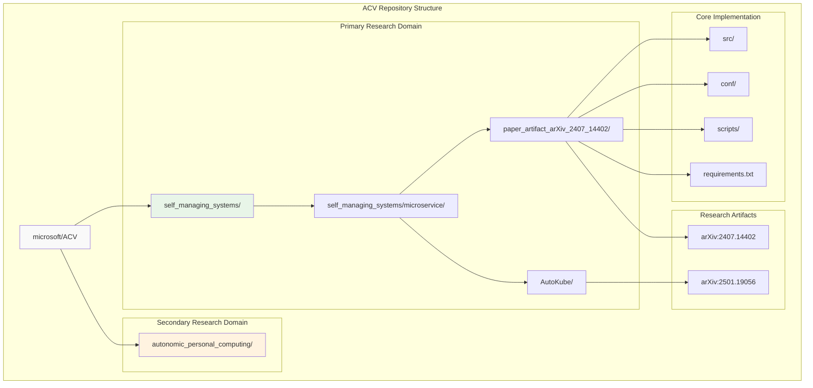
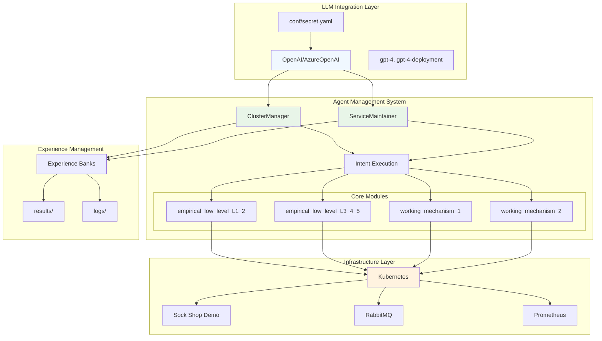

<!-- source: DeepWiki mcp.deepwiki.com · repo microsoft/ACV · page 1 Overview · fetched 2026-10-26 -->

# Overview

Relevant source files

The following files were used as context for generating this wiki page:

- [README.md](README.md)
- [self_managing_systems/microservice/README.md](self_managing_systems/microservice/README.md)
- [self_managing_systems/microservice/paper_artifact_arXiv_2407_14402/README.md](self_managing_systems/microservice/paper_artifact_arXiv_2407_14402/README.md)

## Purpose and Scope

This document provides a comprehensive overview of the Autonomic Computing Vision (ACV) repository, explaining the overall research goals, system architecture, and the two primary research domains. For detailed information about specific systems, see [Self-Managing Systems](#2) for microservice management agents and [OSrCIR System](#3) for composed image retrieval research.

## What is Autonomic Computing Vision (ACV)

Autonomic Computing Vision represents a long-standing goal in computer science to create self-managing systems that can adapt to their environment and requirements with minimal human intervention. The vision is built on four key properties: **self-configuration**, **self-optimization**, **self-healing**, and **self-protection**.

Recent advances in Large Language Models (LLMs) provide a unique opportunity to realize this vision. LLMs offer extensive knowledge, contextual understanding, and adaptive decision-making capabilities that can address longstanding challenges in autonomic computing, such as dynamic configuration generation and real-time diagnostics for large-scale cloud infrastructures.

Sources: [README.md:13-19]()

## Research Domains

The ACV repository contains research across two primary domains:

### Self-Managing Systems
This workstream focuses on developing general self-managing systems within the traditional autonomic computing domain, particularly for large-scale distributed system management. The research includes LLM-based agents for microservice self-management using Kubernetes environments.

### Autonomic Personal Computing  
This workstream explores applying ACV principles to intelligent personal assistants, enabling autonomous engagement with users through understanding and tailored assistance delivery.

Sources: [README.md:21-24]()

## Repository Structure and Key Components

The repository is organized into distinct research workstreams with supporting infrastructure:

**Repository Architecture: Directory Structure and Research Artifacts**

Sources: [README.md:1-45](), [self_managing_systems/microservice/README.md:1-7]()

## System Architecture Overview

The ACV system implements a multi-agent architecture for autonomous microservice management with LLM integration:

**Core System Architecture: Agent-Based Microservice Management**

Sources: [self_managing_systems/microservice/paper_artifact_arXiv_2407_14402/README.md:47-76](), [self_managing_systems/microservice/paper_artifact_arXiv_2407_14402/README.md:81-85]()

## Key Research Contributions

### Microservice Self-Management (arXiv:2407.14402)
The repository includes a complete research artifact implementing LLM-based agents for microservice self-management. The system demonstrates autonomous capabilities across five levels (L1-L5) of management tasks, from basic metric collection to complex failure recovery.

**Key Implementation Files:**
- `src.empirical_low_level_L1_2` - Low-level L1/L2 task implementation
- `src.empirical_low_level_L3_4_5` - Low-level L3/L4/L5 task implementation  
- `src.empirical_high_level_L1_2` - High-level group manager L1/L2 tasks
- `src.working_mechanism_1` - Component-specific task execution
- `src.working_mechanism_2` - Multi-component optimization tasks

### AutoKube General Tool
AutoKube represents the evolution of the research into a practical tool for LLM-powered agent management in Kubernetes environments, supporting both development and operations workflows.

Sources: [README.md:9-11](), [self_managing_systems/microservice/paper_artifact_arXiv_2407_14402/README.md:91-156]()

## Configuration and Setup

The system requires LLM backend configuration through `conf/secret.yaml` supporting multiple providers:

| Backend | Configuration | Model Support |
|---------|---------------|---------------|
| OpenAI | `api_key`, direct API | `gpt-4` models |
| AzureOpenAI | `api_key`, `base_url`, `api_version` | Azure deployed models |
| Other | `base_url`, custom endpoints | Local/custom models |

The system integrates with standard Kubernetes tooling and requires Docker, RabbitMQ, and Prometheus for full functionality.

Sources: [self_managing_systems/microservice/paper_artifact_arXiv_2407_14402/README.md:47-76]()

## Community and Development

This project follows Microsoft Open Source guidelines with contributions welcomed through the standard CLA process. The repository supports academic research collaboration and includes comprehensive documentation for reproducing experimental results.

For specific implementation details, see [Agent Architecture](#2.3) for the core agent system design, [Development and Deployment](#2.4) for setup procedures, and [Project Management](#4) for governance and community guidelines.

Sources: [README.md:26-44]()

---

