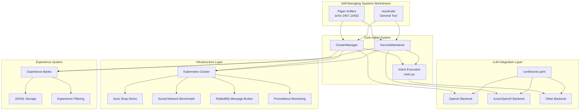
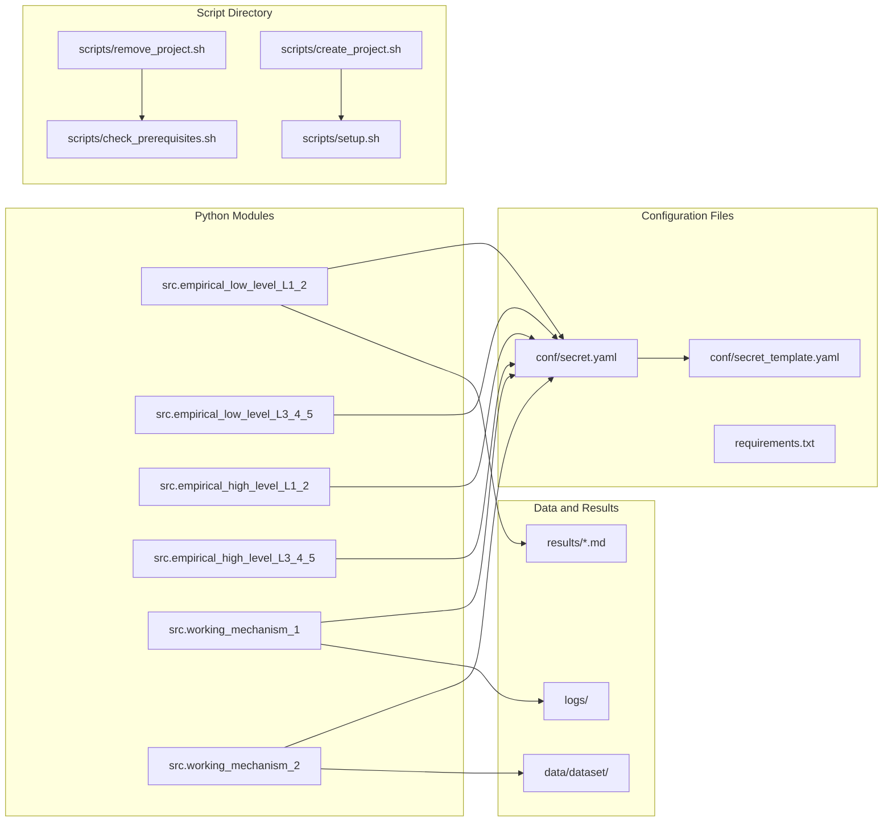
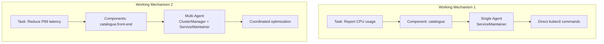
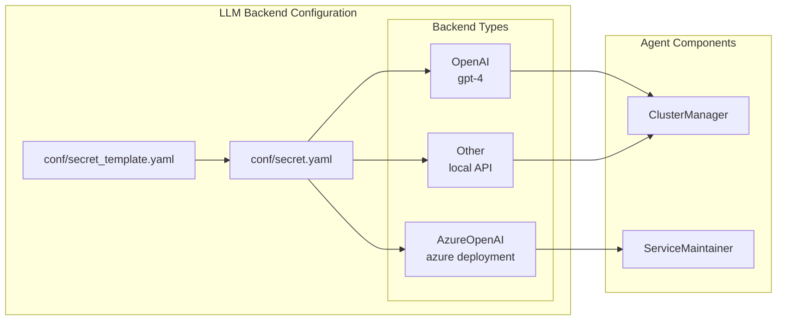
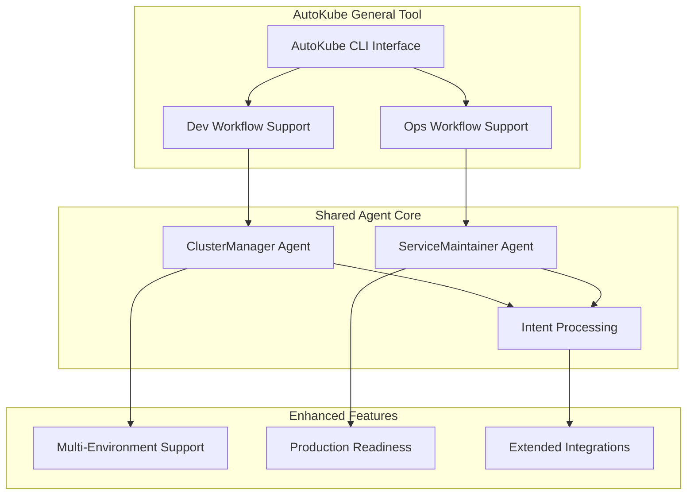
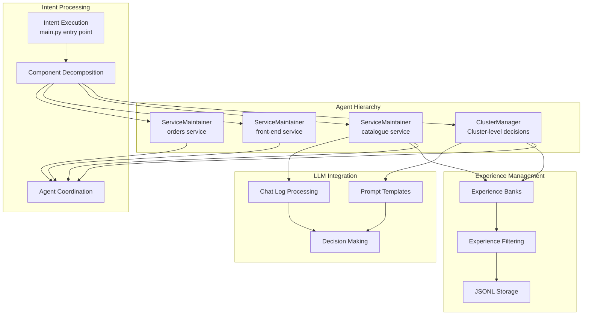
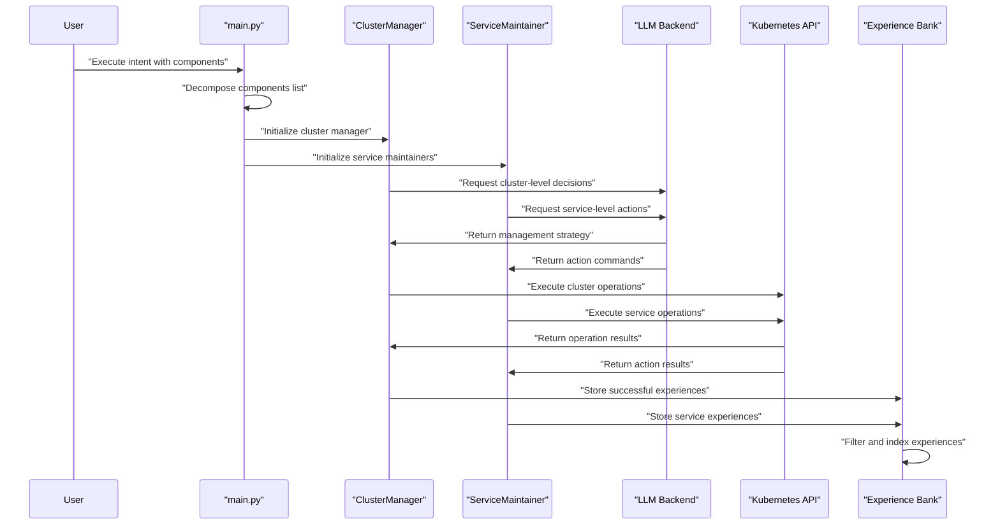
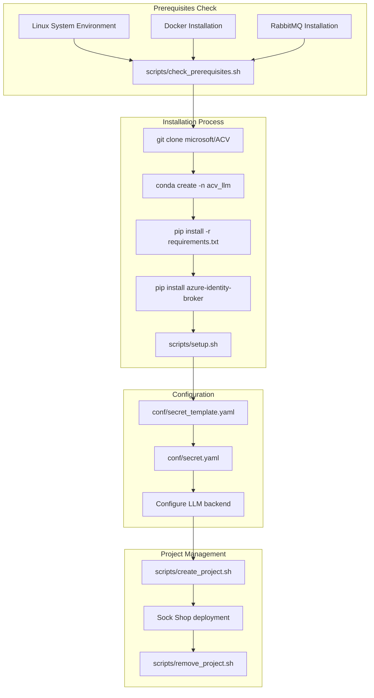

<!-- source: DeepWiki mcp.deepwiki.com · repo microsoft/ACV · page 2 Self-Managing Systems · fetched 2026-10-26 -->

# Self-Managing Systems

Relevant source files

The following files were used as context for generating this wiki page:

- [README.md](README.md)
- [self_managing_systems/microservice/README.md](self_managing_systems/microservice/README.md)
- [self_managing_systems/microservice/paper_artifact_arXiv_2407_14402/README.md](self_managing_systems/microservice/paper_artifact_arXiv_2407_14402/README.md)

## Purpose and Scope

This document covers the Self-Managing Systems workstream, which represents the primary research domain within the Autonomic Computing Vision (ACV) repository. This workstream focuses on developing LLM-based agents for microservice self-management in distributed systems, particularly within Kubernetes environments. The system implements the four key properties of autonomic computing: self-configuration, self-optimization, self-healing, and self-protection.

The Self-Managing Systems workstream includes two main implementations: a research Paper Artifact for experimental validation and AutoKube as a general-purpose tool. For information about the secondary research domain focused on image retrieval, see [OSrCIR System](#3).

Sources: [README.md:13-25](), [self_managing_systems/microservice/README.md:1-7]()

## System Architecture Overview

The Self-Managing Systems workstream implements a multi-agent architecture where LLM-powered agents manage microservices autonomously. The system operates through two primary implementations that share core architectural principles.

### High-Level Architecture

Sources: [README.md:17-24](), [self_managing_systems/microservice/README.md:5-7](), [self_managing_systems/microservice/paper_artifact_arXiv_2407_14402/README.md:47-76]()

### Code-to-System Mapping

Sources: [self_managing_systems/microservice/paper_artifact_arXiv_2407_14402/README.md:78-161]()

## Paper Artifact Implementation

The Paper Artifact implements the experimental framework described in arXiv paper 2407.14402, providing empirical validation of LLM-based agents for microservice self-management. This implementation focuses on the Sock Shop microservice demo environment.

### Experimental Framework

The Paper Artifact includes multiple experimental modules that test different autonomic levels (L1-L5) and agent architectures:

| Module | Purpose | Agent Level | Test Cases |
|--------|---------|-------------|------------|
| `src.empirical_low_level_L1_2` | Basic autonomic tasks | Low-level | metric_collection, restart |
| `src.empirical_low_level_L3_4_5` | Advanced autonomic tasks | Low-level | pod_failure scenarios |
| `src.empirical_high_level_L1_2` | Group management tasks | High-level | Multi-component optimization |
| `src.empirical_high_level_L3_4_5` | Complex group scenarios | High-level | Coordinated failure handling |

### Working Mechanisms

The system implements two primary working mechanisms:

Sources: [self_managing_systems/microservice/paper_artifact_arXiv_2407_14402/README.md:127-156]()

### LLM Configuration

The Paper Artifact supports multiple LLM backends through a unified configuration system in `conf/secret.yaml`:

Sources: [self_managing_systems/microservice/paper_artifact_arXiv_2407_14402/README.md:47-76]()

## AutoKube System

AutoKube represents the general-purpose tool implementation of the Self-Managing Systems architecture, designed to simplify microservice management in Kubernetes through LLM-powered agents. While the Paper Artifact focuses on experimental validation, AutoKube aims for practical deployment scenarios.

### Tool Architecture

AutoKube builds upon the research work from the Paper Artifact but extends it for broader applicability beyond the experimental Sock Shop environment. The system maintains the core agent architecture while providing enhanced Dev and Ops workflow integration.

Sources: [README.md:10](), [self_managing_systems/microservice/README.md:6]()

## Agent Architecture

The core agent system implements a hierarchical architecture with specialized agents for different management scopes. The `ClusterManager` handles cluster-level operations while `ServiceMaintainer` instances manage individual services.

### Agent Component Relationships

Sources: [self_managing_systems/microservice/paper_artifact_arXiv_2407_14402/README.md:78-86](), [self_managing_systems/microservice/paper_artifact_arXiv_2407_14402/README.md:139-155]()

### Agent Execution Flow

Sources: [self_managing_systems/microservice/paper_artifact_arXiv_2407_14402/README.md:78-86]()

## Development and Deployment

The Self-Managing Systems workstream provides comprehensive scripts and workflows for setting up development and experimental environments.

### Environment Setup Workflow

Sources: [self_managing_systems/microservice/paper_artifact_arXiv_2407_14402/README.md:22-45](), [self_managing_systems/microservice/paper_artifact_arXiv_2407_14402/README.md:131-161]()

### Experimental Execution Patterns

The system supports various execution patterns for different experimental scenarios:

| Execution Pattern | Command Example | Purpose |
|------------------|-----------------|---------|
| Quick Trial | `python -m src.empirical_low_level_L1_2 --instance metric_collection_1` | Basic functionality test |
| Low-level L1-L2 | `python -m src.empirical_low_level_L1_2 --instance restart` | Simple autonomic tasks |
| Low-level L3-L5 | `python -m src.empirical_low_level_L3_4_5 --instance pod_failure` | Advanced failure handling |
| High-level L1-L2 | `python -m src.empirical_high_level_L1_2 --task 'Reduce P99 latency'` | Multi-component optimization |
| Working Mechanism 1 | `python -m src.working_mechanism_1 --task 'Report CPU usage'` | Single-agent operations |
| Working Mechanism 2 | `python -m src.working_mechanism_2 --task 'Reduce latency'` | Multi-agent coordination |

Sources: [self_managing_systems/microservice/paper_artifact_arXiv_2407_14402/README.md:78-156]()

---

