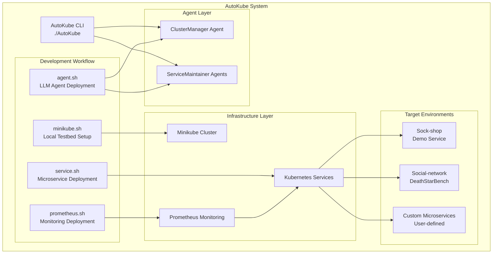
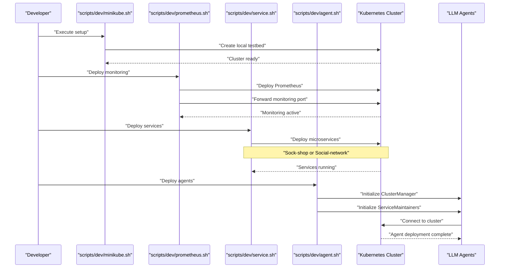
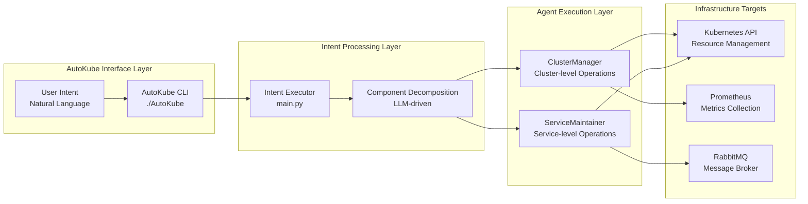

<!-- source: DeepWiki mcp.deepwiki.com · repo microsoft/ACV · page 2.2 AutoKube System · fetched 2026-10-26 -->

# AutoKube System

<details>
<summary>Relevant source files</summary>

The following files were used as context for generating this wiki page:

- [self_managing_systems/microservice/AutoKube/.gitignore](self_managing_systems/microservice/AutoKube/.gitignore)
- [self_managing_systems/microservice/AutoKube/README.md](self_managing_systems/microservice/AutoKube/README.md)
- [self_managing_systems/microservice/AutoKube/src/agent_creation/README.md](self_managing_systems/microservice/AutoKube/src/agent_creation/README.md)

</details>


## Purpose and Scope

This document covers the AutoKube system, a general-purpose tool for LLM-powered Kubernetes microservice management. AutoKube provides both development workflows for setting up agent-based management systems and operational workflows for managing microservices through an intuitive command-line interface. 

For research-specific implementation details related to the academic paper artifact, see [Paper Artifact Implementation](#2.1). For detailed information about the underlying agent architecture that AutoKube orchestrates, see [Agent Architecture](#2.3).

## System Overview

AutoKube simplifies microservice management in Kubernetes environments by leveraging Large Language Model (LLM)-powered agents. The system bridges the gap between complex Kubernetes operations and user-friendly management through two primary workflows: development setup and operational management.

### AutoKube Architecture



Sources: [self_managing_systems/microservice/AutoKube/README.md:17-23](), [self_managing_systems/microservice/AutoKube/README.md:44-60]()

## Development Workflow

The development workflow enables developers to set up agent-based management systems for their microservices. AutoKube provides automated scripts to establish the complete infrastructure stack.

### Development Script Execution Flow



Sources: [self_managing_systems/microservice/AutoKube/README.md:48-60]()

### Development Script Components

| Script | Purpose | Function |
|--------|---------|----------|
| `scripts/dev/minikube.sh` | Local testbed creation | Sets up Minikube cluster for development |
| `scripts/dev/prometheus.sh` | Monitoring infrastructure | Deploys Prometheus and configures port forwarding |
| `scripts/dev/service.sh` | Microservice deployment | Deploys example services (Sock-shop or Social-network) |
| `scripts/dev/agent.sh` | Agent initialization | Deploys and configures LLM-based agents |

Sources: [self_managing_systems/microservice/AutoKube/README.md:48-60]()

## Operations Workflow

The operations workflow provides microservice operators with an intuitive command-line interface for managing services through LLM-based agents, even with limited Kubernetes familiarity.

### AutoKube Command-Line Interface

The primary operational interface is the `AutoKube` executable, which serves as the entry point for all management operations:

```bash
./AutoKube
```

This command-line tool integrates with the underlying agent architecture to provide natural language-based microservice management capabilities.

Sources: [self_managing_systems/microservice/AutoKube/README.md:63-66]()

## Integration with Agent Architecture

AutoKube serves as the orchestration layer that coordinates with the core agent system components. The system leverages the intent execution framework to process user commands and delegate tasks to appropriate agents.

### AutoKube Agent Coordination



Sources: [self_managing_systems/microservice/AutoKube/README.md:17-19](), [self_managing_systems/microservice/AutoKube/README.md:23]()

## Example Scenarios and Supported Services

AutoKube includes two pre-configured example scenarios for demonstration and testing:

### Supported Microservice Examples

| Service | Type | Description |
|---------|------|-------------|
| Sock-shop | E-commerce Demo | Microservice demonstration application |
| Social-network | DeathStarBench | Social networking microservice benchmark |

These examples are deployed through the `scripts/dev/service.sh` script and provide complete environments for testing AutoKube's agent-based management capabilities.

Sources: [self_managing_systems/microservice/AutoKube/README.md:44](), [self_managing_systems/microservice/AutoKube/README.md:51]()

## Research Foundation

AutoKube is inspired by research on applying LLM-based agents for microservice self-management. The system builds upon the academic work documented in the paper artifact implementation, extending the research concepts into a general-purpose tool for broader microservice management scenarios.

For detailed information about the research implementation and experimental validation, see [Paper Artifact Implementation](#2.1). For comprehensive coverage of the agent system architecture that AutoKube orchestrates, see [Agent Architecture](#2.3).

Sources: [self_managing_systems/microservice/AutoKube/README.md:23]()

---

