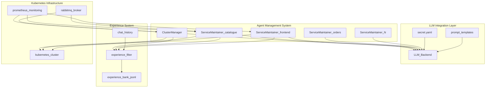
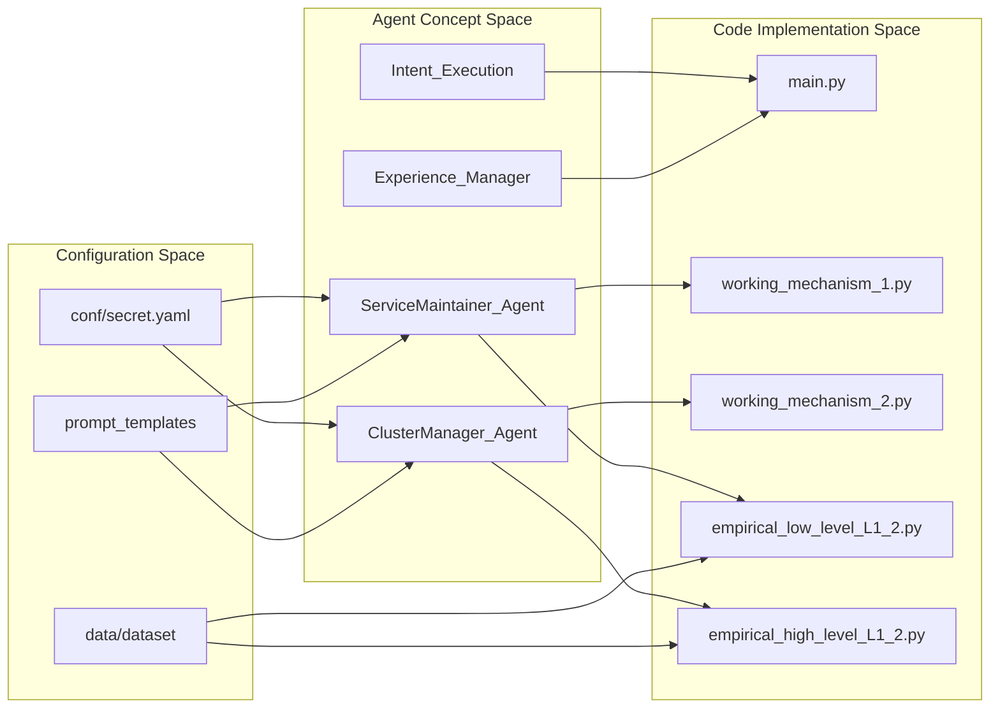
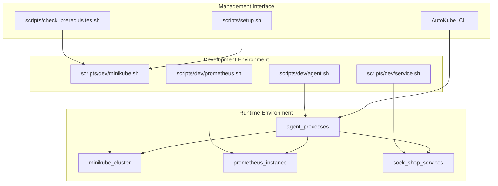
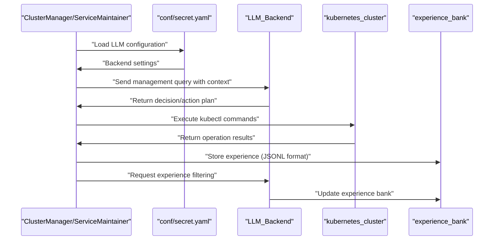

<!-- source: DeepWiki mcp.deepwiki.com · repo microsoft/ACV · page 2.3 Agent Architecture · fetched 2026-10-26 -->

# Agent Architecture

Relevant source files

The following files were used as context for generating this wiki page:

- [README.md](README.md)
- [self_managing_systems/microservice/AutoKube/.gitignore](self_managing_systems/microservice/AutoKube/.gitignore)
- [self_managing_systems/microservice/AutoKube/README.md](self_managing_systems/microservice/AutoKube/README.md)
- [self_managing_systems/microservice/AutoKube/src/agent_creation/README.md](self_managing_systems/microservice/AutoKube/src/agent_creation/README.md)
- [self_managing_systems/microservice/README.md](self_managing_systems/microservice/README.md)
- [self_managing_systems/microservice/paper_artifact_arXiv_2407_14402/README.md](self_managing_systems/microservice/paper_artifact_arXiv_2407_14402/README.md)

This document provides a comprehensive overview of the agent architecture that forms the core of the Self-Managing Systems framework. The architecture consists of LLM-powered agents designed to autonomously manage microservices in Kubernetes environments through intelligent decision-making and experience-based learning.

For specific implementation details on intent processing, see [Intent Execution System](#2.3.1). For information on learning mechanisms, see [Experience Management](#2.3.2). For AI prompt systems, see [Prompt Templates](#2.3.3). For data storage systems, see [Experience Banks](#2.3.4).

## System Overview

The agent architecture implements a multi-agent system where specialized agents collaborate to achieve autonomous microservice management. The system is designed to handle the four key properties of autonomic computing: self-configuration, self-optimization, self-healing, and self-protection.

### Core Agent Architecture

Sources: [self_managing_systems/microservice/paper_artifact_arXiv_2407_14402/README.md:48-76](), [self_managing_systems/microservice/AutoKube/README.md:17-19]()

## Agent Types and Responsibilities

The architecture defines two primary agent types, each with distinct responsibilities and operational scopes within the microservice management ecosystem.

### ClusterManager Agent

The `ClusterManager` serves as the high-level orchestrator responsible for cluster-wide operations and coordination between individual service maintainers. It operates at the infrastructure level and makes decisions that affect the entire microservice ecosystem.

**Key Responsibilities:**
- Cluster-wide resource allocation and optimization
- High-level task decomposition and delegation
- Inter-service dependency management
- Global policy enforcement

### ServiceMaintainer Agents  

`ServiceMaintainer` agents are specialized for individual microservice management. Each microservice component (such as `catalogue`, `front-end`, `orders`) has its dedicated ServiceMaintainer instance that focuses on service-specific operations.

**Key Responsibilities:**
- Service-specific monitoring and diagnostics
- Performance optimization for individual services
- Service-level self-healing and recovery
- Local configuration management

### Agent-to-Code Mapping

Sources: [self_managing_systems/microservice/paper_artifact_arXiv_2407_14402/README.md:139-155](), [self_managing_systems/microservice/paper_artifact_arXiv_2407_14402/README.md:107-123]()

## Agent Communication and Coordination

The agents operate through a coordinated communication model that enables both hierarchical control and peer-to-peer collaboration when needed.

### Communication Patterns

| Communication Type | Participants | Purpose | Implementation |
|-------------------|-------------|---------|----------------|
| Hierarchical | ClusterManager ↔ ServiceMaintainers | Task delegation and status reporting | Direct method calls |
| Peer-to-Peer | ServiceMaintainer ↔ ServiceMaintainer | Cross-service coordination | Message broker (RabbitMQ) |
| External | All Agents ↔ LLM Backend | Decision making and reasoning | HTTP API calls |
| Infrastructure | All Agents ↔ Kubernetes | Operational commands | kubectl/K8s API |

### Agent Deployment Architecture

Sources: [self_managing_systems/microservice/AutoKube/README.md:46-60](), [self_managing_systems/microservice/paper_artifact_arXiv_2407_14402/README.md:24-45]()

## LLM Integration Architecture

The agents integrate with Large Language Models through a configurable backend system that supports multiple LLM providers and deployment models.

### LLM Configuration

The system supports three primary LLM backend configurations:

**OpenAI Integration:**
- Model: `gpt-4` series models
- Configuration file: `conf/secret.yaml`
- API key authentication

**Azure OpenAI Integration:**  
- Model: Custom deployment names (e.g., `my-gpt-4-deployment`)
- Endpoint-based configuration
- API version: `2024-02-01`

**Local/Other Integration:**
- Custom model names (e.g., `llama-7B`)
- Local endpoint support
- Optional API key authentication

### Agent-LLM Interaction Flow

Sources: [self_managing_systems/microservice/paper_artifact_arXiv_2407_14402/README.md:47-76]()

## Working Mechanisms

The agent architecture implements two primary working mechanisms that demonstrate different operational patterns and capabilities.

### Working Mechanism 1: Single Agent Operations

This mechanism focuses on individual ServiceMaintainer operations for component-specific tasks such as monitoring, diagnostics, and basic management operations.

**Example Implementation:**
- Task: `Report CPU usage of your component`
- Target: Single component (e.g., `catalogue`)
- Execution: Direct ServiceMaintainer action

### Working Mechanism 2: Multi-Agent Coordination

This mechanism demonstrates ClusterManager coordination of multiple ServiceMaintainer agents for complex, multi-component tasks requiring cross-service optimization.

**Example Implementation:**
- Task: `Reduce the total P99 latency of catalogue and front-end to under 400 ms`
- Target: Multiple components (`catalogue`, `front-end`)
- Execution: ClusterManager orchestration with ServiceMaintainer collaboration

Sources: [self_managing_systems/microservice/paper_artifact_arXiv_2407_14402/README.md:139-156]()

## Integration with Autonomic Computing Principles

The agent architecture directly implements the four core autonomic computing properties:

| Autonomic Property | Agent Implementation | Code References |
|-------------------|---------------------|----------------|
| Self-Configuration | Automatic service setup and parameter tuning | `scripts/dev/agent.sh` |
| Self-Optimization | Performance monitoring and improvement | Working Mechanism 2 |
| Self-Healing | Failure detection and recovery | L3, L4, L5 tasks |
| Self-Protection | Security monitoring and threat response | ClusterManager oversight |

The architecture provides the foundation for implementing these properties through intelligent agent behavior powered by LLM reasoning capabilities and experience-based learning mechanisms.

Sources: [README.md:15-19](), [self_managing_systems/microservice/paper_artifact_arXiv_2407_14402/README.md:99-123]()

---

