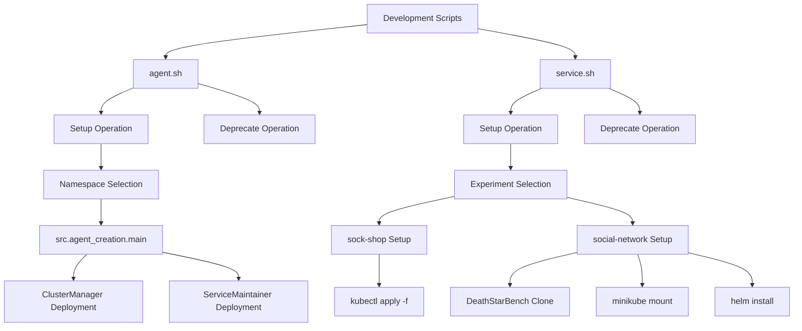
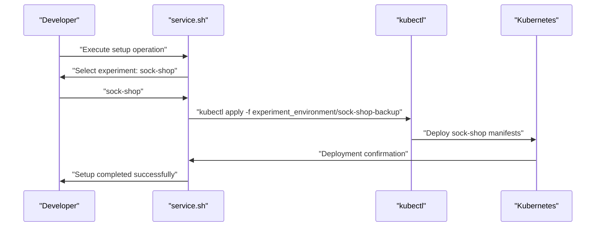
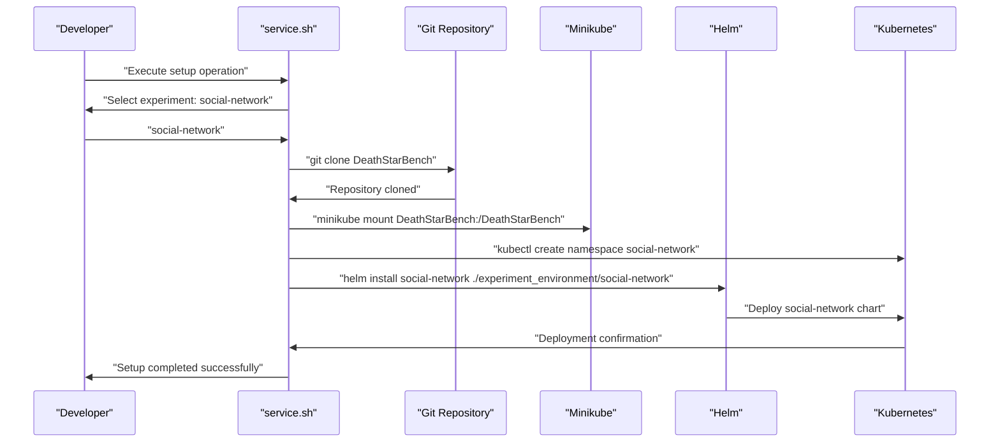
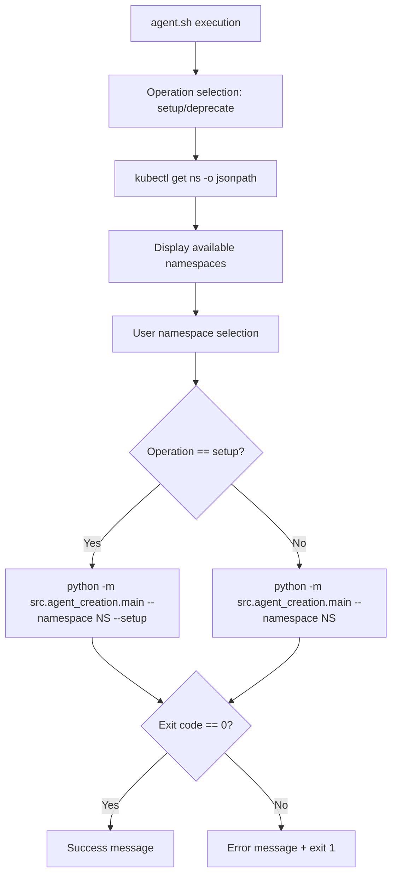
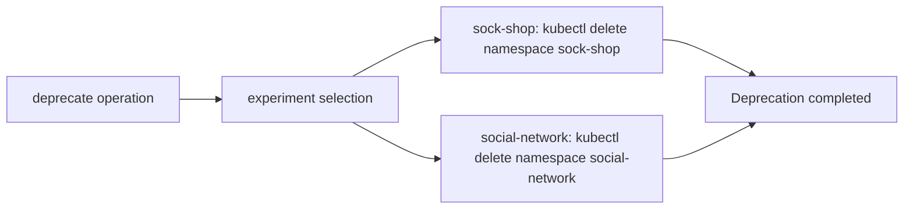

<!-- source: DeepWiki mcp.deepwiki.com · repo microsoft/ACV · page 2.4 Development and Deployment · fetched 2026-10-26 -->

# Development and Deployment

Relevant source files

The following files were used as context for generating this wiki page:

- [self_managing_systems/microservice/AutoKube/scripts/dev/agent.sh](self_managing_systems/microservice/AutoKube/scripts/dev/agent.sh)
- [self_managing_systems/microservice/AutoKube/scripts/dev/service.sh](self_managing_systems/microservice/AutoKube/scripts/dev/service.sh)

This page documents the development environment setup and deployment procedures for the self-managing systems workstream. It covers the automated scripts for deploying microservice environments and LLM-based agents, as well as the lifecycle management of these components. For information about the underlying agent architecture, see [Agent Architecture](#2.3). For details about the AutoKube system design, see [AutoKube System](#2.2).

## Overview

The development and deployment framework provides automated scripts for setting up experimental microservice environments and deploying the corresponding LLM agents that manage them. The system supports two primary experimental environments: the `sock-shop` microservice demo and the `social-network` application from DeathStarBench.

## Development Environment Setup

### Deployment Script Architecture

**Sources:** [self_managing_systems/microservice/AutoKube/scripts/dev/agent.sh:1-55](), [self_managing_systems/microservice/AutoKube/scripts/dev/service.sh:1-65]()

### Script-Based Deployment System

The deployment system consists of two interactive bash scripts that manage the complete lifecycle of microservice environments and their corresponding agents:

| Script | Purpose | Operations | Target Components |
|--------|---------|------------|------------------|
| `agent.sh` | Agent lifecycle management | `setup`, `deprecate` | ClusterManager, ServiceMaintainer |
| `service.sh` | Service environment management | `setup`, `deprecate` | sock-shop, social-network |

**Sources:** [self_managing_systems/microservice/AutoKube/scripts/dev/agent.sh:9-10](), [self_managing_systems/microservice/AutoKube/scripts/dev/service.sh:9-10]()

## Service Deployment Process

### Microservice Environment Setup

#### Sock Shop Deployment Flow

**Sources:** [self_managing_systems/microservice/AutoKube/scripts/dev/service.sh:28-31]()

#### Social Network Deployment Flow

**Sources:** [self_managing_systems/microservice/AutoKube/scripts/dev/service.sh:21-27]()

### Experiment Environment Configuration

The service deployment script supports two experimental environments with different setup procedures:

| Environment | Repository Source | Deployment Method | Namespace |
|-------------|------------------|-------------------|-----------|
| `sock-shop` | Local manifests | `kubectl apply` | `sock-shop` |
| `social-network` | DeathStarBench GitHub | Helm chart | `social-network` |

**Sources:** [self_managing_systems/microservice/AutoKube/scripts/dev/service.sh:15-16](), [self_managing_systems/microservice/AutoKube/scripts/dev/service.sh:40-41]()

## Agent Deployment Process

### Agent Lifecycle Management

The agent deployment process utilizes the `agent.sh` script to manage ClusterManager and ServiceMaintainer instances across Kubernetes namespaces:

#### Agent Setup Workflow

**Sources:** [self_managing_systems/microservice/AutoKube/scripts/dev/agent.sh:12-17](), [self_managing_systems/microservice/AutoKube/scripts/dev/agent.sh:26](), [self_managing_systems/microservice/AutoKube/scripts/dev/agent.sh:41]()

### Agent Creation Module Integration

The agent deployment scripts interface with the Python-based `src.agent_creation.main` module, which handles the instantiation of ClusterManager and ServiceMaintainer agents within specified Kubernetes namespaces.

#### Command Line Interface

| Operation | Command | Parameters | Function |
|-----------|---------|------------|----------|
| Setup | `python -m src.agent_creation.main --namespace <ns> --setup` | `--namespace`, `--setup` | Deploy agents |
| Deprecate | `python -m src.agent_creation.main --namespace <ns>` | `--namespace` | Remove agents |

**Sources:** [self_managing_systems/microservice/AutoKube/scripts/dev/agent.sh:26](), [self_managing_systems/microservice/AutoKube/scripts/dev/agent.sh:41]()

## Deployment Lifecycle Management

### Deprecation Procedures

Both service and agent deployment scripts provide symmetric deprecation operations for environment cleanup:

#### Service Deprecation

**Sources:** [self_managing_systems/microservice/AutoKube/scripts/dev/service.sh:46-53]()

#### Agent Deprecation

The agent deprecation process removes ClusterManager and ServiceMaintainer instances from the specified namespace using the same `src.agent_creation.main` module without the `--setup` flag.

**Sources:** [self_managing_systems/microservice/AutoKube/scripts/dev/agent.sh:35-47]()

### Error Handling and Validation

Both deployment scripts implement comprehensive error handling with colored output for user feedback:

| Color Code | Message Type | Usage |
|------------|--------------|-------|
| `GREEN` | Success/Prompts | Successful operations, user prompts |
| `RED` | Errors | Failed operations, invalid inputs |
| `YELLOW` | Progress | In-progress operations |
| `BLUE` | Values | User input options, namespace names |

**Sources:** [self_managing_systems/microservice/AutoKube/scripts/dev/agent.sh:3-7](), [self_managing_systems/microservice/AutoKube/scripts/dev/service.sh:3-7]()

## Integration with Development Workflow

### Prerequisites

The deployment system requires the following components to be available in the development environment:

- Kubernetes cluster (minikube for local development)
- `kubectl` configured for cluster access
- `helm` for social-network deployment
- Python environment with AutoKube modules
- Git for DeathStarBench repository cloning

### Namespace Management

The agent deployment script dynamically discovers available Kubernetes namespaces using `kubectl get ns -o jsonpath='{.items[*].metadata.name}'`, allowing flexible deployment across different experimental environments.

**Sources:** [self_managing_systems/microservice/AutoKube/scripts/dev/agent.sh:12]()

---

