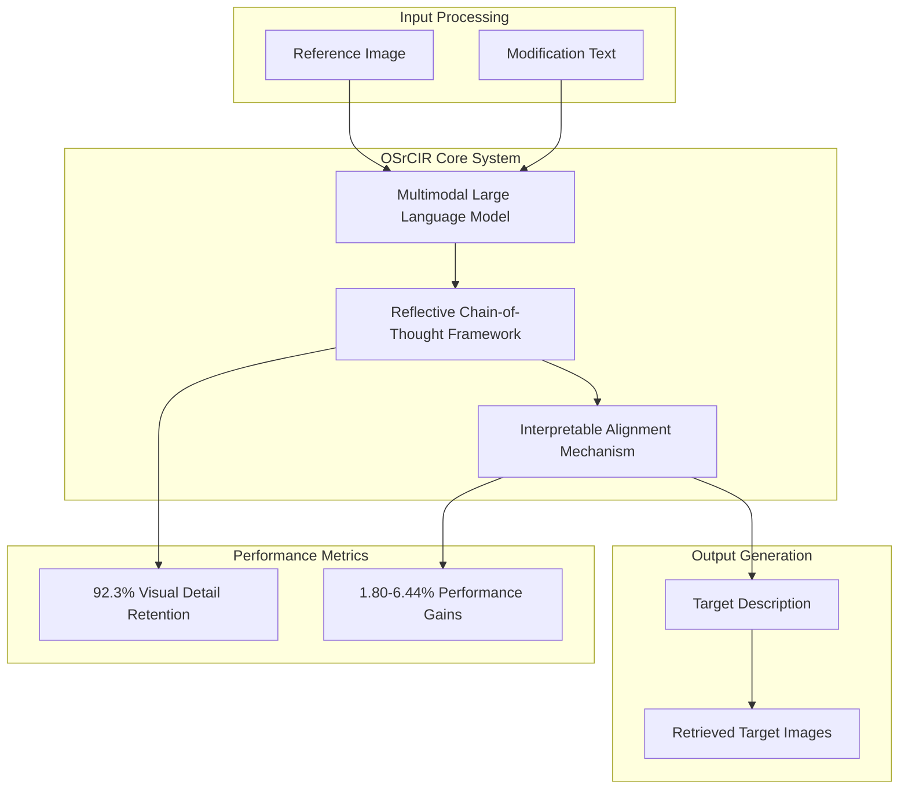
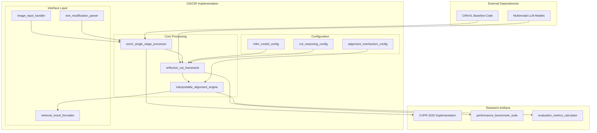
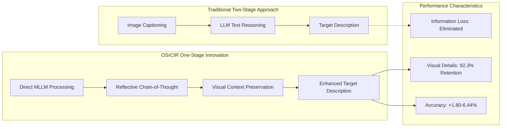

<!-- source: DeepWiki mcp.deepwiki.com · repo microsoft/ACV · page 3 OSrCIR System · fetched 2026-10-26 -->

# OSrCIR System

<details>
<summary>Relevant source files</summary>

The following files were used as context for generating this wiki page:

- [OSrCIR/OSrCIR.jpg](OSrCIR/OSrCIR.jpg)
- [OSrCIR/README.md](OSrCIR/README.md)

</details>


## Purpose and Scope

This document covers the OSrCIR (One-Stage Reflective Chain-of-Thoughts) system for training-free zero-shot composed image retrieval. OSrCIR represents the secondary research domain within the ACV repository, focusing on multimodal large language model applications for image retrieval tasks. For information about the primary self-managing systems domain, see [Self-Managing Systems](#2).

The OSrCIR system addresses composed image retrieval (CIR) challenges by processing reference images and textual modifications in a single stage using multimodal reasoning, eliminating the information loss inherent in traditional two-stage approaches.

Sources: [OSrCIR/README.md:1-89]()

## System Architecture Overview

### High-Level Processing Pipeline



Sources: [OSrCIR/README.md:17-48]()

## Core Components and Implementation Architecture

### Code Structure and Baseline Integration



Sources: [OSrCIR/README.md:88-89](), [OSrCIR/README.md:41-48]()

## Technical Innovation Characteristics

### Performance Comparison Matrix

| Component | Traditional Two-Stage | OSrCIR One-Stage | Improvement |
|-----------|----------------------|------------------|-------------|
| Visual Detail Retention | Baseline | 92.3% higher | Significant |
| Processing Stages | Caption → Reasoning | Direct Processing | Simplified |
| Information Loss | High (stage transition) | Minimal | Eliminated |
| Performance Gains | Baseline | 1.80-6.44% | Measurable |
| Reasoning Capability | Limited LLM | MLLM Enhanced | Advanced |

Sources: [OSrCIR/README.md:34-48]()

### Key Innovation Areas



Sources: [OSrCIR/README.md:41-48]()

## Research Context and Applications

### Application Domains

| Domain | Use Case | OSrCIR Advantage |
|--------|----------|------------------|
| Internet Search | Scene image search with object manipulation | Preserves visual context during modifications |
| E-commerce | Product recommendations with attribute changes | Accurate attribute-based retrieval |
| Academic Research | Zero-shot composed image retrieval benchmarks | State-of-the-art performance without training |

Sources: [OSrCIR/README.md:17]()

### Academic Contributions and Status

The OSrCIR system represents a significant contribution to the computer vision and multimodal learning research communities:

- **Publication Status**: Accepted at CVPR 2025
- **Research Paper**: arXiv:2412.11077
- **Primary Author**: Tang, Yuanmin (tangyuanmin@iie.ac.cn)
- **Code Availability**: Example code planned post-publication
- **Baseline Reference**: Adapted from CIReVL (Vision_by_Language)

### Development Timeline

```mermaid
gantt
    title "OSrCIR Development and Release Timeline"
    dateFormat  YYYY-MM-DD
    section Research Phase
    Paper Development    :done, research, 2024-01-01, 2024-12-11
    arXiv Submission     :done, arxiv, 2024-12-11, 2024-12-11
    section Publication Phase
    CVPR 2025 Acceptance :done, cvpr, 2024-12-15, 2024-12-15
    section Code Release Phase
    Example Code        :active, examples, 2024-12-15, 2025-03-01
    Full Release        :future, release, 2025-03-01, 2025-06-01
```

Sources: [OSrCIR/README.md:50-56](), [OSrCIR/README.md:78-85]()

## Community and Collaboration Framework

### Support Channels

The OSrCIR system maintains active community engagement through multiple channels:

- **Primary Repository**: [Pter61/osrcir](https://github.com/Pter61/osrcir)
- **Issue Tracking**: Active community Q&A through GitHub Issues
- **Academic Contact**: Direct email for research collaboration
- **Documentation**: Author-maintained repository with comprehensive README

### Collaboration Opportunities

| Type | Duration | Focus Area |
|------|----------|------------|
| Research Students | Ongoing | Interesting extensions of OSrCIR work |
| Industry Partners | 2-month minimum | Applied research consulting |
| Community Support | As needed | Bug reports and feature requests |

Sources: [OSrCIR/README.md:58-72]()

---

