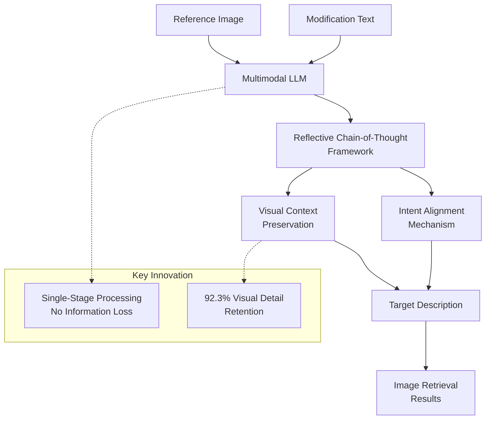
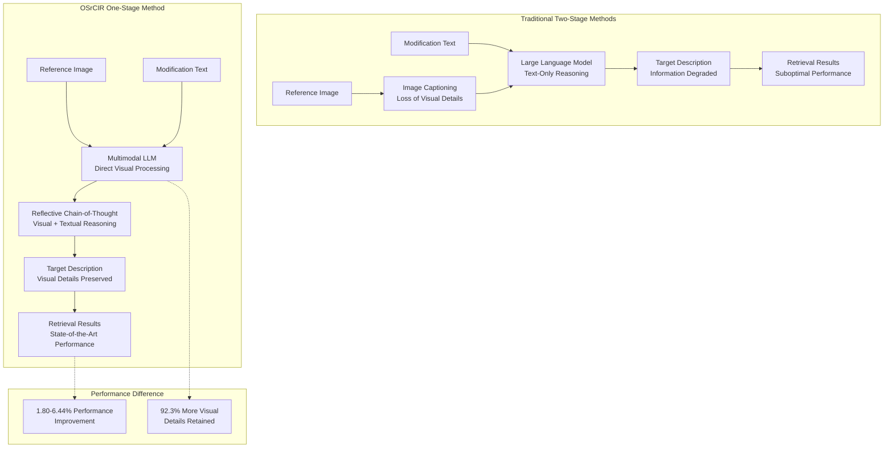
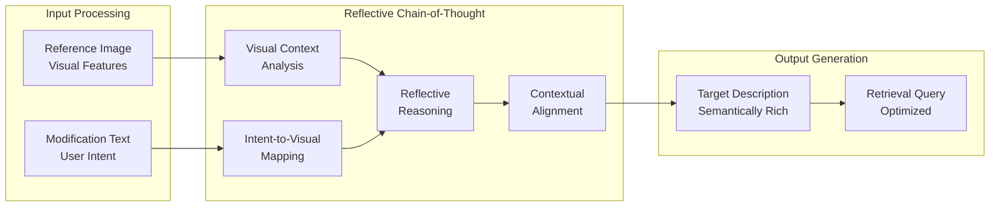
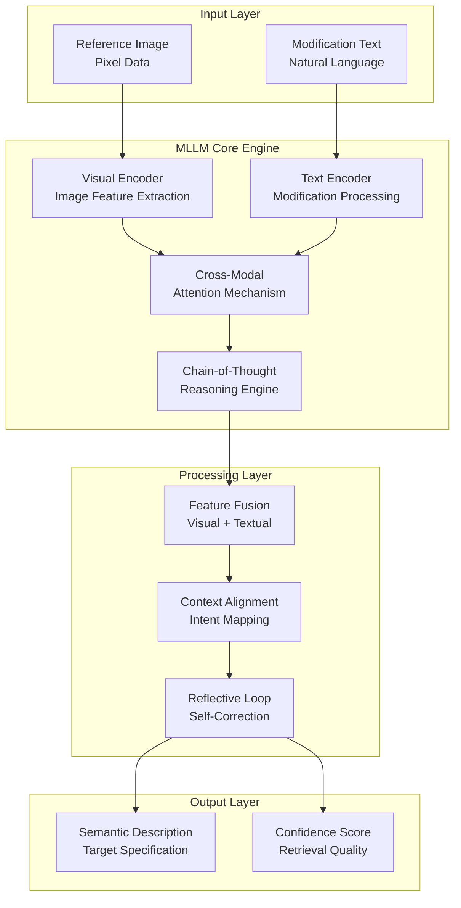
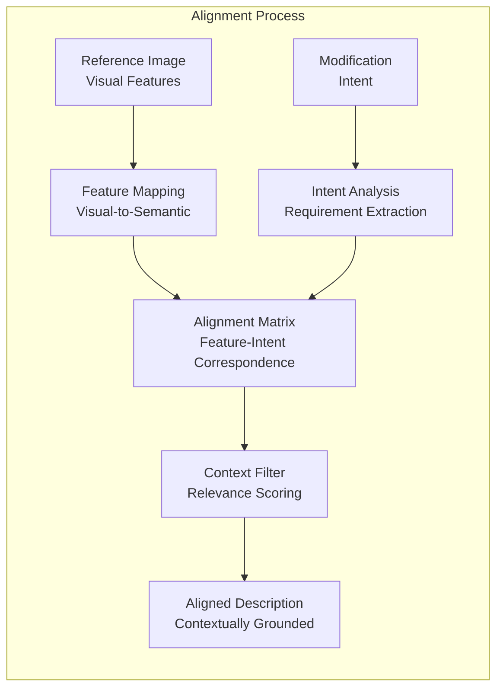
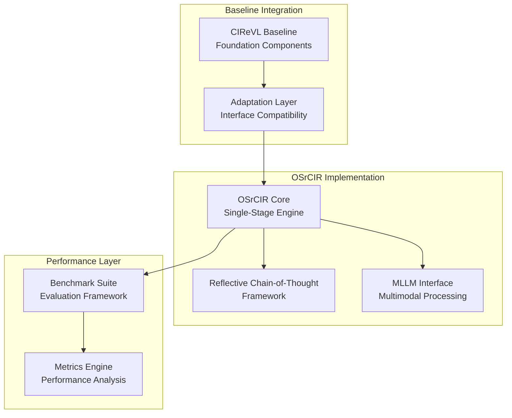

<!-- source: DeepWiki mcp.deepwiki.com · repo microsoft/ACV · page 3.1 Architecture and Innovation · fetched 2026-10-26 -->

# Architecture and Innovation

Relevant source files

The following files were used as context for generating this wiki page:

- [OSrCIR/OSrCIR.jpg](OSrCIR/OSrCIR.jpg)
- [OSrCIR/README.md](OSrCIR/README.md)

This document provides a technical deep dive into the OSrCIR (One-Stage Reflective Chain-of-Thoughts) system architecture, focusing on its innovative single-stage processing approach and multimodal reasoning framework. OSrCIR represents a significant architectural advancement in training-free zero-shot Composed Image Retrieval (CIR), eliminating the information loss inherent in traditional two-stage methods.

For practical applications and research context of OSrCIR, see [Applications and Research Context](#3.2). For the broader Self-Managing Systems architecture, see [Self-Managing Systems](#2).

## Core Architecture Overview

OSrCIR fundamentally reimagines the CIR pipeline by directly processing reference images and textual modifications through Multimodal Large Language Models (MLLMs) in a single reasoning stage. This architecture eliminates the caption generation bottleneck that causes information degradation in conventional approaches.

### OSrCIR Single-Stage Architecture

Sources: [OSrCIR/README.md:28-29](), [OSrCIR/README.md:44-45]()

### Traditional Two-Stage vs OSrCIR Comparison

Sources: [OSrCIR/README.md:17](), [OSrCIR/README.md:34-35](), [OSrCIR/README.md:44-45]()

## Reflective Chain-of-Thought Framework

The Reflective Chain-of-Thought framework represents the core reasoning engine of OSrCIR, designed to maintain critical visual information while aligning modification intent with contextual cues from reference images.

### Chain-of-Thought Processing Pipeline

Sources: [OSrCIR/README.md:31-32](), [OSrCIR/README.md:47-48]()

## Multimodal Large Language Model Integration

OSrCIR's architecture leverages MLLMs as the primary processing engine, enabling direct visual understanding without intermediate caption generation. This integration strategy preserves visual fidelity while maintaining reasoning capabilities.

### MLLM Processing Architecture

Sources: [OSrCIR/README.md:28-29](), [OSrCIR/README.md:41-42]()

## Technical Innovation Components

### Visual Context Preservation Mechanism

The architecture implements a novel visual context preservation strategy that retains critical image details throughout the reasoning process, addressing the primary limitation of traditional two-stage methods.

| Component | Traditional Methods | OSrCIR Innovation | Performance Impact |
|-----------|-------------------|------------------|-------------------|
| Visual Processing | Caption-based (lossy) | Direct MLLM (lossless) | 92.3% detail retention |
| Reasoning Stage | Text-only LLM | Multimodal reasoning | 1.80-6.44% improvement |
| Information Flow | Two-stage pipeline | Single-stage pipeline | Eliminated bottleneck |
| Intent Alignment | Post-hoc matching | Integrated alignment | Enhanced interpretability |

Sources: [OSrCIR/README.md:44-45](), [OSrCIR/README.md:34-35]()

### Interpretable Alignment Mechanism

Sources: [OSrCIR/README.md:47-48]()

## Implementation Foundation

OSrCIR builds upon the CIReVL baseline framework while introducing fundamental architectural changes for single-stage processing.

### System Integration Architecture

Sources: [OSrCIR/README.md:88-89]()

## Performance Characteristics

The OSrCIR architecture delivers measurable improvements across multiple dimensions:

- **Processing Efficiency**: Single-stage elimination of caption generation bottleneck
- **Visual Fidelity**: 92.3% improvement in visual detail retention
- **Retrieval Accuracy**: 1.80-6.44% performance gains across benchmarks
- **Interpretability**: Explicit intent-to-visual feature alignment

Sources: [OSrCIR/README.md:34-35](), [OSrCIR/README.md:44-45]()

The architecture represents a paradigm shift from lossy two-stage processing to direct multimodal reasoning, establishing new state-of-the-art results in training-free zero-shot composed image retrieval.

---

