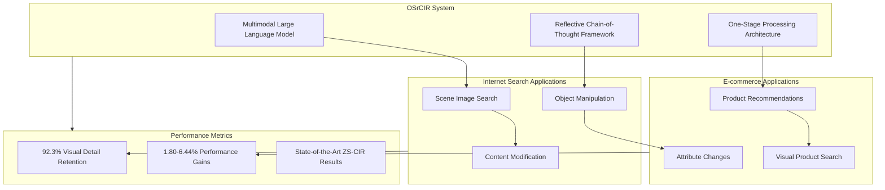
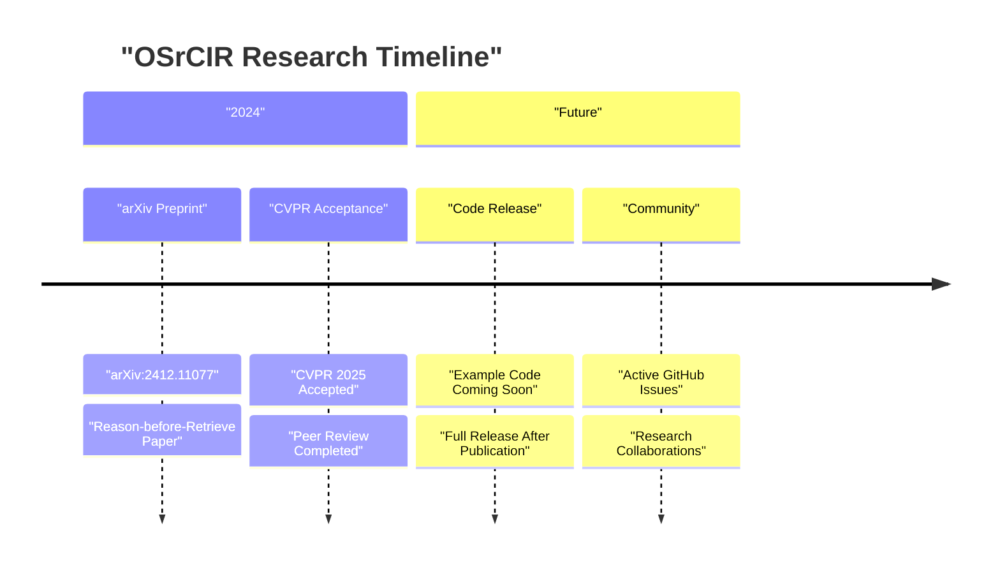
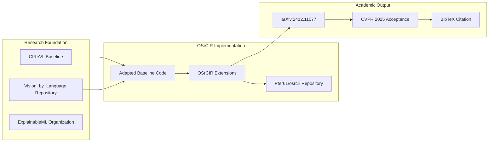
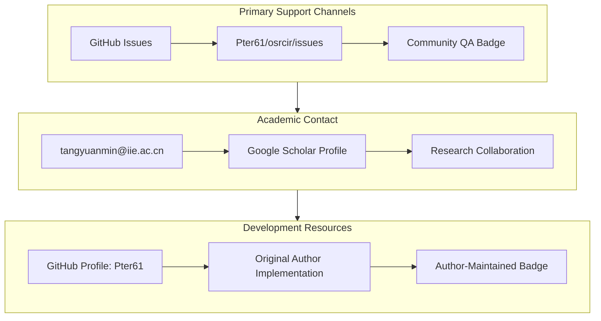

<!-- source: DeepWiki mcp.deepwiki.com · repo microsoft/ACV · page 3.2 Applications and Research Context · fetched 2026-10-26 -->

# Applications and Research Context

<details>
<summary>Relevant source files</summary>

The following files were used as context for generating this wiki page:

- [OSrCIR/OSrCIR.jpg](OSrCIR/OSrCIR.jpg)
- [OSrCIR/README.md](OSrCIR/README.md)

</details>


This document covers the practical applications of the OSrCIR (One-Stage Reflective Chain-of-Thoughts) system and its position within the broader research landscape. It details real-world use cases in internet search and e-commerce, academic contributions, and opportunities for research collaboration and community engagement.

For technical implementation details of the OSrCIR architecture, see [3.1](#3.1). For general information about the ACV research domains, see [1](#1).

## Application Domains

### OSrCIR Application Architecture



Sources: [OSrCIR/README.md:15-19](), [OSrCIR/README.md:28-36]()

### Internet Search Applications

OSrCIR enables sophisticated scene image search capabilities where users can manipulate objects within reference images. The system processes reference images alongside textual modification instructions to retrieve target images that match the user's intent.

Key application scenarios include:
- **Scene Image Search**: Finding images with similar scenes but different object configurations
- **Object Manipulation**: Modifying specific objects within scenes while preserving context
- **Content Modification**: Applying user-specified changes to visual content

Sources: [OSrCIR/README.md:17-18]()

### E-commerce Applications

The e-commerce domain leverages OSrCIR's dual-modality approach for enhanced product discovery and recommendation systems.

| Application Type | Description | Technical Benefit |
|------------------|-------------|-------------------|
| Product Recommendations | Suggest items similar to reference products with specific attribute modifications | Preserves visual context while applying changes |
| Attribute Changes | Modify product characteristics (color, style, material) based on text input | Single-stage processing reduces information loss |
| Visual Product Search | Find products matching reference images with user-specified variations | 92.3% visual detail retention |

Sources: [OSrCIR/README.md:17-18](), [OSrCIR/README.md:45]()

## Research Contributions and Academic Context

### Academic Publication Timeline



Sources: [OSrCIR/README.md:7](), [OSrCIR/README.md:51](), [OSrCIR/README.md:53-55]()

### Performance Achievements

OSrCIR demonstrates significant improvements over existing training-free zero-shot composed image retrieval methods:

- **Performance Gains**: 1.80% to 6.44% improvement across multiple benchmarks
- **Visual Detail Preservation**: 92.3% retention compared to baseline methods  
- **State-of-the-Art Results**: New benchmarks established in ZS-CIR tasks

The system's one-stage architecture eliminates information degradation seen in conventional two-stage pipelines through direct multimodal processing.

Sources: [OSrCIR/README.md:35](), [OSrCIR/README.md:45](), [OSrCIR/README.md:41-42]()

### Research Infrastructure and Baseline



Sources: [OSrCIR/README.md:88](), [OSrCIR/README.md:65](), [OSrCIR/README.md:78-85]()

## Community and Collaboration

### Research Collaboration Framework

The OSrCIR project actively seeks academic partnerships and research collaborations across multiple dimensions:

| Collaboration Type | Target Audience | Engagement Model | Contact Method |
|-------------------|-----------------|------------------|----------------|
| **Research Students** | Graduate/PhD students | Supervision of work extensions | `tangyuanmin@iie.ac.cn` |
| **Industry Partners** | Commercial organizations | Applied research consulting (2-month minimum) | Academic email |
| **Community Support** | General users/developers | GitHub Issues and discussions | GitHub repository |

Sources: [OSrCIR/README.md:64](), [OSrCIR/README.md:69-71]()

### Community Support Channels



Sources: [OSrCIR/README.md:6](), [OSrCIR/README.md:65-66](), [OSrCIR/README.md:71]()

### Citation and Academic Recognition

The OSrCIR research is properly documented for academic citation with the following BibTeX entry structure:

```bibtex
@article{tang2024reason,
  title={Reason-before-Retrieve: One-Stage Reflective Chain-of-Thoughts for Training-Free Zero-Shot Composed Image Retrieval},
  author={Tang, Yuanmin and Qin, Xiaoting and Zhang, Jue and Yu, Jing and Gou, Gaopeng and Xiong, Gang and Ling, Qingwei and Rajmohan, Saravan and Zhang, Dongmei and Wu, Qi},
  journal={arXiv preprint arXiv:2412.11077},
  year={2024}
}
```

The research maintains active community engagement through GitHub stars tracking and author-maintained status indicators.

Sources: [OSrCIR/README.md:78-85](), [OSrCIR/README.md:5](), [OSrCIR/README.md:8]()

---

