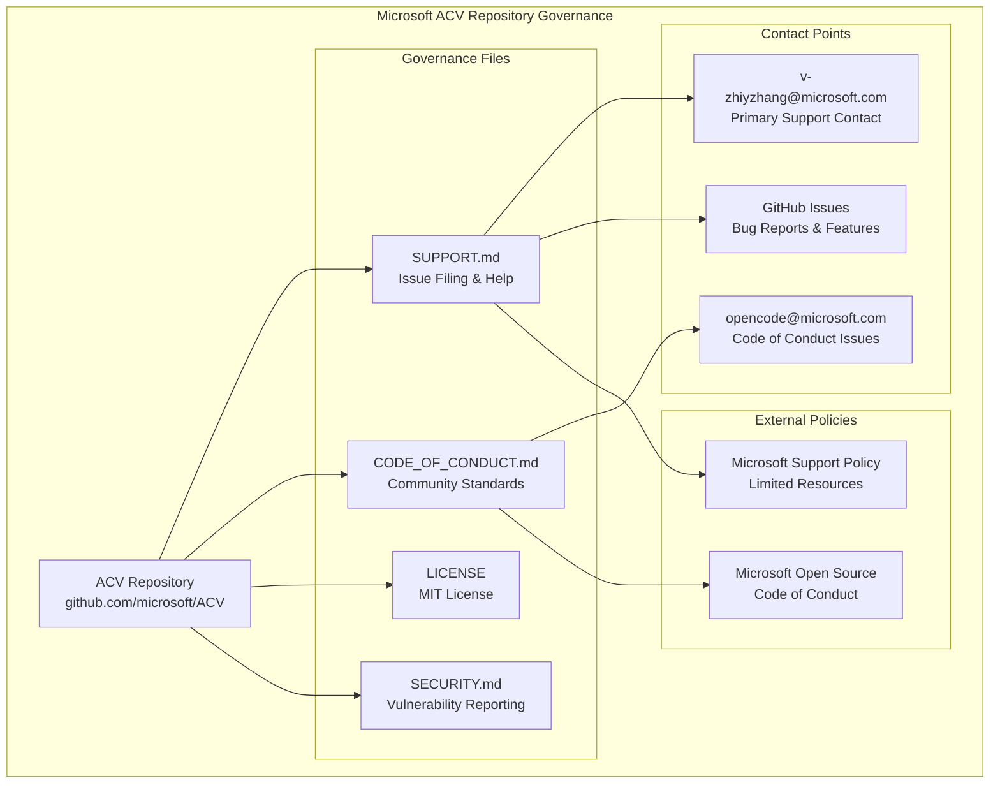
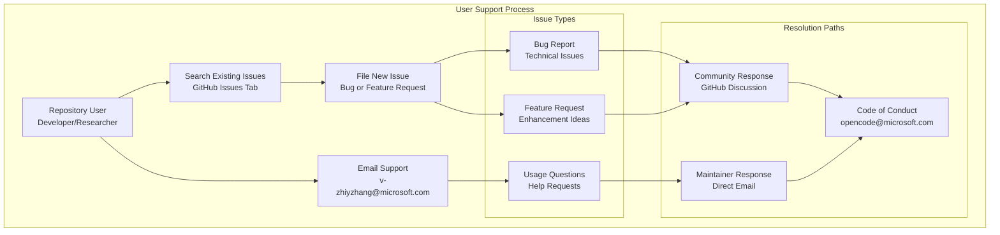
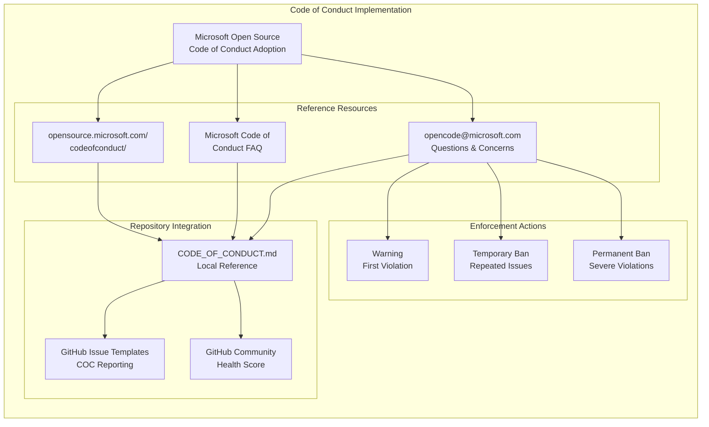

<!-- source: DeepWiki mcp.deepwiki.com · repo microsoft/ACV · page 4 Project Management · fetched 2026-10-26 -->

# Project Management

Relevant source files

The following files were used as context for generating this wiki page:

- [CODE_OF_CONDUCT.md](CODE_OF_CONDUCT.md)
- [SUPPORT.md](SUPPORT.md)

## Purpose and Scope

This document covers the repository governance, community guidelines, and development policies for the Microsoft ACV (Autonomic Computing Vision) repository. It addresses how contributors and users should interact with the project, report issues, seek support, and maintain community standards.

For technical implementation details of the self-managing systems, see [Self-Managing Systems](#2). For information about the OSrCIR research implementation, see [OSrCIR System](#3).

## Repository Governance Structure

The ACV repository follows Microsoft's open source governance model, with clearly defined policies for community interaction and support processes.

### Governance Framework

**Sources:** [SUPPORT.md:1-14](), [CODE_OF_CONDUCT.md:1-10]()

## Community Management Process

The repository implements a structured approach to community management through standardized files and clear escalation paths.

### Issue Management and Support Flow

**Sources:** [SUPPORT.md:3-7](), [SUPPORT.md:9-9](), [CODE_OF_CONDUCT.md:9-9]()

## Support Policy and Resources

The repository operates under Microsoft's limited support model for open source projects, with specific resources available for different types of assistance.

### Support Matrix

| Support Type | Resource | Contact Method | Response Expectation |
|--------------|----------|----------------|---------------------|
| Bug Reports | GitHub Issues | [GitHub Issues]() | Community-driven |
| Feature Requests | GitHub Issues | [GitHub Issues]() | Community-driven |
| Usage Questions | Direct Email | `v-zhiyzhang@microsoft.com` | Best effort |
| Code of Conduct Issues | Microsoft OpenCode | `opencode@microsoft.com` | Formal process |
| Security Vulnerabilities | Security Policy | See [Security and Legal](#4.2) | Coordinated disclosure |

**Sources:** [SUPPORT.md:3-14](), [CODE_OF_CONDUCT.md:9-9]()

## Code of Conduct Enforcement

The repository adheres to the Microsoft Open Source Code of Conduct, providing clear guidelines for community behavior and enforcement mechanisms.

### Behavioral Standards Framework

**Sources:** [CODE_OF_CONDUCT.md:1-10]()

## Development Policies

The repository maintains clear policies for development contributions and community engagement, ensuring consistency with Microsoft's open source standards.

### Policy Implementation Structure

| Policy Area | Implementation File | Key Requirements |
|-------------|-------------------|------------------|
| Community Behavior | `CODE_OF_CONDUCT.md` | Microsoft Open Source standards |
| Support Procedures | `SUPPORT.md` | GitHub Issues, email escalation |
| Legal Framework | `LICENSE` | MIT License terms |
| Security Reporting | `SECURITY.md` | Vulnerability disclosure process |

The project management framework ensures that:

1. **Issue Tracking**: All bugs and features are managed through GitHub Issues with duplicate prevention
2. **Community Standards**: Behavior is governed by Microsoft's established code of conduct
3. **Support Escalation**: Clear pathways exist for different types of assistance
4. **Legal Compliance**: Proper licensing and security policies are maintained

For detailed information about support procedures and community guidelines, see [Support and Community Guidelines](#4.1). For security policies and legal frameworks, see [Security and Legal](#4.2).

**Sources:** [SUPPORT.md:1-14](), [CODE_OF_CONDUCT.md:1-10]()

---

