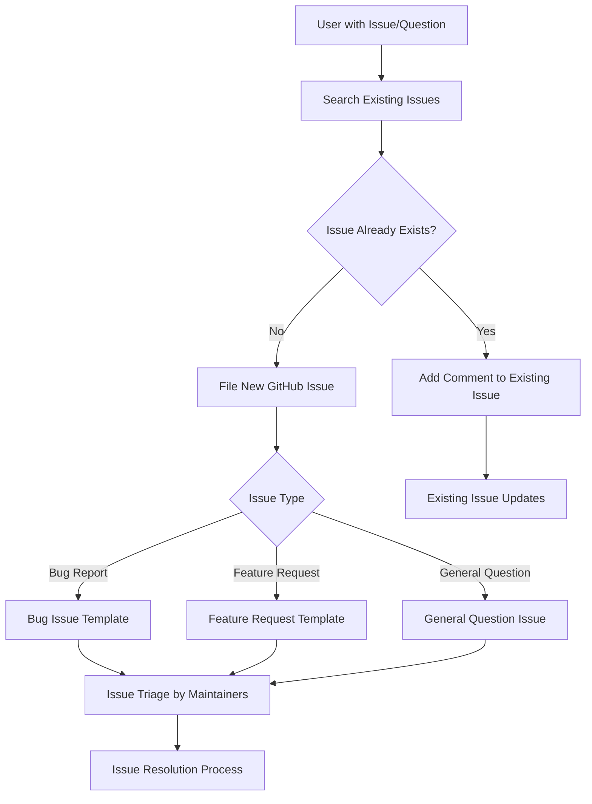
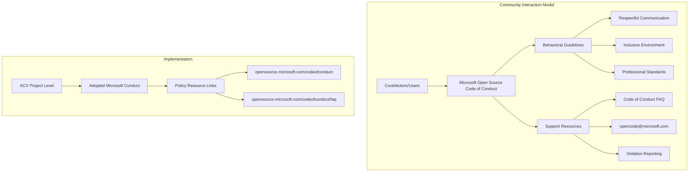
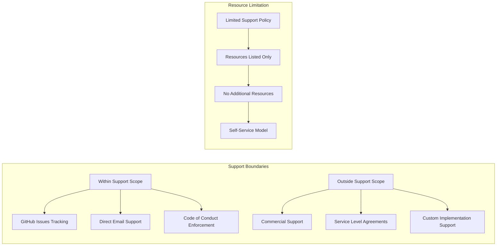

<!-- source: DeepWiki mcp.deepwiki.com · repo microsoft/ACV · page 4.1 Support and Community Guidelines · fetched 2026-10-26 -->

# Support and Community Guidelines

Relevant source files

The following files were used as context for generating this wiki page:

- [CODE_OF_CONDUCT.md](CODE_OF_CONDUCT.md)
- [SUPPORT.md](SUPPORT.md)

This document provides comprehensive guidance on obtaining support, reporting issues, and participating in the Microsoft ACV (Autonomic Computing Vision) community. It covers the official support channels, issue reporting procedures, and behavioral expectations for all contributors and users.

For information about security vulnerability reporting and legal policies, see [Security and Legal](#4.2).

## Support Channels and Issue Reporting

The ACV project provides structured support through multiple channels, each designed for specific types of inquiries and issues.

### GitHub Issues Workflow

The primary mechanism for tracking bugs and feature requests uses the GitHub Issues system with a standardized process to avoid duplication and ensure efficient resolution.

**Support Channel Workflow**
- **Search First**: Users must search existing issues before filing new ones to prevent duplicates [SUPPORT.md:5-7]()
- **New Issues**: File bug reports or feature requests as new GitHub Issues [SUPPORT.md:6-7]()
- **Issue Types**: The system handles bug reports, feature requests, and general questions through the same GitHub Issues interface

Sources: [SUPPORT.md:1-14]()

### Direct Support Contact

For help and questions about using the ACV project that don't require public tracking, direct email support is available.

| Support Type | Contact Method | Use Case |
|--------------|----------------|----------|
| General Help | `v-zhiyzhang@microsoft.com` | Usage questions, implementation guidance |
| Code of Conduct | `opencode@microsoft.com` | Behavioral concerns, conduct violations |
| GitHub Issues | Repository Issues tab | Bug reports, feature requests |

**Contact Guidelines**:
- **Primary Contact**: `v-zhiyzhang@microsoft.com` for project-specific help and questions [SUPPORT.md:9]()
- **Response Expectations**: Support is limited to the resources listed in the official support policy [SUPPORT.md:13]()
- **Scope**: Support covers usage questions and project guidance but has defined limitations

Sources: [SUPPORT.md:9](), [SUPPORT.md:13](), [CODE_OF_CONDUCT.md:9]()

## Microsoft Open Source Code of Conduct

The ACV project operates under the Microsoft Open Source Code of Conduct, which establishes behavioral expectations and provides enforcement mechanisms for community interactions.

### Code of Conduct Framework

**Code of Conduct Structure**:
- **Adoption**: The project has formally adopted the Microsoft Open Source Code of Conduct [CODE_OF_CONDUCT.md:3]()
- **Resources**: Links to the full conduct policy and FAQ are provided for detailed guidance [CODE_OF_CONDUCT.md:7-8]()
- **Enforcement**: Contact mechanism available for reporting violations or concerns [CODE_OF_CONDUCT.md:9]()

Sources: [CODE_OF_CONDUCT.md:1-10]()

### Community Behavioral Expectations

The conduct framework establishes specific expectations for all community participants, including contributors to both the Self-Managing Systems workstream and OSrCIR research components.

| Expectation Category | Description | Enforcement Contact |
|---------------------|-------------|-------------------|
| Respectful Communication | Professional interactions in issues, pull requests, and discussions | `opencode@microsoft.com` |
| Inclusive Environment | Welcoming participation from diverse backgrounds and perspectives | `opencode@microsoft.com` |
| Professional Standards | Maintaining quality and constructive engagement | `opencode@microsoft.com` |

**Resource Links**:
- **Primary Policy**: [Microsoft Open Source Code of Conduct](https://opensource.microsoft.com/codeofconduct/) [CODE_OF_CONDUCT.md:7]()
- **Detailed FAQ**: [Microsoft Code of Conduct FAQ](https://opensource.microsoft.com/codeofconduct/faq/) [CODE_OF_CONDUCT.md:8]()
- **Violation Reporting**: Contact `opencode@microsoft.com` with questions or concerns [CODE_OF_CONDUCT.md:9]()

Sources: [CODE_OF_CONDUCT.md:3](), [CODE_OF_CONDUCT.md:7-9]()

## Support Scope and Limitations

The ACV project operates under a defined support policy that establishes clear boundaries for the types of assistance available to users and contributors.

### Support Policy Framework

**Support Limitations**:
- **Resource Constraints**: Support is explicitly limited to the resources documented in the support policy [SUPPORT.md:13]()
- **Self-Service Model**: Users are expected to utilize available documentation and community resources
- **No SLA**: No formal service level agreements or response time guarantees are provided

**Available Support Resources**:
- GitHub Issues system for bug tracking and feature requests
- Direct email contact for usage questions
- Code of conduct enforcement mechanism
- Documentation and community knowledge sharing

Sources: [SUPPORT.md:11-14]()

---

