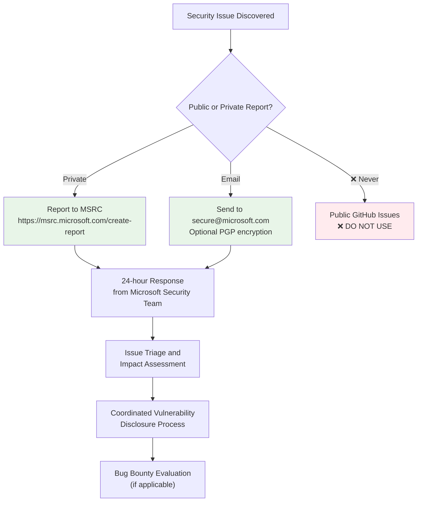
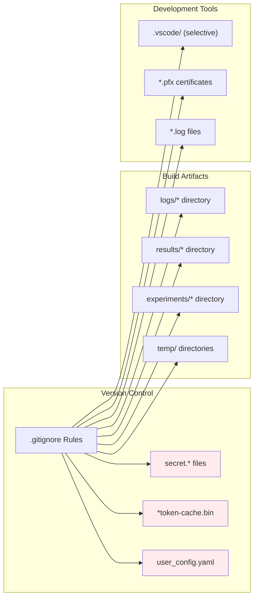
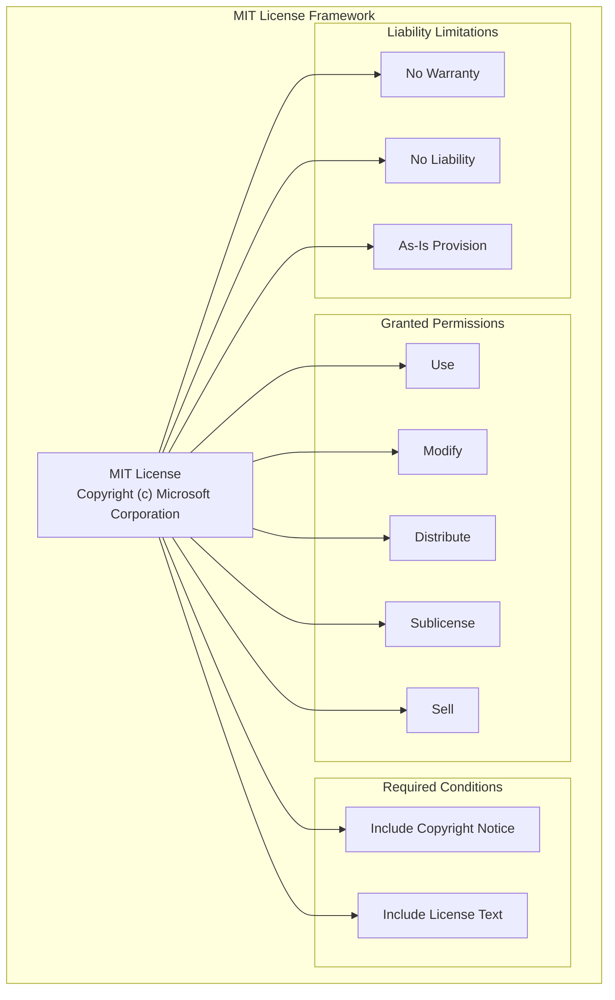

<!-- source: DeepWiki mcp.deepwiki.com · repo microsoft/ACV · page 4.2 Security and Legal · fetched 2026-10-26 -->

# Security and Legal

Relevant source files

The following files were used as context for generating this wiki page:

- [.gitignore](.gitignore)
- [LICENSE](LICENSE)
- [SECURITY.md](SECURITY.md)

This document covers security vulnerability reporting procedures, licensing terms, and development environment security practices for the Autonomic Computing Vision (ACV) repository. It provides guidance for researchers, contributors, and users on how to responsibly handle security issues and understand the legal framework governing the use of this research codebase.

For general community support and contribution guidelines, see [Support and Community Guidelines](#4.1). For technical documentation on system architecture and development practices, see [Self-Managing Systems](#2) and [OSrCIR System](#3).

## Security Vulnerability Reporting

The ACV repository follows Microsoft's standard security vulnerability disclosure process, designed to ensure responsible handling of security issues while protecting users and the broader research community.

### Reporting Process

**Security Vulnerability Reporting Workflow**

**Sources:** [SECURITY.md:11-13](), [SECURITY.md:39]()

### Required Information for Security Reports

When reporting security vulnerabilities, include comprehensive technical details to facilitate rapid triage and resolution:

| Information Category | Required Details | Examples |
|---------------------|------------------|----------|
| **Issue Type** | Vulnerability classification | Buffer overflow, injection attacks, privilege escalation |
| **Source Location** | File paths and code references | Specific files in `/self-managing-systems/` or `/OSrCIR/` |
| **Affected Components** | System components involved | `ClusterManager`, `ServiceMaintainer`, LLM integration points |
| **Reproduction Steps** | Detailed instructions | Configuration requirements, environment setup |
| **Proof of Concept** | Demonstration code | Exploit code, test cases |
| **Impact Assessment** | Potential security implications | Data exposure, system compromise, service disruption |

**Sources:** [SECURITY.md:19-27]()

### Communication and Response

Microsoft Security Response Center provides multiple communication channels with guaranteed response times:

- **Primary Channel**: [Microsoft Security Response Center](https://msrc.microsoft.com/create-report) - Web-based reporting interface
- **Email Alternative**: `secure@microsoft.com` with optional PGP encryption
- **Response Time**: 24-hour initial response guarantee
- **Follow-up**: Contact `secure@microsoft.com` if no response received
- **Language Preference**: English communications preferred

**Sources:** [SECURITY.md:13-17](), [SECURITY.md:35]()

## Development Security Practices

The ACV repository implements security-conscious development practices, particularly important given its integration with external AI services and cloud infrastructure.

### Sensitive Data Protection

**Development Environment Security Configuration**

**Sources:** [.gitignore:403-407](), [.gitignore:239](), [.gitignore:92]()

### Configuration Security

The repository excludes several categories of sensitive files from version control to prevent accidental exposure of credentials and configuration data:

| File Pattern | Security Purpose | Related Components |
|-------------|------------------|-------------------|
| `secret.*` | API keys, credentials | LLM service authentication, cloud access |
| `*token-cache.bin` | Cached authentication tokens | Azure OpenAI, service authentication |
| `user_config.yaml` | Personal configuration | Development environment settings |
| `logs/*` | Runtime logs | May contain sensitive debug information |
| `experiments/*` | Experimental data | Research data, model outputs |
| `*.pfx` | Code signing certificates | Release and deployment security |

**Sources:** [.gitignore:403](), [.gitignore:239](), [.gitignore:406](), [.gitignore:401](), [.gitignore:405](), [.gitignore:407]()

### Research Environment Security

Given the AI research nature of this repository, special consideration is required for:

- **LLM API Key Management**: Secure storage of OpenAI/Azure API credentials
- **Experimental Data Protection**: Isolation of research datasets and model outputs
- **Container Security**: Kubernetes and Docker environment security for microservice experiments
- **Network Security**: Secure communication with external AI services

## Licensing and Legal Framework

The ACV repository is released under the MIT License, providing broad permissions for research and commercial use while maintaining Microsoft's copyright.

### MIT License Terms

**License Structure and Permissions**

**Sources:** [LICENSE:1-21]()

### Copyright and Attribution

| Legal Aspect | Requirement | Implementation |
|-------------|-------------|----------------|
| **Copyright Notice** | Include in all copies | "Copyright (c) Microsoft Corporation" |
| **License Text** | Include full MIT license | Complete LICENSE file in distributions |
| **Attribution** | Maintain original copyright | Required in derivative works |
| **Warranty Disclaimer** | Software provided "as is" | No warranties of any kind |
| **Liability Limitation** | No liability for damages | Users assume all risks |

**Sources:** [LICENSE:3](), [LICENSE:12-13](), [LICENSE:15-21]()

### Research and Commercial Use

The MIT License provides broad flexibility for research institutions and commercial entities:

- **Academic Research**: Free use for research publications, experiments, and educational purposes
- **Commercial Applications**: Permitted for commercial products and services
- **Derivative Works**: Allowed with proper attribution
- **Patent Rights**: No explicit patent grant beyond copyright permissions
- **Distribution Requirements**: Must include copyright and license notices

### Third-Party Dependencies

While the main repository uses the MIT License, users must be aware that:

- **External AI Services**: Usage subject to respective terms of service (OpenAI, Azure)
- **Container Images**: May include components with different licenses
- **Research Datasets**: Subject to original dataset licensing terms
- **Academic Publications**: Citation requirements for research use

**Sources:** [LICENSE:5-11](), [LICENSE:15-21]()

## Privacy and Data Protection

### Research Data Handling

The ACV repository processes various types of data that require careful handling:

- **Microservice Telemetry**: System performance and behavior data
- **LLM Interactions**: Prompts, responses, and conversation logs
- **Image Retrieval Data**: Visual content and metadata
- **Experimental Results**: Research outputs and analysis

### Compliance Considerations

Users should consider applicable privacy regulations:

- **GDPR Compliance**: For EU-based research or data processing
- **Institutional Review**: Academic institutions may require IRB approval
- **Data Retention**: Implement appropriate data lifecycle management
- **Cross-Border Transfer**: Consider data sovereignty requirements

**Sources:** [.gitignore:401](), [.gitignore:405](), [.gitignore:407]()