# Page: Overview

# Overview

<details>
<summary>Relevant source files</summary>

The following files were used as context for generating this wiki page:

- [README.md](README.md)
- [self_managing_systems/microservice/README.md](self_managing_systems/microservice/README.md)
- [self_managing_systems/microservice/paper_artifact_arXiv_2407_14402/README.md](self_managing_systems/microservice/paper_artifact_arXiv_2407_14402/README.md)

</details>


## Purpose and Scope

This document provides a comprehensive overview of the Autonomic Computing Vision (ACV) repository, explaining the overall research goals, system architecture, and the two primary research domains. For detailed information about specific systems, see [Self-Managing Systems](#2) for microservice management agents and [OSrCIR System](#3) for composed image retrieval research.

## What is Autonomic Computing Vision (ACV)

Autonomic Computing Vision represents a long-standing goal in computer science to create self-managing systems that can adapt to their environment and requirements with minimal human intervention. The vision is built on four key properties: **self-configuration**, **self-optimization**, **self-healing**, and **self-protection**.

Recent advances in Large Language Models (LLMs) provide a unique opportunity to realize this vision. LLMs offer extensive knowledge, contextual understanding, and adaptive decision-making capabilities that can address longstanding challenges in autonomic computing, such as dynamic configuration generation and real-time diagnostics for large-scale cloud infrastructures.

Sources: [README.md:13-19]()

## Research Domains

The ACV repository contains research across two primary domains:

### Self-Managing Systems
This workstream focuses on developing general self-managing systems within the traditional autonomic computing domain, particularly for large-scale distributed system management. The research includes LLM-based agents for microservice self-management using Kubernetes environments.

### Autonomic Personal Computing  
This workstream explores applying ACV principles to intelligent personal assistants, enabling autonomous engagement with users through understanding and tailored assistance delivery.

Sources: [README.md:21-24]()

## Repository Structure and Key Components

The repository is organized into distinct research workstreams with supporting infrastructure:

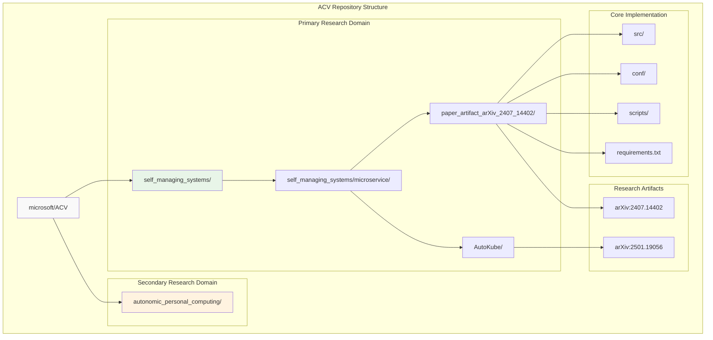

**Repository Architecture: Directory Structure and Research Artifacts**

Sources: [README.md:1-45](), [self_managing_systems/microservice/README.md:1-7]()

## System Architecture Overview

The ACV system implements a multi-agent architecture for autonomous microservice management with LLM integration:

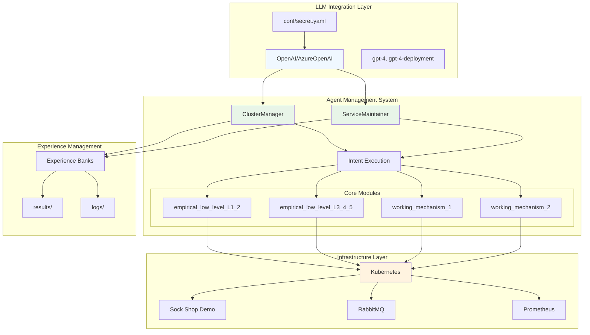

**Core System Architecture: Agent-Based Microservice Management**

Sources: [self_managing_systems/microservice/paper_artifact_arXiv_2407_14402/README.md:47-76](), [self_managing_systems/microservice/paper_artifact_arXiv_2407_14402/README.md:81-85]()

## Key Research Contributions

### Microservice Self-Management (arXiv:2407.14402)
The repository includes a complete research artifact implementing LLM-based agents for microservice self-management. The system demonstrates autonomous capabilities across five levels (L1-L5) of management tasks, from basic metric collection to complex failure recovery.

**Key Implementation Files:**
- `src.empirical_low_level_L1_2` - Low-level L1/L2 task implementation
- `src.empirical_low_level_L3_4_5` - Low-level L3/L4/L5 task implementation  
- `src.empirical_high_level_L1_2` - High-level group manager L1/L2 tasks
- `src.working_mechanism_1` - Component-specific task execution
- `src.working_mechanism_2` - Multi-component optimization tasks

### AutoKube General Tool
AutoKube represents the evolution of the research into a practical tool for LLM-powered agent management in Kubernetes environments, supporting both development and operations workflows.

Sources: [README.md:9-11](), [self_managing_systems/microservice/paper_artifact_arXiv_2407_14402/README.md:91-156]()

## Configuration and Setup

The system requires LLM backend configuration through `conf/secret.yaml` supporting multiple providers:

| Backend | Configuration | Model Support |
|---------|---------------|---------------|
| OpenAI | `api_key`, direct API | `gpt-4` models |
| AzureOpenAI | `api_key`, `base_url`, `api_version` | Azure deployed models |
| Other | `base_url`, custom endpoints | Local/custom models |

The system integrates with standard Kubernetes tooling and requires Docker, RabbitMQ, and Prometheus for full functionality.

Sources: [self_managing_systems/microservice/paper_artifact_arXiv_2407_14402/README.md:47-76]()

## Community and Development

This project follows Microsoft Open Source guidelines with contributions welcomed through the standard CLA process. The repository supports academic research collaboration and includes comprehensive documentation for reproducing experimental results.

For specific implementation details, see [Agent Architecture](#2.3) for the core agent system design, [Development and Deployment](#2.4) for setup procedures, and [Project Management](#4) for governance and community guidelines.

Sources: [README.md:26-44]()

---

# Page: Self-Managing Systems

# Self-Managing Systems

<details>
<summary>Relevant source files</summary>

The following files were used as context for generating this wiki page:

- [README.md](README.md)
- [self_managing_systems/microservice/README.md](self_managing_systems/microservice/README.md)
- [self_managing_systems/microservice/paper_artifact_arXiv_2407_14402/README.md](self_managing_systems/microservice/paper_artifact_arXiv_2407_14402/README.md)

</details>


## Purpose and Scope

This document covers the Self-Managing Systems workstream, which represents the primary research domain within the Autonomic Computing Vision (ACV) repository. This workstream focuses on developing LLM-based agents for microservice self-management in distributed systems, particularly within Kubernetes environments. The system implements the four key properties of autonomic computing: self-configuration, self-optimization, self-healing, and self-protection.

The Self-Managing Systems workstream includes two main implementations: a research Paper Artifact for experimental validation and AutoKube as a general-purpose tool. For information about the secondary research domain focused on image retrieval, see [OSrCIR System](#3).

Sources: [README.md:13-25](), [self_managing_systems/microservice/README.md:1-7]()

## System Architecture Overview

The Self-Managing Systems workstream implements a multi-agent architecture where LLM-powered agents manage microservices autonomously. The system operates through two primary implementations that share core architectural principles.

### High-Level Architecture

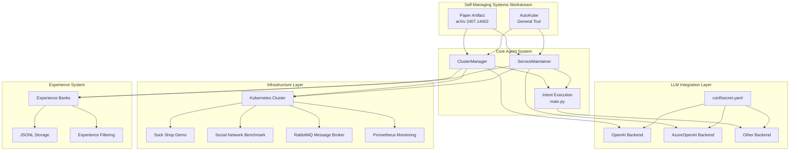

Sources: [README.md:17-24](), [self_managing_systems/microservice/README.md:5-7](), [self_managing_systems/microservice/paper_artifact_arXiv_2407_14402/README.md:47-76]()

### Code-to-System Mapping

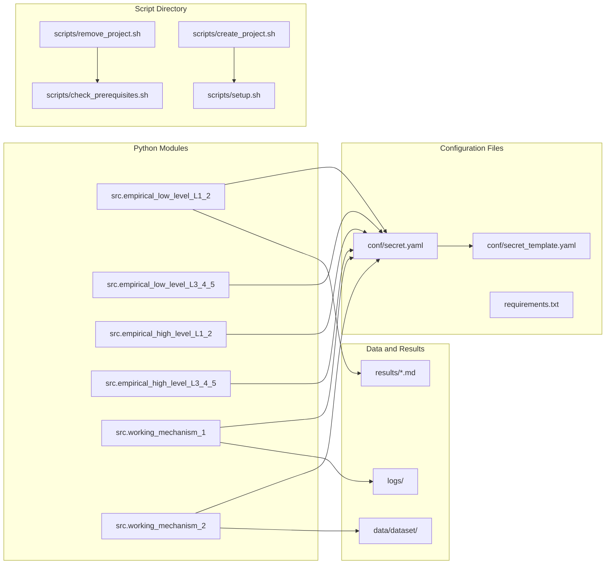

Sources: [self_managing_systems/microservice/paper_artifact_arXiv_2407_14402/README.md:78-161]()

## Paper Artifact Implementation

The Paper Artifact implements the experimental framework described in arXiv paper 2407.14402, providing empirical validation of LLM-based agents for microservice self-management. This implementation focuses on the Sock Shop microservice demo environment.

### Experimental Framework

The Paper Artifact includes multiple experimental modules that test different autonomic levels (L1-L5) and agent architectures:

| Module | Purpose | Agent Level | Test Cases |
|--------|---------|-------------|------------|
| `src.empirical_low_level_L1_2` | Basic autonomic tasks | Low-level | metric_collection, restart |
| `src.empirical_low_level_L3_4_5` | Advanced autonomic tasks | Low-level | pod_failure scenarios |
| `src.empirical_high_level_L1_2` | Group management tasks | High-level | Multi-component optimization |
| `src.empirical_high_level_L3_4_5` | Complex group scenarios | High-level | Coordinated failure handling |

### Working Mechanisms

The system implements two primary working mechanisms:

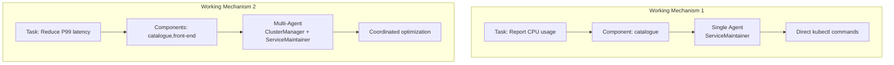

Sources: [self_managing_systems/microservice/paper_artifact_arXiv_2407_14402/README.md:127-156]()

### LLM Configuration

The Paper Artifact supports multiple LLM backends through a unified configuration system in `conf/secret.yaml`:

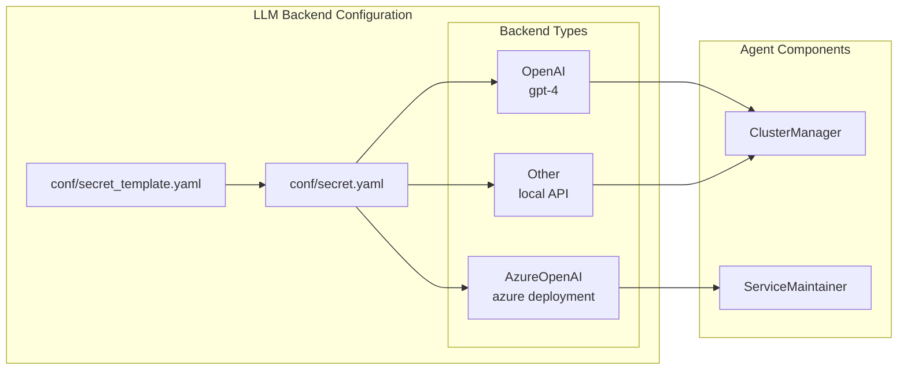

Sources: [self_managing_systems/microservice/paper_artifact_arXiv_2407_14402/README.md:47-76]()

## AutoKube System

AutoKube represents the general-purpose tool implementation of the Self-Managing Systems architecture, designed to simplify microservice management in Kubernetes through LLM-powered agents. While the Paper Artifact focuses on experimental validation, AutoKube aims for practical deployment scenarios.

### Tool Architecture

AutoKube builds upon the research work from the Paper Artifact but extends it for broader applicability beyond the experimental Sock Shop environment. The system maintains the core agent architecture while providing enhanced Dev and Ops workflow integration.

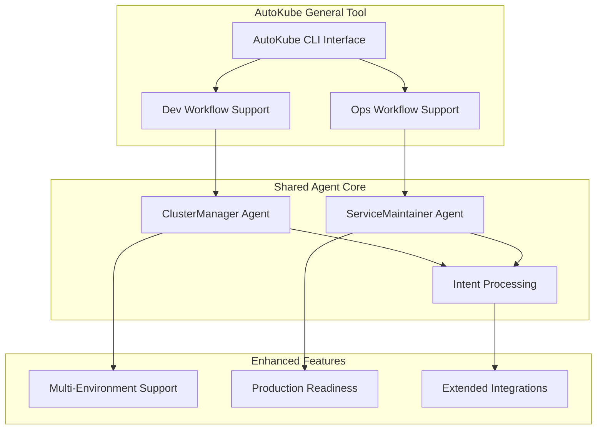

Sources: [README.md:10](), [self_managing_systems/microservice/README.md:6]()

## Agent Architecture

The core agent system implements a hierarchical architecture with specialized agents for different management scopes. The `ClusterManager` handles cluster-level operations while `ServiceMaintainer` instances manage individual services.

### Agent Component Relationships

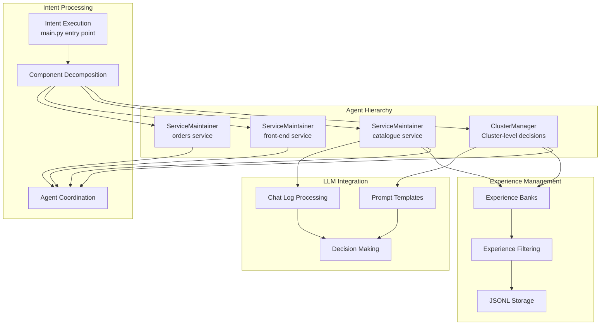

Sources: [self_managing_systems/microservice/paper_artifact_arXiv_2407_14402/README.md:78-86](), [self_managing_systems/microservice/paper_artifact_arXiv_2407_14402/README.md:139-155]()

### Agent Execution Flow

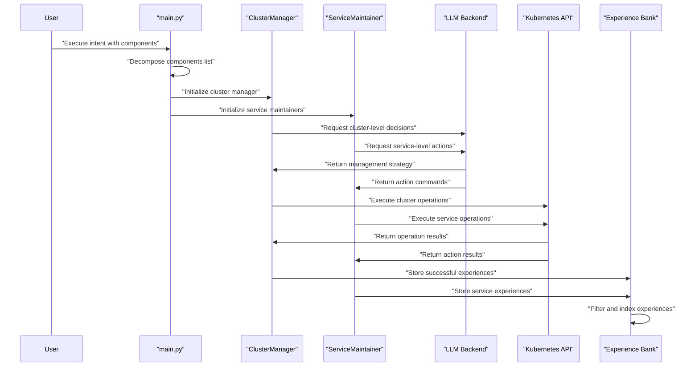

Sources: [self_managing_systems/microservice/paper_artifact_arXiv_2407_14402/README.md:78-86]()

## Development and Deployment

The Self-Managing Systems workstream provides comprehensive scripts and workflows for setting up development and experimental environments.

### Environment Setup Workflow

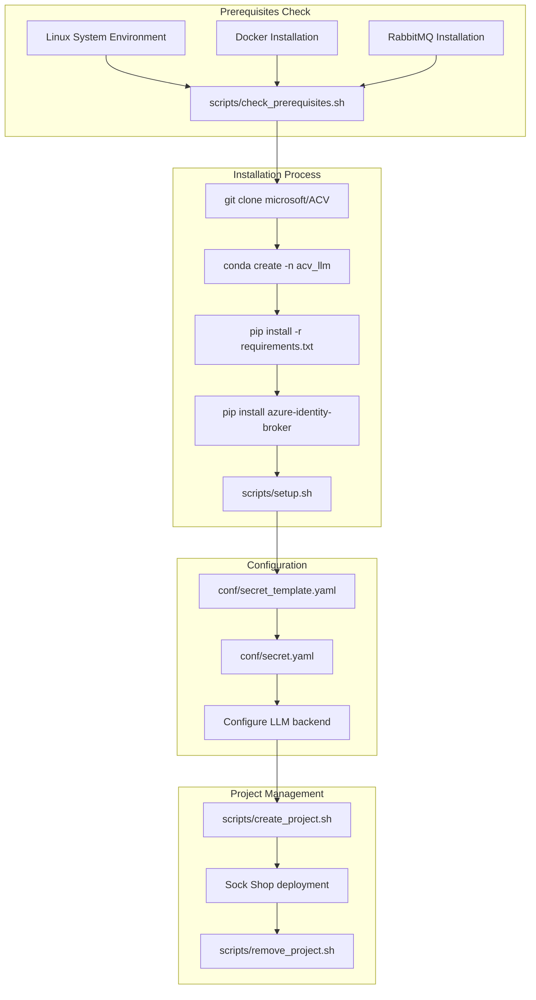

Sources: [self_managing_systems/microservice/paper_artifact_arXiv_2407_14402/README.md:22-45](), [self_managing_systems/microservice/paper_artifact_arXiv_2407_14402/README.md:131-161]()

### Experimental Execution Patterns

The system supports various execution patterns for different experimental scenarios:

| Execution Pattern | Command Example | Purpose |
|------------------|-----------------|---------|
| Quick Trial | `python -m src.empirical_low_level_L1_2 --instance metric_collection_1` | Basic functionality test |
| Low-level L1-L2 | `python -m src.empirical_low_level_L1_2 --instance restart` | Simple autonomic tasks |
| Low-level L3-L5 | `python -m src.empirical_low_level_L3_4_5 --instance pod_failure` | Advanced failure handling |
| High-level L1-L2 | `python -m src.empirical_high_level_L1_2 --task 'Reduce P99 latency'` | Multi-component optimization |
| Working Mechanism 1 | `python -m src.working_mechanism_1 --task 'Report CPU usage'` | Single-agent operations |
| Working Mechanism 2 | `python -m src.working_mechanism_2 --task 'Reduce latency'` | Multi-agent coordination |

Sources: [self_managing_systems/microservice/paper_artifact_arXiv_2407_14402/README.md:78-156]()

---

# Page: Paper Artifact Implementation

# Paper Artifact Implementation

<details>
<summary>Relevant source files</summary>

The following files were used as context for generating this wiki page:

- [README.md](README.md)
- [self_managing_systems/microservice/README.md](self_managing_systems/microservice/README.md)
- [self_managing_systems/microservice/paper_artifact_arXiv_2407_14402/README.md](self_managing_systems/microservice/paper_artifact_arXiv_2407_14402/README.md)

</details>


## Purpose and Scope

This document covers the implementation of the research artifact for arXiv paper 2407.14402 "The Vision of Autonomic Computing: Can LLMs Make It a Reality?". The artifact provides experimental validation of LLM-based agents for microservice self-management using the Sock Shop microservice demo project. For information about the general AutoKube tool built upon this research, see [AutoKube System](#2.2). For broader agent architecture details, see [Agent Architecture](#2.3).

Sources: [README.md:11-13](), [self_managing_systems/microservice/paper_artifact_arXiv_2407_14402/README.md:1-15]()

## Research Context and Implementation Overview

The paper artifact implements a two-level architecture for microservice self-management, consisting of low-level autonomic agents (`ServiceMaintainer`) and high-level group managers (`ClusterManager`). The implementation validates the autonomic computing vision through five levels of management tasks (L1-L5) ranging from basic monitoring to complex failure recovery scenarios.

The artifact specifically targets the Sock Shop microservice demo environment and provides reproducible experiments demonstrating self-configuration, self-optimization, self-healing, and self-protection capabilities using GPT-4 and Azure OpenAI models.

### Paper Artifact Architecture

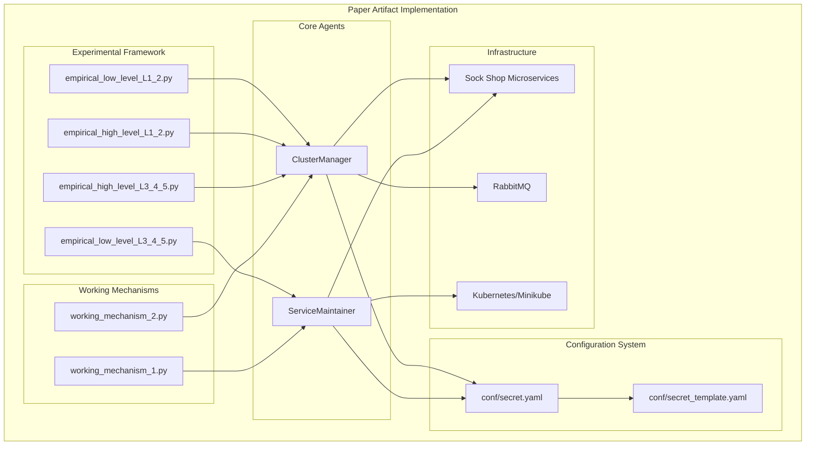

Sources: [self_managing_systems/microservice/paper_artifact_arXiv_2407_14402/README.md:17-20](), [self_managing_systems/microservice/paper_artifact_arXiv_2407_14402/README.md:88-123]()

## Experimental Environment Setup

The paper artifact requires a specific environment setup including Linux, Docker, RabbitMQ, and Kubernetes. The setup process is automated through several shell scripts that handle prerequisite checking, software installation, and environment configuration.

### Environment Setup Flow

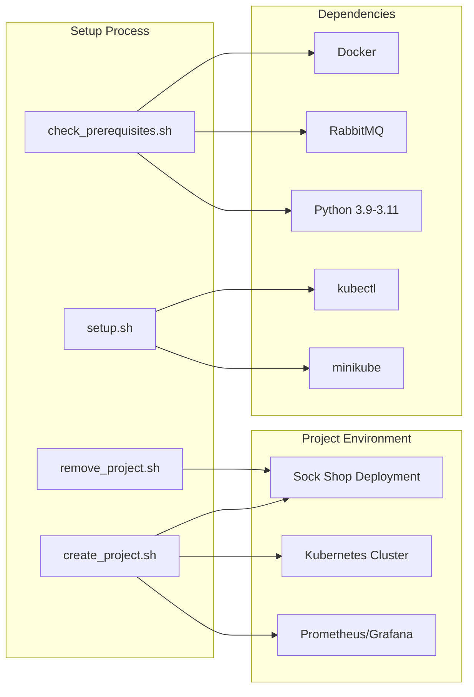

The installation follows this sequence:
1. Prerequisites verification via `check_prerequisites.sh`
2. Software installation via `setup.sh` (Ubuntu-specific)
3. Python dependencies via `requirements.txt`
4. Project environment creation via `create_project.sh`

Sources: [self_managing_systems/microservice/paper_artifact_arXiv_2407_14402/README.md:24-45](), [self_managing_systems/microservice/paper_artifact_arXiv_2407_14402/README.md:131-161]()

## LLM Configuration System

The artifact supports multiple LLM backends through a YAML-based configuration system. The `conf/secret.yaml` file (created from `conf/secret_template.yaml`) defines the LLM endpoint configuration used by both `ClusterManager` and `ServiceMaintainer` agents.

### LLM Backend Configuration

| Backend Type | Configuration Parameters | Supported Models |
|--------------|-------------------------|------------------|
| OpenAI | `api_key`, `model` | gpt-4, gpt-3.5-turbo |
| AzureOpenAI | `api_key`, `base_url`, `api_version`, `model` | Azure OpenAI deployments |
| Other | `base_url`, `api_key`, `model` | Local/custom endpoints |

### Configuration Mapping

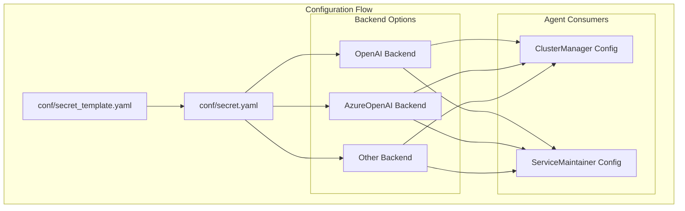

Sources: [self_managing_systems/microservice/paper_artifact_arXiv_2407_14402/README.md:47-76]()

## Experiment Types and Execution

The paper artifact implements two main experimental categories with different task complexity levels (L1-L5). Each experiment type validates specific autonomic computing capabilities through reproducible test scenarios.

### Experimental Structure

| Experiment Type | Script | Agent Level | Task Levels | Purpose |
|-----------------|--------|-------------|-------------|---------|
| Low-level L1-L2 | `empirical_low_level_L1_2.py` | ServiceMaintainer | Basic monitoring, configuration | Validation of self-configuration |
| Low-level L3-L5 | `empirical_low_level_L3_4_5.py` | ServiceMaintainer | Failure handling, optimization | Validation of self-healing |
| High-level L1-L2 | `empirical_high_level_L1_2.py` | ClusterManager | Multi-component optimization | Validation of self-optimization |
| High-level L3-L5 | `empirical_high_level_L3_4_5.py` | ClusterManager | Complex failure scenarios | Validation of self-protection |

### Experiment Execution Flow

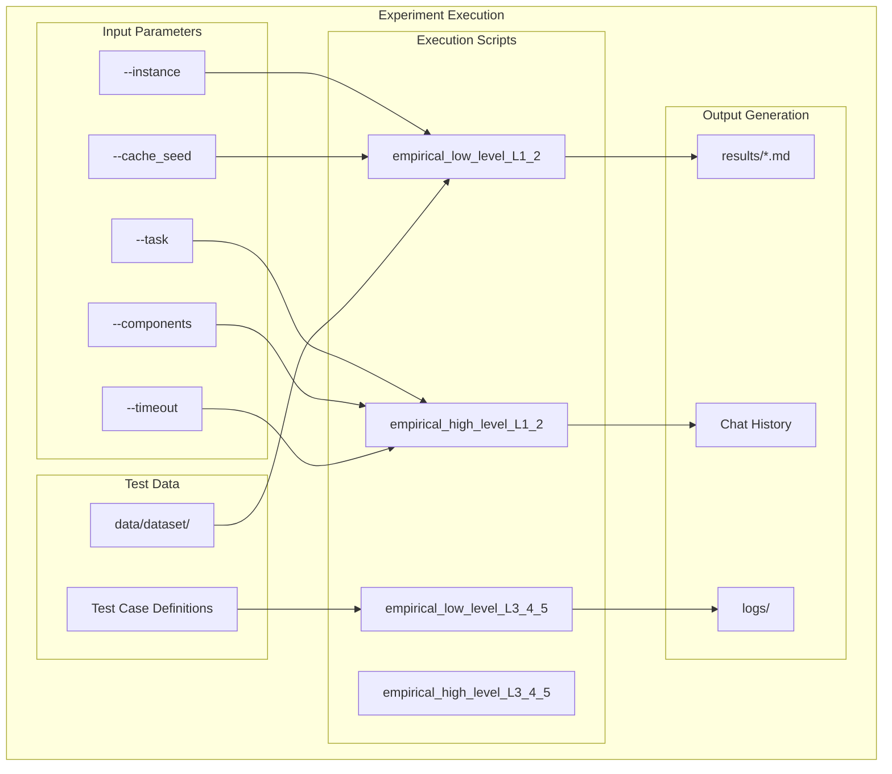

### Working Mechanisms

The artifact also provides two working mechanisms for custom task exploration:

- **Working Mechanism 1** (`working_mechanism_1.py`): Single-component tasks using ServiceMaintainer
- **Working Mechanism 2** (`working_mechanism_2.py`): Multi-component tasks using ClusterManager

Sources: [self_managing_systems/microservice/paper_artifact_arXiv_2407_14402/README.md:88-156]()

## Code Structure and Entry Points

The paper artifact follows a modular structure with clear separation between experimental validation scripts and core agent implementations. The main entry points are located in the `src/` directory with supporting configuration and data in dedicated folders.

### Module Organization

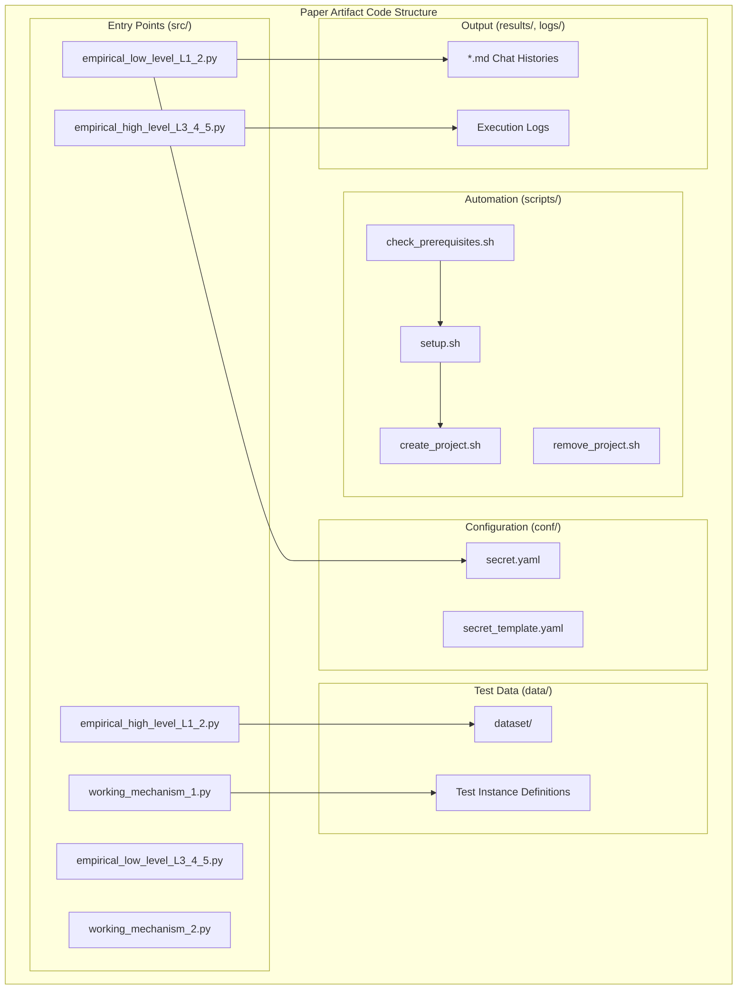

### Quick Trial Execution

The artifact provides a quick trial command for immediate validation:

```bash
python -m src.empirical_low_level_L1_2 \
--instance metric_collection_1 \
--suffix stable \
--cache_seed 42
```

This generates chat history in `results/metric_collection_1-stable.md` and execution logs in `logs/` directory.

Sources: [self_managing_systems/microservice/paper_artifact_arXiv_2407_14402/README.md:78-86](), [self_managing_systems/microservice/paper_artifact_arXiv_2407_14402/README.md:125-126]()

---

# Page: AutoKube System

# AutoKube System

<details>
<summary>Relevant source files</summary>

The following files were used as context for generating this wiki page:

- [self_managing_systems/microservice/AutoKube/.gitignore](self_managing_systems/microservice/AutoKube/.gitignore)
- [self_managing_systems/microservice/AutoKube/README.md](self_managing_systems/microservice/AutoKube/README.md)
- [self_managing_systems/microservice/AutoKube/src/agent_creation/README.md](self_managing_systems/microservice/AutoKube/src/agent_creation/README.md)

</details>


## Purpose and Scope

This document covers the AutoKube system, a general-purpose tool for LLM-powered Kubernetes microservice management. AutoKube provides both development workflows for setting up agent-based management systems and operational workflows for managing microservices through an intuitive command-line interface. 

For research-specific implementation details related to the academic paper artifact, see [Paper Artifact Implementation](#2.1). For detailed information about the underlying agent architecture that AutoKube orchestrates, see [Agent Architecture](#2.3).

## System Overview

AutoKube simplifies microservice management in Kubernetes environments by leveraging Large Language Model (LLM)-powered agents. The system bridges the gap between complex Kubernetes operations and user-friendly management through two primary workflows: development setup and operational management.

### AutoKube Architecture

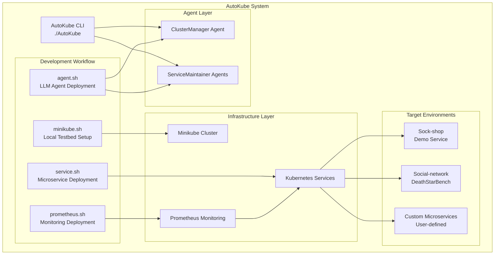

Sources: [self_managing_systems/microservice/AutoKube/README.md:17-23](), [self_managing_systems/microservice/AutoKube/README.md:44-60]()

## Development Workflow

The development workflow enables developers to set up agent-based management systems for their microservices. AutoKube provides automated scripts to establish the complete infrastructure stack.

### Development Script Execution Flow

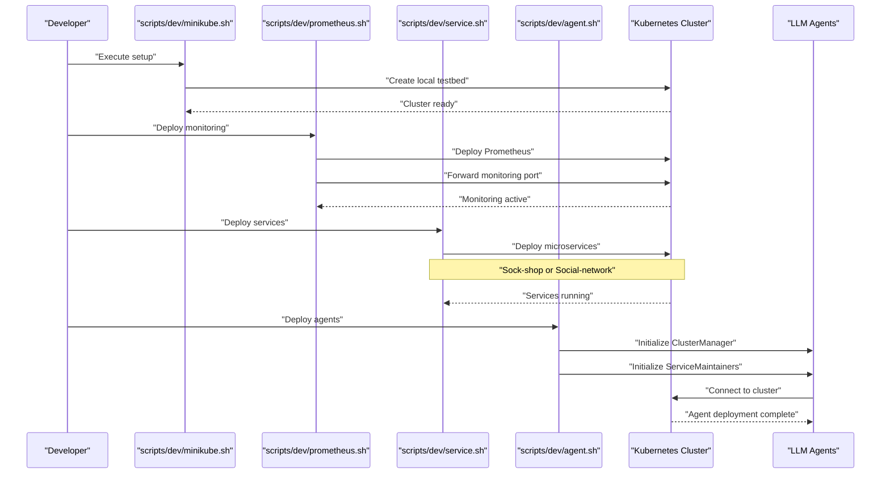

Sources: [self_managing_systems/microservice/AutoKube/README.md:48-60]()

### Development Script Components

| Script | Purpose | Function |
|--------|---------|----------|
| `scripts/dev/minikube.sh` | Local testbed creation | Sets up Minikube cluster for development |
| `scripts/dev/prometheus.sh` | Monitoring infrastructure | Deploys Prometheus and configures port forwarding |
| `scripts/dev/service.sh` | Microservice deployment | Deploys example services (Sock-shop or Social-network) |
| `scripts/dev/agent.sh` | Agent initialization | Deploys and configures LLM-based agents |

Sources: [self_managing_systems/microservice/AutoKube/README.md:48-60]()

## Operations Workflow

The operations workflow provides microservice operators with an intuitive command-line interface for managing services through LLM-based agents, even with limited Kubernetes familiarity.

### AutoKube Command-Line Interface

The primary operational interface is the `AutoKube` executable, which serves as the entry point for all management operations:

```bash
./AutoKube
```

This command-line tool integrates with the underlying agent architecture to provide natural language-based microservice management capabilities.

Sources: [self_managing_systems/microservice/AutoKube/README.md:63-66]()

## Integration with Agent Architecture

AutoKube serves as the orchestration layer that coordinates with the core agent system components. The system leverages the intent execution framework to process user commands and delegate tasks to appropriate agents.

### AutoKube Agent Coordination

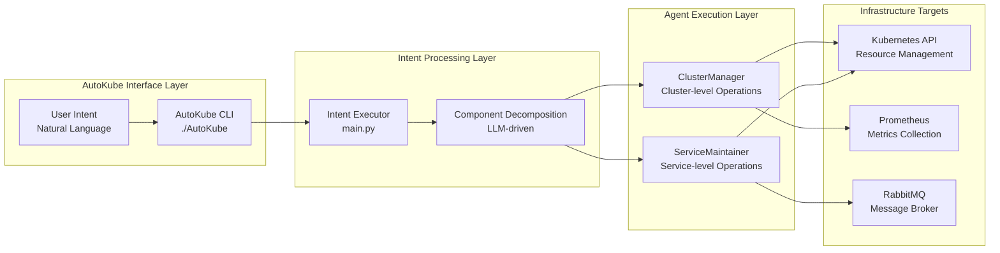

Sources: [self_managing_systems/microservice/AutoKube/README.md:17-19](), [self_managing_systems/microservice/AutoKube/README.md:23]()

## Example Scenarios and Supported Services

AutoKube includes two pre-configured example scenarios for demonstration and testing:

### Supported Microservice Examples

| Service | Type | Description |
|---------|------|-------------|
| Sock-shop | E-commerce Demo | Microservice demonstration application |
| Social-network | DeathStarBench | Social networking microservice benchmark |

These examples are deployed through the `scripts/dev/service.sh` script and provide complete environments for testing AutoKube's agent-based management capabilities.

Sources: [self_managing_systems/microservice/AutoKube/README.md:44](), [self_managing_systems/microservice/AutoKube/README.md:51]()

## Research Foundation

AutoKube is inspired by research on applying LLM-based agents for microservice self-management. The system builds upon the academic work documented in the paper artifact implementation, extending the research concepts into a general-purpose tool for broader microservice management scenarios.

For detailed information about the research implementation and experimental validation, see [Paper Artifact Implementation](#2.1). For comprehensive coverage of the agent system architecture that AutoKube orchestrates, see [Agent Architecture](#2.3).

Sources: [self_managing_systems/microservice/AutoKube/README.md:23]()

---

# Page: Agent Architecture

# Agent Architecture

<details>
<summary>Relevant source files</summary>

The following files were used as context for generating this wiki page:

- [README.md](README.md)
- [self_managing_systems/microservice/AutoKube/.gitignore](self_managing_systems/microservice/AutoKube/.gitignore)
- [self_managing_systems/microservice/AutoKube/README.md](self_managing_systems/microservice/AutoKube/README.md)
- [self_managing_systems/microservice/AutoKube/src/agent_creation/README.md](self_managing_systems/microservice/AutoKube/src/agent_creation/README.md)
- [self_managing_systems/microservice/README.md](self_managing_systems/microservice/README.md)
- [self_managing_systems/microservice/paper_artifact_arXiv_2407_14402/README.md](self_managing_systems/microservice/paper_artifact_arXiv_2407_14402/README.md)

</details>


This document provides a comprehensive overview of the agent architecture that forms the core of the Self-Managing Systems framework. The architecture consists of LLM-powered agents designed to autonomously manage microservices in Kubernetes environments through intelligent decision-making and experience-based learning.

For specific implementation details on intent processing, see [Intent Execution System](#2.3.1). For information on learning mechanisms, see [Experience Management](#2.3.2). For AI prompt systems, see [Prompt Templates](#2.3.3). For data storage systems, see [Experience Banks](#2.3.4).

## System Overview

The agent architecture implements a multi-agent system where specialized agents collaborate to achieve autonomous microservice management. The system is designed to handle the four key properties of autonomic computing: self-configuration, self-optimization, self-healing, and self-protection.

### Core Agent Architecture

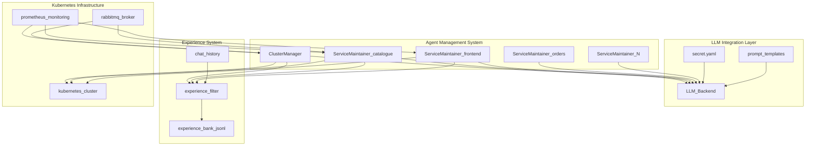

Sources: [self_managing_systems/microservice/paper_artifact_arXiv_2407_14402/README.md:48-76](), [self_managing_systems/microservice/AutoKube/README.md:17-19]()

## Agent Types and Responsibilities

The architecture defines two primary agent types, each with distinct responsibilities and operational scopes within the microservice management ecosystem.

### ClusterManager Agent

The `ClusterManager` serves as the high-level orchestrator responsible for cluster-wide operations and coordination between individual service maintainers. It operates at the infrastructure level and makes decisions that affect the entire microservice ecosystem.

**Key Responsibilities:**
- Cluster-wide resource allocation and optimization
- High-level task decomposition and delegation
- Inter-service dependency management
- Global policy enforcement

### ServiceMaintainer Agents  

`ServiceMaintainer` agents are specialized for individual microservice management. Each microservice component (such as `catalogue`, `front-end`, `orders`) has its dedicated ServiceMaintainer instance that focuses on service-specific operations.

**Key Responsibilities:**
- Service-specific monitoring and diagnostics
- Performance optimization for individual services
- Service-level self-healing and recovery
- Local configuration management

### Agent-to-Code Mapping

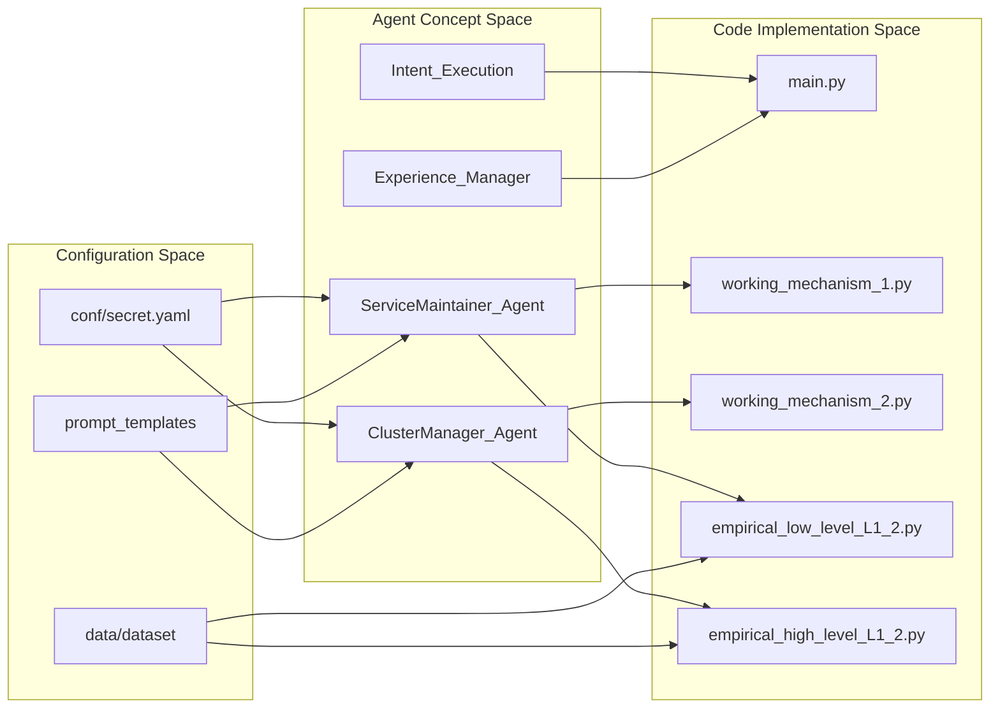

Sources: [self_managing_systems/microservice/paper_artifact_arXiv_2407_14402/README.md:139-155](), [self_managing_systems/microservice/paper_artifact_arXiv_2407_14402/README.md:107-123]()

## Agent Communication and Coordination

The agents operate through a coordinated communication model that enables both hierarchical control and peer-to-peer collaboration when needed.

### Communication Patterns

| Communication Type | Participants | Purpose | Implementation |
|-------------------|-------------|---------|----------------|
| Hierarchical | ClusterManager ↔ ServiceMaintainers | Task delegation and status reporting | Direct method calls |
| Peer-to-Peer | ServiceMaintainer ↔ ServiceMaintainer | Cross-service coordination | Message broker (RabbitMQ) |
| External | All Agents ↔ LLM Backend | Decision making and reasoning | HTTP API calls |
| Infrastructure | All Agents ↔ Kubernetes | Operational commands | kubectl/K8s API |

### Agent Deployment Architecture

```mermaid
graph TB
    subgraph "Development Environment"
        DEV_SETUP[scripts/dev/minikube.sh]
        DEV_PROM[scripts/dev/prometheus.sh] 
        DEV_SERVICE[scripts/dev/service.sh]
        DEV_AGENT[scripts/dev/agent.sh]
    end
    
    subgraph "Runtime Environment"
        MINIKUBE[minikube_cluster]
        PROMETHEUS[prometheus_instance]
        SOCKSHOP[sock_shop_services]
        AGENTS[agent_processes]
    end
    
    subgraph "Management Interface"
        AUTOKUBE[AutoKube_CLI]
        CONFIG_CHECK[scripts/check_prerequisites.sh]
        SETUP[scripts/setup.sh]
    end
    
    DEV_SETUP --> MINIKUBE
    DEV_PROM --> PROMETHEUS
    DEV_SERVICE --> SOCKSHOP
    DEV_AGENT --> AGENTS
    
    CONFIG_CHECK --> DEV_SETUP
    SETUP --> DEV_SETUP
    AUTOKUBE --> AGENTS
    
    AGENTS --> MINIKUBE
    AGENTS --> PROMETHEUS
    AGENTS --> SOCKSHOP
```

Sources: [self_managing_systems/microservice/AutoKube/README.md:46-60](), [self_managing_systems/microservice/paper_artifact_arXiv_2407_14402/README.md:24-45]()

## LLM Integration Architecture

The agents integrate with Large Language Models through a configurable backend system that supports multiple LLM providers and deployment models.

### LLM Configuration

The system supports three primary LLM backend configurations:

**OpenAI Integration:**
- Model: `gpt-4` series models
- Configuration file: `conf/secret.yaml`
- API key authentication

**Azure OpenAI Integration:**  
- Model: Custom deployment names (e.g., `my-gpt-4-deployment`)
- Endpoint-based configuration
- API version: `2024-02-01`

**Local/Other Integration:**
- Custom model names (e.g., `llama-7B`)
- Local endpoint support
- Optional API key authentication

### Agent-LLM Interaction Flow

```mermaid
sequenceDiagram
    participant Agent as "ClusterManager/ServiceMaintainer"
    participant Config as "conf/secret.yaml"
    participant LLM as "LLM_Backend"
    participant K8s as "kubernetes_cluster"
    participant Exp as "experience_bank"
    
    Agent->>Config: "Load LLM configuration"
    Config->>Agent: "Backend settings"
    Agent->>LLM: "Send management query with context"
    LLM->>Agent: "Return decision/action plan"
    Agent->>K8s: "Execute kubectl commands"
    K8s->>Agent: "Return operation results"
    Agent->>Exp: "Store experience (JSONL format)"
    Agent->>LLM: "Request experience filtering"
    LLM->>Exp: "Update experience bank"
```

Sources: [self_managing_systems/microservice/paper_artifact_arXiv_2407_14402/README.md:47-76]()

## Working Mechanisms

The agent architecture implements two primary working mechanisms that demonstrate different operational patterns and capabilities.

### Working Mechanism 1: Single Agent Operations

This mechanism focuses on individual ServiceMaintainer operations for component-specific tasks such as monitoring, diagnostics, and basic management operations.

**Example Implementation:**
- Task: `Report CPU usage of your component`
- Target: Single component (e.g., `catalogue`)
- Execution: Direct ServiceMaintainer action

### Working Mechanism 2: Multi-Agent Coordination

This mechanism demonstrates ClusterManager coordination of multiple ServiceMaintainer agents for complex, multi-component tasks requiring cross-service optimization.

**Example Implementation:**
- Task: `Reduce the total P99 latency of catalogue and front-end to under 400 ms`
- Target: Multiple components (`catalogue`, `front-end`)
- Execution: ClusterManager orchestration with ServiceMaintainer collaboration

Sources: [self_managing_systems/microservice/paper_artifact_arXiv_2407_14402/README.md:139-156]()

## Integration with Autonomic Computing Principles

The agent architecture directly implements the four core autonomic computing properties:

| Autonomic Property | Agent Implementation | Code References |
|-------------------|---------------------|----------------|
| Self-Configuration | Automatic service setup and parameter tuning | `scripts/dev/agent.sh` |
| Self-Optimization | Performance monitoring and improvement | Working Mechanism 2 |
| Self-Healing | Failure detection and recovery | L3, L4, L5 tasks |
| Self-Protection | Security monitoring and threat response | ClusterManager oversight |

The architecture provides the foundation for implementing these properties through intelligent agent behavior powered by LLM reasoning capabilities and experience-based learning mechanisms.

Sources: [README.md:15-19](), [self_managing_systems/microservice/paper_artifact_arXiv_2407_14402/README.md:99-123]()

---

# Page: Intent Execution System

# Intent Execution System

<details>
<summary>Relevant source files</summary>

The following files were used as context for generating this wiki page:

- [self_managing_systems/microservice/AutoKube/src/intent_exec/main.py](self_managing_systems/microservice/AutoKube/src/intent_exec/main.py)

</details>


## Purpose and Scope

The Intent Execution System serves as the primary orchestration engine for user intent processing in the AutoKube self-managing systems framework. This system translates natural language user intents into coordinated actions performed by multiple autonomous agents across a Kubernetes cluster.

The system handles the complete lifecycle from intent reception to execution completion, including component decomposition, agent initialization, message-based coordination, and experience collection. For information about the underlying agent implementations, see [Agent Architecture](#2.3). For details about experience-based learning mechanisms, see [Experience Management](#2.3.2).

## System Overview

The Intent Execution System operates as a multi-stage pipeline that transforms user intents into concrete infrastructure management actions. The system leverages Large Language Models (LLMs) for intent understanding and component identification, while utilizing message queues for agent coordination.

```mermaid
graph TD
    UserIntent["User Intent<br/>(Natural Language)"] --> ComponentDecomposer["Component Decomposer<br/>(LLM-based)"]
    ComponentDecomposer --> ComponentList["Component List<br/>(Parsed Output)"]
    ComponentList --> AgentInit["Agent Initialization"]
    
    subgraph "Agent Orchestration"
        AgentInit --> ClusterManager["ClusterManager<br/>(_init_from_config)"]
        AgentInit --> ServiceMaintainers["ServiceMaintainer[]<br/>(_init_from_config)"]
    end
    
    subgraph "Message Queue System"
        RabbitMQSetup["RabbitMQ Setup<br/>(Exchange & Queues)"]
        ManagerConsumer["ManagerConsumer<br/>(Agent Wrapper)"]
        ServiceConsumers["ServiceMaintainerConsumer[]<br/>(Agent Wrappers)"]
    end
    
    subgraph "Execution & Collection"
        MessageCollector["MessageCollector<br/>(Log Aggregation)"]
        ResultSummary["Result Summary<br/>(LLM-generated)"]
        ExperienceStorage["Experience Storage<br/>(add_experience)"]
    end
    
    ClusterManager --> ManagerConsumer
    ServiceMaintainers --> ServiceConsumers
    ManagerConsumer --> RabbitMQSetup
    ServiceConsumers --> RabbitMQSetup
    
    RabbitMQSetup --> MessageCollector
    MessageCollector --> ResultSummary
    ResultSummary --> ExperienceStorage
```

Sources: [self_managing_systems/microservice/AutoKube/src/intent_exec/main.py:29-174]()

## Intent Processing Flow

The intent execution begins with command-line argument parsing and proceeds through several distinct phases. The system accepts a natural language intent and optional cache seed configuration.

### Command Line Interface

The system entry point accepts the following parameters:

| Parameter | Type | Required | Description |
|-----------|------|----------|-------------|
| `--intent` | string | Yes | Natural language description of desired action |
| `--cache_seed` | integer | No | Cache seed for agents (default: 42, -1 to disable) |

### Execution Phases

```mermaid
sequenceDiagram
    participant CLI as "Command Line"
    participant Main as "main.py"
    participant LLM as "get_chat_completion"
    participant Config as "component_list.yaml"
    participant Agents as "Agent Initialization"
    participant Queue as "RabbitMQ"
    participant Consumers as "Agent Consumers"
    
    CLI->>Main: "--intent 'user request'"
    Main->>Config: "Load component definitions"
    Config->>Main: "Available components list"
    Main->>LLM: "Decompose intent to components"
    LLM->>Main: "Component list response"
    Main->>Agents: "Initialize ClusterManager & ServiceMaintainers"
    Main->>Queue: "Setup exchanges and queues"
    Main->>Consumers: "Start agent consumers"
    Queue->>Consumers: "TASK: user intent"
    Consumers->>Queue: "Agent communications"
```

Sources: [self_managing_systems/microservice/AutoKube/src/intent_exec/main.py:29-35](), [self_managing_systems/microservice/AutoKube/src/intent_exec/main.py:37-56]()

## Component Decomposition

The system uses an LLM-based component decomposition mechanism to translate user intents into specific microservice components that need management attention.

### Decomposition Process

The component decomposer utilizes a YAML-based prompt template system:

1. **Component Configuration Loading**: The system loads available components from `component_list.yaml` [self_managing_systems/microservice/AutoKube/src/intent_exec/main.py:37-42]()

2. **Prompt Template Processing**: Uses `component_decomposer.yaml` to format system and user prompts [self_managing_systems/microservice/AutoKube/src/intent_exec/main.py:44-51]()

3. **LLM Processing**: Sends formatted prompts to GPT-4 Turbo model [self_managing_systems/microservice/AutoKube/src/intent_exec/main.py:52-53]()

4. **Component Extraction**: Parses LLM response into component list [self_managing_systems/microservice/AutoKube/src/intent_exec/main.py:54-56]()

### Cluster Mapping

The system maps decomposed components to specific cluster configurations:

```mermaid
graph LR
    Components["Decomposed Components"] --> ClusterMatcher["Cluster Matcher<br/>(component_config)"]
    ClusterMatcher --> ClusterValidation["Cluster Validation<br/>(all components match)"]
    ClusterValidation --> ClusterName["Selected Cluster<br/>(sock-shop, social-network, etc.)"]
    
    subgraph "Special Handling"
        GlobalMaintainer["global-maintainer<br/>(removed from list)"]
    end
    
    Components --> GlobalMaintainer
```

Sources: [self_managing_systems/microservice/AutoKube/src/intent_exec/main.py:77-89]()

## Agent Orchestration

The system initializes and orchestrates two types of agents: a single `ClusterManager` and multiple `ServiceMaintainer` instances corresponding to identified components.

### Agent Initialization

Agent creation follows a factory pattern using configuration-based initialization:

**ClusterManager Initialization**:
```python
cluster_manager = ClusterManager._init_from_config(
    cache_seed=args.cache_seed if args.cache_seed != -1 else None,
    components=[component.strip() for component in args.components.split(',')]
)
```

**ServiceMaintainer Initialization**:
```python
agents = [
    ServiceMaintainer._init_from_config(
        cluster_name=cluster_name,
        service_name=component,
        intent=args.intent,
        cache_seed=args.cache_seed if args.cache_seed != -1 else None, 
    )
    for component in components
]
```

### Consumer Wrapper Pattern

Each agent is wrapped in a consumer that handles message queue integration and logging:

```mermaid
graph TD
    subgraph "Agent Layer"
        ClusterManagerAgent["ClusterManager<br/>(Business Logic)"]
        ServiceAgent1["ServiceMaintainer<br/>(Component 1)"]
        ServiceAgent2["ServiceMaintainer<br/>(Component 2)"]
    end
    
    subgraph "Consumer Layer"
        ManagerConsumer["ManagerConsumer<br/>(Message Handler)"]
        ServiceConsumer1["ServiceMaintainerConsumer<br/>(Message Handler)"]
        ServiceConsumer2["ServiceMaintainerConsumer<br/>(Message Handler)"]
    end
    
    subgraph "Infrastructure Layer"
        ManagerLog["manager.md<br/>(Log File)"]
        ServiceLog1["component1.md<br/>(Log File)"]
        ServiceLog2["component2.md<br/>(Log File)"]
    end
    
    ClusterManagerAgent --> ManagerConsumer
    ServiceAgent1 --> ServiceConsumer1
    ServiceAgent2 --> ServiceConsumer2
    
    ManagerConsumer --> ManagerLog
    ServiceConsumer1 --> ServiceLog1
    ServiceConsumer2 --> ServiceLog2
```

Sources: [self_managing_systems/microservice/AutoKube/src/intent_exec/main.py:66-111]()

## Message Flow and Communication

The system implements an asynchronous message-passing architecture using RabbitMQ for agent coordination and a `MessageCollector` for centralized logging.

### RabbitMQ Configuration

The message queue system is configured through the global configuration and supports multiple queues for different agent types:

```mermaid
graph LR
    subgraph "RabbitMQ Setup"
        Exchange["RabbitMQ Exchange<br/>(global_config)"]
        ManagerQueue["Manager Queue<br/>(routing_key: manager)"]
        ServiceQueues["Service Queues<br/>(component-specific)"]
    end
    
    subgraph "Message Publishers"
        MainProcess["main.py<br/>(Task Publisher)"]
    end
    
    subgraph "Message Consumers"
        ManagerConsumer["ManagerConsumer<br/>(ClusterManager)"]
        ServiceConsumers["ServiceMaintainerConsumer[]<br/>(ServiceMaintainers)"]
    end
    
    MainProcess --> Exchange
    Exchange --> ManagerQueue
    Exchange --> ServiceQueues
    ManagerQueue --> ManagerConsumer
    ServiceQueues --> ServiceConsumers
```

### Task Initiation

The system publishes the initial task message to trigger agent execution:

```python
rabbitmq.publish(f'TASK: {args.intent}', routing_keys=['manager'])
```

Sources: [self_managing_systems/microservice/AutoKube/src/intent_exec/main.py:125-129]()

## Result Collection and Experience Storage

The execution phase concludes with comprehensive result collection, summary generation, and experience storage for future learning.

### Execution Management

The system manages execution timing and graceful shutdown:

1. **Execution Window**: 10-minute execution timeout with keyboard interrupt handling [self_managing_systems/microservice/AutoKube/src/intent_exec/main.py:131-141]()

2. **Consumer Lifecycle**: Proper startup and shutdown of all message consumers [self_managing_systems/microservice/AutoKube/src/intent_exec/main.py:115-140]()

### Result Summarization

The system generates intelligent summaries of execution results using LLM processing:

```mermaid
graph TD
    ExecutionLogs["Execution Logs<br/>(manager.md, component.md files)"] --> LogReader["Log File Reader<br/>(File I/O)"]
    LogReader --> SummaryPrompt["Summary Prompt<br/>(LLM Query)"]
    SummaryPrompt --> GPT4["GPT-4 Turbo<br/>(get_chat_completion)"]
    GPT4 --> SummaryOutput["Summary Output<br/>(Blue Terminal Text)"]
    
    subgraph "Summary Context"
        TaskDescription["Task Description<br/>(Original Intent)"]
        ChatLog["Chat Log Content<br/>(Execution Process)"]
    end
    
    TaskDescription --> SummaryPrompt
    ChatLog --> SummaryPrompt
```

### Experience Banking

Each agent's execution log is processed and stored as experience for future reference:

```python
for agent in agents:
    agent_log_path = os.path.join(result_dir, f'{agent.name}.md')
    if os.path.exists(agent_log_path):
        with open(agent_log_path, 'r') as file:
            agent_log_content = file.read()
            add_experience(cluster, agent_log_content)
```

The `add_experience()` function integrates with the broader experience management system documented in [Experience Management](#2.3.2).

Sources: [self_managing_systems/microservice/AutoKube/src/intent_exec/main.py:145-174]()

## Result Directory Structure

The system creates timestamped result directories containing all execution artifacts:

```
results/AutoKube/
└── {YYYY-MM-DD HH:MM:SS}/
    ├── manager.md           # ClusterManager chat log
    ├── {component1}.md      # ServiceMaintainer logs
    ├── {component2}.md      # Additional component logs
    └── ...
```

This structured logging enables both immediate result review and long-term experience accumulation for the autonomous learning system.

Sources: [self_managing_systems/microservice/AutoKube/src/intent_exec/main.py:58-64](), [self_managing_systems/microservice/AutoKube/src/intent_exec/main.py:72-108]()

---

# Page: Experience Management

# Experience Management

<details>
<summary>Relevant source files</summary>

The following files were used as context for generating this wiki page:

- [self_managing_systems/microservice/AutoKube/src/intent_exec/agent/tool_functions_for_experience.py](self_managing_systems/microservice/AutoKube/src/intent_exec/agent/tool_functions_for_experience.py)
- [self_managing_systems/microservice/AutoKube/src/self_exploration/main.py](self_managing_systems/microservice/AutoKube/src/self_exploration/main.py)

</details>


This document covers the experience-based learning system that enables ACV agents to store, filter, and retrieve operational experiences for improved decision-making. The experience management system provides persistent memory capabilities through JSONL-based storage and LLM-powered relevance filtering.

For information about how experiences are used during intent execution, see [Intent Execution System](#2.3.1). For details about the prompt templates used in experience generation, see [Prompt Templates](#2.3.3). For documentation of the stored experience banks, see [Experience Banks](#2.3.4).

## System Architecture

The experience management system operates through two primary mechanisms: experience creation from chat logs and experience retrieval based on user intent relevance.

### Experience Creation Flow

```mermaid
flowchart TD
    ChatLog["Chat Log (Markdown)"] --> LoadPrompt["load_prompt_from_yaml()"]
    LoadPrompt --> SystemMsg["System Message"]
    LoadPrompt --> UserMsg["User Message"]
    
    SystemMsg --> ChatCompletion["get_chat_completion()"]
    UserMsg --> ChatCompletion
    ChatCompletion --> GPT4["GPT-4-turbo-20240409"]
    
    GPT4 --> JsonResponse["JSON Response"]
    JsonResponse --> ParseJson["json.loads()"]
    ParseJson --> StructuredExp["Structured Experience"]
    
    StructuredExp --> SaveJsonl["Save to {namespace}.jsonl"]
    SaveJsonl --> ExperienceBank["Experience Bank"]
    
    subgraph "File System"
        PromptYaml["prompts/generate_mem.yaml"]
        JsonlFile["experience_bank/{namespace}.jsonl"]
    end
    
    LoadPrompt --> PromptYaml
    SaveJsonl --> JsonlFile
```

**Experience Creation Process**

Sources: [self_managing_systems/microservice/AutoKube/src/self_exploration/main.py:17-40]()

### Experience Retrieval Flow

```mermaid
flowchart TD
    UserIntent["User Intent"] --> FilterFunc["filter_experiences_via_component()"]
    JsonlPath["JSONL File Path"] --> FilterFunc
    FilterKey["Filter Key"] --> FilterFunc
    FilterValue["Filter Value"] --> FilterFunc
    
    FilterFunc --> ReadJsonl["Read JSONL File"]
    ReadJsonl --> FilterKV["Filter by Key-Value"]
    FilterKV --> FilterSuccess["Filter Success Only"]
    
    FilterSuccess --> RelevanceLoop["For Each Experience"]
    RelevanceLoop --> BuildPrompt["Build Chat Message"]
    BuildPrompt --> GPTCall["get_chat_completion()"]
    GPTCall --> GPT4o["GPT-4o-20240513"]
    
    GPT4o --> YesNo["'yes' or 'no'"]
    YesNo --> TripleCheck["Check 3 Times"]
    TripleCheck --> AddToResults["Add to satisfied_experiences"]
    
    AddToResults --> CheckLimit["len >= 3?"]
    CheckLimit -->|No| RelevanceLoop
    CheckLimit -->|Yes| ReturnResults["Return Experiences"]
    
    subgraph "Experience Structure"
        TaskType["task_type"]
        TaskDesc["task_description"] 
        Result["result"]
    end
    
    FilterSuccess --> TaskType
    BuildPrompt --> TaskType
    BuildPrompt --> TaskDesc
    FilterSuccess --> Result
```

**Experience Filtering and Retrieval Process**

Sources: [self_managing_systems/microservice/AutoKube/src/intent_exec/agent/tool_functions_for_experience.py:7-41]()

## Core Functions

### Experience Creation: `add_experience`

The `add_experience` function processes operational chat logs into structured experiences using LLM-based extraction.

| Parameter | Type | Description |
|-----------|------|-------------|
| `namespace` | string | Target experience bank identifier |
| `markdown_text` | string | Raw chat log content |
| `yaml_path` | string | Path to prompt template (default: "prompts/generate_mem.yaml") |

**Process Flow:**
1. Load prompt template from YAML using `load_prompt_from_yaml()`
2. Replace placeholder `{markdown_content}` with actual chat log
3. Send structured prompt to `gpt-4-turbo-20240409`
4. Extract JSON response between first `{` and last `}`
5. Parse and append to `{namespace}.jsonl` file

Sources: [self_managing_systems/microservice/AutoKube/src/self_exploration/main.py:17-40]()

### Experience Retrieval: `filter_experiences_via_component`

The `filter_experiences_via_component` function retrieves relevant experiences based on component matching and intent similarity.

| Parameter | Type | Description |
|-----------|------|-------------|
| `jsonl_path` | string | Path to experience bank JSONL file |
| `filter_key` | string | Experience field to filter on |
| `filter_value` | string | Required value for filter field |
| `intent` | string | User's current intent for relevance check |

**Filtering Logic:**
1. **Component Filter**: Match experiences where `experience[filter_key] == filter_value`
2. **Success Filter**: Only include experiences with `result == "success"`
3. **Relevance Filter**: Use GPT-4o to assess if `task_type` and `task_description` relate to user intent
4. **Triple Validation**: Require 3 consecutive "yes" responses for relevance confirmation
5. **Limit Results**: Return maximum of 3 satisfied experiences

Sources: [self_managing_systems/microservice/AutoKube/src/intent_exec/agent/tool_functions_for_experience.py:7-41]()

## Experience Structure

### JSONL Storage Format

Experiences are stored in namespace-specific JSONL files with the following structure:

```json
{
  "task_type": "string",
  "task_description": "string", 
  "result": "success|failure",
  "component": "string",
  "namespace": "string"
}
```

### Relevance Assessment Prompt

The LLM-based relevance check uses a structured prompt:

| Role | Content |
|------|---------|
| system | "Your task is to determine if the provided task type and task description are related to the user's intent. Respond with 'yes' or 'no'." |
| system | "Related means that similar things to query, similar aims to operate or similar cause to analyze." |
| user | "User's intent: {intent}" |
| user | "Task Type: {task_type}" |
| user | "Task Description: {task_description}" |

Sources: [self_managing_systems/microservice/AutoKube/src/intent_exec/agent/tool_functions_for_experience.py:21-27]()

## Integration Points

### API Dependencies

The experience management system integrates with the following components:

```mermaid
graph LR
    ExpMgmt["Experience Management"] --> CloudGPT["cloudgpt_aoai"]
    ExpMgmt --> Logger["Logger Module"]
    ExpMgmt --> YAML["YAML Config Loader"]
    ExpMgmt --> JSON["JSON Processing"]
    
    CloudGPT --> GPT4Turbo["GPT-4-turbo-20240409"]
    CloudGPT --> GPT4o["GPT-4o-20240513"]
    
    YAML --> PromptTemplate["Prompt Templates"]
    JSON --> JsonlFiles["JSONL Experience Banks"]
    
    subgraph "File System Integration"
        ExperienceBank["experience_bank/{namespace}.jsonl"]
        GenerateMemYAML["prompts/generate_mem.yaml"]
    end
    
    ExpMgmt --> ExperienceBank
    ExpMgmt --> GenerateMemYAML
```

**System Dependencies**

Sources: [self_managing_systems/microservice/AutoKube/src/intent_exec/agent/tool_functions_for_experience.py:1-5](), [self_managing_systems/microservice/AutoKube/src/self_exploration/main.py:1-4]()

### Agent System Integration

Experience management supports the broader agent architecture through:

- **ClusterManager**: Stores cluster-level operational experiences
- **ServiceMaintainer**: Stores service-specific maintenance experiences  
- **Intent Execution**: Retrieves relevant experiences for decision-making
- **Namespace Isolation**: Separates experiences by deployment environment (sock-shop, social-network)

The system provides persistent learning capabilities that enable agents to improve performance through accumulated operational knowledge while maintaining strict relevance filtering to ensure experience quality.

Sources: [self_managing_systems/microservice/AutoKube/src/intent_exec/agent/tool_functions_for_experience.py:7-41](), [self_managing_systems/microservice/AutoKube/src/self_exploration/main.py:17-40]()

---

# Page: Prompt Templates

# Prompt Templates

<details>
<summary>Relevant source files</summary>

The following files were used as context for generating this wiki page:

- [self_managing_systems/microservice/AutoKube/src/prompts/generate_mem.yaml](self_managing_systems/microservice/AutoKube/src/prompts/generate_mem.yaml)

</details>


This document covers the prompt template system used by the self-managing systems to generate structured experiences from chat logs and other LLM interactions. The prompt templates define how raw conversational data is transformed into structured JSON experiences that can be stored and retrieved by the experience management system.

For information about how these structured experiences are stored and managed, see [Experience Banks](#2.3.4). For details on how experiences are filtered and retrieved during agent operations, see [Experience Management](#2.3.2).

## Purpose and Architecture

The prompt template system serves as the bridge between unstructured natural language interactions and the structured experience data required by the agent system. When agents interact with LLMs to manage Kubernetes environments, the conversational logs need to be converted into standardized JSON format for storage in experience banks.

### Template System Overview

```mermaid
graph TB
    ChatLogs["Chat Logs<br/>(Natural Language)"] --> PromptTemplate["generate_mem.yaml<br/>Prompt Template"]
    PromptTemplate --> LLMService["LLM Service<br/>(GPT-4)"]
    LLMService --> StructuredJSON["Structured JSON<br/>Experience"]
    StructuredJSON --> ExperienceBank["Experience Banks<br/>(JSONL Files)"]
    
    subgraph "Template Components"
        SystemMessage["system_message"]
        Instructions["Instructions"]
        JSONTemplate["JSON Template"]
    end
    
    PromptTemplate --> SystemMessage
    PromptTemplate --> Instructions
    PromptTemplate --> JSONTemplate
```

Sources: [self_managing_systems/microservice/AutoKube/src/prompts/generate_mem.yaml:1-37]()

## Template Structure

### Core Template: generate_mem.yaml

The primary prompt template is defined in `generate_mem.yaml` and contains three main components:

| Component | Purpose | Content |
|-----------|---------|---------|
| `system_message` | Defines LLM role and task | Instructions for converting chat logs to JSON |
| Instructions | Structured rules | 6 specific formatting requirements |
| Template | JSON schema | Expected output format |

```mermaid
graph LR
    subgraph "generate_mem.yaml Structure"
        SystemMsg["system_message:<br/>Role Definition"]
        Rules["Instructions:<br/>6 Formatting Rules"]
        Schema["Template:<br/>JSON Schema"]
    end
    
    subgraph "Output JSON Fields"
        Component["component"]
        TaskType["task_type"]
        TaskDesc["task_description"]
        Result["result"]
        Trajectories["trajectories[]"]
    end
    
    SystemMsg --> Component
    Rules --> TaskType
    Rules --> TaskDesc
    Rules --> Result
    Schema --> Trajectories
    
    subgraph "Trajectory Structure"
        Step["step"]
        Input["input"]
        Output["output"]
        Reasoning["reasoning"]
    end
    
    Trajectories --> Step
    Trajectories --> Input
    Trajectories --> Output
    Trajectories --> Reasoning
```

Sources: [self_managing_systems/microservice/AutoKube/src/prompts/generate_mem.yaml:1-37]()

### System Message Design

The system message establishes the LLM's role as a converter of Kubernetes interaction logs:

- **Input**: Series of steps from chat logs describing Kubernetes interactions
- **Output**: Structured JSON experience log
- **Transformation**: Natural language → Standardized experience format

The message specifically targets Kubernetes environment interactions, making it domain-specific for the microservice management use case.

Sources: [self_managing_systems/microservice/AutoKube/src/prompts/generate_mem.yaml:1-3]()

## JSON Schema Definition

### Top-Level Structure

The template defines a specific JSON schema with four required top-level fields:

```mermaid
graph TD
    ExperienceJSON["Experience JSON"] --> Component["component:<br/>Component Under Test"]
    ExperienceJSON --> TaskType["task_type:<br/>Task Descriptor"]
    ExperienceJSON --> TaskDesc["task_description:<br/>Overall Task Goal"]
    ExperienceJSON --> Result["result:<br/>Overall Outcome"]
    ExperienceJSON --> Trajectories["trajectories[]:<br/>Step Array"]
    
    subgraph "Example Values"
        CompEx["'nginx-service'"]
        TypeEx["'Verification'"]
        DescEx["'Check service health'"]
        ResEx["'success' | 'failure'"]
    end
    
    Component -.-> CompEx
    TaskType -.-> TypeEx
    TaskDesc -.-> DescEx
    Result -.-> ResEx
```

Sources: [self_managing_systems/microservice/AutoKube/src/prompts/generate_mem.yaml:6-10]()

### Trajectory Step Schema

Each trajectory step follows a standardized four-field structure:

| Field | Type | Description | Example |
|-------|------|-------------|---------|
| `step` | Number | Sequential step order | `1, 2, 3...` |
| `input` | String | Command or action executed | `"kubectl get pods"` |
| `output` | String | Response or result | `"3 pods running"` |
| `reasoning` | String | Why step was taken | `"Verify deployment status"` |

The template includes fallback values for missing data: `"No command executed"` for input and `"No output"` for output when no actual command was run.

Sources: [self_managing_systems/microservice/AutoKube/src/prompts/generate_mem.yaml:11-16]()

## Data Flow and Integration

### Natural Language to Structured Data Pipeline

```mermaid
sequenceDiagram
    participant Agent as "ClusterManager/ServiceMaintainer"
    participant ChatLog as "Chat Log Buffer"
    participant Template as "generate_mem.yaml"
    participant LLM as "LLM Service"
    participant Experience as "Experience Bank"
    
    Agent->>ChatLog: "Log interaction steps"
    Agent->>Template: "Load prompt template"
    Template->>LLM: "System message + instructions"
    ChatLog->>LLM: "Raw chat log data"
    LLM->>LLM: "Apply JSON transformation rules"
    LLM->>Experience: "Structured JSON experience"
    
    Note over LLM: "Converts:<br/>Natural language → JSON<br/>Unstructured → Structured<br/>Conversational → Experiential"
```

Sources: [self_managing_systems/microservice/AutoKube/src/prompts/generate_mem.yaml:1-37]()

### Template Processing Rules

The template includes six specific processing rules that ensure consistent output:

1. **Field Completeness**: All top-level JSON fields must be present
2. **Data Consistency**: Information must be correctly inferred from conversation
3. **Missing Data Handling**: Standardized fallback values for missing commands
4. **JSON Validity**: Output must be syntactically correct
5. **Step Ordering**: Trajectory steps must maintain sequential numbering
6. **Format Compliance**: Must match the provided JSON template exactly

Sources: [self_managing_systems/microservice/AutoKube/src/prompts/generate_mem.yaml:17-18]()

## Template Usage Context

The `generate_mem.yaml` template specifically supports the experience-based learning system by converting operational interactions into reusable experiences. This enables agents to:

- **Learn from Past Actions**: Store successful interaction patterns
- **Avoid Repeated Mistakes**: Capture failure scenarios with reasoning
- **Share Knowledge**: Create transferable experience records
- **Debug Operations**: Maintain detailed step-by-step logs

The template's focus on Kubernetes operations aligns with the self-managing systems' primary use case of microservice environment management.

Sources: [self_managing_systems/microservice/AutoKube/src/prompts/generate_mem.yaml:1-37]()

---

# Page: Experience Banks

# Experience Banks

<details>
<summary>Relevant source files</summary>

The following files were used as context for generating this wiki page:

- [self_managing_systems/microservice/AutoKube/src/self_exploration/experience_bank/social-network.jsonl](self_managing_systems/microservice/AutoKube/src/self_exploration/experience_bank/social-network.jsonl)
- [self_managing_systems/microservice/AutoKube/src/self_exploration/experience_bank/sock-shop.jsonl](self_managing_systems/microservice/AutoKube/src/self_exploration/experience_bank/sock-shop.jsonl)

</details>


## Purpose and Scope

Experience Banks provide persistent storage for agent experiences in JSONL (JSON Lines) format, enabling the self-managing systems to learn from past actions and improve decision-making over time. This system stores structured records of agent activities across different microservice environments, supporting experience-based learning for both ClusterManager and ServiceMaintainer agents.

For information about how experiences are generated and filtered before storage, see [Experience Management](#2.3.2). For details on how stored experiences are retrieved and used during agent execution, see [Intent Execution System](#2.3.1).

## File System Organization

The experience banks are organized as environment-specific JSONL files within the AutoKube source tree:

```mermaid
graph TD
    root["self_managing_systems/microservice/AutoKube/src/self_exploration/experience_bank/"]
    sockshop["sock-shop.jsonl"]
    socialnet["social-network.jsonl"]
    
    root --> sockshop
    root --> socialnet
    
    sockshop --> sockexp["Sock Shop Environment<br/>Agent Experiences"]
    socialnet --> socialexp["Social Network Environment<br/>Agent Experiences"]
```

**Storage Directory Structure**
| Environment | File Path | Purpose |
|-------------|-----------|---------|
| Sock Shop | `sock-shop.jsonl` | Experiences from sock-shop microservice demo |
| Social Network | `social-network.jsonl` | Experiences from DeathStarBench social network |

Sources: [self_managing_systems/microservice/AutoKube/src/self_exploration/experience_bank/sock-shop.jsonl:1-1](), [self_managing_systems/microservice/AutoKube/src/self_exploration/experience_bank/social-network.jsonl:1-2]()

## Experience Entry Format

Each experience entry follows a standardized JSON schema that captures the complete context and execution trace of an agent task:

```mermaid
graph LR
    entry["Experience Entry"]
    
    entry --> component["component"]
    entry --> tasktype["task_type"] 
    entry --> taskdesc["task_description"]
    entry --> result["result"]
    entry --> trajectories["trajectories[]"]
    
    trajectories --> step["step"]
    trajectories --> input["input"]
    trajectories --> output["output"] 
    trajectories --> reasoning["reasoning"]
    
    component --> compval["home-timeline-service"]
    tasktype --> tasktypeval["Monitoring"]
    taskdesc --> taskdescval["Check CPU usage..."]
    result --> resultval["success"]
```

**Core Experience Fields**
| Field | Type | Description |
|-------|------|-------------|
| `component` | string | Target microservice component name |
| `task_type` | string | Category of task (Monitoring, Scaling, etc.) |
| `task_description` | string | Natural language description of the task |
| `result` | string | Outcome status (success, failure) |
| `trajectories` | array | Step-by-step execution trace |

**Trajectory Step Fields**
| Field | Type | Description |
|-------|------|-------------|
| `step` | integer | Sequential step number |
| `input` | string | Command or action executed |
| `output` | string | Command output or response |
| `reasoning` | string | Agent's reasoning for the step |

Sources: [self_managing_systems/microservice/AutoKube/src/self_exploration/experience_bank/social-network.jsonl:1-1]()

## Experience Storage Schema

The following diagram illustrates how agent experiences map to the JSONL storage format:

```mermaid
graph TB
    subgraph "Agent Execution"
        agent["ServiceMaintainer Agent"]
        task["kubectl top pod command"]
        steps["Multi-step trajectory"]
    end
    
    subgraph "JSONL Storage Format"
        jsonentry["JSON Entry"]
        comp["component: home-timeline-service"]
        ttype["task_type: Monitoring"] 
        tdesc["task_description: Check CPU usage..."]
        res["result: success"]
        traj["trajectories: [step1, step2, ...]"]
    end
    
    subgraph "Trajectory Steps"
        step1["step: 1, input: No command, reasoning: Preparing..."]
        step2["step: 2, input: kubectl top pod..., output: CPU data"]
        step3["step: 3, reasoning: Inform CPU usage..."]
        step4["step: 4, input: report_result(...), reasoning: Reporting..."]
        step5["step: 5, reasoning: Terminate monitoring..."]
    end
    
    agent --> jsonentry
    task --> comp
    steps --> traj
    
    traj --> step1
    traj --> step2  
    traj --> step3
    traj --> step4
    traj --> step5
```

Sources: [self_managing_systems/microservice/AutoKube/src/self_exploration/experience_bank/social-network.jsonl:1-1]()

## Integration with Agent System

Experience banks integrate with the broader agent architecture through read/write operations during agent execution:

```mermaid
sequenceDiagram
    participant "ServiceMaintainer" as SM
    participant "Experience Manager" as EM  
    participant "Experience Bank" as EB
    participant "social-network.jsonl" as SNDB
    
    SM->>EM: "Execute monitoring task"
    EM->>SM: "Retrieve relevant experiences"
    EM->>SNDB: "Read matching experiences" 
    SNDB->>EM: "Return experience data"
    EM->>SM: "Provide context from past tasks"
    
    SM->>SM: "Execute kubectl commands"
    SM->>EM: "Store new experience"
    EM->>EM: "Format experience as JSON"
    EM->>SNDB: "Append to JSONL file"
    
    Note over SNDB: "Each line = one experience"
    Note over SNDB: "Persistent across agent restarts"
```

**Read Operations**: Experience retrieval for context-aware decision making
**Write Operations**: New experience persistence after successful task completion
**File Format**: JSONL enables incremental append operations without full file rewrites

Sources: [self_managing_systems/microservice/AutoKube/src/self_exploration/experience_bank/social-network.jsonl:1-1]()

## Environment-Specific Storage

Different microservice environments maintain separate experience banks to ensure context-appropriate learning:

**Sock Shop Environment**
- File: `sock-shop.jsonl`
- Focus: E-commerce microservice patterns
- Components: Frontend, catalogue, user services

**Social Network Environment** 
- File: `social-network.jsonl`
- Focus: Social media microservice patterns  
- Components: `home-timeline-service`, user-service, compose-post-service

This separation enables environment-specific optimization while maintaining experience portability across similar microservice architectures.

Sources: [self_managing_systems/microservice/AutoKube/src/self_exploration/experience_bank/sock-shop.jsonl:1-1](), [self_managing_systems/microservice/AutoKube/src/self_exploration/experience_bank/social-network.jsonl:1-1]()

---

# Page: Development and Deployment

# Development and Deployment

<details>
<summary>Relevant source files</summary>

The following files were used as context for generating this wiki page:

- [self_managing_systems/microservice/AutoKube/scripts/dev/agent.sh](self_managing_systems/microservice/AutoKube/scripts/dev/agent.sh)
- [self_managing_systems/microservice/AutoKube/scripts/dev/service.sh](self_managing_systems/microservice/AutoKube/scripts/dev/service.sh)

</details>


This page documents the development environment setup and deployment procedures for the self-managing systems workstream. It covers the automated scripts for deploying microservice environments and LLM-based agents, as well as the lifecycle management of these components. For information about the underlying agent architecture, see [Agent Architecture](#2.3). For details about the AutoKube system design, see [AutoKube System](#2.2).

## Overview

The development and deployment framework provides automated scripts for setting up experimental microservice environments and deploying the corresponding LLM agents that manage them. The system supports two primary experimental environments: the `sock-shop` microservice demo and the `social-network` application from DeathStarBench.

## Development Environment Setup

### Deployment Script Architecture

```mermaid
graph TD
    DEV["Development Scripts"] --> AGENT_SCRIPT["agent.sh"]
    DEV --> SERVICE_SCRIPT["service.sh"]
    
    AGENT_SCRIPT --> SETUP_AGENT["Setup Operation"]
    AGENT_SCRIPT --> DEPRECATE_AGENT["Deprecate Operation"]
    
    SERVICE_SCRIPT --> SETUP_SERVICE["Setup Operation"]
    SERVICE_SCRIPT --> DEPRECATE_SERVICE["Deprecate Operation"]
    
    SETUP_AGENT --> NAMESPACE_SELECT["Namespace Selection"]
    NAMESPACE_SELECT --> AGENT_CREATION["src.agent_creation.main"]
    
    SETUP_SERVICE --> EXPERIMENT_SELECT["Experiment Selection"]
    EXPERIMENT_SELECT --> SOCKSHOP["sock-shop Setup"]
    EXPERIMENT_SELECT --> SOCIAL["social-network Setup"]
    
    SOCKSHOP --> KUBECTL_APPLY["kubectl apply -f"]
    SOCIAL --> DEATHSTAR_CLONE["DeathStarBench Clone"]
    SOCIAL --> MINIKUBE_MOUNT["minikube mount"]
    SOCIAL --> HELM_INSTALL["helm install"]
    
    AGENT_CREATION --> CLUSTER_MANAGER["ClusterManager Deployment"]
    AGENT_CREATION --> SERVICE_MAINTAINER["ServiceMaintainer Deployment"]
```

**Sources:** [self_managing_systems/microservice/AutoKube/scripts/dev/agent.sh:1-55](), [self_managing_systems/microservice/AutoKube/scripts/dev/service.sh:1-65]()

### Script-Based Deployment System

The deployment system consists of two interactive bash scripts that manage the complete lifecycle of microservice environments and their corresponding agents:

| Script | Purpose | Operations | Target Components |
|--------|---------|------------|------------------|
| `agent.sh` | Agent lifecycle management | `setup`, `deprecate` | ClusterManager, ServiceMaintainer |
| `service.sh` | Service environment management | `setup`, `deprecate` | sock-shop, social-network |

**Sources:** [self_managing_systems/microservice/AutoKube/scripts/dev/agent.sh:9-10](), [self_managing_systems/microservice/AutoKube/scripts/dev/service.sh:9-10]()

## Service Deployment Process

### Microservice Environment Setup

#### Sock Shop Deployment Flow

```mermaid
sequenceDiagram
    participant USER as "Developer"
    participant SCRIPT as "service.sh"
    participant KUBECTL as "kubectl"
    participant K8S as "Kubernetes"
    
    USER->>SCRIPT: "Execute setup operation"
    SCRIPT->>USER: "Select experiment: sock-shop"
    USER->>SCRIPT: "sock-shop"
    SCRIPT->>KUBECTL: "kubectl apply -f experiment_environment/sock-shop-backup"
    KUBECTL->>K8S: "Deploy sock-shop manifests"
    K8S->>SCRIPT: "Deployment confirmation"
    SCRIPT->>USER: "Setup completed successfully"
```

**Sources:** [self_managing_systems/microservice/AutoKube/scripts/dev/service.sh:28-31]()

#### Social Network Deployment Flow

```mermaid
sequenceDiagram
    participant USER as "Developer"
    participant SCRIPT as "service.sh"
    participant GIT as "Git Repository"
    participant MINIKUBE as "Minikube"
    participant HELM as "Helm"
    participant K8S as "Kubernetes"
    
    USER->>SCRIPT: "Execute setup operation"
    SCRIPT->>USER: "Select experiment: social-network"
    USER->>SCRIPT: "social-network"
    SCRIPT->>GIT: "git clone DeathStarBench"
    GIT->>SCRIPT: "Repository cloned"
    SCRIPT->>MINIKUBE: "minikube mount DeathStarBench:/DeathStarBench"
    SCRIPT->>K8S: "kubectl create namespace social-network"
    SCRIPT->>HELM: "helm install social-network ./experiment_environment/social-network"
    HELM->>K8S: "Deploy social-network chart"
    K8S->>SCRIPT: "Deployment confirmation"
    SCRIPT->>USER: "Setup completed successfully"
```

**Sources:** [self_managing_systems/microservice/AutoKube/scripts/dev/service.sh:21-27]()

### Experiment Environment Configuration

The service deployment script supports two experimental environments with different setup procedures:

| Environment | Repository Source | Deployment Method | Namespace |
|-------------|------------------|-------------------|-----------|
| `sock-shop` | Local manifests | `kubectl apply` | `sock-shop` |
| `social-network` | DeathStarBench GitHub | Helm chart | `social-network` |

**Sources:** [self_managing_systems/microservice/AutoKube/scripts/dev/service.sh:15-16](), [self_managing_systems/microservice/AutoKube/scripts/dev/service.sh:40-41]()

## Agent Deployment Process

### Agent Lifecycle Management

The agent deployment process utilizes the `agent.sh` script to manage ClusterManager and ServiceMaintainer instances across Kubernetes namespaces:

#### Agent Setup Workflow

```mermaid
graph TD
    START["agent.sh execution"] --> OP_SELECT["Operation selection: setup/deprecate"]
    OP_SELECT --> NS_LIST["kubectl get ns -o jsonpath"]
    NS_LIST --> NS_DISPLAY["Display available namespaces"]
    NS_DISPLAY --> NS_INPUT["User namespace selection"]
    NS_INPUT --> SETUP_CHECK{"Operation == setup?"}
    
    SETUP_CHECK -->|Yes| SETUP_EXEC["python -m src.agent_creation.main --namespace NS --setup"]
    SETUP_CHECK -->|No| DEPRECATE_EXEC["python -m src.agent_creation.main --namespace NS"]
    
    SETUP_EXEC --> SUCCESS_CHECK{"Exit code == 0?"}
    DEPRECATE_EXEC --> SUCCESS_CHECK
    
    SUCCESS_CHECK -->|Yes| SUCCESS_MSG["Success message"]
    SUCCESS_CHECK -->|No| ERROR_MSG["Error message + exit 1"]
```

**Sources:** [self_managing_systems/microservice/AutoKube/scripts/dev/agent.sh:12-17](), [self_managing_systems/microservice/AutoKube/scripts/dev/agent.sh:26](), [self_managing_systems/microservice/AutoKube/scripts/dev/agent.sh:41]()

### Agent Creation Module Integration

The agent deployment scripts interface with the Python-based `src.agent_creation.main` module, which handles the instantiation of ClusterManager and ServiceMaintainer agents within specified Kubernetes namespaces.

#### Command Line Interface

| Operation | Command | Parameters | Function |
|-----------|---------|------------|----------|
| Setup | `python -m src.agent_creation.main --namespace <ns> --setup` | `--namespace`, `--setup` | Deploy agents |
| Deprecate | `python -m src.agent_creation.main --namespace <ns>` | `--namespace` | Remove agents |

**Sources:** [self_managing_systems/microservice/AutoKube/scripts/dev/agent.sh:26](), [self_managing_systems/microservice/AutoKube/scripts/dev/agent.sh:41]()

## Deployment Lifecycle Management

### Deprecation Procedures

Both service and agent deployment scripts provide symmetric deprecation operations for environment cleanup:

#### Service Deprecation

```mermaid
graph LR
    DEPRECATE_START["deprecate operation"] --> EXP_SELECT["experiment selection"]
    EXP_SELECT --> SOCKSHOP_DEP["sock-shop: kubectl delete namespace sock-shop"]
    EXP_SELECT --> SOCIAL_DEP["social-network: kubectl delete namespace social-network"]
    SOCKSHOP_DEP --> SUCCESS["Deprecation completed"]
    SOCIAL_DEP --> SUCCESS
```

**Sources:** [self_managing_systems/microservice/AutoKube/scripts/dev/service.sh:46-53]()

#### Agent Deprecation

The agent deprecation process removes ClusterManager and ServiceMaintainer instances from the specified namespace using the same `src.agent_creation.main` module without the `--setup` flag.

**Sources:** [self_managing_systems/microservice/AutoKube/scripts/dev/agent.sh:35-47]()

### Error Handling and Validation

Both deployment scripts implement comprehensive error handling with colored output for user feedback:

| Color Code | Message Type | Usage |
|------------|--------------|-------|
| `GREEN` | Success/Prompts | Successful operations, user prompts |
| `RED` | Errors | Failed operations, invalid inputs |
| `YELLOW` | Progress | In-progress operations |
| `BLUE` | Values | User input options, namespace names |

**Sources:** [self_managing_systems/microservice/AutoKube/scripts/dev/agent.sh:3-7](), [self_managing_systems/microservice/AutoKube/scripts/dev/service.sh:3-7]()

## Integration with Development Workflow

### Prerequisites

The deployment system requires the following components to be available in the development environment:

- Kubernetes cluster (minikube for local development)
- `kubectl` configured for cluster access
- `helm` for social-network deployment
- Python environment with AutoKube modules
- Git for DeathStarBench repository cloning

### Namespace Management

The agent deployment script dynamically discovers available Kubernetes namespaces using `kubectl get ns -o jsonpath='{.items[*].metadata.name}'`, allowing flexible deployment across different experimental environments.

**Sources:** [self_managing_systems/microservice/AutoKube/scripts/dev/agent.sh:12]()

---

# Page: OSrCIR System

# OSrCIR System

<details>
<summary>Relevant source files</summary>

The following files were used as context for generating this wiki page:

- [OSrCIR/OSrCIR.jpg](OSrCIR/OSrCIR.jpg)
- [OSrCIR/README.md](OSrCIR/README.md)

</details>


## Purpose and Scope

This document covers the OSrCIR (One-Stage Reflective Chain-of-Thoughts) system for training-free zero-shot composed image retrieval. OSrCIR represents the secondary research domain within the ACV repository, focusing on multimodal large language model applications for image retrieval tasks. For information about the primary self-managing systems domain, see [Self-Managing Systems](#2).

The OSrCIR system addresses composed image retrieval (CIR) challenges by processing reference images and textual modifications in a single stage using multimodal reasoning, eliminating the information loss inherent in traditional two-stage approaches.

Sources: [OSrCIR/README.md:1-89]()

## System Architecture Overview

### High-Level Processing Pipeline

```mermaid
graph TD
    subgraph "Input Processing"
        RefImg["Reference Image"]
        ModText["Modification Text"]
    end
    
    subgraph "OSrCIR Core System"
        MLLM["Multimodal Large Language Model"]
        RCoT["Reflective Chain-of-Thought Framework"]
        Align["Interpretable Alignment Mechanism"]
    end
    
    subgraph "Output Generation"
        TargetDesc["Target Description"]
        RetrievalResults["Retrieved Target Images"]
    end
    
    subgraph "Performance Metrics"
        VisualRetention["92.3% Visual Detail Retention"]
        PerfGains["1.80-6.44% Performance Gains"]
    end
    
    RefImg --> MLLM
    ModText --> MLLM
    MLLM --> RCoT
    RCoT --> Align
    Align --> TargetDesc
    TargetDesc --> RetrievalResults
    
    RCoT --> VisualRetention
    Align --> PerfGains
```

Sources: [OSrCIR/README.md:17-48]()

## Core Components and Implementation Architecture

### Code Structure and Baseline Integration

```mermaid
graph TB
    subgraph "External Dependencies"
        CIReVL["CIReVL Baseline Code"]
        MLLM_Models["Multimodal LLM Models"]
    end
    
    subgraph "OSrCIR Implementation"
        subgraph "Core Processing"
            SingleStage["osrcir_single_stage_processor"]
            ReflectiveReasoning["reflective_cot_framework"]
            AlignmentEngine["interpretable_alignment_engine"]
        end
        
        subgraph "Interface Layer"
            ImageProcessor["image_input_handler"]
            TextProcessor["text_modification_parser"]
            ResultGenerator["retrieval_result_formatter"]
        end
        
        subgraph "Configuration"
            ModelConfig["mllm_model_config"]
            ChainConfig["cot_reasoning_config"]
            AlignConfig["alignment_mechanism_config"]
        end
    end
    
    subgraph "Research Artifacts"
        PaperCode["CVPR 2025 Implementation"]
        BenchmarkTests["performance_benchmark_suite"]
        EvalMetrics["evaluation_metrics_calculator"]
    end
    
    CIReVL --> SingleStage
    MLLM_Models --> ReflectiveReasoning
    
    ImageProcessor --> SingleStage
    TextProcessor --> SingleStage
    SingleStage --> ReflectiveReasoning
    ReflectiveReasoning --> AlignmentEngine
    AlignmentEngine --> ResultGenerator
    
    ModelConfig --> ReflectiveReasoning
    ChainConfig --> ReflectiveReasoning
    AlignConfig --> AlignmentEngine
    
    SingleStage --> PaperCode
    ReflectiveReasoning --> BenchmarkTests
    AlignmentEngine --> EvalMetrics
```

Sources: [OSrCIR/README.md:88-89](), [OSrCIR/README.md:41-48]()

## Technical Innovation Characteristics

### Performance Comparison Matrix

| Component | Traditional Two-Stage | OSrCIR One-Stage | Improvement |
|-----------|----------------------|------------------|-------------|
| Visual Detail Retention | Baseline | 92.3% higher | Significant |
| Processing Stages | Caption → Reasoning | Direct Processing | Simplified |
| Information Loss | High (stage transition) | Minimal | Eliminated |
| Performance Gains | Baseline | 1.80-6.44% | Measurable |
| Reasoning Capability | Limited LLM | MLLM Enhanced | Advanced |

Sources: [OSrCIR/README.md:34-48]()

### Key Innovation Areas

```mermaid
graph LR
    subgraph "Traditional Two-Stage Approach"
        T1["Image Captioning"]
        T2["LLM Text Reasoning"]
        T1 --> T2
        T2 --> TResult["Target Description"]
    end
    
    subgraph "OSrCIR One-Stage Innovation"
        O1["Direct MLLM Processing"]
        O2["Reflective Chain-of-Thought"]
        O3["Visual Context Preservation"]
        O1 --> O2
        O2 --> O3
        O3 --> OResult["Enhanced Target Description"]
    end
    
    subgraph "Performance Characteristics"
        InfoLoss["Information Loss: Eliminated"]
        VisualDetails["Visual Details: 92.3% Retention"]
        Accuracy["Accuracy: +1.80-6.44%"]
    end
    
    TResult -.-> InfoLoss
    OResult --> VisualDetails
    OResult --> Accuracy
```

Sources: [OSrCIR/README.md:41-48]()

## Research Context and Applications

### Application Domains

| Domain | Use Case | OSrCIR Advantage |
|--------|----------|------------------|
| Internet Search | Scene image search with object manipulation | Preserves visual context during modifications |
| E-commerce | Product recommendations with attribute changes | Accurate attribute-based retrieval |
| Academic Research | Zero-shot composed image retrieval benchmarks | State-of-the-art performance without training |

Sources: [OSrCIR/README.md:17]()

### Academic Contributions and Status

The OSrCIR system represents a significant contribution to the computer vision and multimodal learning research communities:

- **Publication Status**: Accepted at CVPR 2025
- **Research Paper**: arXiv:2412.11077
- **Primary Author**: Tang, Yuanmin (tangyuanmin@iie.ac.cn)
- **Code Availability**: Example code planned post-publication
- **Baseline Reference**: Adapted from CIReVL (Vision_by_Language)

### Development Timeline

```mermaid
gantt
    title "OSrCIR Development and Release Timeline"
    dateFormat  YYYY-MM-DD
    section Research Phase
    Paper Development    :done, research, 2024-01-01, 2024-12-11
    arXiv Submission     :done, arxiv, 2024-12-11, 2024-12-11
    section Publication Phase
    CVPR 2025 Acceptance :done, cvpr, 2024-12-15, 2024-12-15
    section Code Release Phase
    Example Code        :active, examples, 2024-12-15, 2025-03-01
    Full Release        :future, release, 2025-03-01, 2025-06-01
```

Sources: [OSrCIR/README.md:50-56](), [OSrCIR/README.md:78-85]()

## Community and Collaboration Framework

### Support Channels

The OSrCIR system maintains active community engagement through multiple channels:

- **Primary Repository**: [Pter61/osrcir](https://github.com/Pter61/osrcir)
- **Issue Tracking**: Active community Q&A through GitHub Issues
- **Academic Contact**: Direct email for research collaboration
- **Documentation**: Author-maintained repository with comprehensive README

### Collaboration Opportunities

| Type | Duration | Focus Area |
|------|----------|------------|
| Research Students | Ongoing | Interesting extensions of OSrCIR work |
| Industry Partners | 2-month minimum | Applied research consulting |
| Community Support | As needed | Bug reports and feature requests |

Sources: [OSrCIR/README.md:58-72]()

---

# Page: Architecture and Innovation

# Architecture and Innovation

<details>
<summary>Relevant source files</summary>

The following files were used as context for generating this wiki page:

- [OSrCIR/OSrCIR.jpg](OSrCIR/OSrCIR.jpg)
- [OSrCIR/README.md](OSrCIR/README.md)

</details>


This document provides a technical deep dive into the OSrCIR (One-Stage Reflective Chain-of-Thoughts) system architecture, focusing on its innovative single-stage processing approach and multimodal reasoning framework. OSrCIR represents a significant architectural advancement in training-free zero-shot Composed Image Retrieval (CIR), eliminating the information loss inherent in traditional two-stage methods.

For practical applications and research context of OSrCIR, see [Applications and Research Context](#3.2). For the broader Self-Managing Systems architecture, see [Self-Managing Systems](#2).

## Core Architecture Overview

OSrCIR fundamentally reimagines the CIR pipeline by directly processing reference images and textual modifications through Multimodal Large Language Models (MLLMs) in a single reasoning stage. This architecture eliminates the caption generation bottleneck that causes information degradation in conventional approaches.

### OSrCIR Single-Stage Architecture

```mermaid
graph TD
    InputRef["Reference Image"] --> MLLM["Multimodal LLM"]
    InputText["Modification Text"] --> MLLM
    
    MLLM --> RCoT["Reflective Chain-of-Thought<br/>Framework"]
    RCoT --> VisualAlign["Visual Context<br/>Preservation"]
    RCoT --> IntentAlign["Intent Alignment<br/>Mechanism"]
    
    VisualAlign --> OutputDesc["Target Description"]
    IntentAlign --> OutputDesc
    OutputDesc --> Retrieval["Image Retrieval<br/>Results"]
    
    subgraph "Key Innovation"
        SingleStage["Single-Stage Processing<br/>No Information Loss"]
        VisualRetain["92.3% Visual Detail<br/>Retention"]
    end
    
    MLLM -.-> SingleStage
    VisualAlign -.-> VisualRetain
```

Sources: [OSrCIR/README.md:28-29](), [OSrCIR/README.md:44-45]()

### Traditional Two-Stage vs OSrCIR Comparison

```mermaid
graph TB
    subgraph "Traditional Two-Stage Methods"
        RefImg1["Reference Image"] --> Caption["Image Captioning<br/>Loss of Visual Details"]
        ModText1["Modification Text"] --> LLM1["Large Language Model<br/>Text-Only Reasoning"]
        Caption --> LLM1
        LLM1 --> Target1["Target Description<br/>Information Degraded"]
        Target1 --> Ret1["Retrieval Results<br/>Suboptimal Performance"]
    end
    
    subgraph "OSrCIR One-Stage Method"
        RefImg2["Reference Image"] --> MLLM2["Multimodal LLM<br/>Direct Visual Processing"]
        ModText2["Modification Text"] --> MLLM2
        MLLM2 --> RCoT2["Reflective Chain-of-Thought<br/>Visual + Textual Reasoning"]
        RCoT2 --> Target2["Target Description<br/>Visual Details Preserved"]
        Target2 --> Ret2["Retrieval Results<br/>State-of-the-Art Performance"]
    end
    
    subgraph "Performance Difference"
        Gain["1.80-6.44% Performance<br/>Improvement"]
        Detail["92.3% More Visual<br/>Details Retained"]
    end
    
    Ret2 -.-> Gain
    MLLM2 -.-> Detail
```

Sources: [OSrCIR/README.md:17](), [OSrCIR/README.md:34-35](), [OSrCIR/README.md:44-45]()

## Reflective Chain-of-Thought Framework

The Reflective Chain-of-Thought framework represents the core reasoning engine of OSrCIR, designed to maintain critical visual information while aligning modification intent with contextual cues from reference images.

### Chain-of-Thought Processing Pipeline

```mermaid
graph LR
    subgraph "Input Processing"
        RefImage["Reference Image<br/>Visual Features"]
        ModText["Modification Text<br/>User Intent"]
    end
    
    subgraph "Reflective Chain-of-Thought"
        VisualAnalysis["Visual Context<br/>Analysis"]
        IntentMapping["Intent-to-Visual<br/>Mapping"]
        Reflection["Reflective<br/>Reasoning"]
        Alignment["Contextual<br/>Alignment"]
    end
    
    subgraph "Output Generation"
        TargetDesc["Target Description<br/>Semantically Rich"]
        RetrievalQuery["Retrieval Query<br/>Optimized"]
    end
    
    RefImage --> VisualAnalysis
    ModText --> IntentMapping
    VisualAnalysis --> Reflection
    IntentMapping --> Reflection
    Reflection --> Alignment
    Alignment --> TargetDesc
    TargetDesc --> RetrievalQuery
```

Sources: [OSrCIR/README.md:31-32](), [OSrCIR/README.md:47-48]()

## Multimodal Large Language Model Integration

OSrCIR's architecture leverages MLLMs as the primary processing engine, enabling direct visual understanding without intermediate caption generation. This integration strategy preserves visual fidelity while maintaining reasoning capabilities.

### MLLM Processing Architecture

```mermaid
graph TD
    subgraph "MLLM Core Engine"
        VisualEncoder["Visual Encoder<br/>Image Feature Extraction"]
        TextEncoder["Text Encoder<br/>Modification Processing"]
        CrossModal["Cross-Modal<br/>Attention Mechanism"]
        Reasoning["Chain-of-Thought<br/>Reasoning Engine"]
    end
    
    subgraph "Input Layer"
        InputImg["Reference Image<br/>Pixel Data"]
        InputMod["Modification Text<br/>Natural Language"]
    end
    
    subgraph "Processing Layer"
        FeatureFusion["Feature Fusion<br/>Visual + Textual"]
        ContextAlign["Context Alignment<br/>Intent Mapping"]
        ReflectiveLoop["Reflective Loop<br/>Self-Correction"]
    end
    
    subgraph "Output Layer"
        SemanticDesc["Semantic Description<br/>Target Specification"]
        ConfidenceScore["Confidence Score<br/>Retrieval Quality"]
    end
    
    InputImg --> VisualEncoder
    InputMod --> TextEncoder
    VisualEncoder --> CrossModal
    TextEncoder --> CrossModal
    CrossModal --> Reasoning
    
    Reasoning --> FeatureFusion
    FeatureFusion --> ContextAlign
    ContextAlign --> ReflectiveLoop
    ReflectiveLoop --> SemanticDesc
    ReflectiveLoop --> ConfidenceScore
```

Sources: [OSrCIR/README.md:28-29](), [OSrCIR/README.md:41-42]()

## Technical Innovation Components

### Visual Context Preservation Mechanism

The architecture implements a novel visual context preservation strategy that retains critical image details throughout the reasoning process, addressing the primary limitation of traditional two-stage methods.

| Component | Traditional Methods | OSrCIR Innovation | Performance Impact |
|-----------|-------------------|------------------|-------------------|
| Visual Processing | Caption-based (lossy) | Direct MLLM (lossless) | 92.3% detail retention |
| Reasoning Stage | Text-only LLM | Multimodal reasoning | 1.80-6.44% improvement |
| Information Flow | Two-stage pipeline | Single-stage pipeline | Eliminated bottleneck |
| Intent Alignment | Post-hoc matching | Integrated alignment | Enhanced interpretability |

Sources: [OSrCIR/README.md:44-45](), [OSrCIR/README.md:34-35]()

### Interpretable Alignment Mechanism

```mermaid
graph LR
    subgraph "Alignment Process"
        RefFeatures["Reference Image<br/>Visual Features"]
        ModIntent["Modification<br/>Intent"]
        
        FeatureMap["Feature Mapping<br/>Visual-to-Semantic"]
        IntentAnalysis["Intent Analysis<br/>Requirement Extraction"]
        
        AlignmentMatrix["Alignment Matrix<br/>Feature-Intent Correspondence"]
        ContextFilter["Context Filter<br/>Relevance Scoring"]
        
        OutputAlign["Aligned Description<br/>Contextually Grounded"]
    end
    
    RefFeatures --> FeatureMap
    ModIntent --> IntentAnalysis
    FeatureMap --> AlignmentMatrix
    IntentAnalysis --> AlignmentMatrix
    AlignmentMatrix --> ContextFilter
    ContextFilter --> OutputAlign
```

Sources: [OSrCIR/README.md:47-48]()

## Implementation Foundation

OSrCIR builds upon the CIReVL baseline framework while introducing fundamental architectural changes for single-stage processing.

### System Integration Architecture

```mermaid
graph TB
    subgraph "OSrCIR Implementation"
        OSrCIRCore["OSrCIR Core<br/>Single-Stage Engine"]
        RCoTFramework["Reflective Chain-of-Thought<br/>Framework"]
        MLLMInterface["MLLM Interface<br/>Multimodal Processing"]
    end
    
    subgraph "Baseline Integration"
        CIReVLBase["CIReVL Baseline<br/>Foundation Components"]
        AdaptationLayer["Adaptation Layer<br/>Interface Compatibility"]
    end
    
    subgraph "Performance Layer"
        BenchmarkSuite["Benchmark Suite<br/>Evaluation Framework"]
        MetricsEngine["Metrics Engine<br/>Performance Analysis"]
    end
    
    CIReVLBase --> AdaptationLayer
    AdaptationLayer --> OSrCIRCore
    OSrCIRCore --> RCoTFramework
    OSrCIRCore --> MLLMInterface
    
    OSrCIRCore --> BenchmarkSuite
    BenchmarkSuite --> MetricsEngine
```

Sources: [OSrCIR/README.md:88-89]()

## Performance Characteristics

The OSrCIR architecture delivers measurable improvements across multiple dimensions:

- **Processing Efficiency**: Single-stage elimination of caption generation bottleneck
- **Visual Fidelity**: 92.3% improvement in visual detail retention
- **Retrieval Accuracy**: 1.80-6.44% performance gains across benchmarks
- **Interpretability**: Explicit intent-to-visual feature alignment

Sources: [OSrCIR/README.md:34-35](), [OSrCIR/README.md:44-45]()

The architecture represents a paradigm shift from lossy two-stage processing to direct multimodal reasoning, establishing new state-of-the-art results in training-free zero-shot composed image retrieval.

---

# Page: Applications and Research Context

# Applications and Research Context

<details>
<summary>Relevant source files</summary>

The following files were used as context for generating this wiki page:

- [OSrCIR/OSrCIR.jpg](OSrCIR/OSrCIR.jpg)
- [OSrCIR/README.md](OSrCIR/README.md)

</details>


This document covers the practical applications of the OSrCIR (One-Stage Reflective Chain-of-Thoughts) system and its position within the broader research landscape. It details real-world use cases in internet search and e-commerce, academic contributions, and opportunities for research collaboration and community engagement.

For technical implementation details of the OSrCIR architecture, see [3.1](#3.1). For general information about the ACV research domains, see [1](#1).

## Application Domains

### OSrCIR Application Architecture

```mermaid
graph TB
    subgraph "OSrCIR_System" ["OSrCIR System"]
        MLLM["Multimodal Large Language Model"]
        RCoT["Reflective Chain-of-Thought Framework"]
        OneSatge["One-Stage Processing Architecture"]
    end
    
    subgraph "Internet_Search" ["Internet Search Applications"]
        SceneSearch["Scene Image Search"]
        ObjectManip["Object Manipulation"]
        ContentMod["Content Modification"]
    end
    
    subgraph "ECommerce" ["E-commerce Applications"]
        ProductRec["Product Recommendations"] 
        AttributeChange["Attribute Changes"]
        VisualSearch["Visual Product Search"]
    end
    
    subgraph "Technical_Performance" ["Performance Metrics"]
        VisualDetail["92.3% Visual Detail Retention"]
        PerfGain["1.80-6.44% Performance Gains"]
        SOTA["State-of-the-Art ZS-CIR Results"]
    end
    
    MLLM --> SceneSearch
    RCoT --> ObjectManip
    OneSatge --> ProductRec
    
    SceneSearch --> ContentMod
    ObjectManip --> AttributeChange
    ProductRec --> VisualSearch
    
    OSrCIR_System --> Technical_Performance
    Internet_Search --> VisualDetail
    ECommerce --> PerfGain
```

Sources: [OSrCIR/README.md:15-19](), [OSrCIR/README.md:28-36]()

### Internet Search Applications

OSrCIR enables sophisticated scene image search capabilities where users can manipulate objects within reference images. The system processes reference images alongside textual modification instructions to retrieve target images that match the user's intent.

Key application scenarios include:
- **Scene Image Search**: Finding images with similar scenes but different object configurations
- **Object Manipulation**: Modifying specific objects within scenes while preserving context
- **Content Modification**: Applying user-specified changes to visual content

Sources: [OSrCIR/README.md:17-18]()

### E-commerce Applications

The e-commerce domain leverages OSrCIR's dual-modality approach for enhanced product discovery and recommendation systems.

| Application Type | Description | Technical Benefit |
|------------------|-------------|-------------------|
| Product Recommendations | Suggest items similar to reference products with specific attribute modifications | Preserves visual context while applying changes |
| Attribute Changes | Modify product characteristics (color, style, material) based on text input | Single-stage processing reduces information loss |
| Visual Product Search | Find products matching reference images with user-specified variations | 92.3% visual detail retention |

Sources: [OSrCIR/README.md:17-18](), [OSrCIR/README.md:45]()

## Research Contributions and Academic Context

### Academic Publication Timeline

```mermaid
timeline
    title "OSrCIR Research Timeline"
    
    section "2024"
        "arXiv Preprint" : "arXiv:2412.11077"
                         : "Reason-before-Retrieve Paper"
        
        "CVPR Acceptance" : "CVPR 2025 Accepted"
                          : "Peer Review Completed"
    
    section "Future"
        "Code Release" : "Example Code Coming Soon"
                      : "Full Release After Publication"
                      
        "Community" : "Active GitHub Issues"
                    : "Research Collaborations"
```

Sources: [OSrCIR/README.md:7](), [OSrCIR/README.md:51](), [OSrCIR/README.md:53-55]()

### Performance Achievements

OSrCIR demonstrates significant improvements over existing training-free zero-shot composed image retrieval methods:

- **Performance Gains**: 1.80% to 6.44% improvement across multiple benchmarks
- **Visual Detail Preservation**: 92.3% retention compared to baseline methods  
- **State-of-the-Art Results**: New benchmarks established in ZS-CIR tasks

The system's one-stage architecture eliminates information degradation seen in conventional two-stage pipelines through direct multimodal processing.

Sources: [OSrCIR/README.md:35](), [OSrCIR/README.md:45](), [OSrCIR/README.md:41-42]()

### Research Infrastructure and Baseline

```mermaid
graph LR
    subgraph "Research_Foundation" ["Research Foundation"]
        CIReVL["CIReVL Baseline"]
        VisionLang["Vision_by_Language Repository"]
        ExplainableML["ExplainableML Organization"]
    end
    
    subgraph "OSrCIR_Implementation" ["OSrCIR Implementation"]
        BaselineCode["Adapted Baseline Code"]
        OSrCIRCode["OSrCIR Extensions"]
        PterRepo["Pter61/osrcir Repository"]
    end
    
    subgraph "Academic_Output" ["Academic Output"]
        arXivPaper["arXiv:2412.11077"]
        CVPRAccept["CVPR 2025 Acceptance"]
        Citation["BibTeX Citation"]
    end
    
    CIReVL --> BaselineCode
    VisionLang --> BaselineCode
    BaselineCode --> OSrCIRCode
    OSrCIRCode --> PterRepo
    
    OSrCIRCode --> arXivPaper
    arXivPaper --> CVPRAccept
    CVPRAccept --> Citation
```

Sources: [OSrCIR/README.md:88](), [OSrCIR/README.md:65](), [OSrCIR/README.md:78-85]()

## Community and Collaboration

### Research Collaboration Framework

The OSrCIR project actively seeks academic partnerships and research collaborations across multiple dimensions:

| Collaboration Type | Target Audience | Engagement Model | Contact Method |
|-------------------|-----------------|------------------|----------------|
| **Research Students** | Graduate/PhD students | Supervision of work extensions | `tangyuanmin@iie.ac.cn` |
| **Industry Partners** | Commercial organizations | Applied research consulting (2-month minimum) | Academic email |
| **Community Support** | General users/developers | GitHub Issues and discussions | GitHub repository |

Sources: [OSrCIR/README.md:64](), [OSrCIR/README.md:69-71]()

### Community Support Channels

```mermaid
graph TB
    subgraph "Primary_Support" ["Primary Support Channels"]
        GitHub["GitHub Issues"]
        ActiveIssues["Pter61/osrcir/issues"]
        CommunityQA["Community QA Badge"]
    end
    
    subgraph "Academic_Contact" ["Academic Contact"]
        Email["tangyuanmin@iie.ac.cn"]
        Scholar["Google Scholar Profile"]
        ResearchProfile["Research Collaboration"]
    end
    
    subgraph "Development" ["Development Resources"]
        PterProfile["GitHub Profile: Pter61"]
        OSrCIRProject["Original Author Implementation"]
        MaintainedBadge["Author-Maintained Badge"]
    end
    
    GitHub --> ActiveIssues
    ActiveIssues --> CommunityQA
    
    Email --> Scholar
    Scholar --> ResearchProfile
    
    PterProfile --> OSrCIRProject
    OSrCIRProject --> MaintainedBadge
    
    Primary_Support --> Academic_Contact
    Academic_Contact --> Development
```

Sources: [OSrCIR/README.md:6](), [OSrCIR/README.md:65-66](), [OSrCIR/README.md:71]()

### Citation and Academic Recognition

The OSrCIR research is properly documented for academic citation with the following BibTeX entry structure:

```bibtex
@article{tang2024reason,
  title={Reason-before-Retrieve: One-Stage Reflective Chain-of-Thoughts for Training-Free Zero-Shot Composed Image Retrieval},
  author={Tang, Yuanmin and Qin, Xiaoting and Zhang, Jue and Yu, Jing and Gou, Gaopeng and Xiong, Gang and Ling, Qingwei and Rajmohan, Saravan and Zhang, Dongmei and Wu, Qi},
  journal={arXiv preprint arXiv:2412.11077},
  year={2024}
}
```

The research maintains active community engagement through GitHub stars tracking and author-maintained status indicators.

Sources: [OSrCIR/README.md:78-85](), [OSrCIR/README.md:5](), [OSrCIR/README.md:8]()

---

# Page: Project Management

# Project Management

<details>
<summary>Relevant source files</summary>

The following files were used as context for generating this wiki page:

- [CODE_OF_CONDUCT.md](CODE_OF_CONDUCT.md)
- [SUPPORT.md](SUPPORT.md)

</details>


## Purpose and Scope

This document covers the repository governance, community guidelines, and development policies for the Microsoft ACV (Autonomic Computing Vision) repository. It addresses how contributors and users should interact with the project, report issues, seek support, and maintain community standards.

For technical implementation details of the self-managing systems, see [Self-Managing Systems](#2). For information about the OSrCIR research implementation, see [OSrCIR System](#3).

## Repository Governance Structure

The ACV repository follows Microsoft's open source governance model, with clearly defined policies for community interaction and support processes.

### Governance Framework

```mermaid
graph TB
    subgraph "Microsoft ACV Repository Governance"
        REPO["ACV Repository<br/>github.com/microsoft/ACV"]
        
        subgraph "Governance Files"
            SUPPORT["SUPPORT.md<br/>Issue Filing & Help"]
            COC["CODE_OF_CONDUCT.md<br/>Community Standards"]
            LICENSE["LICENSE<br/>MIT License"]
            SECURITY["SECURITY.md<br/>Vulnerability Reporting"]
        end
        
        subgraph "Contact Points"
            PRIMARY["v-zhiyzhang@microsoft.com<br/>Primary Support Contact"]
            OPENCODE["opencode@microsoft.com<br/>Code of Conduct Issues"]
            GITHUB_ISSUES["GitHub Issues<br/>Bug Reports & Features"]
        end
        
        subgraph "External Policies"
            MS_COC["Microsoft Open Source<br/>Code of Conduct"]
            MS_SUPPORT["Microsoft Support Policy<br/>Limited Resources"]
        end
    end
    
    REPO --> SUPPORT
    REPO --> COC
    REPO --> LICENSE
    REPO --> SECURITY
    
    SUPPORT --> PRIMARY
    SUPPORT --> GITHUB_ISSUES
    COC --> OPENCODE
    COC --> MS_COC
    SUPPORT --> MS_SUPPORT
```

**Sources:** [SUPPORT.md:1-14](), [CODE_OF_CONDUCT.md:1-10]()

## Community Management Process

The repository implements a structured approach to community management through standardized files and clear escalation paths.

### Issue Management and Support Flow

```mermaid
graph TD
    subgraph "User Support Process"
        USER["Repository User<br/>Developer/Researcher"]
        SEARCH["Search Existing Issues<br/>GitHub Issues Tab"]
        NEW_ISSUE["File New Issue<br/>Bug or Feature Request"]
        EMAIL_SUPPORT["Email Support<br/>v-zhiyzhang@microsoft.com"]
        
        subgraph "Issue Types"
            BUG["Bug Report<br/>Technical Issues"]
            FEATURE["Feature Request<br/>Enhancement Ideas"]
            QUESTION["Usage Questions<br/>Help Requests"]
        end
        
        subgraph "Resolution Paths"
            COMMUNITY["Community Response<br/>GitHub Discussion"]
            MAINTAINER["Maintainer Response<br/>Direct Email"]
            COC_VIOLATION["Code of Conduct<br/>opencode@microsoft.com"]
        end
    end
    
    USER --> SEARCH
    SEARCH --> NEW_ISSUE
    USER --> EMAIL_SUPPORT
    
    NEW_ISSUE --> BUG
    NEW_ISSUE --> FEATURE
    EMAIL_SUPPORT --> QUESTION
    
    BUG --> COMMUNITY
    FEATURE --> COMMUNITY
    QUESTION --> MAINTAINER
    
    COMMUNITY --> COC_VIOLATION
    MAINTAINER --> COC_VIOLATION
```

**Sources:** [SUPPORT.md:3-7](), [SUPPORT.md:9-9](), [CODE_OF_CONDUCT.md:9-9]()

## Support Policy and Resources

The repository operates under Microsoft's limited support model for open source projects, with specific resources available for different types of assistance.

### Support Matrix

| Support Type | Resource | Contact Method | Response Expectation |
|--------------|----------|----------------|---------------------|
| Bug Reports | GitHub Issues | [GitHub Issues]() | Community-driven |
| Feature Requests | GitHub Issues | [GitHub Issues]() | Community-driven |
| Usage Questions | Direct Email | `v-zhiyzhang@microsoft.com` | Best effort |
| Code of Conduct Issues | Microsoft OpenCode | `opencode@microsoft.com` | Formal process |
| Security Vulnerabilities | Security Policy | See [Security and Legal](#4.2) | Coordinated disclosure |

**Sources:** [SUPPORT.md:3-14](), [CODE_OF_CONDUCT.md:9-9]()

## Code of Conduct Enforcement

The repository adheres to the Microsoft Open Source Code of Conduct, providing clear guidelines for community behavior and enforcement mechanisms.

### Behavioral Standards Framework

```mermaid
graph LR
    subgraph "Code of Conduct Implementation"
        ADOPTION["Microsoft Open Source<br/>Code of Conduct Adoption"]
        
        subgraph "Reference Resources"
            MAIN_COC["opensource.microsoft.com/<br/>codeofconduct/"]
            FAQ["Microsoft Code of<br/>Conduct FAQ"]
            CONTACT["opencode@microsoft.com<br/>Questions & Concerns"]
        end
        
        subgraph "Repository Integration"
            COC_FILE["CODE_OF_CONDUCT.md<br/>Local Reference"]
            ISSUE_TEMPLATE["GitHub Issue Templates<br/>COC Reporting"]
            COMMUNITY_HEALTH["GitHub Community<br/>Health Score"]
        end
        
        subgraph "Enforcement Actions"
            WARNING["Warning<br/>First Violation"]
            TEMPORARY["Temporary Ban<br/>Repeated Issues"]
            PERMANENT["Permanent Ban<br/>Severe Violations"]
        end
    end
    
    ADOPTION --> MAIN_COC
    ADOPTION --> FAQ
    ADOPTION --> CONTACT
    
    MAIN_COC --> COC_FILE
    FAQ --> COC_FILE
    CONTACT --> COC_FILE
    
    COC_FILE --> ISSUE_TEMPLATE
    COC_FILE --> COMMUNITY_HEALTH
    
    CONTACT --> WARNING
    CONTACT --> TEMPORARY
    CONTACT --> PERMANENT
```

**Sources:** [CODE_OF_CONDUCT.md:1-10]()

## Development Policies

The repository maintains clear policies for development contributions and community engagement, ensuring consistency with Microsoft's open source standards.

### Policy Implementation Structure

| Policy Area | Implementation File | Key Requirements |
|-------------|-------------------|------------------|
| Community Behavior | `CODE_OF_CONDUCT.md` | Microsoft Open Source standards |
| Support Procedures | `SUPPORT.md` | GitHub Issues, email escalation |
| Legal Framework | `LICENSE` | MIT License terms |
| Security Reporting | `SECURITY.md` | Vulnerability disclosure process |

The project management framework ensures that:

1. **Issue Tracking**: All bugs and features are managed through GitHub Issues with duplicate prevention
2. **Community Standards**: Behavior is governed by Microsoft's established code of conduct
3. **Support Escalation**: Clear pathways exist for different types of assistance
4. **Legal Compliance**: Proper licensing and security policies are maintained

For detailed information about support procedures and community guidelines, see [Support and Community Guidelines](#4.1). For security policies and legal frameworks, see [Security and Legal](#4.2).

**Sources:** [SUPPORT.md:1-14](), [CODE_OF_CONDUCT.md:1-10]()

---

# Page: Support and Community Guidelines

# Support and Community Guidelines

<details>
<summary>Relevant source files</summary>

The following files were used as context for generating this wiki page:

- [CODE_OF_CONDUCT.md](CODE_OF_CONDUCT.md)
- [SUPPORT.md](SUPPORT.md)

</details>


This document provides comprehensive guidance on obtaining support, reporting issues, and participating in the Microsoft ACV (Autonomic Computing Vision) community. It covers the official support channels, issue reporting procedures, and behavioral expectations for all contributors and users.

For information about security vulnerability reporting and legal policies, see [Security and Legal](#4.2).

## Support Channels and Issue Reporting

The ACV project provides structured support through multiple channels, each designed for specific types of inquiries and issues.

### GitHub Issues Workflow

The primary mechanism for tracking bugs and feature requests uses the GitHub Issues system with a standardized process to avoid duplication and ensure efficient resolution.

```mermaid
flowchart TD
    User["User with Issue/Question"] --> Search["Search Existing Issues"]
    Search --> Found{"Issue Already Exists?"}
    Found -->|Yes| Comment["Add Comment to Existing Issue"]
    Found -->|No| NewIssue["File New GitHub Issue"]
    
    NewIssue --> IssueType{"Issue Type"}
    IssueType -->|Bug Report| Bug["Bug Issue Template"]
    IssueType -->|Feature Request| Feature["Feature Request Template"]
    IssueType -->|General Question| Question["General Question Issue"]
    
    Bug --> Triage["Issue Triage by Maintainers"]
    Feature --> Triage
    Question --> Triage
    
    Triage --> Resolution["Issue Resolution Process"]
    Comment --> Existing["Existing Issue Updates"]
```

**Support Channel Workflow**
- **Search First**: Users must search existing issues before filing new ones to prevent duplicates [SUPPORT.md:5-7]()
- **New Issues**: File bug reports or feature requests as new GitHub Issues [SUPPORT.md:6-7]()
- **Issue Types**: The system handles bug reports, feature requests, and general questions through the same GitHub Issues interface

Sources: [SUPPORT.md:1-14]()

### Direct Support Contact

For help and questions about using the ACV project that don't require public tracking, direct email support is available.

| Support Type | Contact Method | Use Case |
|--------------|----------------|----------|
| General Help | `v-zhiyzhang@microsoft.com` | Usage questions, implementation guidance |
| Code of Conduct | `opencode@microsoft.com` | Behavioral concerns, conduct violations |
| GitHub Issues | Repository Issues tab | Bug reports, feature requests |

**Contact Guidelines**:
- **Primary Contact**: `v-zhiyzhang@microsoft.com` for project-specific help and questions [SUPPORT.md:9]()
- **Response Expectations**: Support is limited to the resources listed in the official support policy [SUPPORT.md:13]()
- **Scope**: Support covers usage questions and project guidance but has defined limitations

Sources: [SUPPORT.md:9](), [SUPPORT.md:13](), [CODE_OF_CONDUCT.md:9]()

## Microsoft Open Source Code of Conduct

The ACV project operates under the Microsoft Open Source Code of Conduct, which establishes behavioral expectations and provides enforcement mechanisms for community interactions.

### Code of Conduct Framework

```mermaid
graph TB
    subgraph "Community Interaction Model"
        Contributor["Contributors/Users"] --> Conduct["Microsoft Open Source Code of Conduct"]
        Conduct --> Guidelines["Behavioral Guidelines"]
        Conduct --> Resources["Support Resources"]
        
        Guidelines --> Respectful["Respectful Communication"]
        Guidelines --> Inclusive["Inclusive Environment"]
        Guidelines --> Professional["Professional Standards"]
        
        Resources --> FAQ["Code of Conduct FAQ"]
        Resources --> Contact["opencode@microsoft.com"]
        Resources --> Enforcement["Violation Reporting"]
    end
    
    subgraph "Implementation"
        ProjectLevel["ACV Project Level"] --> AdoptedConduct["Adopted Microsoft Conduct"]
        AdoptedConduct --> PolicyLinks["Policy Resource Links"]
        PolicyLinks --> ConductURL["opensource.microsoft.com/codeofconduct"]
        PolicyLinks --> FAQURL["opensource.microsoft.com/codeofconduct/faq"]
    end
```

**Code of Conduct Structure**:
- **Adoption**: The project has formally adopted the Microsoft Open Source Code of Conduct [CODE_OF_CONDUCT.md:3]()
- **Resources**: Links to the full conduct policy and FAQ are provided for detailed guidance [CODE_OF_CONDUCT.md:7-8]()
- **Enforcement**: Contact mechanism available for reporting violations or concerns [CODE_OF_CONDUCT.md:9]()

Sources: [CODE_OF_CONDUCT.md:1-10]()

### Community Behavioral Expectations

The conduct framework establishes specific expectations for all community participants, including contributors to both the Self-Managing Systems workstream and OSrCIR research components.

| Expectation Category | Description | Enforcement Contact |
|---------------------|-------------|-------------------|
| Respectful Communication | Professional interactions in issues, pull requests, and discussions | `opencode@microsoft.com` |
| Inclusive Environment | Welcoming participation from diverse backgrounds and perspectives | `opencode@microsoft.com` |
| Professional Standards | Maintaining quality and constructive engagement | `opencode@microsoft.com` |

**Resource Links**:
- **Primary Policy**: [Microsoft Open Source Code of Conduct](https://opensource.microsoft.com/codeofconduct/) [CODE_OF_CONDUCT.md:7]()
- **Detailed FAQ**: [Microsoft Code of Conduct FAQ](https://opensource.microsoft.com/codeofconduct/faq/) [CODE_OF_CONDUCT.md:8]()
- **Violation Reporting**: Contact `opencode@microsoft.com` with questions or concerns [CODE_OF_CONDUCT.md:9]()

Sources: [CODE_OF_CONDUCT.md:3](), [CODE_OF_CONDUCT.md:7-9]()

## Support Scope and Limitations

The ACV project operates under a defined support policy that establishes clear boundaries for the types of assistance available to users and contributors.

### Support Policy Framework

```mermaid
flowchart LR
    subgraph "Support Boundaries"
        InScope["Within Support Scope"] --> Issues["GitHub Issues Tracking"]
        InScope --> Email["Direct Email Support"]
        InScope --> Conduct["Code of Conduct Enforcement"]
        
        OutScope["Outside Support Scope"] --> Commercial["Commercial Support"]
        OutScope --> SLA["Service Level Agreements"]
        OutScope --> Custom["Custom Implementation Support"]
    end
    
    subgraph "Resource Limitation"
        Limited["Limited Support Policy"] --> Listed["Resources Listed Only"]
        Listed --> NoExpansion["No Additional Resources"]
        NoExpansion --> SelfService["Self-Service Model"]
    end
```

**Support Limitations**:
- **Resource Constraints**: Support is explicitly limited to the resources documented in the support policy [SUPPORT.md:13]()
- **Self-Service Model**: Users are expected to utilize available documentation and community resources
- **No SLA**: No formal service level agreements or response time guarantees are provided

**Available Support Resources**:
- GitHub Issues system for bug tracking and feature requests
- Direct email contact for usage questions
- Code of conduct enforcement mechanism
- Documentation and community knowledge sharing

Sources: [SUPPORT.md:11-14]()

---

# Page: Security and Legal

# Security and Legal

<details>
<summary>Relevant source files</summary>

The following files were used as context for generating this wiki page:

- [.gitignore](.gitignore)
- [LICENSE](LICENSE)
- [SECURITY.md](SECURITY.md)

</details>


This document covers security vulnerability reporting procedures, licensing terms, and development environment security practices for the Autonomic Computing Vision (ACV) repository. It provides guidance for researchers, contributors, and users on how to responsibly handle security issues and understand the legal framework governing the use of this research codebase.

For general community support and contribution guidelines, see [Support and Community Guidelines](#4.1). For technical documentation on system architecture and development practices, see [Self-Managing Systems](#2) and [OSrCIR System](#3).

## Security Vulnerability Reporting

The ACV repository follows Microsoft's standard security vulnerability disclosure process, designed to ensure responsible handling of security issues while protecting users and the broader research community.

### Reporting Process

**Security Vulnerability Reporting Workflow**
```mermaid
flowchart TD
    A[Security Issue Discovered] --> B{Public or Private Report?}
    B -->|Private| C["Report to MSRC<br/>https://msrc.microsoft.com/create-report"]
    B -->|Email| D["Send to secure@microsoft.com<br/>Optional PGP encryption"]
    C --> E["24-hour Response<br/>from Microsoft Security Team"]
    D --> E
    E --> F["Issue Triage and<br/>Impact Assessment"]
    F --> G["Coordinated Vulnerability<br/>Disclosure Process"]
    G --> H["Bug Bounty Evaluation<br/>(if applicable)"]
    
    B -->|❌ Never| I["Public GitHub Issues<br/>❌ DO NOT USE"]
    
    style I fill:#ffebee
    style C fill:#e8f5e8
    style D fill:#e8f5e8
```

**Sources:** [SECURITY.md:11-13](), [SECURITY.md:39]()

### Required Information for Security Reports

When reporting security vulnerabilities, include comprehensive technical details to facilitate rapid triage and resolution:

| Information Category | Required Details | Examples |
|---------------------|------------------|----------|
| **Issue Type** | Vulnerability classification | Buffer overflow, injection attacks, privilege escalation |
| **Source Location** | File paths and code references | Specific files in `/self-managing-systems/` or `/OSrCIR/` |
| **Affected Components** | System components involved | `ClusterManager`, `ServiceMaintainer`, LLM integration points |
| **Reproduction Steps** | Detailed instructions | Configuration requirements, environment setup |
| **Proof of Concept** | Demonstration code | Exploit code, test cases |
| **Impact Assessment** | Potential security implications | Data exposure, system compromise, service disruption |

**Sources:** [SECURITY.md:19-27]()

### Communication and Response

Microsoft Security Response Center provides multiple communication channels with guaranteed response times:

- **Primary Channel**: [Microsoft Security Response Center](https://msrc.microsoft.com/create-report) - Web-based reporting interface
- **Email Alternative**: `secure@microsoft.com` with optional PGP encryption
- **Response Time**: 24-hour initial response guarantee
- **Follow-up**: Contact `secure@microsoft.com` if no response received
- **Language Preference**: English communications preferred

**Sources:** [SECURITY.md:13-17](), [SECURITY.md:35]()

## Development Security Practices

The ACV repository implements security-conscious development practices, particularly important given its integration with external AI services and cloud infrastructure.

### Sensitive Data Protection

**Development Environment Security Configuration**
```mermaid
flowchart LR
    subgraph "Version Control"
        A[".gitignore Rules"]
        B["secret.* files"]
        C["*token-cache.bin"]
        D["user_config.yaml"]
    end
    
    subgraph "Build Artifacts"
        E["logs/* directory"]
        F["results/* directory"]
        G["experiments/* directory"]
        H["temp/ directories"]
    end
    
    subgraph "Development Tools"
        I[".vscode/ (selective)"]
        J["*.pfx certificates"]
        K["*.log files"]
    end
    
    A --> B
    A --> C
    A --> D
    A --> E
    A --> F
    A --> G
    A --> H
    A --> I
    A --> J
    A --> K
    
    style B fill:#ffebee
    style C fill:#ffebee
    style D fill:#ffebee
```

**Sources:** [.gitignore:403-407](), [.gitignore:239](), [.gitignore:92]()

### Configuration Security

The repository excludes several categories of sensitive files from version control to prevent accidental exposure of credentials and configuration data:

| File Pattern | Security Purpose | Related Components |
|-------------|------------------|-------------------|
| `secret.*` | API keys, credentials | LLM service authentication, cloud access |
| `*token-cache.bin` | Cached authentication tokens | Azure OpenAI, service authentication |
| `user_config.yaml` | Personal configuration | Development environment settings |
| `logs/*` | Runtime logs | May contain sensitive debug information |
| `experiments/*` | Experimental data | Research data, model outputs |
| `*.pfx` | Code signing certificates | Release and deployment security |

**Sources:** [.gitignore:403](), [.gitignore:239](), [.gitignore:406](), [.gitignore:401](), [.gitignore:405](), [.gitignore:407]()

### Research Environment Security

Given the AI research nature of this repository, special consideration is required for:

- **LLM API Key Management**: Secure storage of OpenAI/Azure API credentials
- **Experimental Data Protection**: Isolation of research datasets and model outputs
- **Container Security**: Kubernetes and Docker environment security for microservice experiments
- **Network Security**: Secure communication with external AI services

## Licensing and Legal Framework

The ACV repository is released under the MIT License, providing broad permissions for research and commercial use while maintaining Microsoft's copyright.

### MIT License Terms

**License Structure and Permissions**
```mermaid
flowchart TD
    subgraph "MIT License Framework"
        A["MIT License<br/>Copyright (c) Microsoft Corporation"]
        
        subgraph "Granted Permissions"
            B["Use"]
            C["Modify"] 
            D["Distribute"]
            E["Sublicense"]
            F["Sell"]
        end
        
        subgraph "Required Conditions"
            G["Include Copyright Notice"]
            H["Include License Text"]
        end
        
        subgraph "Liability Limitations"
            I["No Warranty"]
            J["No Liability"]
            K["As-Is Provision"]
        end
    end
    
    A --> B
    A --> C
    A --> D
    A --> E
    A --> F
    A --> G
    A --> H
    A --> I
    A --> J
    A --> K
```

**Sources:** [LICENSE:1-21]()

### Copyright and Attribution

| Legal Aspect | Requirement | Implementation |
|-------------|-------------|----------------|
| **Copyright Notice** | Include in all copies | "Copyright (c) Microsoft Corporation" |
| **License Text** | Include full MIT license | Complete LICENSE file in distributions |
| **Attribution** | Maintain original copyright | Required in derivative works |
| **Warranty Disclaimer** | Software provided "as is" | No warranties of any kind |
| **Liability Limitation** | No liability for damages | Users assume all risks |

**Sources:** [LICENSE:3](), [LICENSE:12-13](), [LICENSE:15-21]()

### Research and Commercial Use

The MIT License provides broad flexibility for research institutions and commercial entities:

- **Academic Research**: Free use for research publications, experiments, and educational purposes
- **Commercial Applications**: Permitted for commercial products and services
- **Derivative Works**: Allowed with proper attribution
- **Patent Rights**: No explicit patent grant beyond copyright permissions
- **Distribution Requirements**: Must include copyright and license notices

### Third-Party Dependencies

While the main repository uses the MIT License, users must be aware that:

- **External AI Services**: Usage subject to respective terms of service (OpenAI, Azure)
- **Container Images**: May include components with different licenses
- **Research Datasets**: Subject to original dataset licensing terms
- **Academic Publications**: Citation requirements for research use

**Sources:** [LICENSE:5-11](), [LICENSE:15-21]()

## Privacy and Data Protection

### Research Data Handling

The ACV repository processes various types of data that require careful handling:

- **Microservice Telemetry**: System performance and behavior data
- **LLM Interactions**: Prompts, responses, and conversation logs
- **Image Retrieval Data**: Visual content and metadata
- **Experimental Results**: Research outputs and analysis

### Compliance Considerations

Users should consider applicable privacy regulations:

- **GDPR Compliance**: For EU-based research or data processing
- **Institutional Review**: Academic institutions may require IRB approval
- **Data Retention**: Implement appropriate data lifecycle management
- **Cross-Border Transfer**: Consider data sovereignty requirements

**Sources:** [.gitignore:401](), [.gitignore:405](), [.gitignore:407]()