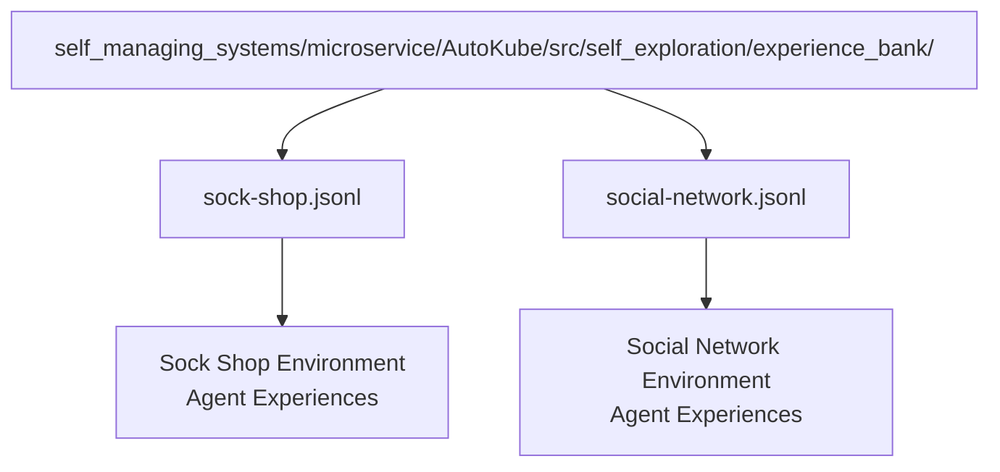
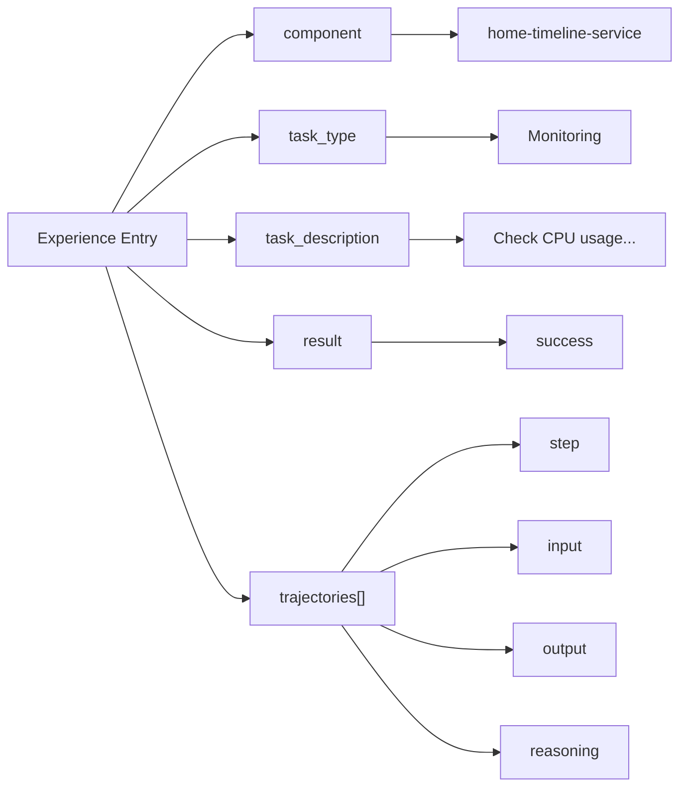
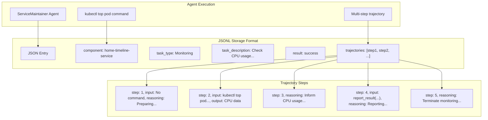
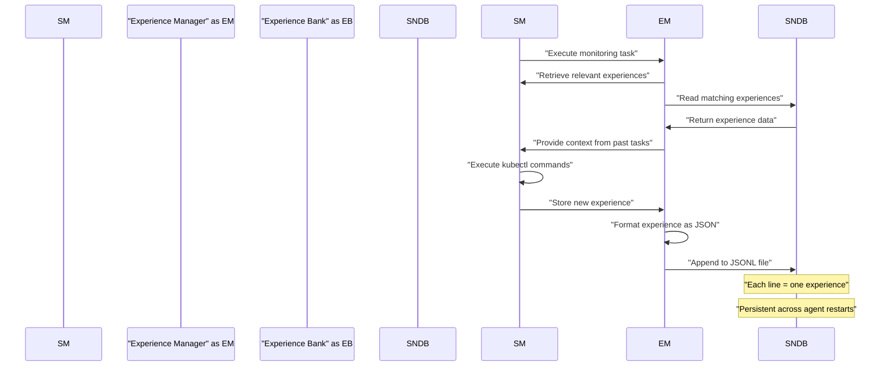

<!-- source: DeepWiki mcp.deepwiki.com · repo microsoft/ACV · extra page Experience Banks · fetched 2026-10-26 -->

# Experience Banks

Relevant source files

The following files were used as context for generating this wiki page:

- [self_managing_systems/microservice/AutoKube/src/self_exploration/experience_bank/social-network.jsonl](self_managing_systems/microservice/AutoKube/src/self_exploration/experience_bank/social-network.jsonl)
- [self_managing_systems/microservice/AutoKube/src/self_exploration/experience_bank/sock-shop.jsonl](self_managing_systems/microservice/AutoKube/src/self_exploration/experience_bank/sock-shop.jsonl)

## Purpose and Scope

Experience Banks provide persistent storage for agent experiences in JSONL (JSON Lines) format, enabling the self-managing systems to learn from past actions and improve decision-making over time. This system stores structured records of agent activities across different microservice environments, supporting experience-based learning for both ClusterManager and ServiceMaintainer agents.

For information about how experiences are generated and filtered before storage, see [Experience Management](#2.3.2). For details on how stored experiences are retrieved and used during agent execution, see [Intent Execution System](#2.3.1).

## File System Organization

The experience banks are organized as environment-specific JSONL files within the AutoKube source tree:

**Storage Directory Structure**
| Environment | File Path | Purpose |
|-------------|-----------|---------|
| Sock Shop | `sock-shop.jsonl` | Experiences from sock-shop microservice demo |
| Social Network | `social-network.jsonl` | Experiences from DeathStarBench social network |

Sources: [self_managing_systems/microservice/AutoKube/src/self_exploration/experience_bank/sock-shop.jsonl:1-1](), [self_managing_systems/microservice/AutoKube/src/self_exploration/experience_bank/social-network.jsonl:1-2]()

## Experience Entry Format

Each experience entry follows a standardized JSON schema that captures the complete context and execution trace of an agent task:

**Core Experience Fields**
| Field | Type | Description |
|-------|------|-------------|
| `component` | string | Target microservice component name |
| `task_type` | string | Category of task (Monitoring, Scaling, etc.) |
| `task_description` | string | Natural language description of the task |
| `result` | string | Outcome status (success, failure) |
| `trajectories` | array | Step-by-step execution trace |

**Trajectory Step Fields**
| Field | Type | Description |
|-------|------|-------------|
| `step` | integer | Sequential step number |
| `input` | string | Command or action executed |
| `output` | string | Command output or response |
| `reasoning` | string | Agent's reasoning for the step |

Sources: [self_managing_systems/microservice/AutoKube/src/self_exploration/experience_bank/social-network.jsonl:1-1]()

## Experience Storage Schema

The following diagram illustrates how agent experiences map to the JSONL storage format:

Sources: [self_managing_systems/microservice/AutoKube/src/self_exploration/experience_bank/social-network.jsonl:1-1]()

## Integration with Agent System

Experience banks integrate with the broader agent architecture through read/write operations during agent execution:

**Read Operations**: Experience retrieval for context-aware decision making
**Write Operations**: New experience persistence after successful task completion
**File Format**: JSONL enables incremental append operations without full file rewrites

Sources: [self_managing_systems/microservice/AutoKube/src/self_exploration/experience_bank/social-network.jsonl:1-1]()

## Environment-Specific Storage

Different microservice environments maintain separate experience banks to ensure context-appropriate learning:

**Sock Shop Environment**
- File: `sock-shop.jsonl`
- Focus: E-commerce microservice patterns
- Components: Frontend, catalogue, user services

**Social Network Environment** 
- File: `social-network.jsonl`
- Focus: Social media microservice patterns  
- Components: `home-timeline-service`, user-service, compose-post-service

This separation enables environment-specific optimization while maintaining experience portability across similar microservice architectures.

Sources: [self_managing_systems/microservice/AutoKube/src/self_exploration/experience_bank/sock-shop.jsonl:1-1](), [self_managing_systems/microservice/AutoKube/src/self_exploration/experience_bank/social-network.jsonl:1-1]()

---

