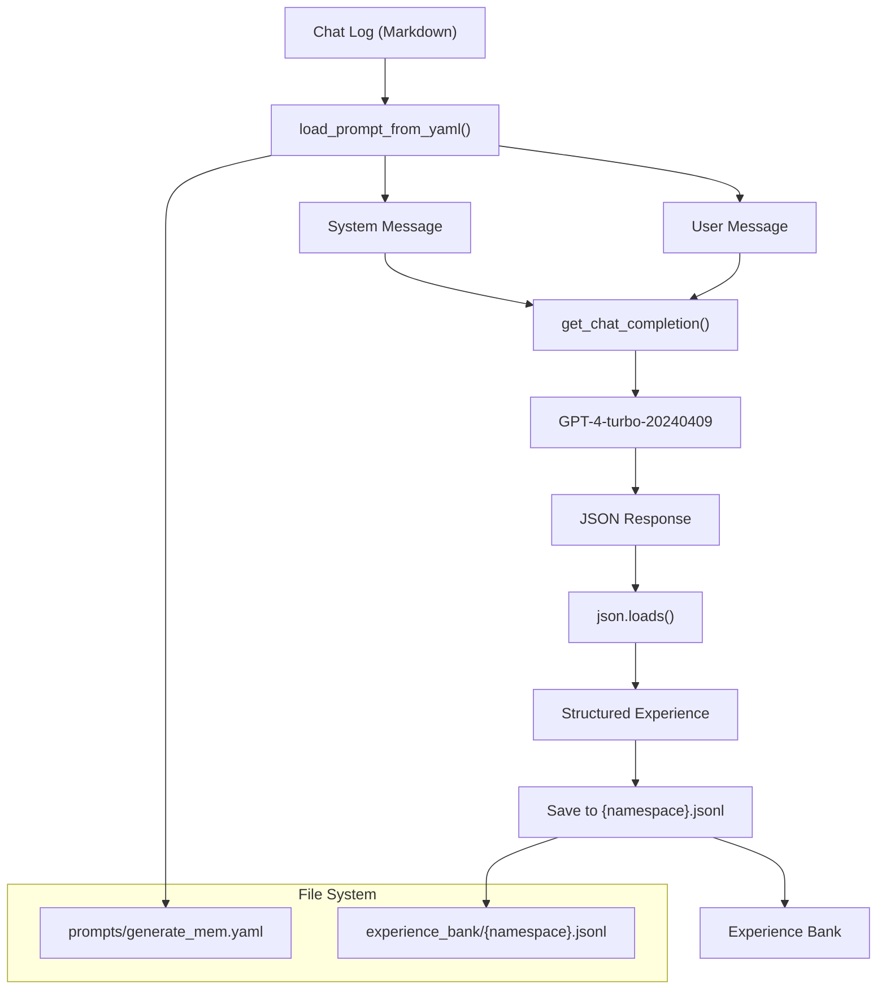
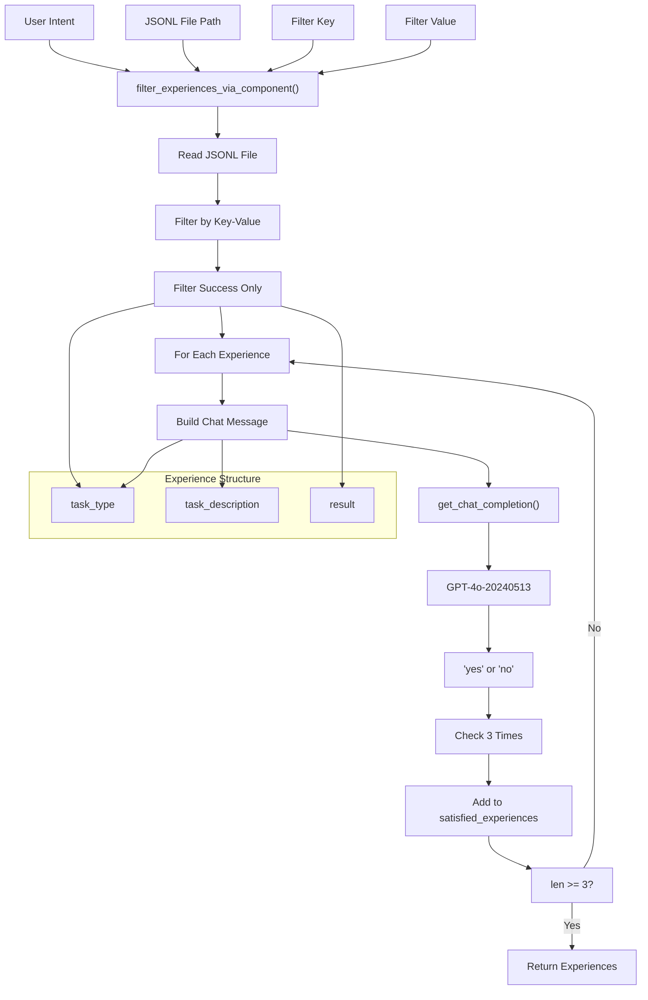
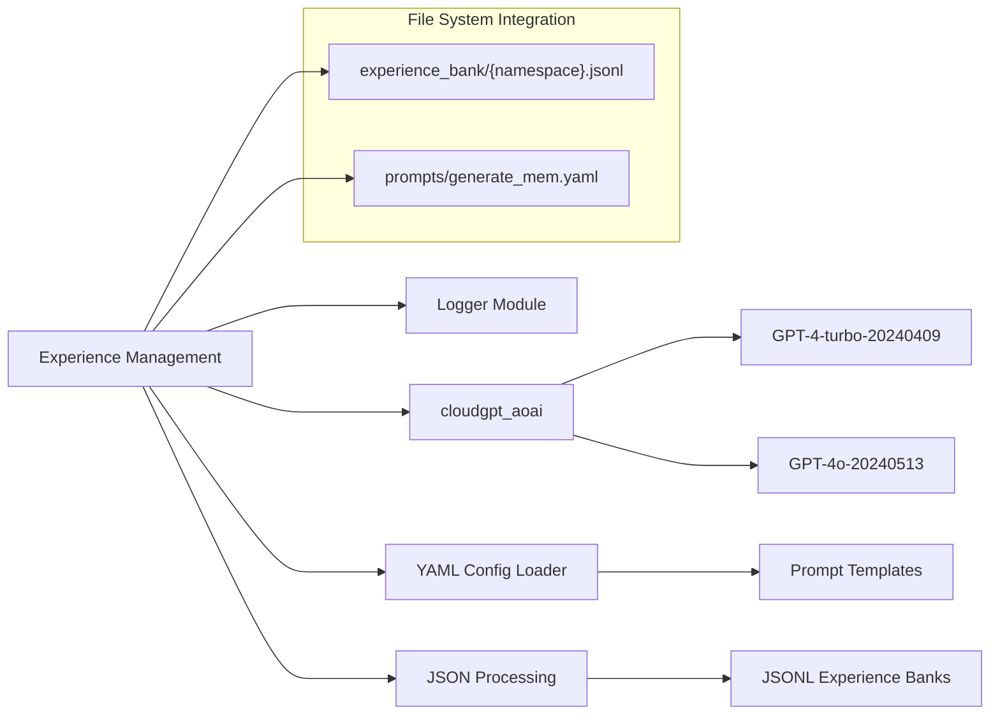

<!-- source: DeepWiki mcp.deepwiki.com · repo microsoft/ACV · extra page Experience Management · fetched 2026-10-26 -->

# Experience Management

<details>
<summary>Relevant source files</summary>

The following files were used as context for generating this wiki page:

- [self_managing_systems/microservice/AutoKube/src/intent_exec/agent/tool_functions_for_experience.py](self_managing_systems/microservice/AutoKube/src/intent_exec/agent/tool_functions_for_experience.py)
- [self_managing_systems/microservice/AutoKube/src/self_exploration/main.py](self_managing_systems/microservice/AutoKube/src/self_exploration/main.py)

</details>


This document covers the experience-based learning system that enables ACV agents to store, filter, and retrieve operational experiences for improved decision-making. The experience management system provides persistent memory capabilities through JSONL-based storage and LLM-powered relevance filtering.

For information about how experiences are used during intent execution, see [Intent Execution System](#2.3.1). For details about the prompt templates used in experience generation, see [Prompt Templates](#2.3.3). For documentation of the stored experience banks, see [Experience Banks](#2.3.4).

## System Architecture

The experience management system operates through two primary mechanisms: experience creation from chat logs and experience retrieval based on user intent relevance.

### Experience Creation Flow



**Experience Creation Process**

Sources: [self_managing_systems/microservice/AutoKube/src/self_exploration/main.py:17-40]()

### Experience Retrieval Flow



**Experience Filtering and Retrieval Process**

Sources: [self_managing_systems/microservice/AutoKube/src/intent_exec/agent/tool_functions_for_experience.py:7-41]()

## Core Functions

### Experience Creation: `add_experience`

The `add_experience` function processes operational chat logs into structured experiences using LLM-based extraction.

| Parameter | Type | Description |
|-----------|------|-------------|
| `namespace` | string | Target experience bank identifier |
| `markdown_text` | string | Raw chat log content |
| `yaml_path` | string | Path to prompt template (default: "prompts/generate_mem.yaml") |

**Process Flow:**
1. Load prompt template from YAML using `load_prompt_from_yaml()`
2. Replace placeholder `{markdown_content}` with actual chat log
3. Send structured prompt to `gpt-4-turbo-20240409`
4. Extract JSON response between first `{` and last `}`
5. Parse and append to `{namespace}.jsonl` file

Sources: [self_managing_systems/microservice/AutoKube/src/self_exploration/main.py:17-40]()

### Experience Retrieval: `filter_experiences_via_component`

The `filter_experiences_via_component` function retrieves relevant experiences based on component matching and intent similarity.

| Parameter | Type | Description |
|-----------|------|-------------|
| `jsonl_path` | string | Path to experience bank JSONL file |
| `filter_key` | string | Experience field to filter on |
| `filter_value` | string | Required value for filter field |
| `intent` | string | User's current intent for relevance check |

**Filtering Logic:**
1. **Component Filter**: Match experiences where `experience[filter_key] == filter_value`
2. **Success Filter**: Only include experiences with `result == "success"`
3. **Relevance Filter**: Use GPT-4o to assess if `task_type` and `task_description` relate to user intent
4. **Triple Validation**: Require 3 consecutive "yes" responses for relevance confirmation
5. **Limit Results**: Return maximum of 3 satisfied experiences

Sources: [self_managing_systems/microservice/AutoKube/src/intent_exec/agent/tool_functions_for_experience.py:7-41]()

## Experience Structure

### JSONL Storage Format

Experiences are stored in namespace-specific JSONL files with the following structure:

```json
{
  "task_type": "string",
  "task_description": "string", 
  "result": "success|failure",
  "component": "string",
  "namespace": "string"
}
```

### Relevance Assessment Prompt

The LLM-based relevance check uses a structured prompt:

| Role | Content |
|------|---------|
| system | "Your task is to determine if the provided task type and task description are related to the user's intent. Respond with 'yes' or 'no'." |
| system | "Related means that similar things to query, similar aims to operate or similar cause to analyze." |
| user | "User's intent: {intent}" |
| user | "Task Type: {task_type}" |
| user | "Task Description: {task_description}" |

Sources: [self_managing_systems/microservice/AutoKube/src/intent_exec/agent/tool_functions_for_experience.py:21-27]()

## Integration Points

### API Dependencies

The experience management system integrates with the following components:



**System Dependencies**

Sources: [self_managing_systems/microservice/AutoKube/src/intent_exec/agent/tool_functions_for_experience.py:1-5](), [self_managing_systems/microservice/AutoKube/src/self_exploration/main.py:1-4]()

### Agent System Integration

Experience management supports the broader agent architecture through:

- **ClusterManager**: Stores cluster-level operational experiences
- **ServiceMaintainer**: Stores service-specific maintenance experiences  
- **Intent Execution**: Retrieves relevant experiences for decision-making
- **Namespace Isolation**: Separates experiences by deployment environment (sock-shop, social-network)

The system provides persistent learning capabilities that enable agents to improve performance through accumulated operational knowledge while maintaining strict relevance filtering to ensure experience quality.

Sources: [self_managing_systems/microservice/AutoKube/src/intent_exec/agent/tool_functions_for_experience.py:7-41](), [self_managing_systems/microservice/AutoKube/src/self_exploration/main.py:17-40]()

---

