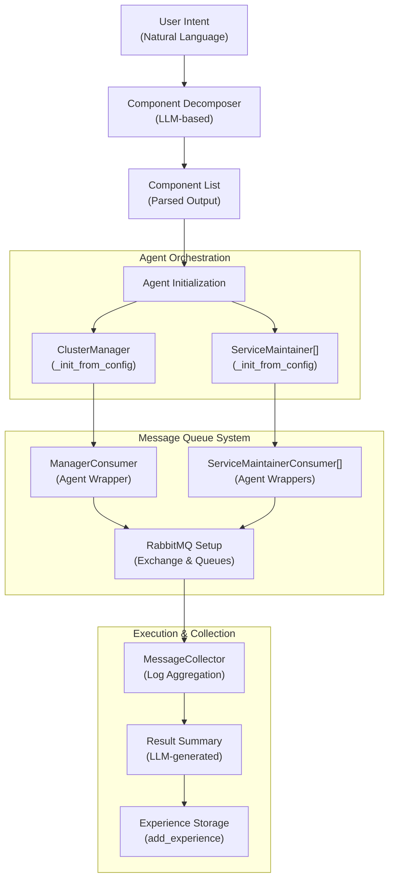
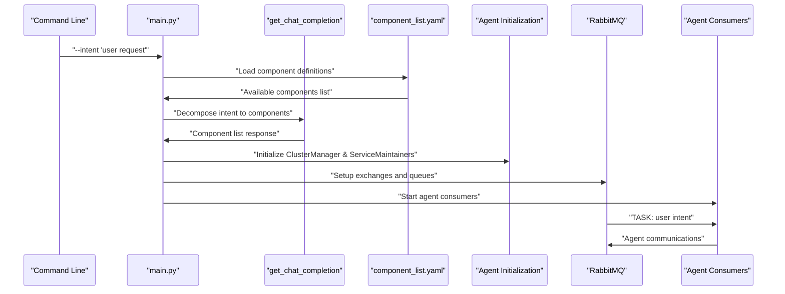
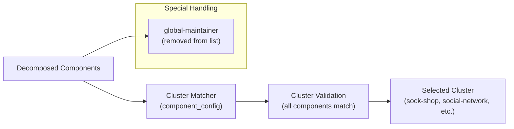
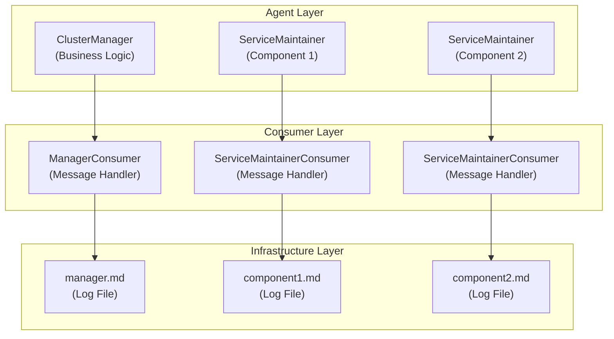
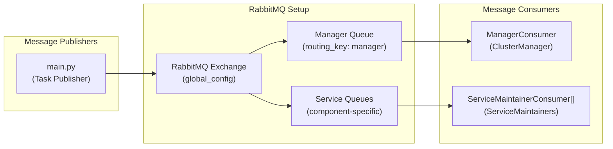
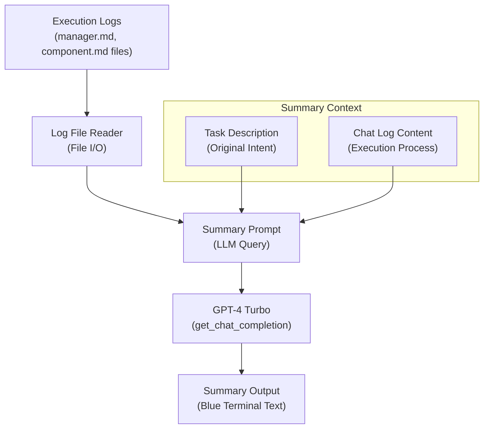

<!-- source: DeepWiki mcp.deepwiki.com · repo microsoft/ACV · extra page Intent Execution System · fetched 2026-10-26 -->

# Intent Execution System

<details>
<summary>Relevant source files</summary>

The following files were used as context for generating this wiki page:

- [self_managing_systems/microservice/AutoKube/src/intent_exec/main.py](self_managing_systems/microservice/AutoKube/src/intent_exec/main.py)

</details>


## Purpose and Scope

The Intent Execution System serves as the primary orchestration engine for user intent processing in the AutoKube self-managing systems framework. This system translates natural language user intents into coordinated actions performed by multiple autonomous agents across a Kubernetes cluster.

The system handles the complete lifecycle from intent reception to execution completion, including component decomposition, agent initialization, message-based coordination, and experience collection. For information about the underlying agent implementations, see [Agent Architecture](#2.3). For details about experience-based learning mechanisms, see [Experience Management](#2.3.2).

## System Overview

The Intent Execution System operates as a multi-stage pipeline that transforms user intents into concrete infrastructure management actions. The system leverages Large Language Models (LLMs) for intent understanding and component identification, while utilizing message queues for agent coordination.



Sources: [self_managing_systems/microservice/AutoKube/src/intent_exec/main.py:29-174]()

## Intent Processing Flow

The intent execution begins with command-line argument parsing and proceeds through several distinct phases. The system accepts a natural language intent and optional cache seed configuration.

### Command Line Interface

The system entry point accepts the following parameters:

| Parameter | Type | Required | Description |
|-----------|------|----------|-------------|
| `--intent` | string | Yes | Natural language description of desired action |
| `--cache_seed` | integer | No | Cache seed for agents (default: 42, -1 to disable) |

### Execution Phases



Sources: [self_managing_systems/microservice/AutoKube/src/intent_exec/main.py:29-35](), [self_managing_systems/microservice/AutoKube/src/intent_exec/main.py:37-56]()

## Component Decomposition

The system uses an LLM-based component decomposition mechanism to translate user intents into specific microservice components that need management attention.

### Decomposition Process

The component decomposer utilizes a YAML-based prompt template system:

1. **Component Configuration Loading**: The system loads available components from `component_list.yaml` [self_managing_systems/microservice/AutoKube/src/intent_exec/main.py:37-42]()

2. **Prompt Template Processing**: Uses `component_decomposer.yaml` to format system and user prompts [self_managing_systems/microservice/AutoKube/src/intent_exec/main.py:44-51]()

3. **LLM Processing**: Sends formatted prompts to GPT-4 Turbo model [self_managing_systems/microservice/AutoKube/src/intent_exec/main.py:52-53]()

4. **Component Extraction**: Parses LLM response into component list [self_managing_systems/microservice/AutoKube/src/intent_exec/main.py:54-56]()

### Cluster Mapping

The system maps decomposed components to specific cluster configurations:



Sources: [self_managing_systems/microservice/AutoKube/src/intent_exec/main.py:77-89]()

## Agent Orchestration

The system initializes and orchestrates two types of agents: a single `ClusterManager` and multiple `ServiceMaintainer` instances corresponding to identified components.

### Agent Initialization

Agent creation follows a factory pattern using configuration-based initialization:

**ClusterManager Initialization**:
```python
cluster_manager = ClusterManager._init_from_config(
    cache_seed=args.cache_seed if args.cache_seed != -1 else None,
    components=[component.strip() for component in args.components.split(',')]
)
```

**ServiceMaintainer Initialization**:
```python
agents = [
    ServiceMaintainer._init_from_config(
        cluster_name=cluster_name,
        service_name=component,
        intent=args.intent,
        cache_seed=args.cache_seed if args.cache_seed != -1 else None, 
    )
    for component in components
]
```

### Consumer Wrapper Pattern

Each agent is wrapped in a consumer that handles message queue integration and logging:



Sources: [self_managing_systems/microservice/AutoKube/src/intent_exec/main.py:66-111]()

## Message Flow and Communication

The system implements an asynchronous message-passing architecture using RabbitMQ for agent coordination and a `MessageCollector` for centralized logging.

### RabbitMQ Configuration

The message queue system is configured through the global configuration and supports multiple queues for different agent types:



### Task Initiation

The system publishes the initial task message to trigger agent execution:

```python
rabbitmq.publish(f'TASK: {args.intent}', routing_keys=['manager'])
```

Sources: [self_managing_systems/microservice/AutoKube/src/intent_exec/main.py:125-129]()

## Result Collection and Experience Storage

The execution phase concludes with comprehensive result collection, summary generation, and experience storage for future learning.

### Execution Management

The system manages execution timing and graceful shutdown:

1. **Execution Window**: 10-minute execution timeout with keyboard interrupt handling [self_managing_systems/microservice/AutoKube/src/intent_exec/main.py:131-141]()

2. **Consumer Lifecycle**: Proper startup and shutdown of all message consumers [self_managing_systems/microservice/AutoKube/src/intent_exec/main.py:115-140]()

### Result Summarization

The system generates intelligent summaries of execution results using LLM processing:



### Experience Banking

Each agent's execution log is processed and stored as experience for future reference:

```python
for agent in agents:
    agent_log_path = os.path.join(result_dir, f'{agent.name}.md')
    if os.path.exists(agent_log_path):
        with open(agent_log_path, 'r') as file:
            agent_log_content = file.read()
            add_experience(cluster, agent_log_content)
```

The `add_experience()` function integrates with the broader experience management system documented in [Experience Management](#2.3.2).

Sources: [self_managing_systems/microservice/AutoKube/src/intent_exec/main.py:145-174]()

## Result Directory Structure

The system creates timestamped result directories containing all execution artifacts:

```
results/AutoKube/
└── {YYYY-MM-DD HH:MM:SS}/
    ├── manager.md           # ClusterManager chat log
    ├── {component1}.md      # ServiceMaintainer logs
    ├── {component2}.md      # Additional component logs
    └── ...
```

This structured logging enables both immediate result review and long-term experience accumulation for the autonomous learning system.

Sources: [self_managing_systems/microservice/AutoKube/src/intent_exec/main.py:58-64](), [self_managing_systems/microservice/AutoKube/src/intent_exec/main.py:72-108]()

---

