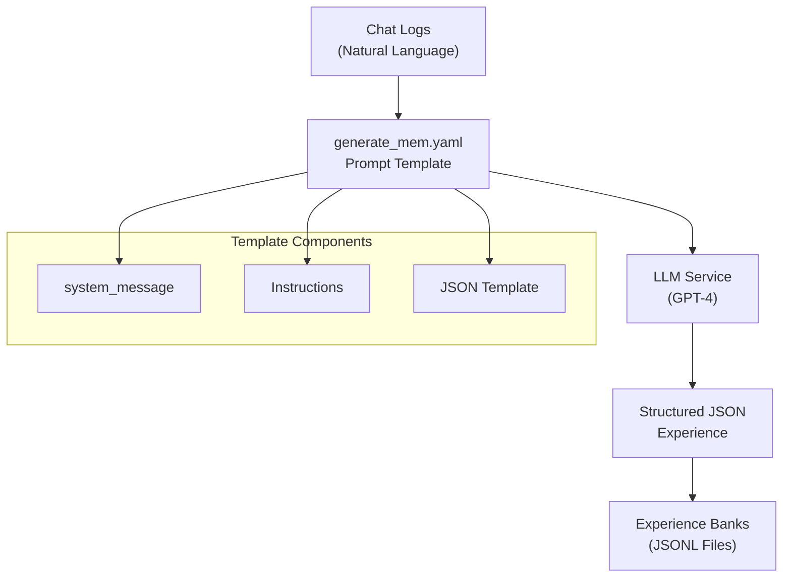
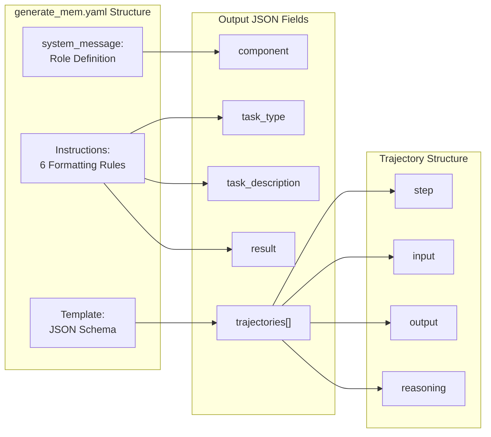
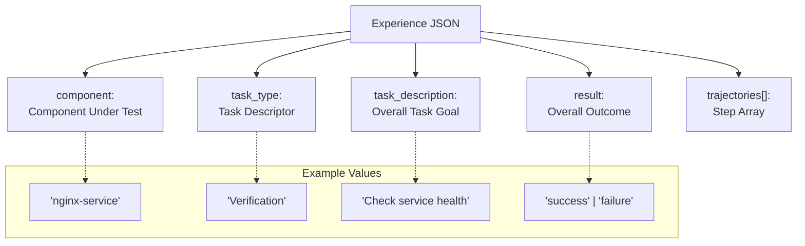
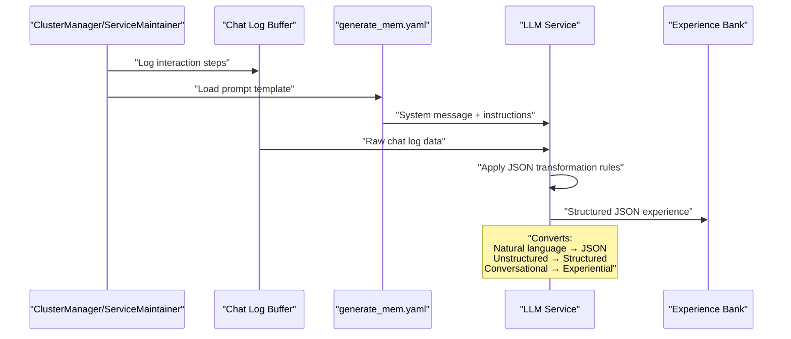

<!-- source: DeepWiki mcp.deepwiki.com · repo microsoft/ACV · extra page Prompt Templates · fetched 2026-10-26 -->

# Prompt Templates

Relevant source files

The following files were used as context for generating this wiki page:

- [self_managing_systems/microservice/AutoKube/src/prompts/generate_mem.yaml](self_managing_systems/microservice/AutoKube/src/prompts/generate_mem.yaml)

This document covers the prompt template system used by the self-managing systems to generate structured experiences from chat logs and other LLM interactions. The prompt templates define how raw conversational data is transformed into structured JSON experiences that can be stored and retrieved by the experience management system.

For information about how these structured experiences are stored and managed, see [Experience Banks](#2.3.4). For details on how experiences are filtered and retrieved during agent operations, see [Experience Management](#2.3.2).

## Purpose and Architecture

The prompt template system serves as the bridge between unstructured natural language interactions and the structured experience data required by the agent system. When agents interact with LLMs to manage Kubernetes environments, the conversational logs need to be converted into standardized JSON format for storage in experience banks.

### Template System Overview

Sources: [self_managing_systems/microservice/AutoKube/src/prompts/generate_mem.yaml:1-37]()

## Template Structure

### Core Template: generate_mem.yaml

The primary prompt template is defined in `generate_mem.yaml` and contains three main components:

| Component | Purpose | Content |
|-----------|---------|---------|
| `system_message` | Defines LLM role and task | Instructions for converting chat logs to JSON |
| Instructions | Structured rules | 6 specific formatting requirements |
| Template | JSON schema | Expected output format |

Sources: [self_managing_systems/microservice/AutoKube/src/prompts/generate_mem.yaml:1-37]()

### System Message Design

The system message establishes the LLM's role as a converter of Kubernetes interaction logs:

- **Input**: Series of steps from chat logs describing Kubernetes interactions
- **Output**: Structured JSON experience log
- **Transformation**: Natural language → Standardized experience format

The message specifically targets Kubernetes environment interactions, making it domain-specific for the microservice management use case.

Sources: [self_managing_systems/microservice/AutoKube/src/prompts/generate_mem.yaml:1-3]()

## JSON Schema Definition

### Top-Level Structure

The template defines a specific JSON schema with four required top-level fields:

Sources: [self_managing_systems/microservice/AutoKube/src/prompts/generate_mem.yaml:6-10]()

### Trajectory Step Schema

Each trajectory step follows a standardized four-field structure:

| Field | Type | Description | Example |
|-------|------|-------------|---------|
| `step` | Number | Sequential step order | `1, 2, 3...` |
| `input` | String | Command or action executed | `"kubectl get pods"` |
| `output` | String | Response or result | `"3 pods running"` |
| `reasoning` | String | Why step was taken | `"Verify deployment status"` |

The template includes fallback values for missing data: `"No command executed"` for input and `"No output"` for output when no actual command was run.

Sources: [self_managing_systems/microservice/AutoKube/src/prompts/generate_mem.yaml:11-16]()

## Data Flow and Integration

### Natural Language to Structured Data Pipeline

Sources: [self_managing_systems/microservice/AutoKube/src/prompts/generate_mem.yaml:1-37]()

### Template Processing Rules

The template includes six specific processing rules that ensure consistent output:

1. **Field Completeness**: All top-level JSON fields must be present
2. **Data Consistency**: Information must be correctly inferred from conversation
3. **Missing Data Handling**: Standardized fallback values for missing commands
4. **JSON Validity**: Output must be syntactically correct
5. **Step Ordering**: Trajectory steps must maintain sequential numbering
6. **Format Compliance**: Must match the provided JSON template exactly

Sources: [self_managing_systems/microservice/AutoKube/src/prompts/generate_mem.yaml:17-18]()

## Template Usage Context

The `generate_mem.yaml` template specifically supports the experience-based learning system by converting operational interactions into reusable experiences. This enables agents to:

- **Learn from Past Actions**: Store successful interaction patterns
- **Avoid Repeated Mistakes**: Capture failure scenarios with reasoning
- **Share Knowledge**: Create transferable experience records
- **Debug Operations**: Maintain detailed step-by-step logs

The template's focus on Kubernetes operations aligns with the self-managing systems' primary use case of microservice environment management.

Sources: [self_managing_systems/microservice/AutoKube/src/prompts/generate_mem.yaml:1-37]()

---

