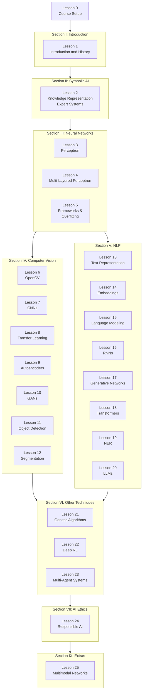
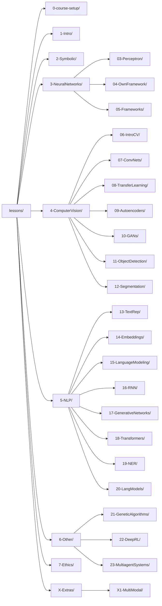
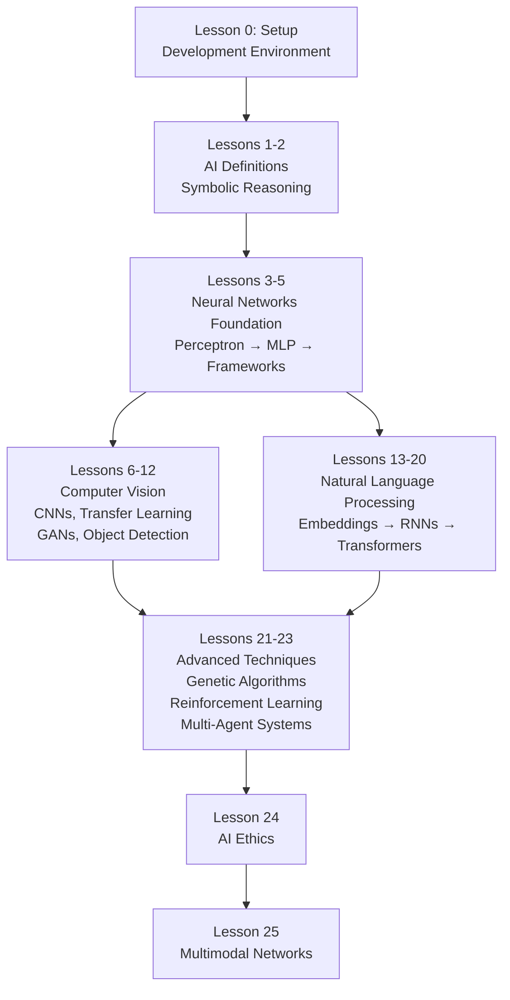
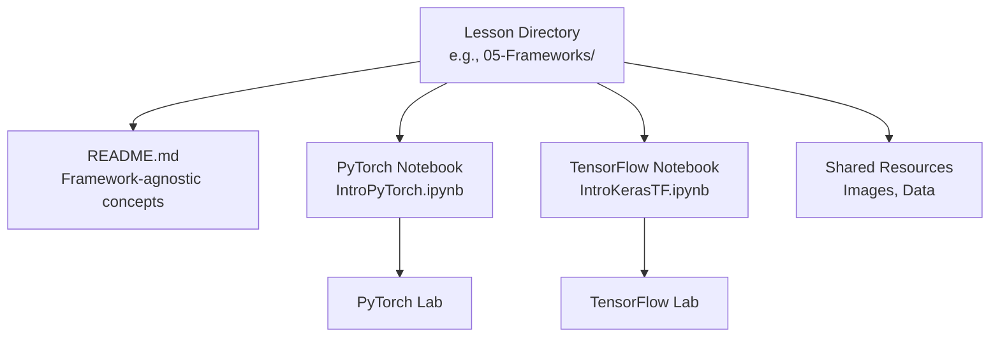
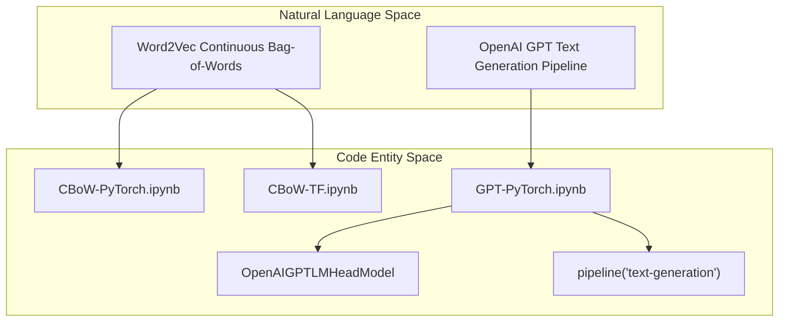
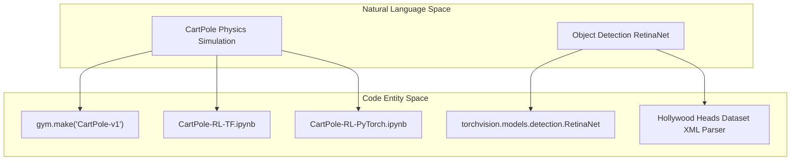

<!-- source: DeepWiki mcp.deepwiki.com · repo microsoft/AI-For-Beginners · page 1.1 Curriculum Structure · fetched 2026-10-26 -->

# Curriculum Structure

Relevant source files

The following files were used as context for generating this wiki page:

- [.gitignore](.gitignore)
- [README.md](README.md)
- [etc/Mindmap.html](etc/Mindmap.html)
- [etc/Mindmap.md](etc/Mindmap.md)
- [etc/Mindmap.svg](etc/Mindmap.svg)
- [lessons/3-NeuralNetworks/README.md](lessons/3-NeuralNetworks/README.md)
- [lessons/4-ComputerVision/11-ObjectDetection/README.md](lessons/4-ComputerVision/11-ObjectDetection/README.md)
- [lessons/4-ComputerVision/11-ObjectDetection/lab/README.md](lessons/4-ComputerVision/11-ObjectDetection/lab/README.md)
- [lessons/5-NLP/15-LanguageModeling/CBoW-TF.ipynb](lessons/5-NLP/15-LanguageModeling/CBoW-TF.ipynb)
- [lessons/5-NLP/15-LanguageModeling/README.md](lessons/5-NLP/15-LanguageModeling/README.md)
- [lessons/5-NLP/15-LanguageModeling/lab/README.md](lessons/5-NLP/15-LanguageModeling/lab/README.md)
- [lessons/5-NLP/20-LangModels/GPT-PyTorch.ipynb](lessons/5-NLP/20-LangModels/GPT-PyTorch.ipynb)
- [lessons/5-NLP/20-LangModels/README.md](lessons/5-NLP/20-LangModels/README.md)
- [lessons/6-Other/22-DeepRL/README.md](lessons/6-Other/22-DeepRL/README.md)

This document explains the organization of the 24-lesson AI curriculum, its mapping to a 12-week learning timeline, the progression of topics from foundational symbolic reasoning to modern deep learning, and the dual-framework implementation strategy using PyTorch and TensorFlow. For details on pedagogical methods and learning resources, see [Learning Approach](#1.2).

Sources: [README.md:21-23]()

## Overview

The AI-For-Beginners curriculum consists of 24 core lessons plus extra topics, organized into major sections covering the full spectrum of AI approaches from symbolic reasoning to neural networks, computer vision, natural language processing, reinforcement learning, and AI ethics [README.md:21-71](). 

Sources: [README.md:21-71]()

## Curriculum Organization

The curriculum follows a hierarchical structure with numbered sections containing thematically related lessons:

**Lesson Distribution by Section**

Sources: [README.md:65-74]()

## Directory Structure and Lesson Mapping

The curriculum's physical organization maps lessons to directories under `lessons/`:

**Directory-to-Lesson Mapping**

Each lesson directory contains a `README.md` file introducing theory, Jupyter notebooks (`.ipynb`) for hands-on execution, and a `lab/` subdirectory for assignments where applicable [lessons/3-NeuralNetworks/README.md:42-48](), [lessons/5-NLP/15-LanguageModeling/README.md:41-43]().

Sources: [lessons/1-Intro/README.md:1](), [lessons/2-Symbolic/README.md:1](), [lessons/3-NeuralNetworks/03-Perceptron/README.md:1](), [lessons/4-ComputerVision/07-ConvNets/README.md:1](), [lessons/5-NLP/15-LanguageModeling/README.md:1]()

## Weekly Schedule

The 12-week curriculum maps lessons to specific weeks, averaging two lessons per week:

| Week | Lessons | Topics |
|------|---------|--------|
| 0 | Lesson 0 | Environment Setup |
| 1 | Lessons 1-2 | AI Introduction, History, Symbolic AI |
| 2 | Lessons 3-4 | Perceptron, Multi-Layered Networks |
| 3 | Lesson 5 | Neural Network Frameworks (PyTorch/TensorFlow) |
| 4 | Lessons 6-7 | OpenCV, Convolutional Networks |
| 5 | Lessons 8-9 | Transfer Learning, Autoencoders |
| 6 | Lessons 10-11 | GANs, Object Detection |
| 7 | Lesson 12, 13 | Segmentation, Text Representation |
| 8 | Lessons 14-15 | Embeddings, Language Modeling |
| 9 | Lessons 16-17 | RNNs, Generative Networks |
| 10 | Lessons 18-19 | Transformers, Named Entity Recognition |
| 11 | Lessons 20-21 | Large Language Models, Genetic Algorithms |
| 12 | Lessons 22-24 | Deep RL, Multi-Agent Systems, AI Ethics |

Sources: [README.md:21-23]()

## Topic Progression Architecture

The curriculum follows a deliberate progression from simple to complex concepts, building prerequisite knowledge for each subsequent domain:

**Conceptual Progression Flow**

Sources: [README.md:65-74]()

## Dual-Framework Implementation Strategy

Every hands-on lesson from Lesson 3 onwards provides parallel implementations in both PyTorch and TensorFlow, letting learners select their framework:

**Dual-Framework Lesson Structure**

Sources: [lessons/3-NeuralNetworks/README.md:46-47]()

### Framework Selection Pattern

Notebook naming follows a consistent convention:

| Framework | Naming Convention | Example |
|-----------|------------------|---------|
| PyTorch | `*PyTorch.ipynb` | `CBoW-PyTorch.ipynb` [lessons/5-NLP/15-LanguageModeling/README.md:26](), `CartPole-RL-PyTorch.ipynb` [lessons/6-Other/22-DeepRL/README.md:86]() |
| TensorFlow/Keras | `*TF.ipynb` or `*Keras.ipynb` | `CBoW-TF.ipynb` [lessons/5-NLP/15-LanguageModeling/README.md:25](), `CartPole-RL-TF.ipynb` [lessons/6-Other/22-DeepRL/README.md:85]() |

Sources: [lessons/5-NLP/15-LanguageModeling/README.md:25-26](), [lessons/6-Other/22-DeepRL/README.md:85-86]()

### API Level Coverage

Frameworks are taught at both low-level custom implementations and high-level abstractions (`torch.nn`, `tf.keras.layers`, `pipeline`) [lessons/3-NeuralNetworks/README.md:46-47](), [lessons/5-NLP/20-LangModels/GPT-PyTorch.ipynb:58-64]().

Sources: [lessons/3-NeuralNetworks/README.md:46-47](), [lessons/5-NLP/20-LangModels/GPT-PyTorch.ipynb:58-64]()

## Natural Language Space to Code Entity Space Mappings

To bridge conceptual curriculum topics with underlying code implementations, the following architecture diagrams map system concepts to explicit code entities, classes, and file paths.

### Diagram 1: Natural Language to Code Mapping for NLP and LLMs

**NLP & LLM Domain Code Mapping**

Sources: [lessons/5-NLP/15-LanguageModeling/README.md:25-26](), [lessons/5-NLP/20-LangModels/README.md:43-47](), [lessons/5-NLP/20-LangModels/GPT-PyTorch.ipynb:32-64]()

### Diagram 2: Natural Language to Code Mapping for Reinforcement Learning and Computer Vision

**Reinforcement Learning & Vision Domain Code Mapping**

Sources: [lessons/6-Other/22-DeepRL/README.md:34-86](), [lessons/4-ComputerVision/11-ObjectDetection/lab/README.md:11-59]()

## Lesson Component Structure

Each lesson follows a standard structure with consistent components:

| Component | Location | Purpose |
|-----------|----------|---------|
| Pre-lecture quiz | Quiz app | Assess prior knowledge [lessons/5-NLP/15-LanguageModeling/README.md:5]() |
| Conceptual content | `README.md` | Introduce theory and concepts [lessons/3-NeuralNetworks/README.md:1-25]() |
| Executable notebooks | `*.ipynb` files | Hands-on implementation [lessons/5-NLP/15-LanguageModeling/README.md:25-26]() |
| Lab assignments | `lab/README.md` | Apply concepts to new problems [lessons/5-NLP/15-LanguageModeling/README.md:41-43]() |
| Post-lecture quiz | Quiz app | Verify understanding [lessons/5-NLP/15-LanguageModeling/README.md:33]() |

Sources: [lessons/5-NLP/15-LanguageModeling/README.md:5-43]()

### Quiz Integration

Quizzes follow a numbering convention where lesson N has pre-quiz ID `1XX` and post-quiz ID `2XX` hosted via the quiz application [README.md:149-151]().

Sources: [README.md:149-151]()

## Cross-Cutting Content Structure

### Microsoft Learn Integration

Lessons integrate with external Microsoft Learn modules for supplementary paths in AI fundamentals, computer vision, natural language processing, and responsible AI [README.md:74]().

Sources: [README.md:74]()

### Lab Assignments

Lab assignments located in `lab/` subdirectories extend lesson concepts to real-world datasets, such as training RetinaNet on the Hollywood Heads dataset [lessons/4-ComputerVision/11-ObjectDetection/lab/README.md:1-11]().

Sources: [lessons/4-ComputerVision/11-ObjectDetection/lab/README.md:1-11]()

Sources: [README.md:21-74](), [lessons/3-NeuralNetworks/README.md:1-48](), [lessons/5-NLP/15-LanguageModeling/README.md:1-43](), [lessons/5-NLP/20-LangModels/README.md:1-53](), [lessons/6-Other/22-DeepRL/README.md:1-87](), [lessons/4-ComputerVision/11-ObjectDetection/lab/README.md:1-62]()

---

