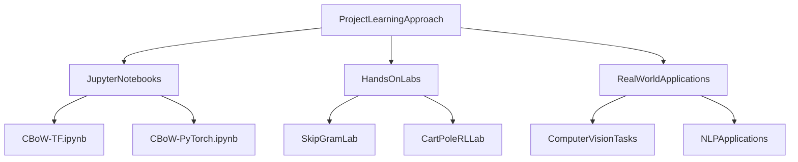
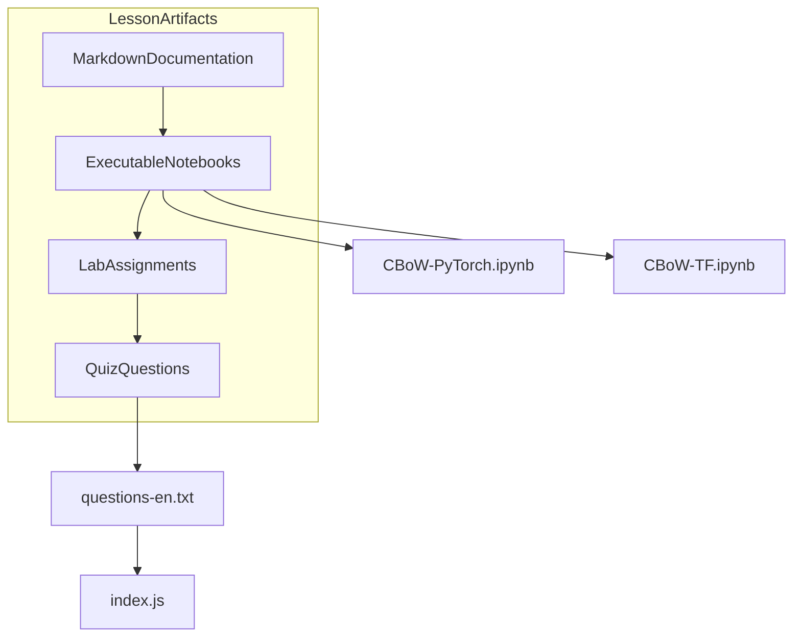
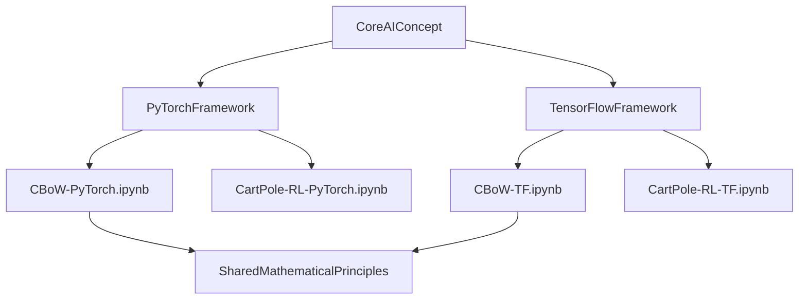
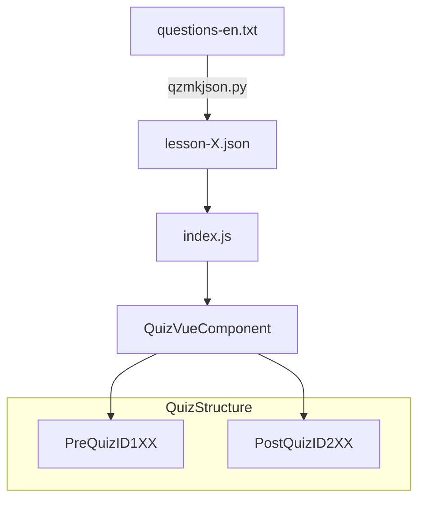
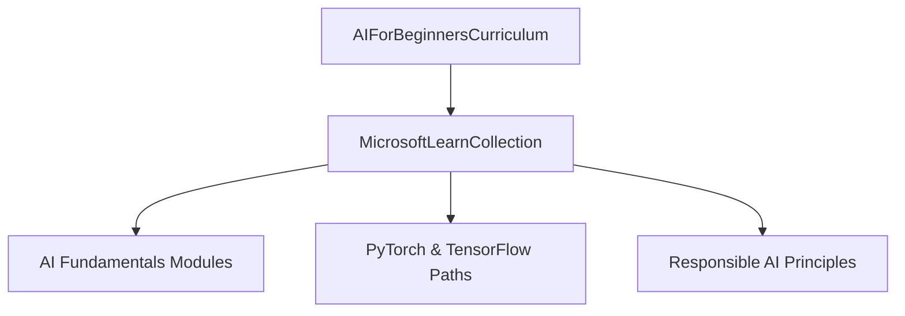

<!-- source: DeepWiki mcp.deepwiki.com · repo microsoft/AI-For-Beginners · page 1.2 Learning Approach · fetched 2026-10-26 -->

# Learning Approach

Relevant source files

The following files were used as context for generating this wiki page:

- [.gitignore](.gitignore)
- [README.md](README.md)
- [etc/Mindmap.html](etc/Mindmap.html)
- [etc/Mindmap.md](etc/Mindmap.md)
- [etc/Mindmap.svg](etc/Mindmap.svg)
- [etc/quiz-app/src/assets/translations/en/index.js](etc/quiz-app/src/assets/translations/en/index.js)
- [etc/quiz-app/src/assets/translations/en/lesson-11.json](etc/quiz-app/src/assets/translations/en/lesson-11.json)
- [etc/quiz-app/src/assets/translations/en/lesson-12.json](etc/quiz-app/src/assets/translations/en/lesson-12.json)
- [etc/quiz-app/src/assets/translations/en/lesson-13.json](etc/quiz-app/src/assets/translations/en/lesson-13.json)
- [etc/quiz-app/src/assets/translations/en/lesson-14.json](etc/quiz-app/src/assets/translations/en/lesson-14.json)
- [etc/quiz-app/src/assets/translations/en/lesson-15.json](etc/quiz-app/src/assets/translations/en/lesson-15.json)
- [etc/quiz-app/src/assets/translations/en/lesson-16.json](etc/quiz-app/src/assets/translations/en/lesson-16.json)
- [etc/quiz-app/src/assets/translations/en/lesson-17.json](etc/quiz-app/src/assets/translations/en/lesson-17.json)
- [etc/quiz-app/src/assets/translations/en/lesson-18.json](etc/quiz-app/src/assets/translations/en/lesson-18.json)
- [etc/quiz-app/src/assets/translations/en/lesson-19.json](etc/quiz-app/src/assets/translations/en/lesson-19.json)
- [etc/quiz-app/src/assets/translations/en/lesson-20.json](etc/quiz-app/src/assets/translations/en/lesson-20.json)
- [etc/quiz-app/src/assets/translations/en/lesson-22.json](etc/quiz-app/src/assets/translations/en/lesson-22.json)
- [etc/quiz-app/src/assets/translations/en/lesson-23.json](etc/quiz-app/src/assets/translations/en/lesson-23.json)
- [etc/quiz-src/questions-en.txt](etc/quiz-src/questions-en.txt)
- [lessons/4-ComputerVision/11-ObjectDetection/README.md](lessons/4-ComputerVision/11-ObjectDetection/README.md)
- [lessons/4-ComputerVision/11-ObjectDetection/lab/README.md](lessons/4-ComputerVision/11-ObjectDetection/lab/README.md)
- [lessons/5-NLP/14-Embeddings/EmbeddingsTF.ipynb](lessons/5-NLP/14-Embeddings/EmbeddingsTF.ipynb)
- [lessons/5-NLP/15-LanguageModeling/CBoW-TF.ipynb](lessons/5-NLP/15-LanguageModeling/CBoW-TF.ipynb)
- [lessons/5-NLP/15-LanguageModeling/README.md](lessons/5-NLP/15-LanguageModeling/README.md)
- [lessons/5-NLP/15-LanguageModeling/lab/README.md](lessons/5-NLP/15-LanguageModeling/lab/README.md)
- [lessons/5-NLP/20-LangModels/GPT-PyTorch.ipynb](lessons/5-NLP/20-LangModels/GPT-PyTorch.ipynb)
- [lessons/5-NLP/20-LangModels/README.md](lessons/5-NLP/20-LangModels/README.md)
- [lessons/6-Other/22-DeepRL/README.md](lessons/6-Other/22-DeepRL/README.md)

This document details the pedagogical approach and learning methodology used in the AI-For-Beginners curriculum. It explains the project-based learning philosophy, framework options, assessment components, and integration with external platforms like Microsoft Learn. For information about the overall curriculum structure, see [Curriculum Structure](#1.1).

## Project-Based Learning Philosophy

The AI-For-Beginners curriculum embraces a hands-on, project-based learning approach designed to maximize engagement and retention. Rather than focusing solely on abstract theoretical concepts, learners engage directly with executable examples and real-world scenarios. The lessons start small and progressively increase in complexity over the 12-week schedule [README.md:21-21]().

Sources: [README.md:21-21](), [lessons/5-NLP/15-LanguageModeling/README.md:21-26]()

## Learning Components and Lesson Architecture

Each lesson in the 24-lesson curriculum integrates multiple learning modalities to reinforce core AI principles through different channels. 

Each lesson follows a structured execution path:
1. **Pre-reading Material & Pre-Quiz**: Sets learning intentions and reviews foundational concepts (`[etc/quiz-src/questions-en.txt:1-53]()`).
2. **Jupyter Notebooks**: Dual-framework interactive code implementations in both PyTorch and TensorFlow (`[lessons/5-NLP/15-LanguageModeling/README.md:21-26]()`).
3. **Labs and Assignments**: Practical coding extensions challenging learners to modify and apply models (`[lessons/5-NLP/15-LanguageModeling/README.md:41-43]()`).
4. **Post-Quiz**: Verifies technical comprehension and concept retention (`[etc/quiz-src/questions-en.txt:1-53]()`).
5. **Microsoft Learn References**: Curated external learning modules for broader context (`[README.md:72-74]()`).

Sources: [README.md:21-21](), [etc/quiz-src/questions-en.txt:1-53](), [lessons/5-NLP/15-LanguageModeling/README.md:21-43]()

## Dual Framework Implementation Strategy

A distinctive technical feature of the curriculum is its dual-framework implementation strategy. For nearly every deep learning concept, parallel notebooks are provided for both PyTorch and TensorFlow/Keras.

This dual approach ensures that learners understand underlying mathematical principles independently of framework-specific abstractions or syntax differences.

Sources: [README.md:65-68](), [lessons/5-NLP/15-LanguageModeling/README.md:21-26](), [lessons/6-Other/22-DeepRL/README.md:81-86]()

## Assessment System Architecture

The assessment system combines formative quizzes and practical lab evaluations. Quizzes are authored in plain text format (`[etc/quiz-src/questions-en.txt:1-53]()`) and compiled into JSON structures consumed by the Vue.js quiz single-page application (`[etc/quiz-app/src/assets/translations/en/index.js:1-26]()`).

- **Pre-Quiz**: Identifies baseline knowledge before tackling lesson materials (`[etc/quiz-src/questions-en.txt:1-53]()`).
- **Post-Quiz**: Evaluates mastery after completing notebooks and labs (`[etc/quiz-src/questions-en.txt:1-53]()`).
- **Vue Integration**: Managed centrally via JavaScript index mapping (`[etc/quiz-app/src/assets/translations/en/index.js:1-26]()`).

Sources: [etc/quiz-src/questions-en.txt:1-53](), [etc/quiz-app/src/assets/translations/en/index.js:1-26]()

## Hands-On Labs and Assignments

Labs provide practical engineering challenges that build upon lesson notebooks. For example, the Natural Language Processing module shifts from Continuous Bag-of-Words implementations to skip-gram training tasks via lab assignments (`[lessons/5-NLP/15-LanguageModeling/README.md:41-43]()`).

Sources: [lessons/5-NLP/15-LanguageModeling/README.md:41-43]()

## Microsoft Learn Integration

The curriculum links directly to Microsoft Learn collections to complement repository notebooks with structured documentation and tutorials.

Sources: [README.md:72-74](), [etc/Mindmap.md:28-31]()

---

