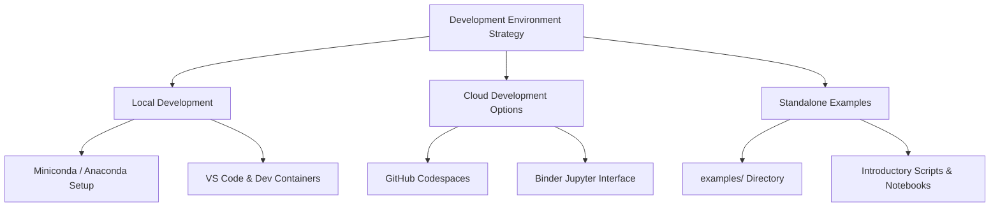

<!-- source: DeepWiki mcp.deepwiki.com · repo microsoft/AI-For-Beginners · page 2 Development Environment · fetched 2026-10-26 -->

# Development Environment

Relevant source files

The following files were used as context for generating this wiki page:

- [.devcontainer/Dockerfile](.devcontainer/Dockerfile)
- [.devcontainer/add-notice.sh](.devcontainer/add-notice.sh)
- [.devcontainer/devcontainer.json](.devcontainer/devcontainer.json)
- [.devcontainer/environment.yml](.devcontainer/environment.yml)
- [.devcontainer/requirements.txt](.devcontainer/requirements.txt)
- [binder/environment.yml](binder/environment.yml)
- [binder/requirements.txt](binder/requirements.txt)
- [environment.yml](environment.yml)
- [lessons/0-course-setup/for-teachers.md](lessons/0-course-setup/for-teachers.md)
- [lessons/0-course-setup/how-to-run.md](lessons/0-course-setup/how-to-run.md)
- [lessons/0-course-setup/setup.md](lessons/0-course-setup/setup.md)
- [lessons/4-ComputerVision/12-Segmentation/lab/BodySegmentation.ipynb](lessons/4-ComputerVision/12-Segmentation/lab/BodySegmentation.ipynb)
- [lessons/5-NLP/14-Embeddings/torchnlp.py](lessons/5-NLP/14-Embeddings/torchnlp.py)
- [lessons/5-NLP/16-RNN/RNNPyTorch.ipynb](lessons/5-NLP/16-RNN/RNNPyTorch.ipynb)
- [lessons/5-NLP/16-RNN/torchnlp.py](lessons/5-NLP/16-RNN/torchnlp.py)
- [lessons/5-NLP/17-GenerativeNetworks/torchnlp.py](lessons/5-NLP/17-GenerativeNetworks/torchnlp.py)
- [lessons/5-NLP/18-Transformers/torchnlp.py](lessons/5-NLP/18-Transformers/torchnlp.py)
- [lessons/5-NLP/requirements-pytorch.txt](lessons/5-NLP/requirements-pytorch.txt)
- [lessons/5-NLP/requirements-tf.txt](lessons/5-NLP/requirements-tf.txt)
- [requirements.txt](requirements.txt)
- [translations/ur/CONTRIBUTING.md](translations/ur/CONTRIBUTING.md)
- [translations/ur/examples/README.md](translations/ur/examples/README.md)
- [translations/ur/lessons/0-course-setup/how-to-run.md](translations/ur/lessons/0-course-setup/how-to-run.md)
- [translations/ur/lessons/4-ComputerVision/08-TransferLearning/TransferLearningTF.ipynb](translations/ur/lessons/4-ComputerVision/08-TransferLearning/TransferLearningTF.ipynb)
- [translations/ur/lessons/5-NLP/README.md](translations/ur/lessons/5-NLP/README.md)
- [translations/zh-CN/CONTRIBUTING.md](translations/zh-CN/CONTRIBUTING.md)
- [translations/zh-CN/examples/README.md](translations/zh-CN/examples/README.md)
- [translations/zh-CN/lessons/0-course-setup/how-to-run.md](translations/zh-CN/lessons/0-course-setup/how-to-run.md)
- [translations/zh-CN/lessons/4-ComputerVision/08-TransferLearning/TransferLearningTF.ipynb](translations/zh-CN/lessons/4-ComputerVision/08-TransferLearning/TransferLearningTF.ipynb)
- [translations/zh-CN/lessons/5-NLP/README.md](translations/zh-CN/lessons/5-NLP/README.md)
- [translations/zh-MO/examples/README.md](translations/zh-MO/examples/README.md)
- [translations/zh-MO/lessons/0-course-setup/how-to-run.md](translations/zh-MO/lessons/0-course-setup/how-to-run.md)
- [translations/zh-MO/lessons/5-NLP/README.md](translations/zh-MO/lessons/5-NLP/README.md)

## Purpose and Scope

This document provides a high-level overview of the development environment setup options for the AI-For-Beginners repository. It explains the multi-environment strategy supporting local Python installations, Visual Studio Code Dev Containers, GitHub Codespaces, and Binder, as well as the core dependency stack and introductory standalone examples. 

For deep technical details, configuration files, and step-by-step guides, please refer to the following child pages:
- [Local Development Setup](#2.1) — Detailed Conda configuration, `environment.yml`, `Dockerfile`, and `devcontainer.json`.
- [Cloud Development Options](#2.2) — GitHub Codespaces and Binder setup and comparisons.
- [Dependencies and Framework Stack](#2.3) — PyTorch vs. TensorFlow stacks, shared libraries (`numpy`, `opencv-python`, `scikit-learn`), and NLP requirements.
- [Standalone Beginner Examples](#2.4) — The `examples/` directory scripts and notebooks establishing the beginner difficulty ladder.

Sources: [lessons/0-course-setup/how-to-run.md:1-94](), [.devcontainer/devcontainer.json:1-32]()

## Multi-Environment Strategy Overview

The AI-For-Beginners repository is designed to accommodate diverse learner setups and infrastructure constraints. By decoupling the curriculum content from execution runtimes, students can execute code locally or in cloud-hosted containers without manual dependency resolution.

Sources: [lessons/0-course-setup/how-to-run.md:5-94](), [.devcontainer/devcontainer.json:1-32]()

## Local Development Setup

Local development relies on **Miniconda** or **Anaconda** to establish a standardized virtual environment named `ai4beg` [lessons/0-course-setup/how-to-run.md:5-16](). Configuration is driven by `.devcontainer/environment.yml` and the root `requirements.txt` [lessons/0-course-setup/how-to-run.md:14](). Visual Studio Code integrates natively with this environment via Python extensions and workspace settings.

For detailed instructions on setting up Conda, handling Windows-specific `UnicodeDecodeError` scenarios using `PYTHONUTF8`, and configuring Docker-based Dev Containers, see [Local Development Setup](#2.1).

Sources: [lessons/0-course-setup/how-to-run.md:5-47](), [.devcontainer/environment.yml:1-24]()

## Cloud Development Options

For users who wish to bypass local installation, the repository supports cloud-based execution. **GitHub Codespaces** automatically provisions a fully configured VS Code browser environment using the repository's container definition [lessons/0-course-setup/how-to-run.md:75-79](). Alternatively, **Binder** builds lightweight Jupyter environments directly from the repository's binder configuration files [lessons/0-course-setup/how-to-run.md:80-82]().

For a comprehensive comparison of cloud resource limits, GPU access considerations, and configuration differences, see [Cloud Development Options](#2.2).

Sources: [lessons/0-course-setup/how-to-run.md:75-84](), [.devcontainer/devcontainer.json:1-32](), [binder/environment.yml:1-25]()

## Dependencies and Framework Stack

The curriculum utilizes a dual-framework approach, incorporating both **PyTorch** and **TensorFlow/Keras** across deep learning modules. Shared scientific libraries such as `numpy`, `scikit-learn`, `scipy`, and `opencv-python` support core data manipulation and computer vision lessons, while specialized requirements files manage Natural Language Processing dependencies.

For a complete breakdown of framework version pins, shared libraries, and NLP-specific toolsets, see [Dependencies and Framework Stack](#2.3).

Sources: [.devcontainer/requirements.txt:1-21](), [lessons/5-NLP/requirements-pytorch.txt:1-15](), [lessons/5-NLP/requirements-tf.txt:1-13]()

## Standalone Beginner Examples

Before engaging with the full 24-lesson curriculum, learners can explore standalone examples located in the `examples/` directory. These include foundational scripts and notebooks such as `01-hello-ai-world.py`, `02-simple-neural-network.py`, `03-image-classifier.ipynb`, and `04-text-sentiment.py`, which provide a gentle introduction to AI concepts before scaling up to framework-specific lessons.

For prerequisites, code walkthroughs, and curriculum mapping, see [Standalone Beginner Examples](#2.4).

Sources: [lessons/0-course-setup/setup.md:1-42]()

---

