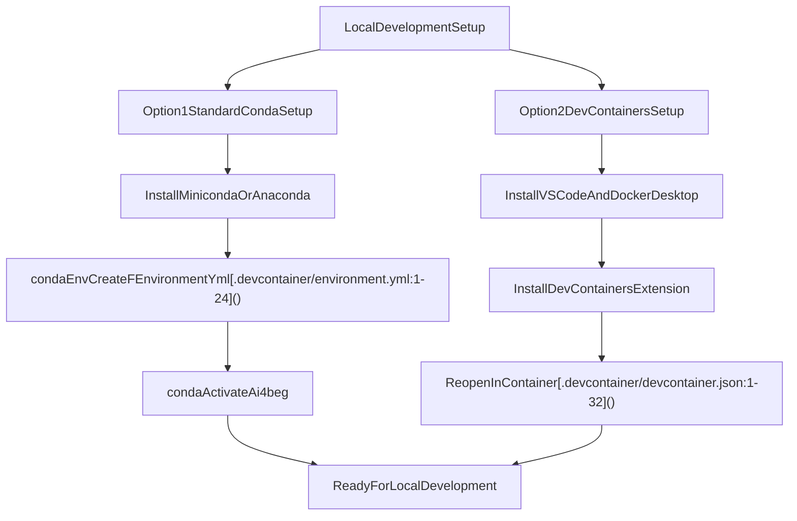
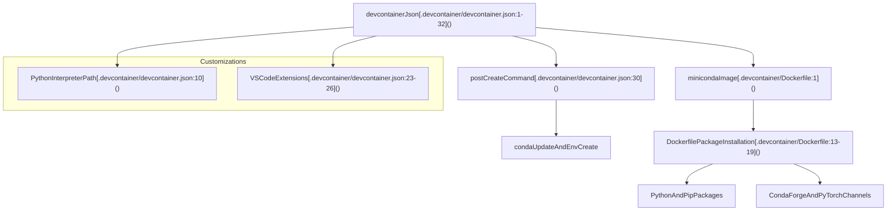

<!-- source: DeepWiki mcp.deepwiki.com · repo microsoft/AI-For-Beginners · page 2.1 Local Development Setup · fetched 2026-10-26 -->

# Local Development Setup

<details>
<summary>Relevant source files</summary>

The following files were used as context for generating this wiki page:

- [.devcontainer/Dockerfile](.devcontainer/Dockerfile)
- [.devcontainer/add-notice.sh](.devcontainer/add-notice.sh)
- [.devcontainer/devcontainer.json](.devcontainer/devcontainer.json)
- [.devcontainer/environment.yml](.devcontainer/environment.yml)
- [.devcontainer/requirements.txt](.devcontainer/requirements.txt)
- [binder/environment.yml](binder/environment.yml)
- [binder/requirements.txt](binder/requirements.txt)
- [environment.yml](environment.yml)
- [lessons/4-ComputerVision/12-Segmentation/lab/BodySegmentation.ipynb](lessons/4-ComputerVision/12-Segmentation/lab/BodySegmentation.ipynb)
- [lessons/5-NLP/14-Embeddings/torchnlp.py](lessons/5-NLP/14-Embeddings/torchnlp.py)
- [lessons/5-NLP/16-RNN/RNNPyTorch.ipynb](lessons/5-NLP/16-RNN/RNNPyTorch.ipynb)
- [lessons/5-NLP/16-RNN/torchnlp.py](lessons/5-NLP/16-RNN/torchnlp.py)
- [lessons/5-NLP/17-GenerativeNetworks/torchnlp.py](lessons/5-NLP/17-GenerativeNetworks/torchnlp.py)
- [lessons/5-NLP/18-Transformers/torchnlp.py](lessons/5-NLP/18-Transformers/torchnlp.py)
- [lessons/5-NLP/requirements-pytorch.txt](lessons/5-NLP/requirements-pytorch.txt)
- [lessons/5-NLP/requirements-tf.txt](lessons/5-NLP/requirements-tf.txt)
- [requirements.txt](requirements.txt)

</details>


This document details the Dev Container configuration, Dockerfile, `environment.yml`, and `conda` environment setup required for local development in the AI-For-Beginners repository. For cloud-based alternatives, see [Cloud Development Options](#2.2).

## System Requirements

Running the curriculum code locally requires the following minimum and recommended hardware and software specifications:

| Component | Minimum Requirement | Recommended |
|-----------|---------------------|-------------|
| CPU       | 2 cores             | 4+ cores [.devcontainer/devcontainer.json:4-6]() |
| RAM       | 4GB                 | 8GB+        |
| Storage   | 10GB free space     | 50GB+ free space |
| GPU       | Not required        | CUDA-compatible (for accelerated training) |
| OS        | Windows 10/11, macOS 10.15+, or Linux | Latest versions |

Sources: [.devcontainer/devcontainer.json:4-6]()

## Development Setup Architecture

The repository supports two local environment setup patterns: a standard `conda` environment setup and a containerized approach using VS Code Dev Containers.



Sources: [.devcontainer/devcontainer.json:1-32](), [.devcontainer/environment.yml:1-24](), [requirements.txt:1-21]()

## Option 1: Standard Conda Setup

To set up the `ai4beg` environment manually on a host machine:

1. Clone the repository and navigate to its root directory:
   ```bash
   git clone https://github.com/microsoft/AI-For-Beginners.git
   cd AI-For-Beginners
   ```

2. Create the conda environment using `.devcontainer/environment.yml` [.devcontainer/environment.yml:1-24]():
   ```bash
   conda env create -f .devcontainer/environment.yml
   ```

3. Activate the environment [.devcontainer/environment.yml:1]():
   ```bash
   conda activate ai4beg
   ```

Sources: [.devcontainer/environment.yml:1-24]()

## Option 2: VS Code Dev Containers

The repository provides a complete containerized development setup under `.devcontainer/` containing a `devcontainer.json` configuration [,.devcontainer/devcontainer.json:1-32]() and a custom `Dockerfile` [.devcontainer/Dockerfile:1-20]().

### Configuration Breakdown

- **Base Image:** Built on `mcr.microsoft.com/vscode/devcontainers/miniconda:0-3` [.devcontainer/Dockerfile:1]().
- **Host Requirements:** Configured to allocate a minimum of 2 CPU cores [.devcontainer/devcontainer.json:4-6]().
- **Post-Creation Command:** Automatically updates `conda` and creates the environment using `conda update conda -y && conda env create -f environment.yml` [.devcontainer/devcontainer.json:30]().
- **Python Interpreter:** Defaults to `/opt/conda/bin/python` [.devcontainer/devcontainer.json:10]().
- **VS Code Extensions:** Automatically installs `ms-python.python` and `ms-python.vscode-pylance` [.devcontainer/devcontainer.json:23-26]().



Sources: [.devcontainer/devcontainer.json:1-32](), [.devcontainer/Dockerfile:1-20]()

## Dependency Management and Framework Stack

The environment relies on a layered dependency stack combining `conda` channels (`defaults`, `conda-forge`, `pytorch`) with pip requirements.

### Core Environment Specification (`environment.yml`)

The main conda environment configuration specifies key scientific and deep learning packages:
- **Python & Core Tools:** `python`, `pip`, `ipykernel`, `ipython`, `ipywidgets`, `jupyter` [.devcontainer/environment.yml:6-12]()
- **Scientific Computing:** `matplotlib=3.9`, `numpy=1.26`, `scipy=1.13`, `scikit-learn`, `requests=2.32` [.devcontainer/environment.yml:10-15]()
- **Computer Vision & Frameworks:** `conda-forge::opencv`, `pytorch::pytorch`, `pytorch::torchtext`, `pytorch::torchvision`, `pytorch::torchdata` [.devcontainer/environment.yml:17-22]()
- **Pip Requirements:** Extends environment packages using `.devcontainer/requirements.txt` [.devcontainer/environment.yml:23-24]()

Sources: [.devcontainer/environment.yml:1-24]()

### Python Pip Dependencies (`requirements.txt`)

Additional machine learning, NLP, and utility packages are installed via `.devcontainer/requirements.txt`:
```
gensim==4.3.3
gym==0.26.2
huggingface==0.0.1
imageio==2.35.0
keras==3.15.0
nltk==3.10.3
pandas==2.2.2
pillow==12.3.0
pygame==2.6.0
scikit-image==0.24.0
seaborn==0.13.2
smart-open==7.0.4
tensorboard-data-server==0.7.2
tensorflow-datasets==4.9.6
tensorflow-hub==0.16.1
tensorflow==2.17.0
tensorboard==2.17.1
tokenizers==0.20.0
torchinfo==1.8.0
tqdm==4.66.5
```
Sources: [.devcontainer/requirements.txt:1-21](), [requirements.txt:1-21]()

### Framework-Specific NLP Dependencies

For lessons focusing specifically on Natural Language Processing, dual-framework requirements are provided:

- **PyTorch Stack (`lessons/5-NLP/requirements-pytorch.txt`):**
  ```
  gensim>=4.3.0,<5
  huggingface==0.0.1
  matplotlib
  nltk==3.10.3
  numpy==1.22.0
  opencv-python==4.5.1.48
  Pillow==12.3.0
  scikit-learn
  scipy
  torch==2.13.0
  torchaudio==0.8.1
  torchinfo==0.0.8
  torchtext==0.9.1
  torchvision==0.9.1
  transformers==5.10.1
  ```
  Sources: [lessons/5-NLP/requirements-pytorch.txt:1-15]()

- **TensorFlow Stack (`lessons/5-NLP/requirements-tf.txt`):**
  ```
  gensim==3.8.3
  huggingface==0.0.1
  matplotlib
  nltk==3.10.3
  numpy==1.22.0
  opencv-python==4.5.1.48
  Pillow==12.3.0
  scikit-learn
  scipy
  TensorFlow
  TensorFlow_datasets
  TensorFlow_text
  transformers==5.10.1
  ```
  Sources: [lessons/5-NLP/requirements-tf.txt:1-13]()

## Troubleshooting

- **Conda Environment Creation Hangs/Failures:** If environment resolution hangs, update conda prior to creating the environment [.devcontainer/devcontainer.json:30]():
  ```bash
  conda update conda -y
  conda env create -f .devcontainer/environment.yml
  ```
- **GPU Acceleration:** Ensure NVIDIA CUDA toolkit and compatible drivers are installed on the host if training deep neural networks locally.

Sources: [.devcontainer/devcontainer.json:30]()

---

