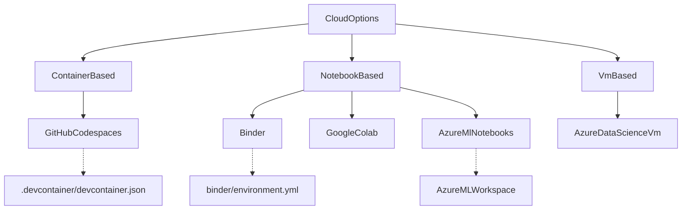
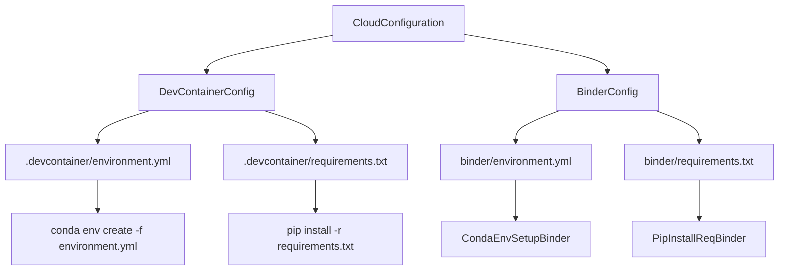
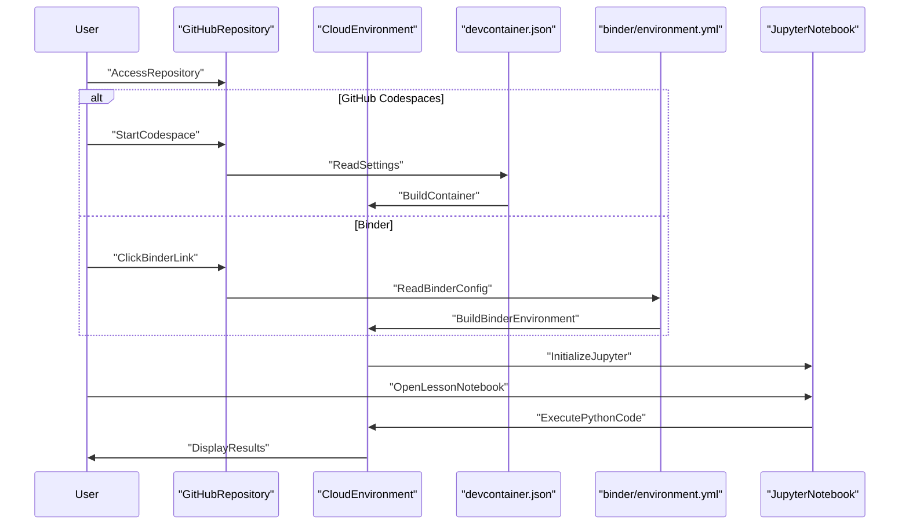

<!-- source: DeepWiki mcp.deepwiki.com · repo microsoft/AI-For-Beginners · page 2.2 Cloud Development Options · fetched 2026-10-26 -->

# Cloud Development Options

Relevant source files

The following files were used as context for generating this wiki page:

- [.devcontainer/Dockerfile](.devcontainer/Dockerfile)
- [.devcontainer/add-notice.sh](.devcontainer/add-notice.sh)
- [.devcontainer/devcontainer.json](.devcontainer/devcontainer.json)
- [.devcontainer/environment.yml](.devcontainer/environment.yml)
- [.devcontainer/requirements.txt](.devcontainer/requirements.txt)
- [binder/environment.yml](binder/environment.yml)
- [binder/requirements.txt](binder/requirements.txt)
- [environment.yml](environment.yml)
- [lessons/0-course-setup/for-teachers.md](lessons/0-course-setup/for-teachers.md)
- [lessons/0-course-setup/how-to-run.md](lessons/0-course-setup/how-to-run.md)
- [lessons/0-course-setup/setup.md](lessons/0-course-setup/setup.md)
- [lessons/4-ComputerVision/12-Segmentation/lab/BodySegmentation.ipynb](lessons/4-ComputerVision/12-Segmentation/lab/BodySegmentation.ipynb)
- [lessons/5-NLP/14-Embeddings/torchnlp.py](lessons/5-NLP/14-Embeddings/torchnlp.py)
- [lessons/5-NLP/16-RNN/RNNPyTorch.ipynb](lessons/5-NLP/16-RNN/RNNPyTorch.ipynb)
- [lessons/5-NLP/16-RNN/torchnlp.py](lessons/5-NLP/16-RNN/torchnlp.py)
- [lessons/5-NLP/17-GenerativeNetworks/torchnlp.py](lessons/5-NLP/17-GenerativeNetworks/torchnlp.py)
- [lessons/5-NLP/18-Transformers/torchnlp.py](lessons/5-NLP/18-Transformers/torchnlp.py)
- [lessons/5-NLP/requirements-pytorch.txt](lessons/5-NLP/requirements-pytorch.txt)
- [lessons/5-NLP/requirements-tf.txt](lessons/5-NLP/requirements-tf.txt)
- [requirements.txt](requirements.txt)
- [translations/ur/CONTRIBUTING.md](translations/ur/CONTRIBUTING.md)
- [translations/ur/examples/README.md](translations/ur/examples/README.md)
- [translations/ur/lessons/0-course-setup/how-to-run.md](translations/ur/lessons/0-course-setup/how-to-run.md)
- [translations/ur/lessons/4-ComputerVision/08-TransferLearning/TransferLearningTF.ipynb](translations/ur/lessons/4-ComputerVision/08-TransferLearning/TransferLearningTF.ipynb)
- [translations/ur/lessons/5-NLP/README.md](translations/ur/lessons/5-NLP/README.md)
- [translations/zh-CN/CONTRIBUTING.md](translations/zh-CN/CONTRIBUTING.md)
- [translations/zh-CN/examples/README.md](translations/zh-CN/examples/README.md)
- [translations/zh-CN/lessons/0-course-setup/how-to-run.md](translations/zh-CN/lessons/0-course-setup/how-to-run.md)
- [translations/zh-CN/lessons/4-ComputerVision/08-TransferLearning/TransferLearningTF.ipynb](translations/zh-CN/lessons/4-ComputerVision/08-TransferLearning/TransferLearningTF.ipynb)
- [translations/zh-CN/lessons/5-NLP/README.md](translations/zh-CN/lessons/5-NLP/README.md)
- [translations/zh-MO/examples/README.md](translations/zh-MO/examples/README.md)
- [translations/zh-MO/lessons/0-course-setup/how-to-run.md](translations/zh-MO/lessons/0-course-setup/how-to-run.md)
- [translations/zh-MO/lessons/5-NLP/README.md](translations/zh-MO/lessons/5-NLP/README.md)

This page details the various cloud-based options for running the code examples in the AI-For-Beginners curriculum without requiring a local setup. These cloud environments provide ready-to-use configurations with all necessary dependencies pre-installed, making them ideal for beginners who want to start quickly without configuring a local development environment.

For information about setting up a local environment with required dependencies, see [Local Development Setup](#2.1).

Sources: [lessons/0-course-setup/how-to-run.md:75-81]()

## Available Cloud Options

Several cloud-based options are available for running the curriculum code, each with different advantages and use cases:

### Cloud Environment Types and Code Mapping

Sources: [lessons/0-course-setup/how-to-run.md:75-94](), [.devcontainer/devcontainer.json:1-32](), [binder/environment.yml:1-25]()

### GitHub Codespaces

GitHub Codespaces provides a fully configured development environment in the cloud, accessible through a browser-based VS Code interface.

**Setup:**
1. Navigate to the repository on GitHub
2. Click the "Code" button
3. Select "Open with Codespaces"
4. Create a new codespace

The environment is automatically configured using the `.devcontainer` settings in the repository (`[.devcontainer/devcontainer.json]()`), providing all necessary dependencies for the curriculum.

Sources: [lessons/0-course-setup/how-to-run.md:79-80](), [.devcontainer/devcontainer.json:1-32]()

### Binder

Binder is a free service that allows you to run Jupyter notebooks from GitHub repositories without any installation.

**Setup:**
1. Visit the Binder link for the repository: `https://mybinder.org/v2/gh/microsoft/ai-for-beginners/HEAD`
2. Wait for the environment to build using `binder/environment.yml` and `binder/requirements.txt`
3. Access the notebooks through the Jupyter interface

**Limitations:**
- Limited computing resources
- Some web resources may be blocked
- Sessions are not persistent

Sources: [lessons/0-course-setup/how-to-run.md:80-82](), [binder/environment.yml:1-25](), [binder/requirements.txt:1-22]()

### Azure Machine Learning

Azure Machine Learning provides cloud-based notebook environments with scalable computing resources.

**Setup:**
1. Create an Azure Machine Learning workspace
2. Use the Notebook feature to clone the repository
3. Run the notebooks in the Azure ML environment

This option is particularly useful for lessons that benefit from GPU acceleration.

Sources: [lessons/0-course-setup/how-to-run.md:92-93]()

### Azure Data Science Virtual Machine

Azure Data Science Virtual Machine (DSVM) provides a pre-configured VM with data science tools.

**Setup:**
1. Create a DSVM in Azure (NC-series for GPU support)
2. Connect to the VM via Jupyter
3. Clone the repository to the VM

Sources: [lessons/0-course-setup/how-to-run.md:88-90]()

### Google Colab

Google Colab offers free Jupyter notebooks with some GPU support.

**Setup:**
1. Upload individual notebooks to Google Colab
2. Configure the runtime to use GPU if needed

Sources: [lessons/0-course-setup/how-to-run.md:94]()

## Environment Configuration Files

Different cloud environments use specific configuration files from the repository to provision Python environments and package stacks:

### Configuration Mapping to Code Entities

Sources: [.devcontainer/environment.yml:1-24](), [.devcontainer/requirements.txt:1-21](), [binder/environment.yml:1-25](), [binder/requirements.txt:1-22]()

### Codespaces Configuration

GitHub Codespaces uses the following files defined in the `.devcontainer` directory:
- `.devcontainer/environment.yml`: Conda environment definition (`ai4beg`)
- `.devcontainer/requirements.txt`: Additional pip packages (including `tensorflow==2.17.0`, `keras==3.15.0`, `gensim==4.3.3`)
- `.devcontainer/devcontainer.json`: Container orchestration and VS Code settings

Sources: [.devcontainer/devcontainer.json:1-32](), [.devcontainer/environment.yml:1-24](), [.devcontainer/requirements.txt:1-21]()

### Binder Configuration

Binder uses separate configuration files optimized for its build system:
- `binder/environment.yml`: Conda environment definition with specific version pins (`python=3.8.12`, `numpy=1.22.3`)
- `binder/requirements.txt`: Pip dependencies including `transformers==5.10.1` and `tensorflow==2.13.1`

Sources: [binder/environment.yml:1-25](), [binder/requirements.txt:1-22]()

## GPU Support in Cloud Environments

Some lessons, especially in Computer Vision and NLP sections, benefit significantly from GPU acceleration. The code automatically detects and uses GPU when available through standard PyTorch/TensorFlow device handles.

### Enabling GPU in Different Environments

| Environment | GPU Setup |
|-------------|-----------|
| GitHub Codespaces | Limited GPU availability, may require paid tier |
| Azure ML | Select GPU compute instance when configuring notebook |
| Azure DSVM | Choose NC-series VM with NVIDIA GPU |
| Google Colab | Runtime > Change runtime type > GPU |

**Note**: Some Azure subscriptions, including Azure for Students, may require additional support requests to enable GPU cores.

Sources: [lessons/0-course-setup/how-to-run.md:84-94]()

## Cloud Development Workflow

Sources: [lessons/0-course-setup/how-to-run.md:75-81](), [.devcontainer/devcontainer.json:1-32](), [binder/environment.yml:1-25]()

## Comparison of Cloud Options

| Feature | GitHub Codespaces | Binder | Azure ML | DSVM | Google Colab |
|---------|-------------------|--------|----------|------|--------------|
| Cost | Free tier available | Free | Paid (Azure subscription) | Paid (Azure subscription) | Free tier available |
| Setup complexity | Low | Very low | Medium | Medium-High | Low |
| Persistence | Yes | No | Yes | Yes | Limited |
| GPU support | Limited | No | Yes | Yes | Limited |
| Environment | Full VS Code | Jupyter | Notebooks & compute | Full VM | Jupyter |
| Required account | GitHub | None | Azure | Azure | Google |

Sources: [lessons/0-course-setup/how-to-run.md:75-94]()

## Recommendations for Different Curriculum Sections

| Curriculum Section | Recommended Environment | GPU Beneficial? |
|-------------------|-------------------------|-----------------|
| Introduction to AI | Any cloud option | No |
| Symbolic AI | Any cloud option | No |
| Neural Networks | Any cloud option | No |
| Computer Vision | GPU-enabled option | Yes |
| NLP | GPU-enabled option | Yes |
| Other AI Techniques | Depends on specific lesson | Varies |

Note that while GPU acceleration makes training significantly faster, all examples can still run on CPU-only environments, just with longer training times.

Sources: [lessons/0-course-setup/how-to-run.md:75-94]()

## Troubleshooting Common Issues

### Binder Issues
- **Long build times**: Initial environment setup via `binder/environment.yml` can take several minutes.
- **Resource limitations**: Memory constraints may affect complex models (`binder/requirements.txt`).
- **Network restrictions**: Some external data sources might be blocked.

### GPU-related Issues
- **CUDA errors**: Ensure code is using correct device detection logic.
- **Memory errors**: Large models may exceed GPU memory limits.
- **Azure GPU allocation**: Some subscriptions require support requests to enable GPU resources.

Sources: [lessons/0-course-setup/how-to-run.md:82](), [binder/environment.yml:1-25]()

## Conclusion

Cloud development options provide flexibility and accessibility for working with the AI-For-Beginners curriculum. For beginners or quick exploration, Binder or Google Colab offer simplicity and free access. For more computation-intensive lessons, Azure ML or DSVM with GPU support provide better performance.

All code examples are designed to run in any Python environment configured via `.devcontainer/environment.yml` or `binder/environment.yml`, allowing you to switch between different cloud options or local development as needed.

Sources: [lessons/0-course-setup/how-to-run.md:75-94](), [.devcontainer/environment.yml:1-24](), [binder/environment.yml:1-25]()

---

