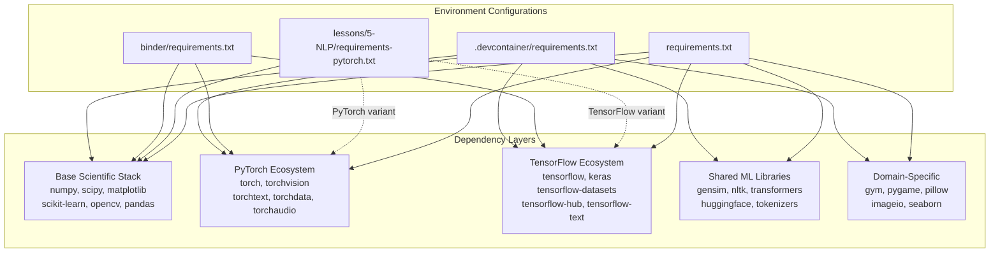
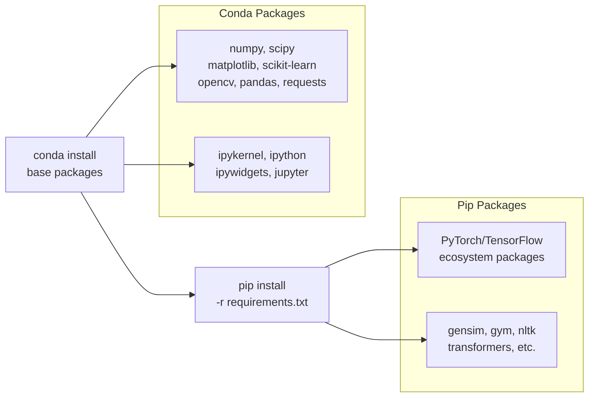
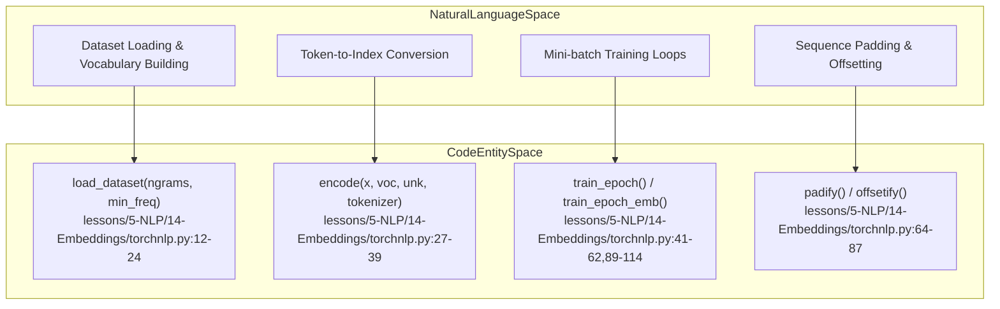
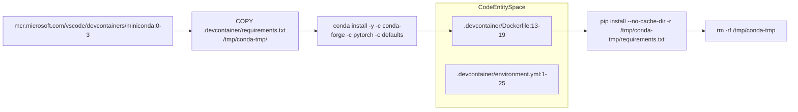

<!-- source: DeepWiki mcp.deepwiki.com · repo microsoft/AI-For-Beginners · page 2.3 Dependencies and Framework Stack · fetched 2026-10-26 -->

# Dependencies and Framework Stack

<details>
<summary>Relevant source files</summary>

The following files were used as context for generating this wiki page:

- [.devcontainer/Dockerfile](.devcontainer/Dockerfile)
- [.devcontainer/add-notice.sh](.devcontainer/add-notice.sh)
- [.devcontainer/devcontainer.json](.devcontainer/devcontainer.json)
- [.devcontainer/environment.yml](.devcontainer/environment.yml)
- [.devcontainer/requirements.txt](.devcontainer/requirements.txt)
- [binder/environment.yml](binder/environment.yml)
- [binder/requirements.txt](binder/requirements.txt)
- [environment.yml](environment.yml)
- [lessons/4-ComputerVision/12-Segmentation/lab/BodySegmentation.ipynb](lessons/4-ComputerVision/12-Segmentation/lab/BodySegmentation.ipynb)
- [lessons/5-NLP/14-Embeddings/torchnlp.py](lessons/5-NLP/14-Embeddings/torchnlp.py)
- [lessons/5-NLP/16-RNN/RNNPyTorch.ipynb](lessons/5-NLP/16-RNN/RNNPyTorch.ipynb)
- [lessons/5-NLP/16-RNN/torchnlp.py](lessons/5-NLP/16-RNN/torchnlp.py)
- [lessons/5-NLP/17-GenerativeNetworks/torchnlp.py](lessons/5-NLP/17-GenerativeNetworks/torchnlp.py)
- [lessons/5-NLP/18-Transformers/torchnlp.py](lessons/5-NLP/18-Transformers/torchnlp.py)
- [lessons/5-NLP/requirements-pytorch.txt](lessons/5-NLP/requirements-pytorch.txt)
- [lessons/5-NLP/requirements-tf.txt](lessons/5-NLP/requirements-tf.txt)
- [requirements.txt](requirements.txt)

</details>


This page documents the dependency management strategy and framework stack organization across the AI-For-Beginners curriculum. It covers the dual-framework architecture supporting both PyTorch and TensorFlow implementations, shared computational libraries, environment-specific dependency configurations, and NLP-specific utility modules.

For development environment setup procedures, see [Local Development Setup](#2.1) and [Cloud Development Options](#2.2). For implementation patterns using these dependencies, see [NLP Utilities and Implementation Patterns](#3.5.4).

## Overview of Dependency Architecture

The repository employs a layered dependency strategy managing multiple target environments, core scientific libraries, framework stacks, and domain-specific packages.

Title: Dependency Layer Architecture and Configuration Mapping


**Dependency Management Strategy**

Sources: [.devcontainer/requirements.txt:1-21](), [.devcontainer/environment.yml:1-24](), [binder/requirements.txt:1-22](), [lessons/5-NLP/requirements-pytorch.txt:1-15](), [lessons/5-NLP/requirements-tf.txt:1-13]()

## Core Shared Dependencies

All curriculum implementations depend on a common scientific computing foundation installed via conda channels `defaults` and `conda-forge` [.devcontainer/environment.yml:1-5]():

| Package | Version (devcontainer) | Version (binder) | Purpose |
|---------|------------------------|------------------|---------|
| `numpy` | 1.26 [.devcontainer/environment.yml:11-11]() | 1.22.3 [binder/environment.yml:11-11]() | Array operations, numerical computation |
| `scipy` | 1.13 [.devcontainer/environment.yml:15-15]() | 1.6.2 [binder/environment.yml:15-15]() | Scientific algorithms, optimization |
| `matplotlib` | 3.9 [.devcontainer/environment.yml:10-10]() | 3.4.2 [binder/environment.yml:10-10]() | Visualization, plotting |
| `scikit-learn` | latest [.devcontainer/environment.yml:14-14]() | 0.24.2 [binder/environment.yml:14-14]() | Classical ML algorithms, preprocessing |
| `opencv` | conda-forge channel [.devcontainer/environment.yml:17-17]() | 4.5 [binder/environment.yml:17-17]() | Computer vision operations |
| `pandas` | 2.2.2 [.devcontainer/requirements.txt:7-7]() | 2.0.3 [binder/requirements.txt:7-7]() | Data manipulation, tabular data |
| `requests` | 2.32 [.devcontainer/environment.yml:13-13]() | 2.26.0 [binder/environment.yml:13-13]() | HTTP requests, dataset downloads |

**Installation Flow**

Title: Conda and Pip Installation Pipeline


**Conda Environment Configuration**

The `environment.yml` defines the base conda environment named `ai4beg` [.devcontainer/environment.yml:1-5]():

```yaml
name: ai4beg
channels:
  - defaults
  - conda-forge
dependencies:
  - ipykernel, ipython, ipywidgets, jupyter
  - matplotlib, numpy, scipy, pandas, scikit-learn
  - requests, opencv, setuptools, pip
  - pytorch::pytorch, pytorch::torchtext, pytorch::torchvision, pytorch::torchdata
  - pip:
    - -r requirements.txt
```

Sources: [.devcontainer/environment.yml:1-24](), [binder/environment.yml:1-25]()

## PyTorch Framework Stack

PyTorch packages are installed via the `pytorch` conda channel and supplemented by pip requirements:

**Core PyTorch Packages**

| Package | Channel | Purpose |
|---------|---------|---------|
| `pytorch` | pytorch [.devcontainer/environment.yml:19-19]() | Core tensor operations, autograd, neural network modules |
| `torchvision` | pytorch [.devcontainer/environment.yml:21-21]() | Computer vision models, datasets, transformations |
| `torchtext` | pytorch [.devcontainer/environment.yml:20-20]() | NLP datasets, tokenization, vocabulary management |
| `torchdata` | pytorch [.devcontainer/environment.yml:22-22]() | Data loading utilities, iterators |
| `torchaudio` | pip [lessons/5-NLP/requirements-pytorch.txt:11-11]() | Audio processing, models (lesson-specific) |

**PyTorch Ecosystem Extensions**

Additional packages installed via pip complement the core stack:
- `torch==2.13.0` [lessons/5-NLP/requirements-pytorch.txt:10-10]() - Explicit version pinning in NLP lessons
- `torchvision==0.9.1` [lessons/5-NLP/requirements-pytorch.txt:14-14]() - Vision utilities
- `torchtext==0.9.1` [lessons/5-NLP/requirements-pytorch.txt:13-13]() - Text processing
- `torchaudio==0.8.1` [lessons/5-NLP/requirements-pytorch.txt:11-11]() - Audio processing
- `torchinfo==1.8.0` [.devcontainer/requirements.txt:19-19]() / `0.0.8` [lessons/5-NLP/requirements-pytorch.txt:12-12]() - Model architecture summaries

Sources: [.devcontainer/environment.yml:19-22](), [lessons/5-NLP/requirements-pytorch.txt:1-15]()

## TensorFlow Framework Stack

The TensorFlow stack provides parallel functionality to PyTorch with Google's framework and associated tools:

**Core TensorFlow Packages**

| Package | Version (devcontainer) | Version (binder) | Purpose |
|---------|------------------------|------------------|---------|
| `tensorflow` | 2.17.0 [.devcontainer/requirements.txt:16-16]() | 2.13.1 [binder/requirements.txt:17-17]() | Core framework, Keras API |
| `keras` | 3.15.0 [.devcontainer/requirements.txt:5-5]() | 3.15.0 [binder/requirements.txt:5-5]() | High-level neural network API |
| `tensorflow-datasets` | 4.9.6 [.devcontainer/requirements.txt:14-14]() | 4.9.2 [binder/requirements.txt:14-14]() | Standard datasets, data loading |
| `tensorflow-hub` | 0.16.1 [.devcontainer/requirements.txt:15-15]() | 0.16.1 [binder/requirements.txt:15-15]() | Pre-trained model repository |
| `tensorflow-text` | Not in devcontainer | 2.13.0 [binder/requirements.txt:16-16]() | Text processing operations |
| `tensorboard` | 2.17.1 [.devcontainer/requirements.txt:17-17]() | 2.13.0 [binder/requirements.txt:18-18]() | Visualization, experiment tracking |
| `tensorboard-data-server` | 0.7.2 [.devcontainer/requirements.txt:13-13]() | 0.7.2 [binder/requirements.txt:13-13]() | TensorBoard backend service |

Sources: [.devcontainer/requirements.txt:13-18](), [binder/requirements.txt:13-19]()

## NLP-Specific Dependencies and Implementation Patterns

Natural language processing lessons require specialized libraries that work with text data representation, tokenization, and vectorization.

**Text Processing and Embeddings**

| Package | Version | Framework Compatibility | Purpose |
|---------|---------|------------------------|---------|
| `gensim` | 4.3.3 [.devcontainer/requirements.txt:1-1]() (main), 3.8.3 [lessons/5-NLP/requirements-tf.txt:1-1]() (NLP tf) | Framework-agnostic | Word2Vec, GloVe, Doc2Vec embeddings |
| `nltk` | 3.10.3 [.devcontainer/requirements.txt:6-6]() | Framework-agnostic | Tokenization, corpora, linguistic data |
| `transformers` | 5.10.1 [binder/requirements.txt:22-22]() | PyTorch & TensorFlow | Hugging Face transformer models |
| `tokenizers` | 0.20.0 [.devcontainer/requirements.txt:18-18]() | Framework-agnostic | Fast tokenization library |
| `huggingface` | 0.0.1 [.devcontainer/requirements.txt:3-3]() | Framework-agnostic | Hugging Face Hub integration |
| `smart-open` | 7.0.4 [.devcontainer/requirements.txt:12-12]() | Framework-agnostic | Stream processing for large files |

Sources: [.devcontainer/requirements.txt:1-21](), [binder/requirements.txt:1-22](), [lessons/5-NLP/requirements-tf.txt:1-13]()

### NLP Utility Module Pattern (`torchnlp.py`)

The curriculum includes a shared utility module `torchnlp.py` duplicated across four NLP lessons. This modulebridges natural language requirements to specific python code functions.

Title: Bridging Natural Language Space to Code Entity Space (`torchnlp.py`)


**Key Functions in `torchnlp.py`**
- `load_dataset(ngrams=1, min_freq=1)` [lessons/5-NLP/14-Embeddings/torchnlp.py:12-24](): Loads `AG_NEWS` dataset via `torchtext.datasets.AG_NEWS` and builds vocabulary counters.
- `encode(x, voc=None, unk=0, tokenizer=tokenizer)` [lessons/5-NLP/14-Embeddings/torchnlp.py:27-39](): Converts raw text strings into token indices using string-to-index mappings (`stoi`).
- `train_epoch(net, dataloader, lr=0.01, ...)` [lessons/5-NLP/14-Embeddings/torchnlp.py:41-62]() / `train_epoch_emb()` [lessons/5-NLP/14-Embeddings/torchnlp.py:89-114](): Executes mini-batch gradient descent steps, forward passes, loss computation, and backpropagation.
- `padify(b, voc=None, tokenizer=tokenizer)` [lessons/5-NLP/14-Embeddings/torchnlp.py:64-75]() / `offsetify(b, voc=None)` [lessons/5-NLP/14-Embeddings/torchnlp.py:77-87](): Handles batch collation, dynamic padding to maximum sequence length within minibatches, and offset generation for embedding bags.

Sources: [lessons/5-NLP/14-Embeddings/torchnlp.py:1-115](), [lessons/5-NLP/16-RNN/torchnlp.py:1-115](), [lessons/5-NLP/17-GenerativeNetworks/torchnlp.py:1-115](), [lessons/5-NLP/18-Transformers/torchnlp.py:1-115]()

## Domain-Specific Dependencies

Additional packages support specific AI application domains beyond core ML functionality:

**Computer Vision Utilities**

| Package | Version | Purpose |
|---------|---------|---------|
| `pillow` | 12.3.0 [.devcontainer/requirements.txt:8-8]() | Image loading, manipulation |
| `imageio` | 2.35.0 [.devcontainer/requirements.txt:4-4]() | Image/video I/O, animation creation |
| `scikit-image` | 0.24.0 [.devcontainer/requirements.txt:10-10]() (main), 0.21.0 [binder/environment.yml:14-14]() (binder) | Image processing algorithms |
| `seaborn` | 0.13.2 [.devcontainer/requirements.txt:11-11]() | Statistical data visualization |

**Reinforcement Learning and Utilities**

| Package | Version | Purpose |
|---------|---------|---------|
| `gym` | 0.26.2 [.devcontainer/requirements.txt:2-2]() | OpenAI Gym environments for RL |
| `pygame` | 2.6.0 [.devcontainer/requirements.txt:9-9]() | Game environment rendering |
| `tqdm` | 4.66.5 [.devcontainer/requirements.txt:20-20]() | Progress bars for training loops |

Sources: [.devcontainer/requirements.txt:1-21]()

## Development Environment Installation

The Docker-based development container orchestrates dependency installation through a multi-stage process [.devcontainer/Dockerfile:1-19]():

Title: Dockerfile Installation Sequence and Code Mapping


Sources: [.devcontainer/Dockerfile:1-25](), [.devcontainer/environment.yml:1-24]()

The Dockerfile explicitly installs packages directly to avoid conda environment solving bottlenecks [.devcontainer/Dockerfile:12-19]():

```dockerfile
RUN umask 0002 \
    && /opt/conda/bin/conda install -y -c conda-forge -c pytorch -c defaults \
        python pip ipykernel ipython ipywidgets jupyter matplotlib=3.9 numpy=1.26 \
        requests=2.32 scikit-learn scipy=1.13 opencv setuptools \
        pytorch torchtext torchvision torchdata \
    && /opt/conda/bin/pip install --no-cache-dir -r /tmp/conda-tmp/requirements.txt \
    && rm -rf /tmp/conda-tmp
```

Sources: [.devcontainer/Dockerfile:13-19]()

---

