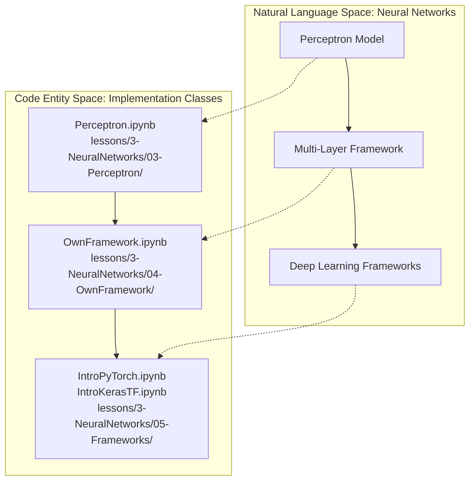
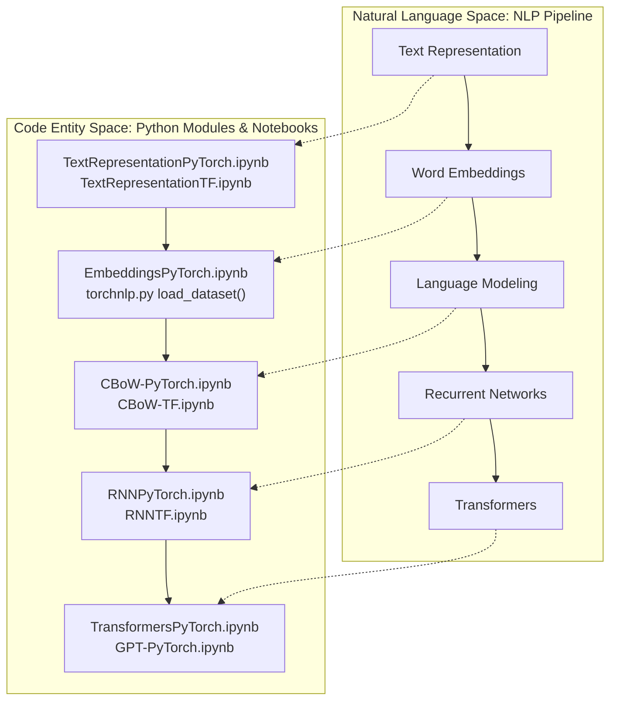

<!-- source: DeepWiki mcp.deepwiki.com · repo microsoft/AI-For-Beginners · page 3 Curriculum Content · fetched 2026-10-26 -->

# Curriculum Content

Relevant source files

The following files were used as context for generating this wiki page:

- [.gitignore](.gitignore)
- [README.md](README.md)
- [etc/Mindmap.html](etc/Mindmap.html)
- [etc/Mindmap.md](etc/Mindmap.md)
- [etc/Mindmap.svg](etc/Mindmap.svg)
- [lessons/4-ComputerVision/11-ObjectDetection/README.md](lessons/4-ComputerVision/11-ObjectDetection/README.md)
- [lessons/4-ComputerVision/11-ObjectDetection/lab/README.md](lessons/4-ComputerVision/11-ObjectDetection/lab/README.md)
- [lessons/4-ComputerVision/12-Segmentation/README.md](lessons/4-ComputerVision/12-Segmentation/README.md)
- [lessons/4-ComputerVision/12-Segmentation/SemanticSegmentationPytorch.ipynb](lessons/4-ComputerVision/12-Segmentation/SemanticSegmentationPytorch.ipynb)
- [lessons/4-ComputerVision/12-Segmentation/SemanticSegmentationTF.ipynb](lessons/4-ComputerVision/12-Segmentation/SemanticSegmentationTF.ipynb)
- [lessons/4-ComputerVision/README.md](lessons/4-ComputerVision/README.md)
- [lessons/5-NLP/13-TextRep/README.md](lessons/5-NLP/13-TextRep/README.md)
- [lessons/5-NLP/13-TextRep/TextRepresentationPyTorch.ipynb](lessons/5-NLP/13-TextRep/TextRepresentationPyTorch.ipynb)
- [lessons/5-NLP/13-TextRep/assignment.md](lessons/5-NLP/13-TextRep/assignment.md)
- [lessons/5-NLP/14-Embeddings/EmbeddingsPyTorch.ipynb](lessons/5-NLP/14-Embeddings/EmbeddingsPyTorch.ipynb)
- [lessons/5-NLP/14-Embeddings/README.md](lessons/5-NLP/14-Embeddings/README.md)
- [lessons/5-NLP/14-Embeddings/assignment.md](lessons/5-NLP/14-Embeddings/assignment.md)
- [lessons/5-NLP/15-LanguageModeling/CBoW-TF.ipynb](lessons/5-NLP/15-LanguageModeling/CBoW-TF.ipynb)
- [lessons/5-NLP/15-LanguageModeling/README.md](lessons/5-NLP/15-LanguageModeling/README.md)
- [lessons/5-NLP/15-LanguageModeling/lab/README.md](lessons/5-NLP/15-LanguageModeling/lab/README.md)
- [lessons/5-NLP/16-RNN/RNNTF.ipynb](lessons/5-NLP/16-RNN/RNNTF.ipynb)
- [lessons/5-NLP/16-RNN/assignment.md](lessons/5-NLP/16-RNN/assignment.md)
- [lessons/5-NLP/17-GenerativeNetworks/GenerativePyTorch.ipynb](lessons/5-NLP/17-GenerativeNetworks/GenerativePyTorch.ipynb)
- [lessons/5-NLP/17-GenerativeNetworks/GenerativeTF.ipynb](lessons/5-NLP/17-GenerativeNetworks/GenerativeTF.ipynb)
- [lessons/5-NLP/17-GenerativeNetworks/README.md](lessons/5-NLP/17-GenerativeNetworks/README.md)
- [lessons/5-NLP/17-GenerativeNetworks/lab/README.md](lessons/5-NLP/17-GenerativeNetworks/lab/README.md)
- [lessons/5-NLP/20-LangModels/GPT-PyTorch.ipynb](lessons/5-NLP/20-LangModels/GPT-PyTorch.ipynb)
- [lessons/5-NLP/20-LangModels/README.md](lessons/5-NLP/20-LangModels/README.md)
- [lessons/5-NLP/README.md](lessons/5-NLP/README.md)
- [lessons/6-Other/22-DeepRL/README.md](lessons/6-Other/22-DeepRL/README.md)
- [lessons/7-Ethics/README.md](lessons/7-Ethics/README.md)

## Purpose and Scope

This document provides an overview of the main learning content areas in the `https://github.com/microsoft/AI-For-Beginners` curriculum. It describes how the 24 lessons are organized across knowledge domains, the progression from fundamentals to advanced topics, and links to the detailed child pages.

Sources: [README.md:15-21](), [README.md:61-71]()

---

## 3.1. Introduction to AI

The curriculum begins with foundational concepts in artificial intelligence, covering its history, core definitions, the Turing Test, and contrasting philosophical approaches (symbolic, neural, evolutionary, and emergent). For details, see [Introduction to AI](#3.1).

Sources: [README.md:61-69](), [etc/Mindmap.md:3-12]()

---

## 3.2. Symbolic AI

Symbolic AI (GOFAI) covers early approaches to artificial intelligence based on explicit knowledge representation, expert systems (`lessons/2-Symbolic/Animals.ipynb`), ontologies (`lessons/2-Symbolic/FamilyOntology.ipynb`), semantic web, and production rules. For details, see [Symbolic AI](#3.2).

Sources: [README.md:65-67](), [etc/Mindmap.md:13-18]()

---

## 3.3. Neural Networks Foundations

Lessons 3 through 5 introduce neural network fundamentals, including perceptron implementation, custom frameworks, backpropagation, gradient descent, and introduction to `PyTorch` and `TensorFlow` frameworks (`lessons/3-NeuralNetworks/05-Frameworks/IntroPyTorch.ipynb`).

Sources: [README.md:67-68](), [etc/Mindmap.md:19-25]()

For details, see [Neural Networks Foundations](#3.3).

Sources: [README.md:67-68](), [etc/Mindmap.md:19-25]()

---

## 3.4. Computer Vision

Lessons 6 through 12 cover computer vision techniques using OpenCV, convolutional neural networks (CNNs), transfer learning (`lessons/4-ComputerVision/08-TransferLearning/README.md`), adversarial examples, autoencoders, GANs, object detection, and semantic segmentation (`lessons/4-ComputerVision/12-Segmentation/SemanticSegmentationTF.ipynb`). For details, see [Computer Vision](#3.4).

Sources: [README.md:68-69](), [etc/Mindmap.md:27-41]()

---

## 3.5. Natural Language Processing

Lessons 13 through 20 cover the full NLP pipeline from traditional text representation to modern transformer architectures and large language models (`lessons/5-NLP/20-LangModels/GPT-PyTorch.ipynb`).

Sources: [lessons/5-NLP/README.md:58-66](), [lessons/5-NLP/14-Embeddings/EmbeddingsPyTorch.ipynb:44-51]()

For details, see [Natural Language Processing](#3.5).

Sources: [README.md:68-69](), [lessons/5-NLP/README.md:5-23]()

---

## 3.6. Multimodal AI

Multimodal AI explores systems that bridge vision and language, such as the `CLIP` architecture (`lessons/X-Extras/X1-MultiModal/Clip.ipynb`), zero-shot classification, VQGAN+CLIP for text-to-image generation, and multimodal learning approaches. For details, see [Multimodal AI](#3.6).

Sources: [README.md:68-69](), [etc/Mindmap.md:69-73]()

---

## 3.7. Reinforcement Learning

Lesson 22 introduces Deep Reinforcement Learning using OpenAI Gym (`lessons/6-Other/22-DeepRL/README.md`), CartPole environments, policy gradients, Q-learning, state discretization, and actor-critic architectures. For details, see [Reinforcement Learning](#3.7).

Sources: [README.md:68-70](), [lessons/6-Other/22-DeepRL/README.md:1-77]()

---

## 3.8. Other AI Techniques

Lessons 21 and 23 cover alternative paradigms such as genetic algorithms (crossover, mutation, fitness) and multi-agent systems (NetLogo, emergent behavior, evolutionary optimization). For details, see [Other AI Techniques](#3.8).

Sources: [README.md:70-71](), [etc/Mindmap.md:62-65]()

---

## 3.9. AI Ethics

Lesson 24 addresses responsible AI principles, fairness, bias mitigation, transparency, accountability, privacy, and the Responsible AI Toolbox (`lessons/7-Ethics/README.md`). For details, see [AI Ethics](#3.9).

Sources: [README.md:21-21](), [lessons/7-Ethics/README.md:11-34]()

---

