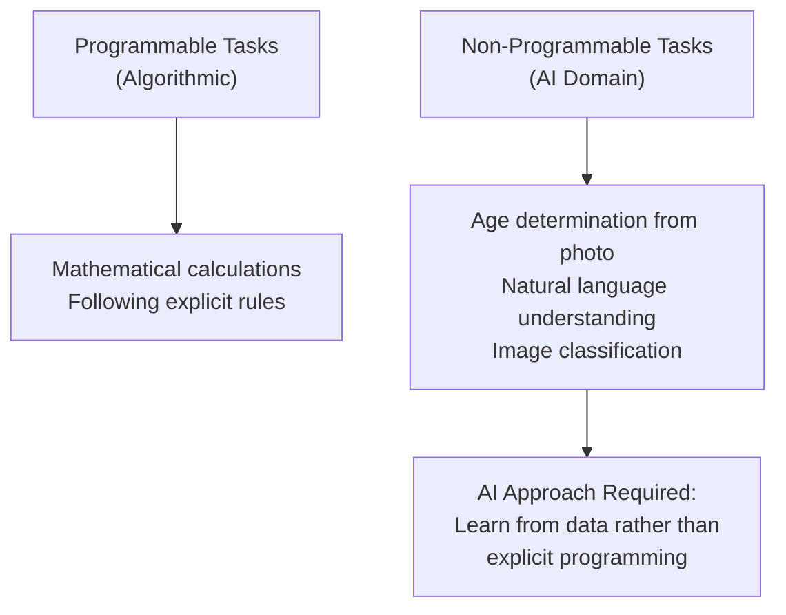
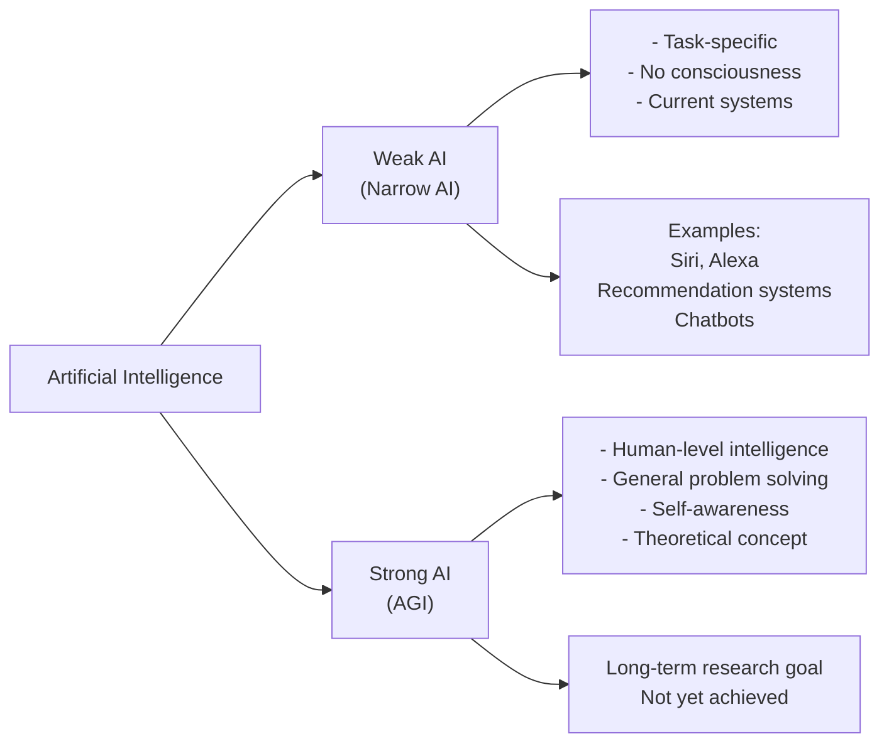
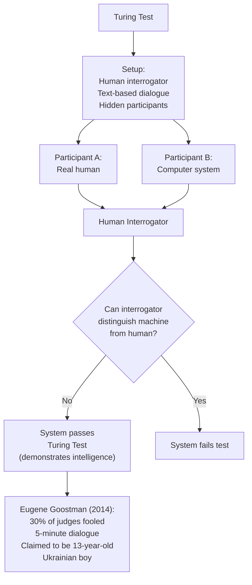
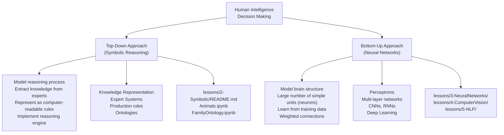
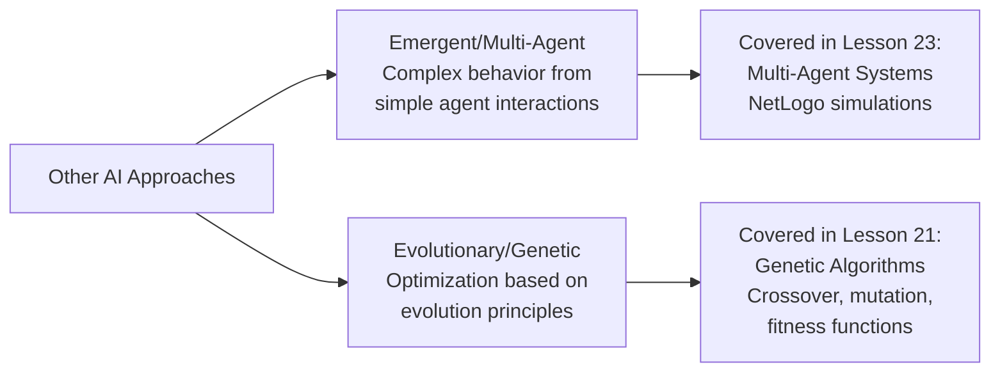
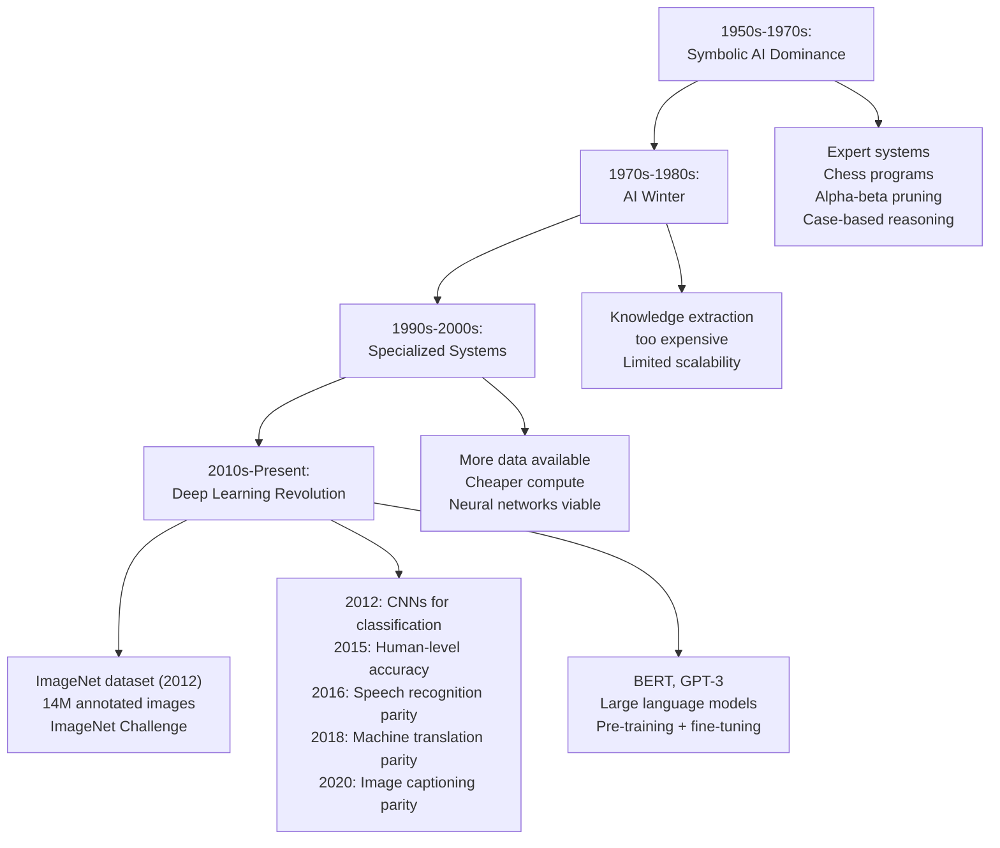
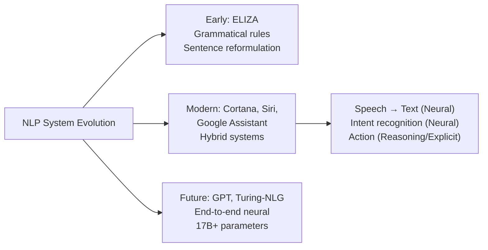
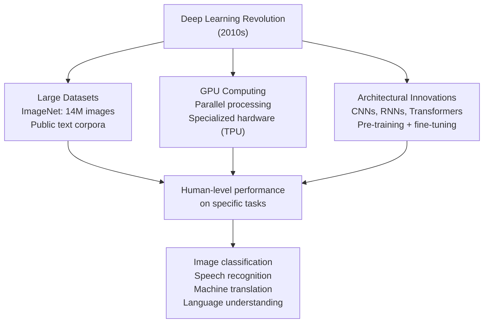
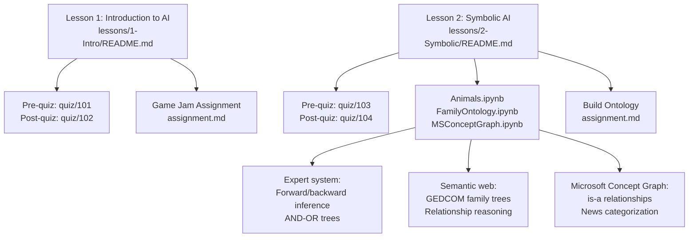

<!-- source: DeepWiki mcp.deepwiki.com · repo microsoft/AI-For-Beginners · page 3.1 Introduction to AI · fetched 2026-10-26 -->

# Introduction to AI

Relevant source files

The following files were used as context for generating this wiki page:

- [etc/CODE_OF_CONDUCT.md](etc/CODE_OF_CONDUCT.md)
- [etc/SUPPORT.md](etc/SUPPORT.md)
- [etc/TRANSLATIONS.md](etc/TRANSLATIONS.md)
- [lessons/1-Intro/README.md](lessons/1-Intro/README.md)
- [lessons/1-Intro/translations/README.ja.md](lessons/1-Intro/translations/README.ja.md)

## Purpose and Scope

This document covers the foundational concepts of Artificial Intelligence presented in Lessons 1-2 of the curriculum, including:

- Core AI definitions and the distinction between tasks that can and cannot be explicitly programmed
- Classification of AI systems (Weak AI vs Strong AI)
- The Turing Test as a measure of machine intelligence
- Different approaches to building intelligent systems (symbolic reasoning, neural networks, evolutionary, emergent)
- Historical evolution of AI from symbolic systems to modern deep learning
- Recent achievements in neural network-based AI

For implementation details of neural network foundations, see [Neural Networks Foundations](#3.3). For symbolic AI implementation patterns including knowledge representation and expert systems, see [Symbolic AI](#3.2).

**Sources**: [lessons/1-Intro/README.md:1-10](), [lessons/2-Symbolic/README.md:1-20]()

## What is Artificial Intelligence

AI is defined as making computers exhibit intelligent behavior—performing tasks that humans are naturally good at but which cannot be explicitly programmed through algorithmic steps. The fundamental challenge is that some cognitive tasks lack clear procedural descriptions.

The classic example: determining a person's age from a photograph is a task humans perform intuitively, but we cannot write explicit algorithmic steps for a computer to follow. This represents the core domain where AI techniques are necessary.

**Sources**: [lessons/1-Intro/README.md:9-22]()

## AI Classification: Weak vs Strong

| Aspect | Weak AI | Strong AI (AGI) |
|--------|---------|----------------|
| **Scope** | Specific tasks or narrow domains | Any intellectual task humans can do |
| **Intelligence** | Specialized, not generally intelligent | Human-level understanding across domains |
| **Consciousness** | No understanding or self-awareness | Possesses consciousness/self-awareness |
| **Current Status** | Widely deployed (assistants, recommendations) | Theoretical concept, not achieved |
| **Examples** | Virtual assistants, streaming recommendations, specialized chatbots | Future AI with reasoning and adaptation across unlimited contexts |

**Sources**: [lessons/1-Intro/README.md:25-34]()

## Intelligence Definition and Turing Test

The concept of intelligence itself lacks a clear definition, making "intelligent machines" a philosophically ambiguous goal. Alan Turing proposed an operational test: if a human interrogator cannot distinguish a machine from a human in text-based dialogue, the machine demonstrates intelligence.

The Eugene Goostman chatbot came close to passing in 2014 by convincing 30% of judges it was a 13-year-old Ukrainian boy (explaining knowledge gaps and language discrepancies). However, this demonstrates clever personality engineering rather than true intelligence.

**Sources**: [lessons/1-Intro/README.md:35-54]()

## AI Approaches: Top-Down vs Bottom-Up

### Top-Down (Symbolic Reasoning)

The symbolic approach models human reasoning by extracting knowledge and representing it in computer-readable form. Example: a doctor diagnosing based on rules:
- **IF** patient has high fever **OR** high C-reactive protein **THEN** inflammation present

Challenges:
- Knowledge extraction from experts is difficult
- Maintaining knowledge bases is expensive
- Limited scalability led to "AI Winter" in 1970s

Implementation examples: [lessons/2-Symbolic/Animals.ipynb](), [lessons/2-Symbolic/FamilyOntology.ipynb]()

**Sources**: [lessons/1-Intro/README.md:55-82](), [lessons/2-Symbolic/README.md:11-156]()

### Bottom-Up (Neural Networks)

Models the structure of biological brains using artificial neurons. Networks learn by processing training data rather than explicit programming. Like newborn learning from observations.

This approach dominates modern AI and is covered extensively in [Neural Networks Foundations](#3.3), [Computer Vision](#3.4), and [Natural Language Processing](#3.5).

**Sources**: [lessons/1-Intro/README.md:83-91]()

### Alternative Approaches

- **Emergent/Synergetic/Multi-Agent**: Complex intelligent behavior emerges from interactions of simple agents. Based on evolutionary cybernetics where intelligence emerges through metasystem transitions.
- **Evolutionary/Genetic Algorithms**: Optimization using evolution principles (selection, crossover, mutation)

**Sources**: [lessons/1-Intro/README.md:67-72]()

## Historical Evolution of AI

### Chess as Evolution Example

The evolution of chess-playing programs illustrates the shift from symbolic to neural approaches:

1. **Early programs**: Alpha-beta pruning search—explicitly estimate opponent moves and select optimal position
2. **Intermediate**: Case-based reasoning—learn from human player matches, apply similar strategies
3. **Modern** (e.g., AlphaGo): Neural networks + reinforcement learning—self-play millions of games, learn from own mistakes

**Sources**: [lessons/1-Intro/README.md:93-108]()

### Natural Language Processing Evolution

- **Early systems**: Rule-based like ELIZA, using grammatical pattern matching
- **Current assistants**: Hybrid approach—neural networks for speech-to-text and intent recognition, combined with explicit algorithms for actions
- **Future direction**: End-to-end neural models like GPT family and Turing-NLG (17 billion parameters)

**Sources**: [lessons/1-Intro/README.md:111-116]()

## Recent Neural Network Achievements

| Year | Achievement | Reference |
|------|-------------|-----------|
| 2012 | CNNs reduce ImageNet classification error from 30% to 16.4% | First major breakthrough |
| 2015 | **Human-level image classification** (ResNet, Microsoft Research) | [lessons/1-Intro/README.md:129]() |
| 2016 | **Human parity: Conversational speech recognition** | [lessons/1-Intro/README.md:138]() |
| 2018 | **Human parity: Machine translation** (Chinese-English) | [lessons/1-Intro/README.md:139]() |
| 2020 | **Human parity: Image captioning** | [lessons/1-Intro/README.md:140]() |

### Key Enablers

The neural network revolution starting ~2010 was enabled by:

1. **Large public datasets**: ImageNet (14M annotated images) launched ImageNet Large Scale Visual Recognition Challenge
2. **Increased computational resources**: GPU availability for parallel processing
3. **Pre-training strategies**: Large language models trained on general text, then specialized for specific tasks

**Sources**: [lessons/1-Intro/README.md:122-142]()

## Curriculum Structure and Materials

The introduction material consists of two lessons with hands-on exercises:

### Assessment System

Both lessons include pre- and post-lecture quizzes deployed as a Vue.js application:

- Quiz IDs follow pattern: `1XX` for pre-quiz, `2XX` for post-quiz where XX is lesson number
- Lesson 1: Quiz 101 (pre), Quiz 102 (post)
- Lesson 2: Quiz 103 (pre), Quiz 104 (post)
- Deployed at: `ff-quizzes.netlify.app`

For details on the quiz architecture, see [Assessment System](#4).

**Sources**: [lessons/1-Intro/README.md:7-9,148](), [lessons/2-Symbolic/README.md:9,235](), [etc/quiz-src/]()

### Key Exercises

**Lesson 2 Notebooks**:

1. **Animals.ipynb**: Implements forward and backward inference for an animal classification expert system using production rules and AND-OR trees
2. **FamilyOntology.ipynb**: Uses semantic web techniques (GEDCOM format + ontologies) to reason about family relationships
3. **MSConceptGraph.ipynb**: Demonstrates using Microsoft Concept Graph for entity categorization in news articles

These notebooks demonstrate the symbolic AI approach covered in Lesson 2, contrasting with the neural network approach that dominates later lessons.

**Sources**: [lessons/2-Symbolic/README.md:151-226]()

## Key Concepts Summary

| Concept | Description | Location |
|---------|-------------|----------|
| **Weak AI** | Task-specific systems without consciousness (current AI) | [lessons/1-Intro/README.md:27-32]() |
| **Strong AI (AGI)** | Human-level general intelligence (theoretical) | [lessons/1-Intro/README.md:29-34]() |
| **Turing Test** | Operational definition of machine intelligence via human indistinguishability | [lessons/1-Intro/README.md:49]() |
| **Symbolic Reasoning** | Top-down approach: extract knowledge, represent as rules | [lessons/1-Intro/README.md:63-82]() |
| **Neural Networks** | Bottom-up approach: model brain structure, learn from data | [lessons/1-Intro/README.md:83-91]() |
| **AI Winter** | Period (1970s) when symbolic AI limitations caused funding decline | [lessons/1-Intro/README.md:95]() |
| **Deep Learning** | Modern neural network approach enabled by large datasets and compute | [lessons/1-Intro/README.md:101-142]() |

**Sources**: [lessons/1-Intro/README.md:1-154]()

---

