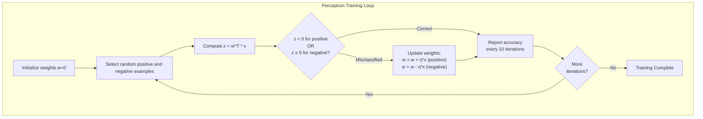
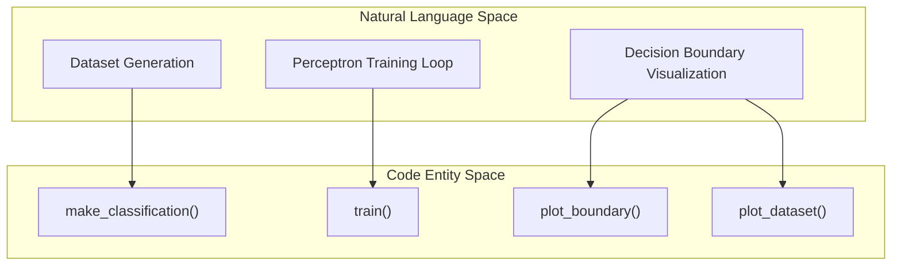
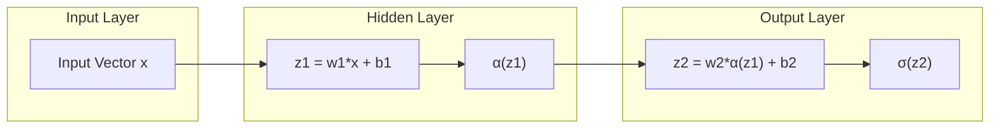
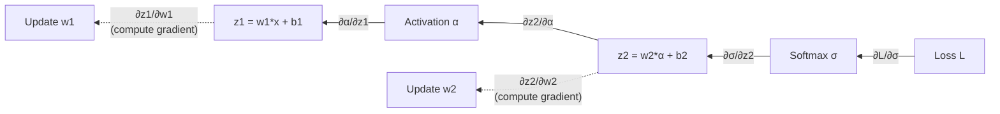
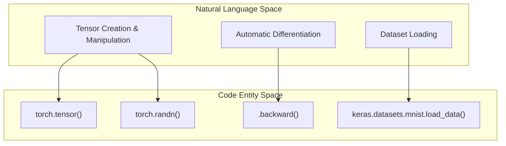
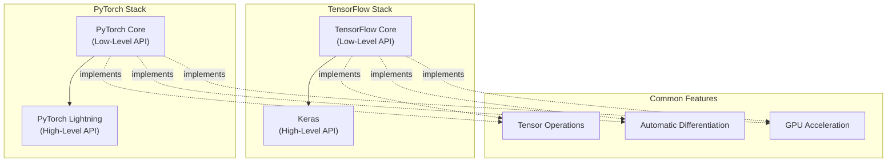
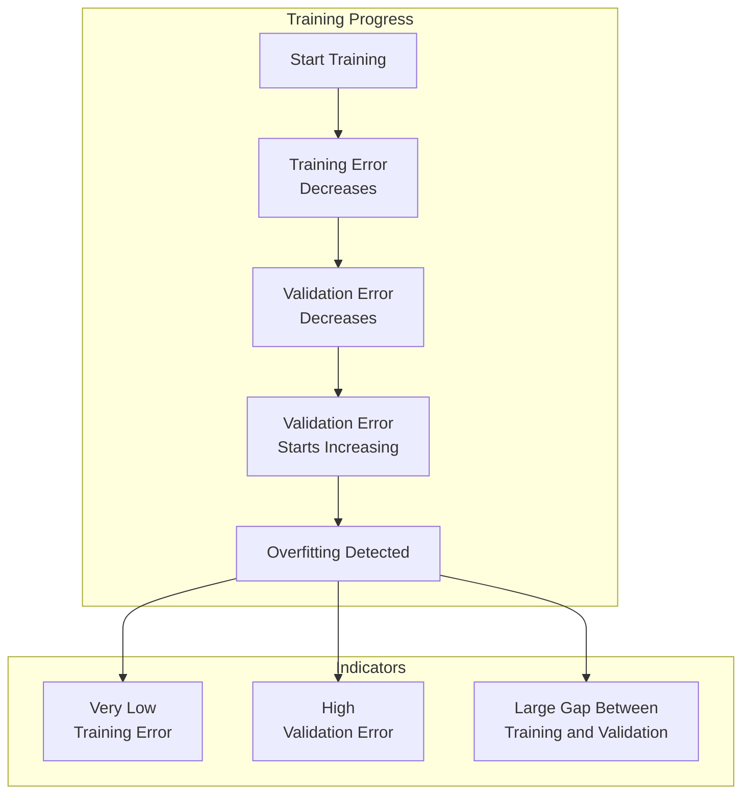
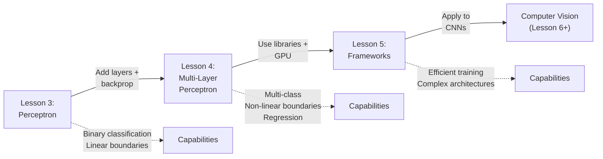

<!-- source: DeepWiki mcp.deepwiki.com · repo microsoft/AI-For-Beginners · page 3.3 Neural Networks Foundations · fetched 2026-10-26 -->

# Neural Networks Foundations

<details>
<summary>Relevant source files</summary>

The following files were used as context for generating this wiki page:

- [lessons/3-NeuralNetworks/03-Perceptron/Perceptron.ipynb](lessons/3-NeuralNetworks/03-Perceptron/Perceptron.ipynb)
- [lessons/3-NeuralNetworks/04-OwnFramework/OwnFramework.ipynb](lessons/3-NeuralNetworks/04-OwnFramework/OwnFramework.ipynb)
- [lessons/3-NeuralNetworks/05-Frameworks/IntroPyTorch.ipynb](lessons/3-NeuralNetworks/05-Frameworks/IntroPyTorch.ipynb)
- [lessons/3-NeuralNetworks/05-Frameworks/lab/README.md](lessons/3-NeuralNetworks/05-Frameworks/lab/README.md)
- [lessons/3-NeuralNetworks/README.md](lessons/3-NeuralNetworks/README.md)
- [lessons/4-ComputerVision/07-ConvNets/ConvNetsTF.ipynb](lessons/4-ComputerVision/07-ConvNets/ConvNetsTF.ipynb)

</details>


This document covers the foundational concepts of neural networks as taught in Lessons 3-5 of the AI-For-Beginners curriculum. These lessons introduce the perceptron model, multi-layered perceptrons, backpropagation algorithms, gradient descent optimization, and practical implementations using PyTorch and TensorFlow frameworks.

For computer vision applications of neural networks, see [Computer Vision](#3.4). For natural language processing applications, see [Natural Language Processing](#3.5).

## Purpose and Scope

This section bridges the gap between symbolic AI approaches (covered in [Symbolic AI](#3.2)) and modern deep learning techniques. The content progresses from single-layer perceptrons through multi-layer architectures, providing both theoretical understanding and practical implementation skills using industry-standard frameworks.

Sources: [lessons/3-NeuralNetworks/README.md:1-48]()

## The Perceptron Model

The perceptron, first implemented by Frank Rosenblatt in 1957, represents the earliest neural network architecture. It performs **binary classification** by computing a weighted sum of inputs and applying a threshold function.

### Mathematical Foundation

For N input features, a perceptron computes:

```
y(x) = f(w^T * x)
```

where:
- `w` is the weight vector
- `x` is the input feature vector
- `f` is a step activation function that outputs +1 or -1

**Activation Function:**

| Input | Output |
|-------|--------|
| x ≥ 0 | +1 |
| x < 0 | -1 |

The model includes a bias term by adding an extra dimension to the input vector that always equals 1, simplifying the formula to avoid separate bias handling.

Sources: [lessons/3-NeuralNetworks/03-Perceptron/README.md:1-70]()

### Training Algorithm

The perceptron learns through **gradient descent** optimization, minimizing the **perceptron criterion**:

```
E(w) = -Σ w^T * x_i * t_i
```

where the sum is taken over misclassified training samples.

**Update Rule:**

```
w^(t+1) = w^(t) + η * Σ x_i * t_i
```

where `η` is the learning rate.

Title: Perceptron Training Process


Sources: [lessons/3-NeuralNetworks/03-Perceptron/README.md:32-70](), [lessons/3-NeuralNetworks/03-Perceptron/Perceptron.ipynb:206-270]()

### Implementation Structure and Code Mapping

To bridge natural language concepts to concrete codebase entities, the following diagram maps functional requirements to Python functions and libraries found in `lessons/3-NeuralNetworks/03-Perceptron/Perceptron.ipynb`.

Title: Natural Language to Code Entity Space - Perceptron Pipeline


The perceptron implementation in the curriculum uses the following key components:

| Component | Purpose | Location |
|-----------|---------|----------|
| `make_classification()` | Generate synthetic 2D dataset | From sklearn [lessons/3-NeuralNetworks/03-Perceptron/Perceptron.ipynb:29-84]() |
| `train()` | Main training loop implementation | [lessons/3-NeuralNetworks/03-Perceptron/Perceptron.ipynb:235-268]() |
| `plot_dataset()` | Visualize training data | [lessons/3-NeuralNetworks/03-Perceptron/Perceptron.ipynb:132-144]() |
| `plot_boundary()` | Visualize decision boundary | [lessons/3-NeuralNetworks/03-Perceptron/Perceptron.ipynb:342-359]() |

**Key Parameters in `train()` function:**
- `num_iterations`: Default 100 training iterations
- `learning_rate`: Default 0.01 (η parameter)
- `weights`: Initialized to zeros for simplicity

Sources: [lessons/3-NeuralNetworks/03-Perceptron/Perceptron.ipynb:1-400]()

## Multi-Layered Perceptrons

Single-layer perceptrons can only classify linearly separable data. Multi-layered perceptrons (MLPs) extend this by stacking multiple layers with non-linear activation functions, enabling them to solve complex classification and regression problems.

### Architecture Components

Title: Multi-Layer Perceptron Architecture


**Mathematical Formulation:**

For a two-layer network:
- Layer 1: `z1 = w1*x + b1`
- Activation: `a1 = α(z1)` where α is non-linear (e.g., ReLU, sigmoid)
- Layer 2: `z2 = w2*a1 + b2`
- Output: `f = σ(z2)` where σ is softmax for classification

**Parameters:** θ = ⟨w1, b1, w2, b2⟩

Sources: [lessons/3-NeuralNetworks/04-OwnFramework/README.md:1-64]()

### Loss Functions

Different tasks require different loss functions:

| Task Type | Loss Function | Formula |
|-----------|---------------|---------|
| Regression | Absolute Error | Σ\|f(x^(i)) - y^(i)\| |
| Regression | Squared Error | Σ(f(x^(i)) - y^(i))^2 |
| Classification | 0-1 Loss | Accuracy-based |
| Classification | Logistic Loss | Cross-entropy based |

Sources: [lessons/3-NeuralNetworks/04-OwnFramework/README.md:14-22]()

## Backpropagation Algorithm

Backpropagation enables efficient computation of gradients in multi-layer networks by applying the chain rule of calculus backwards through the network.

### Gradient Computation

For a two-layer network, gradients are computed as:

**For Layer 2 (closer to output):**
```
∂L/∂w2 = (∂L/∂σ) * (∂σ/∂z2) * (∂z2/∂w2)
```

**For Layer 1 (earlier layer):**
```
∂L/∂w1 = (∂L/∂σ) * (∂σ/∂z2) * (∂z2/∂α) * (∂α/∂z1) * (∂z1/∂w1)
```

The key insight: the left-most part `(∂L/∂σ)` is shared across all gradient calculations, so we can reuse it by computing backwards.

Title: Backpropagation Gradient Flow


Sources: [lessons/3-NeuralNetworks/04-OwnFramework/README.md:41-64]()

### Stochastic Gradient Descent

In practice, computing gradients over the entire dataset is expensive. **Stochastic Gradient Descent (SGD)** uses random **minibatches**:

1. Initialize parameters θ^(0) randomly
2. For each minibatch:
   - Compute loss L on minibatch
   - Compute gradients ∇L
   - Update: θ^(i+1) = θ^(i) - η∇L

This approach trades exact gradients for faster iterations and often better generalization.

Sources: [lessons/3-NeuralNetworks/04-OwnFramework/README.md:32-40]()

## Neural Network Frameworks

Modern neural network development relies on frameworks that automate gradient computation and GPU acceleration. The curriculum covers two primary frameworks: **TensorFlow** and **PyTorch**.

### Framework Architecture Comparison and Code Mapping

Title: Natural Language to Code Entity Space - Framework Operations


Title: Framework Stack Architecture


Sources: [lessons/3-NeuralNetworks/05-Frameworks/README.md:1-43](), [lessons/3-NeuralNetworks/05-Frameworks/IntroPyTorch.ipynb:1-150]()

### API Levels

| API Level | TensorFlow | PyTorch | Use Case |
|-----------|------------|---------|----------|
| Low-Level | TensorFlow Core | PyTorch Core | Custom architectures, research |
| High-Level | Keras | PyTorch Lightning | Rapid prototyping, standard models |

**Low-Level APIs:**
- Build computational graphs explicitly
- Full control over training loops
- Direct GPU memory management
- Required for novel architectures

**High-Level APIs:**
- Models as sequences of layers
- Single `fit()` call for training
- Automatic device management
- Faster development for standard tasks

Both APIs can be mixed: define custom layers with low-level API, then use high-level training loops.

Sources: [lessons/3-NeuralNetworks/05-Frameworks/README.md:16-30]()

### Key Framework Capabilities

**Automatic Differentiation:**

Both frameworks provide automatic gradient computation for any expression:

```python
# PyTorch example (conceptual)
x = torch.tensor([1.0, 2.0], requires_grad=True)
y = x ** 2 + 3*x
loss = y.sum()
loss.backward()  # Automatically computes gradients
# x.grad now contains ∂loss/∂x
```

**GPU Acceleration:**

Frameworks transparently move computations to GPU:
- PyTorch: `.to('cuda')`
- TensorFlow: Automatic device placement

**Computational Graphs:**

Both frameworks build graphs defining how to compute outputs from inputs, then:
1. Execute forward pass
2. Compute gradients via backpropagation
3. Update parameters

Sources: [lessons/3-NeuralNetworks/05-Frameworks/README.md:1-30]()

## Overfitting and Regularization

A critical challenge in neural network training is **overfitting**: when a model memorizes training data rather than learning generalizable patterns.

### Detection and Symptoms

Title: Overfitting Detection Pattern


Sources: [lessons/3-NeuralNetworks/05-Frameworks/README.md:46-91]()

### Causes and Solutions

| Cause | Solution | Implementation |
|-------|----------|----------------|
| Insufficient training data | Collect more data | Data augmentation |
| Model too powerful | Reduce complexity | Fewer layers/neurons |
| Too many training epochs | Early stopping | Monitor validation loss |
| No regularization | Add regularization | Dropout, weight decay |

**Example: Underfitting vs. Overfitting**

Consider approximating 5 data points:
- **Linear model (2 parameters):** Training error = 5.3, Validation error = 5.1 ✓
- **Non-linear model (7 parameters):** Training error = 0, Validation error = 20 ✗

The non-linear model passes through all training points but fails to generalize.

Sources: [lessons/3-NeuralNetworks/05-Frameworks/README.md:46-91]()

### Bias-Variance Tradeoff

Overfitting relates to the statistical concept of bias-variance tradeoff:

- **Bias errors:** Model unable to capture data relationship (underfitting)
- **Variance errors:** Model approximates noise instead of signal (overfitting)

During training:
- Bias decreases (model learns patterns)
- Variance increases (model learns specifics)

Optimal performance occurs at the balance point before variance dominates.

Sources: [lessons/3-NeuralNetworks/05-Frameworks/README.md:84-91]()

## Practical Implementation

The curriculum provides hands-on implementations across multiple frameworks:

### Notebook Structure

| Lesson | Framework | Notebook Location | Key Concepts |
|--------|-----------|-------------------|--------------|
| Lesson 3 | NumPy | [lessons/3-NeuralNetworks/03-Perceptron/Perceptron.ipynb]() | Basic perceptron, gradient descent |
| Lesson 4 | Custom | [lessons/3-NeuralNetworks/04-OwnFramework/OwnFramework.ipynb]() | Backpropagation, multi-layer networks |
| Lesson 5 | PyTorch | [lessons/3-NeuralNetworks/05-Frameworks/IntroPyTorch.ipynb]() | Tensors, autograd, modules |
| Lesson 5 | TensorFlow | [lessons/3-NeuralNetworks/05-Frameworks/IntroKerasTF.ipynb]() | Tensors, GradientTape, layers |
| Lesson 5 | Keras | [lessons/3-NeuralNetworks/05-Frameworks/IntroKeras.ipynb]() | Sequential models, fit() API |

### Example: Perceptron Training Loop

The basic training pattern established in Lesson 3:

```python
# From lessons/3-NeuralNetworks/03-Perceptron/Perceptron.ipynb:235-268
def train(positive_examples, negative_examples, num_iterations=100, learning_rate=0.01):
    num_dims = positive_examples.shape[1]
    weights = np.zeros((num_dims, 1))
    
    for i in range(num_iterations):
        # Sample examples
        pos = random.choice(positive_examples)
        neg = random.choice(negative_examples)
        
        # Update on misclassification
        z = np.dot(pos, weights)
        if z < 0:  # False negative
            weights = weights + learning_rate * pos.reshape(weights.shape)
        
        z = np.dot(neg, weights)
        if z >= 0:  # False positive
            weights = weights - learning_rate * neg.reshape(weights.shape)
```

This pattern scales to multi-layer networks with framework support for automatic differentiation.

Sources: [lessons/3-NeuralNetworks/03-Perceptron/Perceptron.ipynb:235-268]()

## Dataset Usage

The foundational lessons primarily use:

1. **MNIST Handwritten Digits:**
   - 28×28 grayscale images
   - 10 classes (digits 0-9)
   - Standard benchmark for classification
   - Used in all three lessons

2. **Synthetic 2D Data:**
   - Generated via `sklearn.datasets.make_classification`
   - Visualizable decision boundaries
   - Demonstrates linear vs. non-linear separability

Sources: [lessons/3-NeuralNetworks/03-Perceptron/Perceptron.ipynb:54-92](), [lessons/3-NeuralNetworks/03-Perceptron/README.md:86-91]()

## Learning Progression

Title: Curriculum Learning Path Through Neural Network Foundations


This progression builds from mathematical foundations to practical implementation, preparing students for advanced topics like convolutional neural networks (see [Computer Vision](#3.4)) and recurrent networks (see [Recurrent Networks and Language Modeling](#3.5.2)).

Sources: [lessons/3-NeuralNetworks/03-Perceptron/README.md](), [lessons/3-NeuralNetworks/04-OwnFramework/README.md](), [lessons/3-NeuralNetworks/05-Frameworks/README.md]()

---

