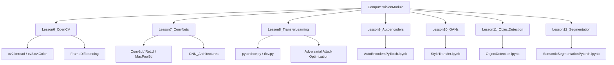
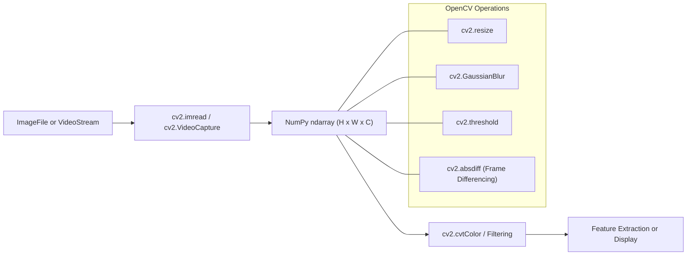
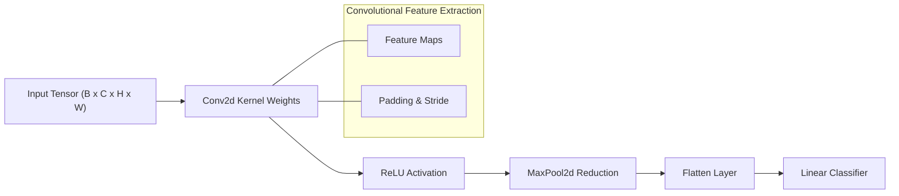
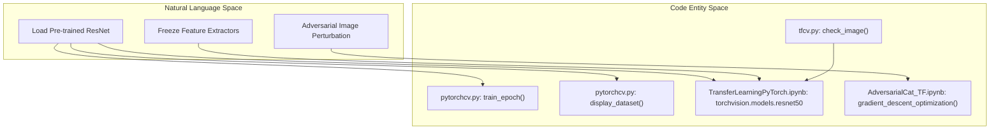
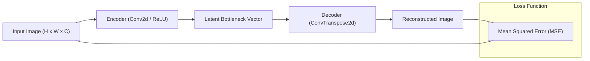
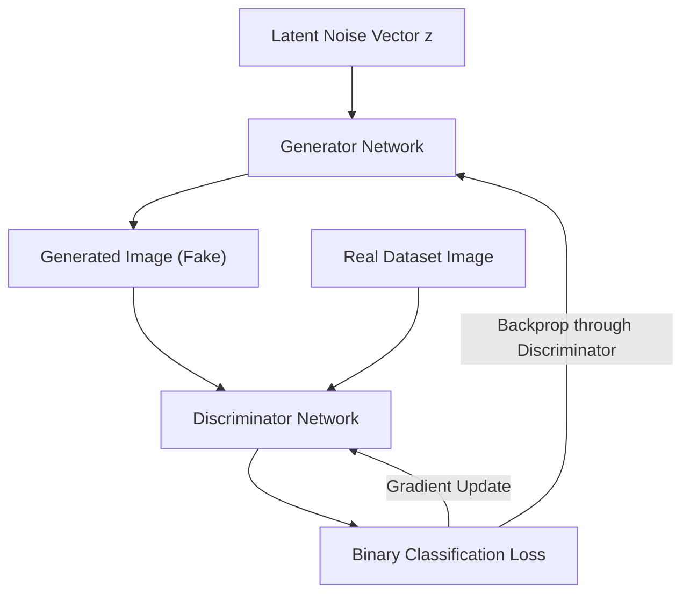
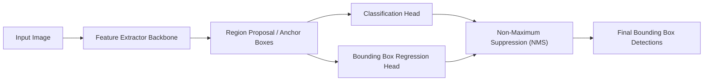
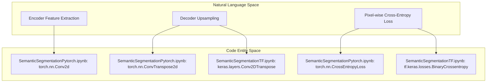

<!-- source: DeepWiki mcp.deepwiki.com · repo microsoft/AI-For-Beginners · page 3.4 Computer Vision · fetched 2026-10-26 -->

# Computer Vision

Relevant source files

The following files were used as context for generating this wiki page:

- [lessons/2-Symbolic/README.md](lessons/2-Symbolic/README.md)
- [lessons/3-NeuralNetworks/03-Perceptron/README.md](lessons/3-NeuralNetworks/03-Perceptron/README.md)
- [lessons/3-NeuralNetworks/04-OwnFramework/README.md](lessons/3-NeuralNetworks/04-OwnFramework/README.md)
- [lessons/3-NeuralNetworks/05-Frameworks/README.md](lessons/3-NeuralNetworks/05-Frameworks/README.md)
- [lessons/4-ComputerVision/07-ConvNets/CNN_Architectures.md](lessons/4-ComputerVision/07-ConvNets/CNN_Architectures.md)
- [lessons/4-ComputerVision/07-ConvNets/README.md](lessons/4-ComputerVision/07-ConvNets/README.md)
- [lessons/4-ComputerVision/07-ConvNets/pytorchcv.py](lessons/4-ComputerVision/07-ConvNets/pytorchcv.py)
- [lessons/4-ComputerVision/07-ConvNets/tfcv.py](lessons/4-ComputerVision/07-ConvNets/tfcv.py)
- [lessons/4-ComputerVision/08-TransferLearning/README.md](lessons/4-ComputerVision/08-TransferLearning/README.md)
- [lessons/4-ComputerVision/08-TransferLearning/TrainingTricks.md](lessons/4-ComputerVision/08-TransferLearning/TrainingTricks.md)
- [lessons/4-ComputerVision/08-TransferLearning/TransferLearningTF.ipynb](lessons/4-ComputerVision/08-TransferLearning/TransferLearningTF.ipynb)
- [lessons/4-ComputerVision/08-TransferLearning/lab/OxfordPets.ipynb](lessons/4-ComputerVision/08-TransferLearning/lab/OxfordPets.ipynb)
- [lessons/4-ComputerVision/08-TransferLearning/lab/README.md](lessons/4-ComputerVision/08-TransferLearning/lab/README.md)
- [lessons/4-ComputerVision/08-TransferLearning/pytorchcv.py](lessons/4-ComputerVision/08-TransferLearning/pytorchcv.py)
- [lessons/4-ComputerVision/08-TransferLearning/tfcv.py](lessons/4-ComputerVision/08-TransferLearning/tfcv.py)
- [lessons/4-ComputerVision/09-Autoencoders/AutoEncodersPyTorch.ipynb](lessons/4-ComputerVision/09-Autoencoders/AutoEncodersPyTorch.ipynb)
- [lessons/4-ComputerVision/09-Autoencoders/AutoencodersTF.ipynb](lessons/4-ComputerVision/09-Autoencoders/AutoencodersTF.ipynb)
- [lessons/4-ComputerVision/09-Autoencoders/README.md](lessons/4-ComputerVision/09-Autoencoders/README.md)
- [lessons/4-ComputerVision/10-GANs/README.md](lessons/4-ComputerVision/10-GANs/README.md)
- [lessons/4-ComputerVision/11-ObjectDetection/ObjectDetection.ipynb](lessons/4-ComputerVision/11-ObjectDetection/ObjectDetection.ipynb)
- [lessons/4-ComputerVision/11-ObjectDetection/images/1200px-Girl_and_cat.jpg](lessons/4-ComputerVision/11-ObjectDetection/images/1200px-Girl_and_cat.jpg)
- [lessons/4-ComputerVision/11-ObjectDetection/images/ObjDetectionPrecisionRecall.png](lessons/4-ComputerVision/11-ObjectDetection/images/ObjDetectionPrecisionRecall.png)
- [lessons/4-ComputerVision/11-ObjectDetection/images/ObjDetectionPrecisionRecallIoU.png](lessons/4-ComputerVision/11-ObjectDetection/images/ObjDetectionPrecisionRecallIoU.png)
- [lessons/4-ComputerVision/11-ObjectDetection/images/Screen_Shot_2016-11-17_at_11.14.54_AM.png](lessons/4-ComputerVision/11-ObjectDetection/images/Screen_Shot_2016-11-17_at_11.14.54_AM.png)
- [lessons/4-ComputerVision/11-ObjectDetection/images/coco-examples.jpg](lessons/4-ComputerVision/11-ObjectDetection/images/coco-examples.jpg)
- [lessons/4-ComputerVision/11-ObjectDetection/images/f-rcnn.png](lessons/4-ComputerVision/11-ObjectDetection/images/f-rcnn.png)
- [lessons/4-ComputerVision/11-ObjectDetection/images/faster-rcnn.png](lessons/4-ComputerVision/11-ObjectDetection/images/faster-rcnn.png)
- [lessons/4-ComputerVision/11-ObjectDetection/images/iou_equation.png](lessons/4-ComputerVision/11-ObjectDetection/images/iou_equation.png)
- [lessons/4-ComputerVision/12-Segmentation/README.md](lessons/4-ComputerVision/12-Segmentation/README.md)
- [lessons/4-ComputerVision/12-Segmentation/SemanticSegmentationPytorch.ipynb](lessons/4-ComputerVision/12-Segmentation/SemanticSegmentationPytorch.ipynb)
- [lessons/4-ComputerVision/12-Segmentation/SemanticSegmentationTF.ipynb](lessons/4-ComputerVision/12-Segmentation/SemanticSegmentationTF.ipynb)
- [lessons/4-ComputerVision/README.md](lessons/4-ComputerVision/README.md)
- [lessons/5-NLP/13-TextRep/README.md](lessons/5-NLP/13-TextRep/README.md)
- [lessons/5-NLP/13-TextRep/TextRepresentationPyTorch.ipynb](lessons/5-NLP/13-TextRep/TextRepresentationPyTorch.ipynb)
- [lessons/5-NLP/13-TextRep/assignment.md](lessons/5-NLP/13-TextRep/assignment.md)
- [lessons/5-NLP/14-Embeddings/EmbeddingsPyTorch.ipynb](lessons/5-NLP/14-Embeddings/EmbeddingsPyTorch.ipynb)
- [lessons/5-NLP/14-Embeddings/README.md](lessons/5-NLP/14-Embeddings/README.md)
- [lessons/5-NLP/14-Embeddings/assignment.md](lessons/5-NLP/14-Embeddings/assignment.md)
- [lessons/5-NLP/16-RNN/RNNTF.ipynb](lessons/5-NLP/16-RNN/RNNTF.ipynb)
- [lessons/5-NLP/16-RNN/assignment.md](lessons/5-NLP/16-RNN/assignment.md)
- [lessons/5-NLP/17-GenerativeNetworks/GenerativePyTorch.ipynb](lessons/5-NLP/17-GenerativeNetworks/GenerativePyTorch.ipynb)
- [lessons/5-NLP/17-GenerativeNetworks/GenerativeTF.ipynb](lessons/5-NLP/17-GenerativeNetworks/GenerativeTF.ipynb)
- [lessons/5-NLP/17-GenerativeNetworks/README.md](lessons/5-NLP/17-GenerativeNetworks/README.md)
- [lessons/5-NLP/17-GenerativeNetworks/lab/README.md](lessons/5-NLP/17-GenerativeNetworks/lab/README.md)
- [lessons/5-NLP/README.md](lessons/5-NLP/README.md)
- [lessons/7-Ethics/README.md](lessons/7-Ethics/README.md)

This document provides a comprehensive technical overview of computer vision systems and techniques covered in Lessons 6 through 12 of the AI-For-Beginners curriculum (`lessons/4-ComputerVision/README.md`). It explores fundamental image processing with OpenCV, convolutional neural networks (CNNs), standard and custom network architectures, transfer learning helper utilities (`tfcv.py` / `pytorchcv.py`), adversarial examples, autoencoders, generative adversarial networks (GANs), object detection, and semantic segmentation. For multimodal AI approaches combining vision and language, see [Multimodal AI](#3.6).

## Computer Vision Architecture Overview

The following diagram illustrates the architectural hierarchy of computer vision modules and pipelines within the curriculum:

Sources:
- [lessons/4-ComputerVision/README.md]()
- [lessons/4-ComputerVision/08-TransferLearning/pytorchcv.py]()
- [lessons/4-ComputerVision/08-TransferLearning/tfcv.py]()

---

## Introduction to Computer Vision with OpenCV (Lesson 6)

OpenCV (`cv2`) serves as the core library for traditional image processing operations, operating primarily over multi-dimensional NumPy ndarrays where color images are structured as `(height, width, channels)` in BGR format by default.

### Key Capabilities and Data Flow

1. **Image Loading & Color Conversion**: Images are loaded into memory as NumPy arrays. Color conversions (e.g., `cv2.cvtColor(img, cv2.COLOR_BGR2GRAY)`) map multi-channel representations to single-channel grayscale arrays.
2. **Motion Detection via Frame Differencing**: Consecutive frames $F_t$ and $F_{t+1}$ are subtracted using absolute difference operations (`cv2.absdiff`) followed by thresholding (`cv2.threshold`) to produce a binary motion mask highlighting dynamic regions.

Sources:
- [lessons/4-ComputerVision/06-IntroCV/README.md]()
- [lessons/4-ComputerVision/06-IntroCV/OpenCV.ipynb]()

---

## Convolutional Neural Networks for Computer Vision (Lesson 7)

Convolutional Neural Networks replace standard fully connected matrix multiplications with localized sliding-window filter operations (convolutions) to preserve spatial hierarchies.

### Core CNN Layers and Data Flow

### Popular CNN Architectures
- **VGG-16 / VGG-19**: Characterized by uniform $3\times 3$ convolutional stacks and max pooling layers (`lessons/4-ComputerVision/07-ConvNets/CNN_Architectures.md`).
- **ResNet**: Introduces skip connections (residual blocks) that mitigate the vanishing gradient problem in deep networks.
- **MobileNet**: Employs depthwise separable convolutions to drastically reduce parameter counts for embedded environments.

Sources:
- [lessons/4-ComputerVision/07-ConvNets/README.md]()
- [lessons/4-ComputerVision/07-ConvNets/CNN_Architectures.md]()

---

## Transfer Learning, Adversarial Examples, and Training Tricks (Lesson 8)

Transfer learning bypasses full training cycles by initializing networks with weights pre-trained on large-scale datasets such as ImageNet. The curriculum encapsulates utility functions and model loaders inside helper modules (`pytorchcv.py` and `tfcv.py`).

### Code Entity Space: Transfer Learning and Helper Modules

The following diagram bridges the high-level concepts of transfer learning and helper utilities to their concrete code entities:

Sources:
- [lessons/4-ComputerVision/08-TransferLearning/pytorchcv.py]()
- [lessons/4-ComputerVision/08-TransferLearning/tfcv.py]()
- [lessons/4-ComputerVision/08-TransferLearning/TransferLearningPyTorch.ipynb]()
- [lessons/4-ComputerVision/08-TransferLearning/AdversarialCat_TF.ipynb]()

### Helper Utilities (`pytorchcv.py` / `tfcv.py`)
- **Dataset Verification**: Helper modules include dataset sanitization checks to filter out corrupt or incorrectly formatted image files (e.g., zero-byte JPEGs) before feeding them into minibatches (`lessons/4-ComputerVision/08-TransferLearning/tfcv.py`).
- **Training Loops**: Standardized training loops (`train_epoch`) handle forward passes, loss calculation via cross-entropy, backpropagation, and optimizer steps across PyTorch and TensorFlow implementations.

### Adversarial Examples and Variation Loss
Pre-trained models contain internal representations of concept classes (e.g., "ideal cat"). By starting from random noise or an existing image (like a dog) and performing gradient descent optimization on the *input pixels* to maximize the target class probability, adversarial images are generated (`lessons/4-ComputerVision/08-TransferLearning/AdversarialCat_TF.ipynb`). To eliminate high-frequency noise and maintain visual coherence, a **variation loss** metric measuring neighboring pixel similarity is added to the optimization objective.

### Training Tricks (`TrainingTricks.md`)
- **Data Augmentation**: Random crops, horizontal flips, and color jittering to expand training set variance.
- **Dropout**: Randomly zeroing out activation units during training to prevent co-adaptation.
- **Learning Rate Scheduling**: Decreasing learning rates dynamically as training plateaus.

Sources:
- [lessons/4-ComputerVision/08-TransferLearning/README.md]()
- [lessons/4-ComputerVision/08-TransferLearning/TrainingTricks.md]()
- [lessons/4-ComputerVision/08-TransferLearning/AdversarialCat_TF.ipynb]()

---

## Autoencoders and Feature Learning (Lesson 9)

Autoencoders perform unsupervised feature learning by mapping high-dimensional inputs to a compressed bottleneck latent space and reconstructing the original input.

- **Variational Autoencoders (VAEs)** extend standard autoencoders by parameterizing probability distributions (mean and variance vectors) in the latent space, enabling robust generative sampling.

Sources:
- [lessons/4-ComputerVision/09-Autoencoders/README.md]()
- [lessons/4-ComputerVision/09-Autoencoders/AutoEncodersPyTorch.ipynb]()

---

## Generative Adversarial Networks & Style Transfer (Lesson 10)

GANs pit a **Generator** network (which maps random noise vectors to synthetic images) against a **Discriminator** network (which classifies inputs as real or synthetic).

### Style Transfer
Style transfer separates an image into content and style representations using pre-trained feature extractors. The optimization minimizes a combined loss function comprising:
1. **Content Loss**: Feature map distance between generated image and content reference.
2. **Style Loss**: Gram matrix differences capturing texture and color correlations.
3. **Total Variation Loss**: Spatial smoothness regularization.

Sources:
- [lessons/4-ComputerVision/10-GANs/README.md]()
- [lessons/4-ComputerVision/10-GANs/StyleTransfer.ipynb]()

---

## Object Detection (Lesson 11)

Object detection combines image classification with bounding box regression to locate and identify multiple entities within a single scene.

- **Evaluation Metrics**: Models are evaluated using **Intersection over Union (IoU)** to measure bounding box overlap, alongside Precision-Recall curves and **mAP (Mean Average Precision)**.

Sources:
- [lessons/4-ComputerVision/11-ObjectDetection/README.md]()
- [lessons/4-ComputerVision/11-ObjectDetection/ObjectDetection.ipynb]()

---

## Semantic Segmentation (Lesson 12)

Semantic segmentation performs pixel-wise classification, assigning every pixel in an image to a specific class label without distinguishing separate instances of the same class.

### Code Entity Space: Semantic Segmentation Pipeline

The following diagram associates the functional stages of semantic segmentation with their underlying PyTorch and TensorFlow code implementations:

Sources:
- [lessons/4-ComputerVision/12-Segmentation/SemanticSegmentationPytorch.ipynb]()
- [lessons/4-ComputerVision/12-Segmentation/SemanticSegmentationTF.ipynb]()
- [lessons/4-ComputerVision/12-Segmentation/README.md]()

### U-Net Architecture and Data Flow
U-Net architectures utilize an encoder-decoder structure linked by skip connections that concatenate high-resolution encoder feature maps with upsampled decoder layers, ensuring precise spatial boundary localization for tasks like medical lesion segmentation (`lessons/4-ComputerVision/12-Segmentation/SemanticSegmentationPytorch.ipynb`).

Sources:
- [lessons/4-ComputerVision/12-Segmentation/README.md]()
- [lessons/4-ComputerVision/12-Segmentation/SemanticSegmentationPytorch.ipynb]()
- [lessons/4-ComputerVision/12-Segmentation/SemanticSegmentationTF.ipynb]()

---

