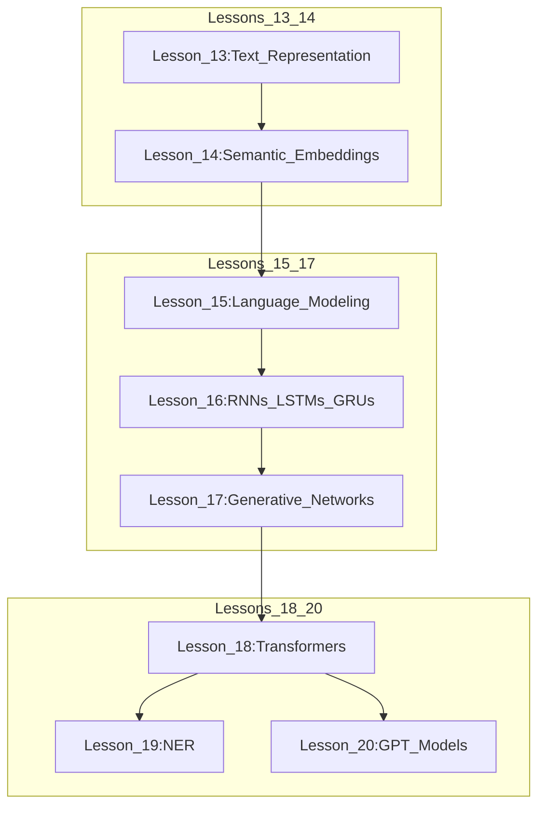
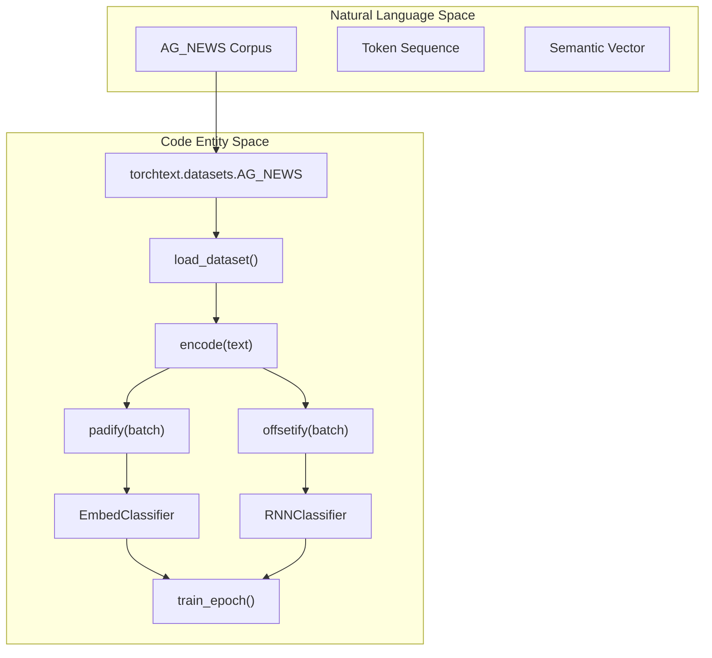

<!-- source: DeepWiki mcp.deepwiki.com · repo microsoft/AI-For-Beginners · page 3.5 Natural Language Processing · fetched 2026-10-26 -->

# Natural Language Processing

Relevant source files

The following files were used as context for generating this wiki page:

- [.gitignore](.gitignore)
- [README.md](README.md)
- [etc/Mindmap.html](etc/Mindmap.html)
- [etc/Mindmap.md](etc/Mindmap.md)
- [etc/Mindmap.svg](etc/Mindmap.svg)
- [lessons/4-ComputerVision/11-ObjectDetection/README.md](lessons/4-ComputerVision/11-ObjectDetection/README.md)
- [lessons/4-ComputerVision/11-ObjectDetection/lab/README.md](lessons/4-ComputerVision/11-ObjectDetection/lab/README.md)
- [lessons/4-ComputerVision/12-Segmentation/README.md](lessons/4-ComputerVision/12-Segmentation/README.md)
- [lessons/4-ComputerVision/12-Segmentation/SemanticSegmentationPytorch.ipynb](lessons/4-ComputerVision/12-Segmentation/SemanticSegmentationPytorch.ipynb)
- [lessons/4-ComputerVision/12-Segmentation/SemanticSegmentationTF.ipynb](lessons/4-ComputerVision/12-Segmentation/SemanticSegmentationTF.ipynb)
- [lessons/4-ComputerVision/README.md](lessons/4-ComputerVision/README.md)
- [lessons/5-NLP/13-TextRep/README.md](lessons/5-NLP/13-TextRep/README.md)
- [lessons/5-NLP/13-TextRep/TextRepresentationPyTorch.ipynb](lessons/5-NLP/13-TextRep/TextRepresentationPyTorch.ipynb)
- [lessons/5-NLP/13-TextRep/assignment.md](lessons/5-NLP/13-TextRep/assignment.md)
- [lessons/5-NLP/14-Embeddings/EmbeddingsPyTorch.ipynb](lessons/5-NLP/14-Embeddings/EmbeddingsPyTorch.ipynb)
- [lessons/5-NLP/14-Embeddings/README.md](lessons/5-NLP/14-Embeddings/README.md)
- [lessons/5-NLP/14-Embeddings/assignment.md](lessons/5-NLP/14-Embeddings/assignment.md)
- [lessons/5-NLP/15-LanguageModeling/CBoW-TF.ipynb](lessons/5-NLP/15-LanguageModeling/CBoW-TF.ipynb)
- [lessons/5-NLP/15-LanguageModeling/README.md](lessons/5-NLP/15-LanguageModeling/README.md)
- [lessons/5-NLP/15-LanguageModeling/lab/README.md](lessons/5-NLP/15-LanguageModeling/lab/README.md)
- [lessons/5-NLP/16-RNN/RNNTF.ipynb](lessons/5-NLP/16-RNN/RNNTF.ipynb)
- [lessons/5-NLP/16-RNN/assignment.md](lessons/5-NLP/16-RNN/assignment.md)
- [lessons/5-NLP/17-GenerativeNetworks/GenerativePyTorch.ipynb](lessons/5-NLP/17-GenerativeNetworks/GenerativePyTorch.ipynb)
- [lessons/5-NLP/17-GenerativeNetworks/GenerativeTF.ipynb](lessons/5-NLP/17-GenerativeNetworks/GenerativeTF.ipynb)
- [lessons/5-NLP/17-GenerativeNetworks/README.md](lessons/5-NLP/17-GenerativeNetworks/README.md)
- [lessons/5-NLP/17-GenerativeNetworks/lab/README.md](lessons/5-NLP/17-GenerativeNetworks/lab/README.md)
- [lessons/5-NLP/20-LangModels/GPT-PyTorch.ipynb](lessons/5-NLP/20-LangModels/GPT-PyTorch.ipynb)
- [lessons/5-NLP/20-LangModels/README.md](lessons/5-NLP/20-LangModels/README.md)
- [lessons/5-NLP/README.md](lessons/5-NLP/README.md)
- [lessons/6-Other/22-DeepRL/README.md](lessons/6-Other/22-DeepRL/README.md)
- [lessons/7-Ethics/README.md](lessons/7-Ethics/README.md)

## Purpose and Scope

This section covers Lessons 13-20 of the curriculum, providing a high-level overview of Natural Language Processing techniques. The material spans from fundamental text representation methods through semantic embeddings, recurrent networks, and modern transformers. All lessons provide dual-framework implementations using PyTorch and TensorFlow.

As a parent page, this overview introduces the core concepts and links to detailed child pages:
- **3.5.1 Text Representation and Embeddings**: For tokenization, BoW, TF-IDF, Word2Vec, GloVe, and embedding training, see [Text Representation and Embeddings](#3.5.1).
- **3.5.2 Recurrent Networks and Language Modeling**: For language modeling, RNNs, LSTMs, GRUs, and text generation, see [Recurrent Networks and Language Modeling](#3.5.2).
- **3.5.3 Transformers and Modern NLP**: For attention mechanisms, transformers, BERT, NER, and large language models, see [Transformers and Modern NLP](#3.5.3).
- **3.5.4 NLP Utilities and Implementation Patterns**: For shared utility functions in `torchnlp.py` and pipeline patterns, see [NLP Utilities and Implementation Patterns](#3.5.4).

For classical machine learning approaches to NLP, refer to the [ML-For-Beginners curriculum](https://github.com/microsoft/ML-For-Beginners/tree/main/6-NLP).

Sources: [lessons/5-NLP/README.md:1-24](), [README.md:73-100]()

## NLP Task Categories

The curriculum addresses multiple categories of NLP problems, spanning classification, regression, extraction, and generation tasks:

| Task | Description | Lessons |
|------|-------------|---------|
| **Text Classification** | Categorizing text into predefined classes (e.g., news categorization, spam detection) | 13-16 |
| **Sentiment Analysis** | Determining sentiment polarity or intensity of text | 13-16 |
| **Named Entity Recognition** | Extracting entities (people, locations, dates) from text | 19 |
| **Text Generation** | Generating coherent text from prompts or contexts | 17, 20 |
| **Language Modeling** | Predicting next words/characters in sequences | 15-17 |
| **Machine Translation** | Translating text between languages (conceptual coverage) | 18 |

Sources: [lessons/5-NLP/README.md:1-24]()

## NLP Learning Progression

Sources: [README.md:73-100](), [lessons/5-NLP/README.md:1-66]()

## Natural Language Space to Code Entity Mapping

The following diagram bridges abstract NLP concepts and datasets to concrete code entities, functions, and classes defined across the curriculum implementation files.

Sources: [lessons/5-NLP/13-TextRep/TextRepresentationPyTorch.ipynb:13-58](), [lessons/5-NLP/14-Embeddings/EmbeddingsPyTorch.ipynb:44-120]()

## Child Page Summaries

### 3.5.1 Text Representation and Embeddings
Covers Lessons 13-14. Introduces sparse representations (Bag-of-Words, TF-IDF) and transitions to dense semantic embeddings (Word2Vec CBoW and Skip-gram models, GloVe). Explains how to implement embedding layers and handle variable-length text sequences using PyTorch and TensorFlow.
For details, see [Text Representation and Embeddings](#3.5.1).
Sources: [lessons/5-NLP/13-TextRep/README.md:1-73](), [lessons/5-NLP/14-Embeddings/README.md:1-65]()

### 3.5.2 Recurrent Networks and Language Modeling
Covers Lessons 15-17. Focuses on sequence modeling, unsupervised language modeling, and recurrent neural network architectures including standard RNNs, LSTMs, and GRUs. Explores vanishing gradient challenges and text generation techniques using temperature sampling.
For details, see [Recurrent Networks and Language Modeling](#3.5.2).
Sources: [lessons/5-NLP/15-LanguageModeling/README.md:1-43](), [lessons/5-NLP/16-RNN/README.md:1-50](), [lessons/5-NLP/17-GenerativeNetworks/README.md:1-76]()

### 3.5.3 Transformers and Modern NLP
Covers Lessons 18-20. Explores the self-attention mechanism, transformer architecture, positional encoding, multi-head attention, and BERT fine-tuning for Named Entity Recognition. Concludes with Large Language Models and prompt engineering strategies using GPT architectures.
For details, see [Transformers and Modern NLP](#3.5.3).
Sources: [lessons/5-NLP/18-Transformers/README.md:1-20](), [lessons/5-NLP/19-NER/README.md:1-20](), [lessons/5-NLP/20-LangModels/README.md:1-53]()

### 3.5.4 NLP Utilities and Implementation Patterns
Documents shared utility modules like `torchnlp.py`, common data-loading and preprocessing functions (`load_dataset`, `encode`, `train_epoch`, `padify`, `offsetify`), and the duplicated module pattern across lessons.
For details, see [NLP Utilities and Implementation Patterns](#3.5.4).
Sources: [lessons/5-NLP/14-Embeddings/EmbeddingsPyTorch.ipynb:44-120]()

---

