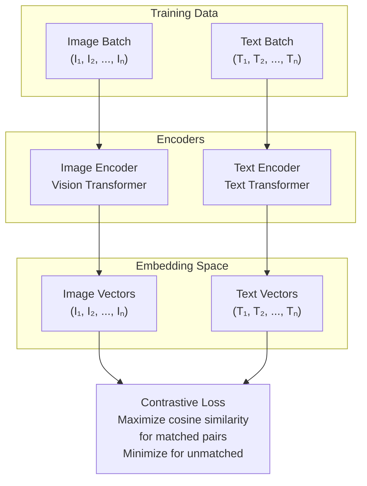
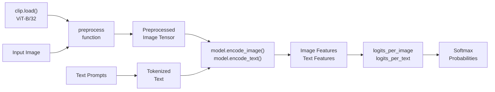
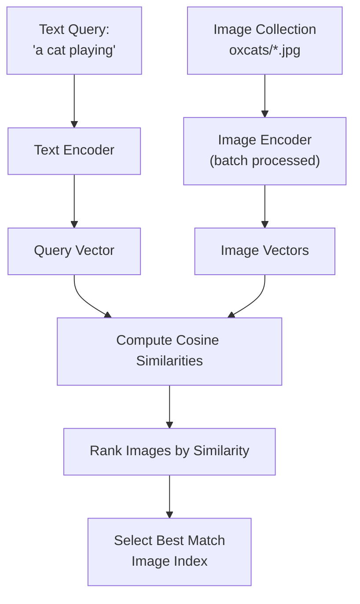
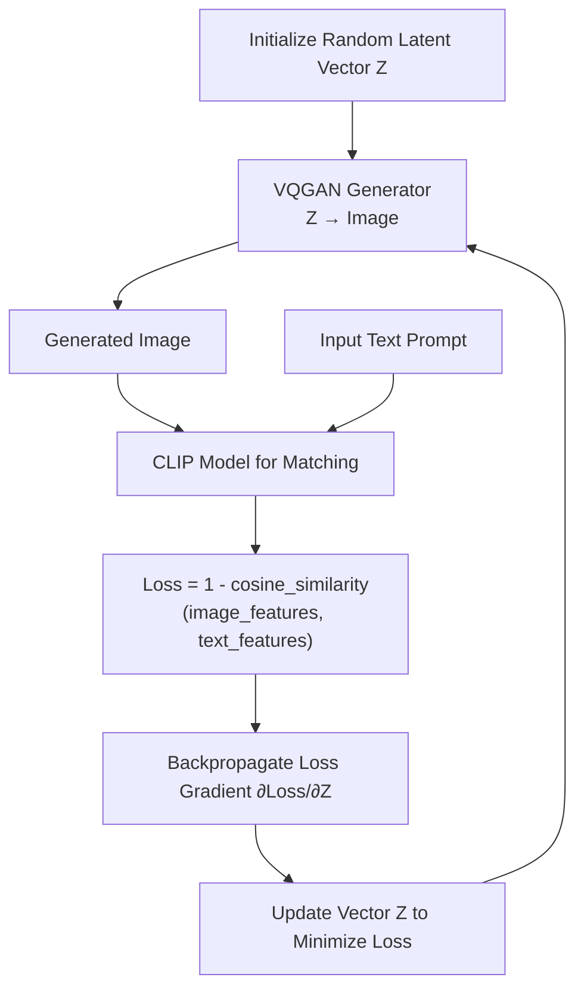
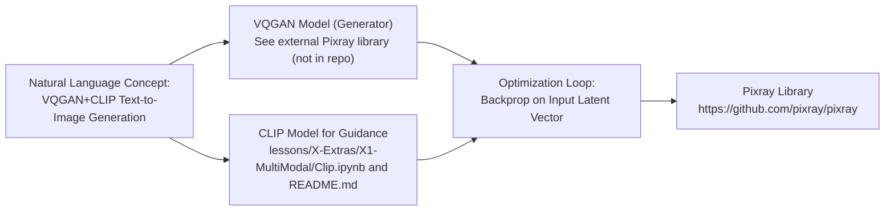

<!-- source: DeepWiki mcp.deepwiki.com · repo microsoft/AI-For-Beginners · page 3.6 Multimodal AI · fetched 2026-10-26 -->

# Multimodal AI

<details>
<summary>Relevant source files</summary>

The following files were used as context for generating this wiki page:

- [lessons/4-ComputerVision/06-IntroCV/OpenCV.ipynb](lessons/4-ComputerVision/06-IntroCV/OpenCV.ipynb)
- [lessons/4-ComputerVision/06-IntroCV/README.md](lessons/4-ComputerVision/06-IntroCV/README.md)
- [lessons/4-ComputerVision/08-TransferLearning/TransferLearningPyTorch.ipynb](lessons/4-ComputerVision/08-TransferLearning/TransferLearningPyTorch.ipynb)
- [lessons/4-ComputerVision/10-GANs/StyleTransfer.ipynb](lessons/4-ComputerVision/10-GANs/StyleTransfer.ipynb)
- [lessons/4-ComputerVision/10-GANs/StyleTransfer_Keras.ipynb](lessons/4-ComputerVision/10-GANs/StyleTransfer_Keras.ipynb)
- [lessons/5-NLP/19-NER/NER-TF.ipynb](lessons/5-NLP/19-NER/NER-TF.ipynb)
- [lessons/5-NLP/19-NER/README.md](lessons/5-NLP/19-NER/README.md)
- [lessons/5-NLP/19-NER/images/bot-ner.png](lessons/5-NLP/19-NER/images/bot-ner.png)
- [lessons/5-NLP/19-NER/lab/README.md](lessons/5-NLP/19-NER/lab/README.md)
- [lessons/X-Extras/X1-MultiModal/Clip.ipynb](lessons/X-Extras/X1-MultiModal/Clip.ipynb)
- [lessons/X-Extras/X1-MultiModal/README.md](lessons/X-Extras/X1-MultiModal/README.md)
- [lessons/X-Extras/X1-MultiModal/images/a_closeup_oil_portrait_of_old_male_teacher_of_math.png](lessons/X-Extras/X1-MultiModal/images/a_closeup_oil_portrait_of_old_male_teacher_of_math.png)
- [lessons/X-Extras/X1-MultiModal/images/a_closeup_oil_portrait_of_young_female_teacher_of_computer_science_with_a_computer.png](lessons/X-Extras/X1-MultiModal/images/a_closeup_oil_portrait_of_young_female_teacher_of_computer_science_with_a_computer.png)
- [translations/README.ja.md](translations/README.ja.md)

</details>


## Overview

This page documents multimodal AI approaches that combine computer vision and natural language processing capabilities. The material focuses on models that can understand relationships between images and text, enabling tasks like zero-shot image classification, text-based image search, and text-to-image generation.

For fundamentals of computer vision, see [Computer Vision](#3.4). For NLP techniques including transformers, see [Natural Language Processing](#3.5).

**Sources:** [lessons/X-Extras/X1-MultiModal/README.md:1-76]()

## CLIP (Contrastive Image Pre-Training)

OpenAI's CLIP model learns a shared embedding space that relates images and their textual descriptions. It does so using **contrastive learning** to maximize similarity between correct image-text pairs and minimize similarity between incorrect pairs.

### Architecture Overview



CLIP is trained on large internet datasets of (image, caption) pairs. During training, each batch contains N pairs. CLIP computes embeddings for images and texts, then applies a loss function that encourages:

- Maximum cosine similarity for matching pairs (Iᵢ, Tᵢ)
- Minimum cosine similarity for mismatched pairs (Iᵢ, Tⱼ), where i ≠ j

This enables efficient cross-modal semantic matching.

**Sources:** [lessons/X-Extras/X1-MultiModal/README.md:5-15]()

### Model Loading and Inference Flow



This workflow illustrates how an input image is preprocessed and encoded, similarly text prompts are tokenized and encoded, then logits are computed representing similarity scores. Softmax probabilities allow interpretation as classification probabilities over categories.

**Sources:** [lessons/X-Extras/X1-MultiModal/Clip.ipynb:37-53]()

## Zero-Shot Image Classification Using CLIP

CLIP can perform **zero-shot classification** by directly computing similarity between images and arbitrary text labels without further training.

| Step | Operation                              | Code Reference                 |
|-------|-------------------------------------|-------------------------------|
| 1.    | Load pre-trained CLIP model         | [Clip.ipynb:44-52]()          |
| 2.    | Preprocess input image               | [Clip.ipynb:100]()            |
| 3.    | Tokenize candidate text labels       | [Clip.ipynb:101]()            |
| 4.    | Encode image and texts               | [Clip.ipynb:104-105]()        |
| 5.    | Compute similarity logits            | [Clip.ipynb:107]()            |
| 6.    | Calculate softmax probabilities      | [Clip.ipynb:108]()            |

Example: Classify an image of a cat against labels `["a penguin", "a bear", "a cat"]`. The probability output strongly favors `"a cat"`.

**Sources:** [lessons/X-Extras/X1-MultiModal/README.md:17-25](), [lessons/X-Extras/X1-MultiModal/Clip.ipynb:86-111]()

## Text-Based Image Search with CLIP

CLIP also supports ranking images in a collection according to a natural language query.



The model encodes the text query and all images, then computes cosine similarities to rank images according to relevance. The image with the highest similarity score is selected.

**Sources:** [lessons/X-Extras/X1-MultiModal/README.md:27-29](), [lessons/X-Extras/X1-MultiModal/Clip.ipynb:113-149]()

## VQGAN+CLIP for Text-to-Image Generation

CLIP by itself does not generate images. To synthesize images from text prompts, CLIP is combined with a **generator model**, most notably **VQGAN (Vector Quantized GAN)**.

### VQGAN Architecture

| Feature                     | Traditional GAN                  | VQGAN                                    |
|-----------------------------|--------------------------------|------------------------------------------|
| Generation method           | Direct noise vector → image     | Transformer generates sequence of visual tokens |
| Visual representation       | Continuous latent vectors       | Discrete codebook learned by CNN          |
| Discriminator approach      | Binary label real/fake          | Patch-based discriminator on image parts  |

VQGAN uses a Transformer-based autoregressive model to generate a sequence of visual tokens, learned via a vector quantization CNN. Its discriminator evaluates individual patches rather than the entire image.

**Sources:** [lessons/X-Extras/X1-MultiModal/README.md:37-42]()

### Image Generation Pipeline



- Start with random latent vector `Z`.
- VQGAN generates `IMG = VQGAN(Z)`.
- CLIP computes similarity between `IMG` and `PROMPT`.
- Loss is set to `1 - similarity`.
- Backpropagation adjusts `Z` to minimize loss.
- Repeat until convergence.

Unlike typical GAN training updating model weights, here only the input vector `Z` is optimized.

**Sources:** [lessons/X-Extras/X1-MultiModal/README.md:43-49]()

### Implementation: Pixray

The [Pixray](https://github.com/pixray/pixray) library provides an effective implementation of VQGAN+CLIP with:

- Support for various VQGAN architectures
- Prompt engineering
- Output quality and iteration control

Examples of images generated using Pixray showcase impressive artistic styles corresponding to prompts like:

- "a closeup watercolor portrait of young male teacher of literature with a book"
- "a closeup oil portrait of old male teacher of mathematics in front of blackboard"

**Sources:** [lessons/X-Extras/X1-MultiModal/README.md:51-57]()

## DALL-E: Transformer-Based Text-to-Image Generation

DALL-E is another notable text-to-image model developed by OpenAI. Unlike VQGAN+CLIP, DALL-E models use transformer architectures to directly generate images from text prompts.

### DALL-E 1 and DALL-E 2 Architectures


| Feature                         | DALL-E 1                                 | DALL-E 2                                   |
|---------------------------------|-----------------------------------------|--------------------------------------------|
| Architecture                   | Autoregressive GPT-3 variant transformer | Two-stage: CLIP prior + diffusion decoder |
| Input                         | Unified text and image token stream      | Text prompt encoded separately             |
| Parameters                    | ~12 billion                              | Undisclosed; likely larger                  |
| Output quality               | Good-resolution images                    | More photorealistic, higher resolution     |
| Training paradigm            | Next token prediction                     | CLIP-guided diffusion process               |

DALL-E 1 generates images by autoregressively modeling a sequence interleaving text and image tokens. DALL-E 2 improves by first creating an embedding conditioned on text, then synthesizing images with a diffusion-based decoder.

**Sources:** [lessons/X-Extras/X1-MultiModal/README.md:59-71]()

### Comparison: VQGAN+CLIP vs DALL-E 2

| Aspect                   | VQGAN+CLIP                          | DALL-E 2                      |
|--------------------------|-----------------------------------|-------------------------------|
| Generation method        | Optimization over latent input    | Learned decoder network        |
| Speed                     | Slow (iterative optimization)     | Faster (single forward pass)   |
| Control                   | High control via loss and prompts | Limited control post-training  |
| Consistency               | Variable image quality             | More consistent outputs        |
| Accessibility             | Open-source (e.g. Pixray)          | Proprietary API                |

**Sources:** [lessons/X-Extras/X1-MultiModal/README.md:51-71]()

## Summary

Multimodal AI leverages combined NLP and vision architectures to understand and generate content across images and text. CLIP demonstrates powerful zero-shot matching and retrieval. VQGAN+CLIP enables text-to-image synthesis via optimization. DALL-E models employ transformer and diffusion architectures for realistic image generation from textual descriptions.

In the curriculum, students interact with these models through demonstrations and notebooks such as `Clip.ipynb` showcasing CLIP usage. Exploring VQGAN+CLIP and DALL-E concepts deepens understanding of advanced generative multimodal AI.

---

## References and Further Reading

- CLIP Paper: [Learning Transferable Visual Models From Natural Language Supervision](https://arxiv.org/pdf/2103.00020.pdf)
- VQGAN Paper: [Taming Transformers for High-Resolution Image Synthesis](https://compvis.github.io/taming-transformers/paper/paper.pdf)
- OpenAI CLIP GitHub: [https://github.com/openai/CLIP]()
- Pixray (VQGAN+CLIP) Library: [https://github.com/pixray/pixray]()
- DALL-E Blog Posts: [DALL-E](https://openai.com/research/dall-e), [DALL-E 2](https://openai.com/dall-e-2)

Related curriculum pages:
- [Computer Vision](#3.4) - CNNs and GANs
- [Transformers and Modern NLP](#3.5.3) - Attention and BERT
- [GANs #4.4](#10) - Generative adversarial networks fundamentals

**Sources:** [lessons/X-Extras/X1-MultiModal/README.md:73-76]()

---

# Bridge Diagrams: From Natural Language Concepts to Code Entities

### Diagram 1: CLIP Text-Image Matching to Code

```mermaid
graph LR
    NAT_LANG["Natural Language Concept:<br/>CLIP Zero-Shot Classification"]
    CLIP_MODEL["Code: clip.load(\"ViT-B/32\")<br/>lessons/X-Extras/X1-MultiModal/Clip.ipynb (lines 44-52)"]
    PREPROCESS["Code: preprocess() Function<br/>lessons/X-Extras/X1-MultiModal/Clip.ipynb (53)"]
    TOKENIZE["Code: clip.tokenize() Text Tokenizer<br/>lessons/X-Extras/X1-MultiModal/Clip.ipynb (101)"]
    ENCODE_IMG["Code: model.encode_image() Method<br/>lessons/X-Extras/X1-MultiModal/Clip.ipynb (104)"]
    ENCODE_TEXT["Code: model.encode_text() Method<br/>lessons/X-Extras/X1-MultiModal/Clip.ipynb (105)"]
    INFER["Code: model(image, text) Produces Similarity Logits<br/>lessons/X-Extras/X1-MultiModal/Clip.ipynb (107)"]

    NAT_LANG --> CLIP_MODEL
    CLIP_MODEL --> PREPROCESS
    CLIP_MODEL --> TOKENIZE
    PREPROCESS --> ENCODE_IMG
    TOKENIZE --> ENCODE_TEXT
    ENCODE_IMG --> INFER
    ENCODE_TEXT --> INFER
```

### Diagram 2: VQGAN+CLIP Text-to-Image Generation to Code



These diagrams map the AI concepts discussed in the multimodal section directly to concrete code entities and implementations in the curriculum and external resources.

---

# End of Page 3.6 - Multimodal AI

---

