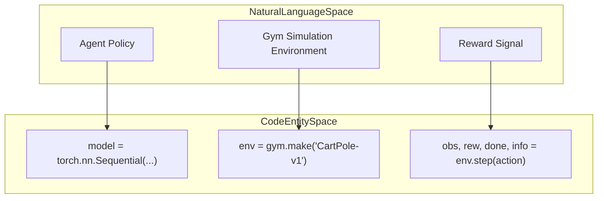
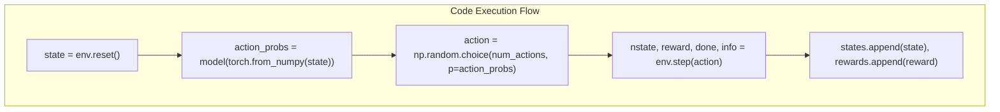
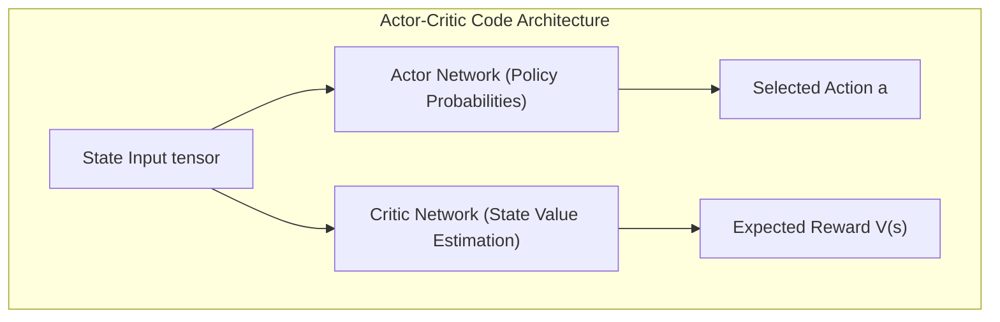

<!-- source: DeepWiki mcp.deepwiki.com · repo microsoft/AI-For-Beginners · page 3.7 Reinforcement Learning · fetched 2026-10-26 -->

# Reinforcement Learning

Relevant source files

The following files were used as context for generating this wiki page:

- [.gitignore](.gitignore)
- [README.md](README.md)
- [etc/Mindmap.html](etc/Mindmap.html)
- [etc/Mindmap.md](etc/Mindmap.md)
- [etc/Mindmap.svg](etc/Mindmap.svg)
- [lessons/4-ComputerVision/11-ObjectDetection/README.md](lessons/4-ComputerVision/11-ObjectDetection/README.md)
- [lessons/4-ComputerVision/11-ObjectDetection/lab/README.md](lessons/4-ComputerVision/11-ObjectDetection/lab/README.md)
- [lessons/5-NLP/15-LanguageModeling/CBoW-TF.ipynb](lessons/5-NLP/15-LanguageModeling/CBoW-TF.ipynb)
- [lessons/5-NLP/15-LanguageModeling/README.md](lessons/5-NLP/15-LanguageModeling/README.md)
- [lessons/5-NLP/15-LanguageModeling/lab/README.md](lessons/5-NLP/15-LanguageModeling/lab/README.md)
- [lessons/5-NLP/20-LangModels/GPT-PyTorch.ipynb](lessons/5-NLP/20-LangModels/GPT-PyTorch.ipynb)
- [lessons/5-NLP/20-LangModels/README.md](lessons/5-NLP/20-LangModels/README.md)
- [lessons/6-Other/22-DeepRL/CartPole-RL-PyTorch.ipynb](lessons/6-Other/22-DeepRL/CartPole-RL-PyTorch.ipynb)
- [lessons/6-Other/22-DeepRL/CartPole-RL-TF.ipynb](lessons/6-Other/22-DeepRL/CartPole-RL-TF.ipynb)
- [lessons/6-Other/22-DeepRL/README.md](lessons/6-Other/22-DeepRL/README.md)
- [lessons/6-Other/22-DeepRL/images/cartpole-balance.gif](lessons/6-Other/22-DeepRL/images/cartpole-balance.gif)
- [lessons/6-Other/22-DeepRL/images/cartpole-nobalance.gif](lessons/6-Other/22-DeepRL/images/cartpole-nobalance.gif)
- [lessons/6-Other/22-DeepRL/images/cartpole.png](lessons/6-Other/22-DeepRL/images/cartpole.png)
- [lessons/6-Other/22-DeepRL/lab/MountainCar.ipynb](lessons/6-Other/22-DeepRL/lab/MountainCar.ipynb)
- [lessons/6-Other/22-DeepRL/lab/README.md](lessons/6-Other/22-DeepRL/lab/README.md)
- [lessons/6-Other/22-DeepRL/lab/images/mountaincar.png](lessons/6-Other/22-DeepRL/lab/images/mountaincar.png)
- [lessons/6-Other/22-DeepRL/notebook.ipynb](lessons/6-Other/22-DeepRL/notebook.ipynb)

This page documents Lesson 22 of the curriculum, focusing on Deep Reinforcement Learning (RL) fundamentals, simulation environments via OpenAI Gym, the CartPole balancing problem, policy gradients, state discretization, the MountainCar lab, and the actor-critic architecture.

Sources: [lessons/6-Other/22-DeepRL/README.md:1-97]()

---

## 1. Introduction to Reinforcement Learning and OpenAI Gym

Reinforcement Learning (RL) is a machine learning paradigm where an agent learns to make decisions by **learning by doing** (interacting with an environment through trial and error) rather than learning from a static labeled dataset.

### Core Concepts

* **Environment / Simulator**: Sets the rules of the world and exposes states, actions, and rewards.
* **Reward Function**: Provides numerical feedback indicating how successful an action or sequence of actions was.
* **Policy ($\pi$)**: A mapping from states to actions, denoted as $a = \pi(s)$ or probabilistically as $\pi(a|s)$.
* **Exploration vs. Exploitation**: Balancing the execution of known optimal strategies (**exploitation**) against trying new actions to discover better states (**exploration**).

### OpenAI Gym Integration

The curriculum utilizes [OpenAI Gym](https://gym.openai.com/) to standardize simulation interfaces across classical control and game environments.

Sources: [lessons/6-Other/22-DeepRL/README.md:1-52](), [lessons/6-Other/22-DeepRL/CartPole-RL-PyTorch.ipynb:44-51]()

---

## 2. CartPole Balancing and Policy Gradients

The **CartPole** environment simulates a vertical pole balanced on a horizontal slider. The objective is to keep the pole upright for as many timesteps as possible.

### CartPole Specifications

* **Observation Space**: 4-dimensional continuous box (cart position, cart velocity, pole angle, pole angular velocity).
* **Action Space**: Discrete(2) — `0` (push cart left) or `1` (push cart right).
* **Reward**: `+1` for every timestep the pole remains balanced.

### Policy Gradient Implementation

The Policy Gradient method models the policy $\pi$ using a neural network that takes the state observation vector and outputs action probabilities via a softmax layer.

Sources: [lessons/6-Other/22-DeepRL/README.md:22-64](), [lessons/6-Other/22-DeepRL/CartPole-RL-PyTorch.ipynb:106-151]()

---

## 3. Actor-Critic Algorithm

The **Actor-Critic** architecture combines policy gradients and value iteration into a dual-network setup:

1. **Actor**: Proposes which action to take (policy optimization).
2. **Critic**: Evaluates the state and estimates total expected cumulative rewards (value function approximation).

Sources: [lessons/6-Other/22-DeepRL/README.md:66-77]()

---

## 4. MountainCar Lab and State Discretization

In addition to CartPole, the curriculum explores the **MountainCar** lab environment where an underpowered car must build momentum by rocking back and forth between a valley to reach a flag at the top of a hill.

### Environment Dynamics

* **State Space**: 2-dimensional continuous space (position $[-1.2, 0.6]$ and velocity $[-0.07, 0.07]$).
* **Action Space**: Discrete(3) — push left (`0`), no push (`1`), push right (`2`).
* **Reward Structure**: Negative reward given at every step until the goal is reached, incentivizing fast completion.

Sources: [lessons/6-Other/22-DeepRL/lab/MountainCar.ipynb]()

---

## 5. Summary and Curriculum Placement

Lesson 22 bridges neural network foundations with interactive decision-making systems. It prepares students for advanced multi-agent and evolutionary tasks covered later in the curriculum.

Sources: [lessons/6-Other/22-DeepRL/README.md:96-98]()

---

